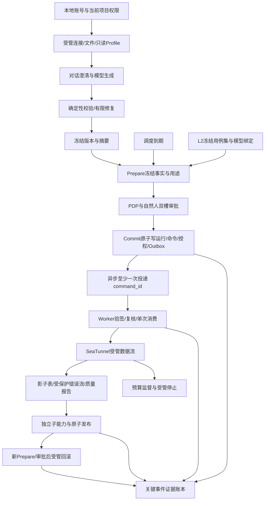
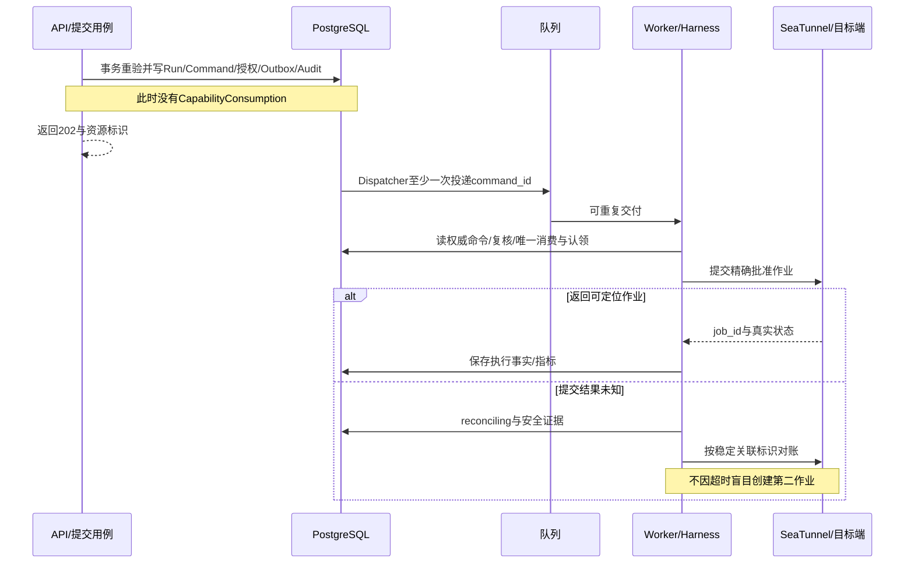

# ETL-Agent 全模块与全功能开发 Spec

| 属性 | 内容 |
|---|---|
| 版本 / 日期 | v0.1 / 2026-10-23 |
| 交付 | 单一Markdown总Spec；不编写业务代码、不安装依赖、不执行数据库迁移 |
| 项目目录 | `D:\python\ETL_Agent` |
| 覆盖 | SPEC-001—SPEC-040分别对应REQ-001—REQ-040，包含全部模块 |
| 组织 | 公共约定 + 每项功能独立15节 + 集成流程/依赖/冲突登记 |

## A. 需求基线与决定优先级

本轮枚举并核对docs中全部4份Markdown，读取其需求、对象、接口、规范和页面约定。工作目录仅发现已有pyproject.toml（Python>=3.12，dependencies为空）及文档，以下路径均为**未来实施时创建/修改的计划**，不表示代码已经存在。

| 输入文档 | SHA256 | 本Spec使用内容 |
|---|---|---|
| [PRD](ETL-Agent_PRD_v0.1.md) | 55DE54F34449002FD92BC03FE6E45561ACE0B0E8120AACD64D7FFA5307F74B54 | REQ/AC-001—040、范围、角色、安全要求 |
| [概要设计与开发规范](ETL-Agent_概要设计总纲_v0.1.md) | C1DE527C2695BFBCF49347BA1AF796B6A3FE78636DE446EAC75B1F2DE2E25252 | DES-001—023、C-01—12、目录、模块及前后端边界 |
| [数据对象与API契约](ETL-Agent_核心数据对象与API契约_v0.1.md) | 95F6CED24B0F29C4205BFB06F8B45E6D7EBDA7D0BAE113312DA531B9A9C07DDE | OBJ-01—55、D-01—14、类型、表/索引、18条既有接口、Worker消费方案 |
| [低保真原型](ETL-Agent_页面原型规划_低保真_v0.1.md) | 0ABB307F85123466C63AEB74973160FAE8729ED591F2BF2F4EEA0D82B8902A28 | P-01—16、UX-001—40、桌面/手机完整操作、G-01—19接口缺口 |

优先级：本轮用户明确决定 > 数据对象文档已登记的用户决定及设计决策 > 其余需求与概要约束。无法按优先级消解的冲突列入B表，不擅自选择实现。本轮不修改既有4份文档；后续冻结基线时依据本Spec决定记录同步更新。

### A.1 本轮用户明确决定

- 所有模块及功能合并为一份Spec，不再只选一个REQ。
- 登录原先选OIDC，用户因没有身份服务地址撤销，随后明确选择**本地账号密码、预置账号、服务端会话、不开放公开注册**。本地方案取代本轮先前的OIDC讨论，不保留对OIDC URL的依赖。
- 允许Preparation.purpose增加`isolated_trial`、`run_l2_benchmark`两种用途，并明确授权规则；现有18个HTTP方法/路径不变。
- 沿用此前已确认：Project为隔离单元，无Tenant表；Capability由Worker首次消费；桌面与手机完整操作。

### A.2 增量数据/认证契约（上述决定的必要实现）

这些是有明确用户授权的认证和用途补齐，不暗改其他字段。

| 对象/字段 | 类型、默认及约束 | 用途 |
|---|---|---|
| User.username | 本地登录规范名，ASCII字母/数字/下划线/短横线3—64字符，统一小写，唯一 | 本地方案需唯一登录名；覆盖旧文档“不默认全局唯一”的未定口径 |
| User.subject_ref | `local:<user_id>`，服务端生成，唯一且稳定 | 保留既有身份字段，不把改用户名视为新人 |
| User.person_ref | UUID，必填，预置账号时指定；同一自然人的多账号使用相同值 | 自批/双槽检查对自然人标识比较，不仅比较user_id；不公开展示人员内部标识 |
| LocalCredential | user_id UUID为PK/FK；password_hash受保护文本必填；changed_at Instant必填 | 只存成熟密码算法输出及其参数，不存明文；不进入普通UserResponse |
| AuthSession | id UUID；user_id UUID；token_digest Digest；csrf_digest Digest；created_at/expires_at/last_seen_at Instant；revoked_at可null默认null | 服务端会话；UQ(token_digest)；过期/撤销不能访问。原始会话Token只放安全Cookie |
| Preparation.purpose | execute_etl / rollback / isolated_trial / run_l2_benchmark | 本轮批准扩展；其他准备事实字段不改 |
| 身份输入 | username:string、password:string；必填，无业务默认；password长度12—128字符且按原样校验 | 长度是本轮本地认证实现默认；不trim、不截断、不写日志 |

person_ref由受控初始化人员映射维护，本地软件不能凭密码证明真实自然人身份。相同person_ref不能分占高风险审批槽。若预置人员映射缺失，不允许参与Maker/Checker安全验收，不用不同账号假装不同人。

本地认证必要新接口属于用户批准的认证缺口补齐，**不替换**既有A-01—18：

| 编号/方法路径 | 请求与输出 | 约束 |
|---|---|---|
| AUTH-01 `POST /api/v1/auth/login` | LocalLoginRequest{username,password} → DataEnvelope<LoginResponse>；LoginResponse含user安全投影、csrf_token:string、expires_at:Instant | 设置服务端session Cookie；统一失败401，响应不返回密码/hash/会话原Token |
| AUTH-02 `GET /api/v1/auth/me` | 无body → DataEnvelope<CurrentIdentityResponse>，含User安全投影、项目成员资格、职责/动作及会话expires_at | 需有效会话；无会话401；不得凭请求体指定用户 |
| AUTH-03 `POST /api/v1/auth/logout` | 无body，需会话及X-CSRF-Token → DataEnvelope<{logged_out:true}> | 撤销当前会话并清Cookie；不设计未经要求的全设备会话管理 |

密码使用成熟scrypt实现（Python标准库hashlib.scrypt可作为适配实现）；初始参数N=2^17、r=8、p=1、随机salt至少16字节、派生输出32字节，内存上限须覆盖所选参数且压测验证。禁止自创散列/仅SHA256密码、禁止在本阶段安装新认证库。常量时间验证；限制并发验证和失败尝试，默认同账号+来源5次失败/15分钟限流，错误不区分“无该用户/密码错误”。

会话Token用密码学安全随机数，至少32字节，DB只存摘要；Cookie设HttpOnly、生产Secure、SameSite=Lax、限定Path，闲置默认30分钟、绝对有效期8小时。所有Cookie认证写请求校验允许Origin及X-CSRF-Token；login只收JSON并校验Origin/Fetch Metadata，不能接受跨站表单登录。关闭页面不等于撤销会话。localhost开发例外须明确配置，不能迁入生产。具体部署域名由环境配置提供，不预填虚构域名。

用于选择本地认证参数的参考仅为实现核实，不扩展业务：[Python scrypt文档](https://docs.python.org/3/library/hashlib.html#hashlib.scrypt)、[OWASP密码存储指南](https://cheatsheetseries.owasp.org/cheatsheets/Password_Storage_Cheat_Sheet.html)。OIDC标准不再作为本期登录实现依赖。

### A.3 新增准备单用途的分发

| purpose | 申请/审批/执行协议 | Commit/工具与输出 |
|---|---|---|
| execute_etl | 冻结正式版本，数据+安全双槽 | A-14受理；tool=execute_etl；返回ExecutionRun标识 |
| rollback | 关联原Run与恢复目标，重新独立审批 | A-17执行等效Commit，创建Operation/Command/授权/Outbox，不新建搬运Run |
| isolated_trial | 同样冻结制品、预算及隔离资源，双槽；正式目标不在允许范围 | A-14受理新用途；仍tool=execute_etl，以purpose限定隔离环境；返回试运行ExecutionRun，不允许正式表发布 |
| run_l2_benchmark | 冻结被测版本、用例集摘要、隔离环境与预算，双槽 | A-18带preparation_id受理并调用内部提交协调器；tool=run_l2_benchmark；同事务建立BenchmarkRun、关联Run、授权及Outbox；A-14拒绝直接启动该用途 |

用途扩展保留HTTP路径、原字段及现有枚举语义，属于本轮明确批准的枚举/授权增量。用户随后批准补齐探查任务持久化与L2评测数据关联，详细字段、逐例Run/能力及冻结数据集协议见F章；设计批准不等于真实L2已经执行或验收通过。

## B. 问题登记、实施状态与依赖白名单

“可实施领域逻辑”不等于“全部接口已联通”。每个Spec第15节引用本表；出现未关闭项目时可做端口/领域/模拟测试，但相应真实集成验收保持阻塞。

| 问题 | 来源与冲突/缺失 | 已完成的澄清/当前处理 | 关闭证据 |
|---|---|---|---|
| B-01 | 登录协议原先未定 | 用户已改为本地账号密码；AUTH-01—03为批准的新认证接口 | 初始化账号、person_ref映射、会话/CSRF集成测试 |
| B-02 | isolated/L2缺Prepare用途；BenchmarkCase关联真实运行未完整定义 | 用户已批准用途及持久化补齐，F.2给出冻结绑定、逐例Run/命令/能力协议；数据设计缺口已补 | 具体字段/迁移技术评审及真实L2对账测试；不宣称已实现 |
| B-03 | ProfileTaskAccepted.resource_id存在，但尚无完整探查异步任务持久化模型/读取路径 | 用户已批准补ProfileTask，字段/索引/状态/结果关系见F.1；数据设计缺口已补 | G-04读取路由仍待确认，持久化/重投集成测试待实施 |
| B-04 | G-01—G-19其余查询/冻结/调度/进化等有类型但没有HTTP路径 | 仅定义内部用例/响应映射和前端API接口，未定路由不硬编码，不造假成功 | 各对应路由、状态和分页契约评审；认证部分由本轮补齐 |
| B-05 | pyproject.dependencies为空；概要中的SQLAlchemy/Alembic/Pydantic、UI/测试库仍为建议 | 不安装依赖；Spec以仓储/校验/HTTP/密码/引擎端口描述，具体库绑定需依赖清单评审 | 兼容矩阵、锁文件、批准依赖清单 |
| B-06 | 不知道SeaTunnel/连接器/Doris实际版本与运行环境 | 不假设引擎幂等、暂停和每种目标端都支持原子发布 | 版本化能力矩阵、真实适配器测试 |
| B-07 | 审计检查点外部锚、SecretProvider、存储、密钥轮转部署未配置 | 定义安全端口与失败关闭语义，不造地址或私钥 | 受管配置与验证演示 |
| B-08 | 覆盖原始错误值的存储权限和实际字段脱敏分类依赖数据策略 | 原值不进入普通API；源分级缺失不得自动判低敏 | 示例敏感字段、受保护错误库权限、泄密回归 |
| B-09 | 两份快照内容、API别名和状态字段可能混用 | 沿用数据对象9.2的唯一映射；本Spec禁止直接序列化ORM | schema_json→fields等往返及契约测试 |
| B-10 | 执行预算、Profile有效期与长作业发布的时间边界不同 | 沿用数据对象第6节，有界执行收据派生独立能力，不重用旧Token | >5分钟作业、>30分钟作业收尾、过期重投故障测试 |

B-02/B-03数据契约已按用户授权补齐；B-04—B-08及实际技术验证仍为未关闭实现输入，不以猜测补齐。可先实现无外部副作用部分；这些限制不构成删减REQ范围。

**允许继承的栈**：Python>=3.12、Vue、FastAPI、LangGraph及PostgreSQL Checkpoint、Celery Worker/Beat、PostgreSQL、Redis、SeaTunnel Zeta、SecretProvider/Vault既有边界。已有依赖为空意味着不能宣称已安装。具体版本及尚属建议的库不在本Spec中升级为已批准，也不顺便增加JWT、OAuth服务、Kafka、Elasticsearch、独立数据仓库或新前端框架。

## C. 全功能适用的输入、类型、错误和工程规范

### C.1 类型与公共输入

| 类型/参数 | 字段、默认和校验 | 归属 |
|---|---|---|
| ActorContext | user_id:UUID、person_ref:UUID、project_id:UUID可null、当前成员/角色/职责；无可信默认，由会话/内部受管身份解析 | 不是客户端可写DTO；user_id不能代表自然人独立性 |
| BusinessId / EngineJobId | 前者UUID字符串，后者不透明文本；非空、类型不混用 | 按数据对象2.2/8.2 |
| Count / Decimal | Count为非负整数字符串；Decimal精确十进制文本；null与0分开 | 禁止JS Number丢精度 |
| Instant | UTC带Z的RFC3339；用户本地时间在统一mapper转换；存timestamptz | 采用数据库可信时钟做过期判断 |
| RequestContext | request_id、Idempotency-Key或If-Match（对应操作要求时必有），由API解析，日志脱敏 | 不把Cookie/Token写日志 |
| CursorQuery | cursor可缺省；limit默认20、1—100；游标绑定项目/排序/过滤 | 无total契约不造总页数 |
| SafeError | code/message/field_errors[]/retryable；失败结构另有request_id | 对应数据对象7.1/8.4 |
| DataEnvelope<T> | data:T、request_id:string | 单项返回，Task接受不是完成 |
| CursorPage<T> | items:T[]、next_cursor:string可null、has_more:boolean、request_id | 失败不伪装空集合 |

每功能第4/5节列出关键字段并引用数据对象具体表，表中未写默认的字段必须显式提供，不用“后续自己猜”填值。新增参数若只用于内部依赖注入，不进入HTTP body。公共DTO/领域/ORM/Form/VM分别建模，路径与字段映射按基线，不跨层共享一个大类。

### C.2 统一返回与异常

所有应用方法返回第5节明确对象；无结果的校验返回None并以类型化异常报告失败。禁止返回True/False同时又吞掉原因。异常统一继承ApplicationError(code,field_errors,retryable)，由API边界映射为SafeError，领域不导入FastAPI异常。

| 异常语义 | 稳定code/HTTP | 处理 |
|---|---|---|
| Unauthenticated / Forbidden | AUTH_REQUIRED/401、FORBIDDEN/403 | 不泄漏其他项目详情 |
| SelfApproval / DutyConflict | SELF_APPROVAL_DENIED、DUTY_CONFLICT/403 | 服务端强制，非仅隐藏按钮 |
| InvalidInput / NotFound | VALIDATION_FAILED/422、RESOURCE_NOT_FOUND/404 | 字段错误定位；不存在/无权隐藏策略一致 |
| StateConflict / FingerprintChanged | STATE_CONFLICT、FINGERPRINT_CHANGED/409 | 刷新重核，不自动重放写请求 |
| RevisionMismatch | REVISION_MISMATCH/412 | If-Match不符，不部分写入 |
| Replay / CapabilityExpired | CAPABILITY_REPLAYED、CAPABILITY_EXPIRED/409 | 不创建第二个消费/作业 |
| IdempotencyMismatch | IDEMPOTENCY_MISMATCH/409 | 同key异请求不复用旧结果 |
| PublicationConflict / RollbackUnavailable | PUBLICATION_CONFLICT、ROLLBACK_UNAVAILABLE/409 | 先核对目标事实，不重复Swap |
| DependencyUnavailable | DEPENDENCY_UNAVAILABLE/503 | 查询可有界重试；外部写结果未知进入reconciling |
| UnexpectedError | INTERNAL_ERROR/500 | 脱敏堆栈留运维日志，响应仅给追踪标识 |

异步作业失败存业务结果；查询仍200返回失败状态，不把曾接受的202改成历史失败HTTP。部分功能依赖缺口未关时必须显示未就绪/能力不支持，不返回模拟成功。

### C.3 数据访问、事务与安全基线

- 每个请求/任务独立会话；并发协程不共享Session。应用用例管理UnitOfWork，仓储不自行commit。外部模型、引擎、Vault、长探查不放短事务内等待。
- 每个项目资源与父资源的project_id一致，仓储复合FK+应用鉴权；无tenant_id。数据库参数化，资源标识来自受管映射，不执行模型原始SQL/shell。
- 冻结/审批/单次消费/发布认领用唯一约束和条件更新；Redis锁不作为唯一安全证据。
- Commit事务建Run/Command/Authorization/Outbox/关键Audit；此时不消费。Worker在另一短事务验签/校验/唯一消费/认领；过期、篡改、撤权、指纹变化均拒绝。
- 日志采用request_id/project_id/actor_id/run_id/command_id/事件/错误码/耗时；不得含password、Cookie、CSRF、Token、原始Secret、错误原值或完整Prompt敏感样本。
- 生成进程无生产写凭据；执行/发布/停止/回滚/隔离真实试验经Harness。前端available_actions只作提示，服务端每次重验。
- 命名、类型、配置、并发、日志、异常、迁移、静态检查遵循DES-013—019；不为写Spec改pyproject或重构无关项目。

### C.4 前端共通实施范围

对照P-01—16和UX-001—40：桌面与手机共用类型和权限协议；页面只负责布局，feature mapper做FormInput→Request与Response→VM，api client统一错误/条件头/CSRF。未知指标显示未知，长表/代码/DAG有完整可读替代视图；审批/Commit/回滚在服务端确认前不能乐观标成功。键盘、焦点、表单label、屏幕阅读反馈按原型第11/12节验收。

不补未经批准的后端路径；原型中G缺口未关时，前端使用明示接口抽象和测试桩，不把模拟结果作为真实验收。所有生成Markdown仍放docs，业务/测试代码路径只在Spec中规划。

## D. 模块与文件职责约定

每项Spec第7节列出具体相对路径，均相对`D:\python\ETL_Agent`。实施时按职责创建，不要求预先建大量空类；现有文件只有pyproject等初始化配置，路径标“计划创建”。以下文件角色F01—F10使同一文件在不同功能的职责保持一致。

| 文件角色 | 典型路径/职责 | 禁止承担 |
|---|---|---|
| F01 domain | src/etl_agent/modules/<module>/domain.py：值对象、不变量、状态转换 | HTTP/ORM/引擎I/O |
| F02 contracts | 同目录contracts.py：模块命令/结果类型，引用明确DTO | 引用任意其他模块内部表 |
| F03 ports | 同目录ports.py：按使用方需要定义仓储/外部协议 | 初始化全局连接或业务决策 |
| F04 service | 同目录service.py：模块用例及授权/规则协调 | 隐式自行commit、创建执行旁路 |
| F05 api/schema | src/etl_agent/api/schemas/<module>.py及routes/<module>.py：DTO/协议映射，只注册已批准路由 | 路由里直接拼SQL、替代领域校验 |
| F06 persistence | src/etl_agent/infrastructure/persistence/<module>.py：仓储记录映射与受管查询 | API直接序列化ORM、跨模块乱改表 |
| F07 application | src/etl_agent/application/<use_case>.py：跨模块事务与端口组合 | 复制模块内部业务规则 |
| F08 external | adapters/<kind>/<adapter>.py：外部接口、能力和脱敏 | 自行提升资源权限 |
| F09 frontend | frontend/features/<feature>/api.ts、mappers.ts、页面组件：统一调用/转换/展示 | 根据按钮状态自行授权、直连引擎 |
| F10 tests | tests/unit、contract、integration、security、e2e：功能行为和协议证据 | 仅断言内部函数被调用就当验收完成 |

UnitOfWork、Clock、IdGenerator、DigestService、SecretProvider、EngineAdapter、PolicyEvaluator等均由组合根注入；方法签名里的actor/payload是业务输入，uow/clock等是构造依赖，不作为请求字段。Spec中的内部返回类型若不属于公开API，是已有对象的组合结果，并在对应第9节说明构成，不新增持久化字段。

## E. 全部功能 Spec

每项完整包含用户要求的15部分。共享约定C/D为每项有效组成，不因复用而免除本项安全/事务/测试要求；新增值不得覆盖数据对象文档或本轮明确决定。

### 功能索引

| Spec / 需求 | 功能 | 模块 |
|---|---|---|
| [SPEC-001](#spec-001) / REQ-001 | 本地身份认证与访问鉴权 | `identity_access` |
| [SPEC-002](#spec-002) / REQ-002 | 项目隔离与成员角色 | `identity_access` |
| [SPEC-003](#spec-003) / REQ-003 | Maker/Checker自然人职责分离 | `identity_access` |
| [SPEC-004](#spec-004) / REQ-004 | Secret引用与凭据轮转 | `assets` |
| [SPEC-005](#spec-005) / REQ-005 | 连接维护与只读连接测试 | `assets` |
| [SPEC-006](#spec-006) / REQ-006 | 只读元数据探查 | `assets` |
| [SPEC-007](#spec-007) / REQ-007 | 文件资产上传与Schema推断 | `assets` |
| [SPEC-008](#spec-008) / REQ-008 | Pipeline与候选版本入口 | `pipelines` |
| [SPEC-009](#spec-009) / REQ-009 | 澄清、持久工作流与恢复 | `generation` |
| [SPEC-010](#spec-010) / REQ-010 | 多模型生成适配 | `generation` |
| [SPEC-011](#spec-011) / REQ-011 | 设计制品与安全预览 | `pipelines` |
| [SPEC-012](#spec-012) / REQ-012 | 确定性校验门禁 | `validation` |
| [SPEC-013](#spec-013) / REQ-013 | 有限自动修复 | `generation` |
| [SPEC-014](#spec-014) / REQ-014 | 对话、Agent、实际运行三层状态 | `generation` |
| [SPEC-015](#spec-015) / REQ-015 | 版本冻结、摘要与差异 | `pipelines` |
| [SPEC-016](#spec-016) / REQ-016 | Prepare冻结执行事实 | `governance` |
| [SPEC-017](#spec-017) / REQ-017 | PDP风险等级与职责槽决策 | `harness` |
| [SPEC-018](#spec-018) / REQ-018 | 独立数据与安全审批 | `governance` |
| [SPEC-019](#spec-019) / REQ-019 | Commit重新校验与原子提交 | `harness` |
| [SPEC-020](#spec-020) / REQ-020 | Ed25519能力与Worker唯一消费 | `harness` |
| [SPEC-021](#spec-021) / REQ-021 | Outbox可靠投递 | `execution` |
| [SPEC-022](#spec-022) / REQ-022 | 受管SeaTunnel执行 | `execution` |
| [SPEC-023](#spec-023) / REQ-023 | 静态试算与隔离真实试运行 | `generation` |
| [SPEC-024](#spec-024) / REQ-024 | 一次性与周期调度 | `scheduling` |
| [SPEC-025](#spec-025) / REQ-025 | 质量契约编译与错误分流 | `quality` |
| [SPEC-026](#spec-026) / REQ-026 | 影子表与有界原子发布 | `publication` |
| [SPEC-027](#spec-027) / REQ-027 | 质量报告与发布条件计算 | `quality` |
| [SPEC-028](#spec-028) / REQ-028 | 运行预算监督与紧急受管停止 | `supervision` |
| [SPEC-029](#spec-029) / REQ-029 | 运行列表、详情、指标与日志 | `execution` |
| [SPEC-030](#spec-030) / REQ-030 | 任务取消与实际结果确认 | `execution` |
| [SPEC-031](#spec-031) / REQ-031 | 引擎能力约束下的暂停与恢复 | `execution` |
| [SPEC-032](#spec-032) / REQ-032 | 发布前清理与发布后回滚 | `publication` |
| [SPEC-033](#spec-033) / REQ-033 | 证据诊断与安全重跑 | `execution` |
| [SPEC-034](#spec-034) / REQ-034 | 追加证据账本与校验 | `audit` |
| [SPEC-035](#spec-035) / REQ-035 | 项目总览工作台 | `reporting` |
| [SPEC-036](#spec-036) / REQ-036 | 健康、就绪与依赖降级 | `reporting` |
| [SPEC-037](#spec-037) / REQ-037 | L0/L1/L2分层仿真 | `evaluation` |
| [SPEC-038](#spec-038) / REQ-038 | 版本化Benchmark与可复算指标 | `evaluation` |
| [SPEC-039](#spec-039) / REQ-039 | 安全进化候选与有界影子/小流量授权 | `evaluation` |
| [SPEC-040](#spec-040) / REQ-040 | 完整可运行交付与业务演示 | `delivery` |

### SPEC-001 本地身份认证与访问鉴权

功能编号：REQ-001；所属模块：`identity_access`。

#### 1. 功能目标与需求来源

PRD原需求：认证与访问鉴权：识别当前用户，在受保护操作前校验身份与权限。认证方式待 Q-01。

当前有效解释以A章用户决定为准（旧PRD待定项不覆盖已确认决定）。概要：DES-003、DES-010、DES-019、DES-021；数据：OBJ-01/03/04/55；增量LocalCredential/AuthSession；原型：P-01及相关UX规则。

#### 2. 本次开发范围

实施本功能第4—14节定义的用例、DTO、持久化约束和必要界面交互；功能边界为“本地身份认证与访问鉴权”。本轮仅形成Spec，实施路径均为计划创建/修改。

#### 3. 非本次开发范围

不做公开注册、OIDC、密码找回、独立租户或额外超级管理员业务；不由本模块替代具体资源规则。

#### 4. 输入参数、默认值、校验与边界

LocalLoginRequest：username:string必填，3—64字符规范化小写；password:string必填，12—128字符，原样处理。CurrentIdentity与Logout无body。会话来自Cookie，不能从user_id请求字段冒充。

ActorContext/RequestContext、缺失/null/非法值及公共类型见C；除明列默认外不得补隐含业务值。字段完整定义复用上述OBJ及数据对象7.2/7.3，不新增同名异义字段。

#### 5. 输出结构、字段类型与含义

LoginResponse：user安全投影、csrf_token:string、expires_at:Instant；CurrentIdentityResponse：用户、项目成员、职责、available_actions；LogoutResponse：logged_out:boolean。包装见C.1，不返回密码/会话原Token。

公开响应使用C.1的DataEnvelope或CursorPage；业务对象、DB记录、API DTO、FormInput与VM各自建模。输出不包含内部令牌/定位信息。

#### 6. 核心业务处理流程

校验来源和输入 → 按规范名定位账号 → 受限并发scrypt验证 → 校验User可用状态 → 新建会话并设Cookie → 每次受保护请求解析会话并重查当前权限。退出撤销当前会话。

#### 7. 需要创建或修改的代码文件

以下均为计划路径，相对项目根；同模块多功能共用同一文件，不要求拆成40套重复实现。

- `src/etl_agent/modules/identity_access/domain.py`
- `src/etl_agent/modules/identity_access/contracts.py`
- `src/etl_agent/modules/identity_access/ports.py`
- `src/etl_agent/modules/identity_access/service.py`
- `src/etl_agent/infrastructure/persistence/identity_access.py`
- `src/etl_agent/api/schemas/identity_access.py`
- `frontend/features/identity_access/api.ts`
- `frontend/features/identity_access/mappers.ts`
- `tests/unit/identity_access/test_req_001.py`
- `tests/integration/identity_access/test_req_001.py`
- `src/etl_agent/api/middleware/session.py`
- `src/etl_agent/adapters/identity/local_password.py`
- `scripts/init_accounts.py`
- `frontend/features/identity_access/components/`

#### 8. 每个文件的职责

| 计划文件 | 责任 |
|---|---|
| `src/etl_agent/modules/identity_access/domain.py` | F01：本功能涉及对象不变量和状态转换。 |
| `src/etl_agent/modules/identity_access/contracts.py` | F02：第4/5/9节模块输入、结果和联合类型。 |
| `src/etl_agent/modules/identity_access/ports.py` | F03：第10节外部/仓储协议，构造注入，无全局连接。 |
| `src/etl_agent/modules/identity_access/service.py` | F04：第6节用例编排与规则调用；跨模块事务交应用协调器。 |
| `src/etl_agent/infrastructure/persistence/identity_access.py` | F06：第11节项目约束、查询、CAS和记录映射。 |
| `src/etl_agent/api/schemas/identity_access.py` | F05：第4/5节API DTO与白名单投影，禁止直接输出ORM。 |
| `frontend/features/identity_access/api.ts` | F09：调用已定HTTP契约；缺路由只保留显式未接入端口。 |
| `frontend/features/identity_access/mappers.ts` | F09：集中Form→Request及Response→VM，页面不重复转换。 |
| `tests/unit/identity_access/test_req_001.py` | F10：第13节不变量、边界与确定性规则。 |
| `tests/integration/identity_access/test_req_001.py` | F10：事务/外部协议测试；桩和真实环境分开标记。 |
| `src/etl_agent/api/middleware/session.py` | 会话解析/当前权限/CSRF边界。 |
| `src/etl_agent/adapters/identity/local_password.py` | 标准库密码算法与安全会话随机源适配；禁止自制密码算法。 |
| `scripts/init_accounts.py` | 受控初始化账号/person_ref与权限，不开放注册HTTP。 |
| `frontend/features/identity_access/components/` | 本模块页面区域/表单/状态组件，路由配置在frontend/router集中管理。 |

#### 9. 类、函数、参数、返回值与异常

LocalAuthService.login(payload:LocalLoginRequest, request:RequestContext)->LoginResponse；current(session_token:str)->CurrentIdentityResponse；logout(actor:ActorContext, session_id:BusinessId)->LogoutResponse。错误：Unauthenticated、InvalidInput、Forbidden、DependencyUnavailable；限流映射429且不透露账号存在性。

参数类型以第4节与C.1为准；依赖构造注入；None与null含义不同。完整异常映射采用C.2，禁止领域层抛HTTP异常或吞异常返回成功。I/O异步边界按DES-017，不要求所有纯计算都声明async。

#### 10. 模块调用与接口约定

AUTH-01—03；所有业务路由通过SessionAuthenticator与PermissionEvaluator；前端P-01登录/会话恢复，401回登录并保留安全的项目内返回位置，403保留当前页面解释权限。

遵循F01—F10依赖方向；若G路由尚未批准，业务逻辑可以先做端口测试，前后端真实联调不得声称完成。

#### 11. 数据库、事务与一致性

LocalCredential.user_id主外键；AuthSession.token_digest唯一并索引(user_id,expires_at)。登录事务建新会话，Logout条件写revoked_at；请求权威时钟判闲置/绝对过期；不把长密码计算放数据库锁内。

表字段沿用OBJ与数据对象第5章；业务服务持有UnitOfWork边界，仓储不自行commit；外部调用不占长事务。涉及新增表字段时须版本化迁移、约束检查及回退方案，冻结历史不原地改写。

#### 12. 日志、异常处理与安全

执行A.2全部密码/CSRF/Cookie规则；受控初始化不允许默认弱密码；不可把localStorage当认证事实。不存在账号也走等价密码校验路径。

日志仅保留C.3追踪字段和安全错误码。前端禁用/隐藏只是展示控制，服务端对每次请求和Worker副作用重验。

#### 13. 测试场景

正确/错误密码；未知账号统一401；CSRF错误；跨站登录；账号停用；闲置30分钟和绝对8小时边界；退出后旧Cookie重用；日志与浏览器存储泄密扫描。

至少划分正常、非法输入/边界、未认证/越权、依赖失败；写入功能增加并发/重投/事务中断。接口schema与权限用contract/security测试，关键流程以真实集成/e2e验证。

#### 14. 可验证验收标准

基线：AC-001：有效账号可进入授权项目；未认证请求被拒绝；有身份但无操作权限的请求不改变受保护资源。

SPEC-001-AC-A：有效预置账号登录后只能进入获授权项目；无会话访问受保护接口401；无权写入403且数据库不变；Logout后旧会话被拒绝；5次失败触发受限策略，响应不泄露账号是否存在。

SPEC-001-AC-B：无权限主体通过直接调用接口/内部受管入口重复测试时，服务端拒绝且受保护业务数据不变；前端加载、空、失败及不可用状态符合原型，不把请求已受理显示为完成。

证据：请求/响应及request_id、相关受管记录、适用时的引擎/目标表快照；失败反例需验证“未产生被禁止副作用”。依赖未满足标阻塞，不能仅凭测试桩完成验收。

#### 15. 依赖、兼容性和实现限制

B-01：登录方式已确认；初始账号与自然人映射由受控初始化提供。无需OIDC。scrypt环境可用性、内存/延迟测试为发布前门禁；不增加公开注册/密码找回功能。

本轮没有依赖安装、业务代码重构或迁移执行；既有18个方法/路径及字段语义保留，明确批准的认证/用途/数据增量单独登记。

### SPEC-002 项目隔离与成员角色

功能编号：REQ-002；所属模块：`identity_access`。

#### 1. 功能目标与需求来源

PRD原需求：项目与成员：支持多租户项目管理、成员和角色分配，并以项目关联连接、文件、Pipeline、审批和运行。

当前有效解释以A章用户决定为准（旧PRD待定项不覆盖已确认决定）。概要：DES-009、DES-010、DES-016、DES-021；数据：OBJ-01—04/55；原型：P-02及相关UX规则。

#### 2. 本次开发范围

实施本功能第4—14节定义的用例、DTO、持久化约束和必要界面交互；功能边界为“项目隔离与成员角色”。本轮仅形成Spec，实施路径均为计划创建/修改。

#### 3. 非本次开发范围

不做公开注册、OIDC、密码找回、独立租户或额外超级管理员业务；不由本模块替代具体资源规则。

#### 4. 输入参数、默认值、校验与边界

project_id:BusinessId必填；MemberGrantRequest.user_id、role/role_slot按现有联合类型必填，expected_revision为正整数；列表cursor可缺省、limit默认20上限100；角色仅允许既有目录。

ActorContext/RequestContext、缺失/null/非法值及公共类型见C；除明列默认外不得补隐含业务值。字段完整定义复用上述OBJ及数据对象7.2/7.3，不新增同名异义字段。

#### 5. 输出结构、字段类型与含义

ProjectResponse及CursorPage<ProjectResponse>；成员授权返回当前ProjectMembership/RoleGrant安全投影及revision；available_actions为提示，不是授权凭证。

公开响应使用C.1的DataEnvelope或CursorPage；业务对象、DB记录、API DTO、FormInput与VM各自建模。输出不包含内部令牌/定位信息。

#### 6. 核心业务处理流程

解析当前身份 → 检查项目管理授权 → 校验成员与职责配置 → 同项目写入 → 记录审计 → 查询按项目和可见范围过滤。

#### 7. 需要创建或修改的代码文件

以下均为计划路径，相对项目根；同模块多功能共用同一文件，不要求拆成40套重复实现。

- `src/etl_agent/modules/identity_access/domain.py`
- `src/etl_agent/modules/identity_access/contracts.py`
- `src/etl_agent/modules/identity_access/ports.py`
- `src/etl_agent/modules/identity_access/service.py`
- `src/etl_agent/infrastructure/persistence/identity_access.py`
- `src/etl_agent/api/schemas/identity_access.py`
- `frontend/features/identity_access/api.ts`
- `frontend/features/identity_access/mappers.ts`
- `tests/unit/identity_access/test_req_002.py`
- `tests/integration/identity_access/test_req_002.py`
- `frontend/features/identity_access/components/`

#### 8. 每个文件的职责

| 计划文件 | 责任 |
|---|---|
| `src/etl_agent/modules/identity_access/domain.py` | F01：本功能涉及对象不变量和状态转换。 |
| `src/etl_agent/modules/identity_access/contracts.py` | F02：第4/5/9节模块输入、结果和联合类型。 |
| `src/etl_agent/modules/identity_access/ports.py` | F03：第10节外部/仓储协议，构造注入，无全局连接。 |
| `src/etl_agent/modules/identity_access/service.py` | F04：第6节用例编排与规则调用；跨模块事务交应用协调器。 |
| `src/etl_agent/infrastructure/persistence/identity_access.py` | F06：第11节项目约束、查询、CAS和记录映射。 |
| `src/etl_agent/api/schemas/identity_access.py` | F05：第4/5节API DTO与白名单投影，禁止直接输出ORM。 |
| `frontend/features/identity_access/api.ts` | F09：调用已定HTTP契约；缺路由只保留显式未接入端口。 |
| `frontend/features/identity_access/mappers.ts` | F09：集中Form→Request及Response→VM，页面不重复转换。 |
| `tests/unit/identity_access/test_req_002.py` | F10：第13节不变量、边界与确定性规则。 |
| `tests/integration/identity_access/test_req_002.py` | F10：事务/外部协议测试；桩和真实环境分开标记。 |
| `frontend/features/identity_access/components/` | 本模块页面区域/表单/状态组件，路由配置在frontend/router集中管理。 |

#### 9. 类、函数、参数、返回值与异常

ProjectService.list_projects(actor:ActorContext, query:CursorQuery)->CursorPage[ProjectResponse]；grant_member(actor:ActorContext, project_id:BusinessId, payload:MemberGrantRequest)->MembershipResponse。异常：Forbidden、InvalidInput、RevisionMismatch、StateConflict。

参数类型以第4节与C.1为准；依赖构造注入；None与null含义不同。完整异常映射采用C.2，禁止领域层抛HTTP异常或吞异常返回成功。I/O异步边界按DES-017，不要求所有纯计算都声明async。

#### 10. 模块调用与接口约定

G-01/G-02；权限模块向所有模块提供assert_action(actor,resource,action)->None；不得新增超级管理员业务。

遵循F01—F10依赖方向；若G路由尚未批准，业务逻辑可以先做端口测试，前后端真实联调不得声称完成。

#### 11. 数据库、事务与一致性

Membership关联User和Project；RoleGrant项目/成员/角色或槽唯一，复合外键防跨项目；角色变更与审计同事务，修订CAS；不建Tenant表。

表字段沿用OBJ与数据对象第5章；业务服务持有UnitOfWork边界，仓储不自行commit；外部调用不占长事务。涉及新增表字段时须版本化迁移、约束检查及回退方案，冻结历史不原地改写。

#### 12. 日志、异常处理与安全

项目由服务端从可信父资源解析并核对；撤权后下一次写请求及Worker消费须失效；禁止仅在前端切换project_id实现隔离。

日志仅保留C.3追踪字段和安全错误码。前端禁用/隐藏只是展示控制，服务端对每次请求和Worker副作用重验。

#### 13. 测试场景

项目A/B交叉列表、详情、写入、游标复用；重复授予；并发修订；撤权后已打开页面继续提交。

至少划分正常、非法输入/边界、未认证/越权、依赖失败；写入功能增加并发/重投/事务中断。接口schema与权限用contract/security测试，关键流程以真实集成/e2e验证。

#### 14. 可验证验收标准

基线：AC-002：建立两个项目，分别配置成员和资源，列表及详情归属一致；按照 ASM-01，项目 A 的无授权成员不能读取或修改项目 B 的资源。管理主体及租户边界待 Q-01。

SPEC-002-AC-A：A成员不能读取/修改B资源，返回不泄漏B详情；数据库所有项目外键正确；两次并发修改只有匹配修订的一次生效；权限撤销后旧按钮无法完成操作。

SPEC-002-AC-B：无权限主体通过直接调用接口/内部受管入口重复测试时，服务端拒绝且受保护业务数据不变；前端加载、空、失败及不可用状态符合原型，不把请求已受理显示为完成。

证据：请求/响应及request_id、相关受管记录、适用时的引擎/目标表快照；失败反例需验证“未产生被禁止副作用”。依赖未满足标阻塞，不能仅凭测试桩完成验收。

#### 15. 依赖、兼容性和实现限制

B-05；真实集成另核对B-06/B-07。

本轮没有依赖安装、业务代码重构或迁移执行；既有18个方法/路径及字段语义保留，明确批准的认证/用途/数据增量单独登记。

### SPEC-003 Maker/Checker自然人职责分离

功能编号：REQ-003；所属模块：`identity_access`。

#### 1. 功能目标与需求来源

PRD原需求：职责分离：校验申请人与审批人身份及审批职责槽，高风险多槽禁止同人。

当前有效解释以A章用户决定为准（旧PRD待定项不覆盖已确认决定）。概要：DES-005、DES-010、DES-021；数据：OBJ-03/04/26/27；原型：P-08/P-09及相关UX规则。

#### 2. 本次开发范围

实施本功能第4—14节定义的用例、DTO、持久化约束和必要界面交互；功能边界为“Maker/Checker自然人职责分离”。本轮仅形成Spec，实施路径均为计划创建/修改。

#### 3. 非本次开发范围

不做公开注册、OIDC、密码找回、独立租户或额外超级管理员业务；不由本模块替代具体资源规则。

#### 4. 输入参数、默认值、校验与边界

maker_person_ref、checker.person_ref:UUID必填，来自可信身份；required_slot为既有data/security槽；历史决定必须属于同一Preparation。无自动允许默认。

ActorContext/RequestContext、缺失/null/非法值及公共类型见C；除明列默认外不得补隐含业务值。字段完整定义复用上述OBJ及数据对象7.2/7.3，不新增同名异义字段。

#### 5. 输出结构、字段类型与含义

assert_eligible返回None表示通过；失败使用SelfApproval/DutyConflict/Forbidden，不修改审批状态；页面动作附明确不可用原因。

公开响应使用C.1的DataEnvelope或CursorPage；业务对象、DB记录、API DTO、FormInput与VM各自建模。输出不包含内部令牌/定位信息。

#### 6. 核心业务处理流程

读取当前职责 → 比较Maker自然人 → 比较其他必需槽已具名自然人 → 校验当前主体资格 → 允许本次决定；审批与Commit/消费均复核。

#### 7. 需要创建或修改的代码文件

以下均为计划路径，相对项目根；同模块多功能共用同一文件，不要求拆成40套重复实现。

- `src/etl_agent/modules/identity_access/domain.py`
- `src/etl_agent/modules/identity_access/contracts.py`
- `src/etl_agent/modules/identity_access/ports.py`
- `src/etl_agent/modules/identity_access/service.py`
- `src/etl_agent/infrastructure/persistence/identity_access.py`
- `src/etl_agent/api/schemas/identity_access.py`
- `frontend/features/identity_access/api.ts`
- `frontend/features/identity_access/mappers.ts`
- `tests/unit/identity_access/test_req_003.py`
- `tests/integration/identity_access/test_req_003.py`
- `frontend/features/identity_access/components/`

#### 8. 每个文件的职责

| 计划文件 | 责任 |
|---|---|
| `src/etl_agent/modules/identity_access/domain.py` | F01：本功能涉及对象不变量和状态转换。 |
| `src/etl_agent/modules/identity_access/contracts.py` | F02：第4/5/9节模块输入、结果和联合类型。 |
| `src/etl_agent/modules/identity_access/ports.py` | F03：第10节外部/仓储协议，构造注入，无全局连接。 |
| `src/etl_agent/modules/identity_access/service.py` | F04：第6节用例编排与规则调用；跨模块事务交应用协调器。 |
| `src/etl_agent/infrastructure/persistence/identity_access.py` | F06：第11节项目约束、查询、CAS和记录映射。 |
| `src/etl_agent/api/schemas/identity_access.py` | F05：第4/5节API DTO与白名单投影，禁止直接输出ORM。 |
| `frontend/features/identity_access/api.ts` | F09：调用已定HTTP契约；缺路由只保留显式未接入端口。 |
| `frontend/features/identity_access/mappers.ts` | F09：集中Form→Request及Response→VM，页面不重复转换。 |
| `tests/unit/identity_access/test_req_003.py` | F10：第13节不变量、边界与确定性规则。 |
| `tests/integration/identity_access/test_req_003.py` | F10：事务/外部协议测试；桩和真实环境分开标记。 |
| `frontend/features/identity_access/components/` | 本模块页面区域/表单/状态组件，路由配置在frontend/router集中管理。 |

#### 9. 类、函数、参数、返回值与异常

SeparationPolicy.assert_eligible(actor:ActorContext, preparation:Preparation, slot:ApprovalSlot, decisions:Sequence[ApprovalRequest])->None。异常：SelfApproval、DutyConflict、Forbidden、StateConflict。

参数类型以第4节与C.1为准；依赖构造注入；None与null含义不同。完整异常映射采用C.2，禁止领域层抛HTTP异常或吞异常返回成功。I/O异步边界按DES-017，不要求所有纯计算都声明async。

#### 10. 模块调用与接口约定

由ApprovalService、CommitCoordinator及Worker授权复核调用；策略不依赖页面，不修改用户角色。

遵循F01—F10依赖方向；若G路由尚未批准，业务逻辑可以先做端口测试，前后端真实联调不得声称完成。

#### 11. 数据库、事务与一致性

审批行修订与Preparation一致性校验置于同事务；两槽竞争时锁定同准备事实或等效条件更新，避免并发同人占槽。

表字段沿用OBJ与数据对象第5章；业务服务持有UnitOfWork边界，仓储不自行commit；外部调用不占长事务。涉及新增表字段时须版本化迁移、约束检查及回退方案，冻结历史不原地改写。

#### 12. 日志、异常处理与安全

同一person_ref的不同账号也视为同人；缺自然人映射失败关闭；审计记录具名actor，不向普通响应暴露映射细节。

日志仅保留C.3追踪字段和安全错误码。前端禁用/隐藏只是展示控制，服务端对每次请求和Worker副作用重验。

#### 13. 测试场景

Maker自批；同人双账号占两槽；并发抢槽；独立两人；审批后职责被撤销。

至少划分正常、非法输入/边界、未认证/越权、依赖失败；写入功能增加并发/重投/事务中断。接口schema与权限用contract/security测试，关键流程以真实集成/e2e验证。

#### 14. 可验证验收标准

基线：AC-003：申请人自批被拒绝且审批状态不变；高风险申请同人重复占槽被拒绝；独立具名审批完成后才满足该申请的审批条件。风险映射待 Q-06。

SPEC-003-AC-A：自批/同人双槽返回403且所有审批行不变；Maker以外两名具备独立职责的自然人审批后才可满足双槽；并发不能绕过。

SPEC-003-AC-B：无权限主体通过直接调用接口/内部受管入口重复测试时，服务端拒绝且受保护业务数据不变；前端加载、空、失败及不可用状态符合原型，不把请求已受理显示为完成。

证据：请求/响应及request_id、相关受管记录、适用时的引擎/目标表快照；失败反例需验证“未产生被禁止副作用”。依赖未满足标阻塞，不能仅凭测试桩完成验收。

#### 15. 依赖、兼容性和实现限制

B-05；真实集成另核对B-06/B-07。

本轮没有依赖安装、业务代码重构或迁移执行；既有18个方法/路径及字段语义保留，明确批准的认证/用途/数据增量单独登记。

### SPEC-004 Secret引用与凭据轮转

功能编号：REQ-004；所属模块：`assets`。

#### 1. 功能目标与需求来源

PRD原需求：凭据管理：密文保存敏感凭据，设计和运行材料使用 Secret 引用；操作员执行凭据轮转。

当前有效解释以A章用户决定为准（旧PRD待定项不覆盖已确认决定）。概要：DES-003、DES-006、DES-014、DES-019；数据：OBJ-06及CredentialInput/RotateCredentialRequest；原型：P-04及相关UX规则。

#### 2. 本次开发范围

实施本功能第4—14节定义的用例、DTO、持久化约束和必要界面交互；功能边界为“Secret引用与凭据轮转”。本轮仅形成Spec，实施路径均为计划创建/修改。

#### 3. 非本次开发范围

不做数据搬运/发布，不执行用户任意SQL或脚本；不把连接测试/探查成功当执行授权。

#### 4. 输入参数、默认值、校验与边界

CredentialInput互斥mode=managed_ref/inline_secret；前者secret_ref_id:UUID，后者secret_values仅连接器认证白名单字段；RotateCredentialRequest带expected_revision，缺失不表示清空。

ActorContext/RequestContext、缺失/null/非法值及公共类型见C；除明列默认外不得补隐含业务值。字段完整定义复用上述OBJ及数据对象7.2/7.3，不新增同名异义字段。

#### 5. 输出结构、字段类型与含义

SecretReference安全投影：id、provider、version与允许公开的状态；禁止secret_values、原始存储路径敏感信息和解密材料进入响应。

公开响应使用C.1的DataEnvelope或CursorPage；业务对象、DB记录、API DTO、FormInput与VM各自建模。输出不包含内部令牌/定位信息。

#### 6. 核心业务处理流程

校验连接登记/轮转权限 → 受管SecretProvider存储新版本 → 更新引用事实 → 记录审计 → 后续连接测试及准备指纹绑定新版本。

#### 7. 需要创建或修改的代码文件

以下均为计划路径，相对项目根；同模块多功能共用同一文件，不要求拆成40套重复实现。

- `src/etl_agent/modules/assets/domain.py`
- `src/etl_agent/modules/assets/contracts.py`
- `src/etl_agent/modules/assets/ports.py`
- `src/etl_agent/modules/assets/service.py`
- `src/etl_agent/infrastructure/persistence/assets.py`
- `src/etl_agent/api/schemas/assets.py`
- `frontend/features/assets/api.ts`
- `frontend/features/assets/mappers.ts`
- `tests/unit/assets/test_req_004.py`
- `tests/integration/assets/test_req_004.py`
- `frontend/features/assets/components/`

#### 8. 每个文件的职责

| 计划文件 | 责任 |
|---|---|
| `src/etl_agent/modules/assets/domain.py` | F01：本功能涉及对象不变量和状态转换。 |
| `src/etl_agent/modules/assets/contracts.py` | F02：第4/5/9节模块输入、结果和联合类型。 |
| `src/etl_agent/modules/assets/ports.py` | F03：第10节外部/仓储协议，构造注入，无全局连接。 |
| `src/etl_agent/modules/assets/service.py` | F04：第6节用例编排与规则调用；跨模块事务交应用协调器。 |
| `src/etl_agent/infrastructure/persistence/assets.py` | F06：第11节项目约束、查询、CAS和记录映射。 |
| `src/etl_agent/api/schemas/assets.py` | F05：第4/5节API DTO与白名单投影，禁止直接输出ORM。 |
| `frontend/features/assets/api.ts` | F09：调用已定HTTP契约；缺路由只保留显式未接入端口。 |
| `frontend/features/assets/mappers.ts` | F09：集中Form→Request及Response→VM，页面不重复转换。 |
| `tests/unit/assets/test_req_004.py` | F10：第13节不变量、边界与确定性规则。 |
| `tests/integration/assets/test_req_004.py` | F10：事务/外部协议测试；桩和真实环境分开标记。 |
| `frontend/features/assets/components/` | 本模块页面区域/表单/状态组件，路由配置在frontend/router集中管理。 |

#### 9. 类、函数、参数、返回值与异常

SecretService.store(actor:ActorContext, input:CredentialInput)->SecretReference；rotate(actor:ActorContext, input:RotateCredentialRequest)->SecretReference。SecretProvider.put/resolve为外部端口。异常：Forbidden、InvalidInput、RevisionMismatch、DependencyUnavailable。

参数类型以第4节与C.1为准；依赖构造注入；None与null含义不同。完整异常映射采用C.2，禁止领域层抛HTTP异常或吞异常返回成功。I/O异步边界按DES-017，不要求所有纯计算都声明async。

#### 10. 模块调用与接口约定

A-03/A-04承接连接凭据；轮转独立契约归G-05；只有探查/执行受管适配器可按用途解析Secret，生成模块只能获取引用。

遵循F01—F10依赖方向；若G路由尚未批准，业务逻辑可以先做端口测试，前后端真实联调不得声称完成。

#### 11. 数据库、事务与一致性

Postgres只存SecretReference，原值在受管加密存储；外部写成功DB失败需对账/回收孤立版本，不以分布式事务假设回滚；引用CAS与审计原子。

表字段沿用OBJ与数据对象第5章；业务服务持有UnitOfWork边界，仓储不自行commit；外部调用不占长事务。涉及新增表字段时须版本化迁移、约束检查及回退方案，冻结历史不原地改写。

#### 12. 日志、异常处理与安全

TLS接收、最小权限解密、内存/临时文件有界生命周期；轮转使旧版本绑定Preparation失效，不能偷偷修改旧准备单。

日志仅保留C.3追踪字段和安全错误码。前端禁用/隐藏只是展示控制，服务端对每次请求和Worker副作用重验。

#### 13. 测试场景

轮转成功/Provider失败/DB失败；已有引用越项目；inline字段注入；前端、Prompt、HOCON、日志、报告明文扫描。

至少划分正常、非法输入/边界、未认证/越权、依赖失败；写入功能增加并发/重投/事务中断。接口schema与权限用contract/security测试，关键流程以真实集成/e2e验证。

#### 14. 可验证验收标准

基线：AC-004：保存测试凭据后，页面、配置预览、模型输入、普通日志和报告中不出现该凭据明文；受管执行可正常取用；轮转后进行连接测试，旧准备单是否失效按 Q-08 执行。

SPEC-004-AC-A：给定唯一测试Secret，普通输出中搜索不到该值；授权Worker能解析；轮转后旧Preparation提交返回指纹变化且无可执行命令。

SPEC-004-AC-B：无权限主体通过直接调用接口/内部受管入口重复测试时，服务端拒绝且受保护业务数据不变；前端加载、空、失败及不可用状态符合原型，不把请求已受理显示为完成。

证据：请求/响应及request_id、相关受管记录、适用时的引擎/目标表快照；失败反例需验证“未产生被禁止副作用”。依赖未满足标阻塞，不能仅凭测试桩完成验收。

#### 15. 依赖、兼容性和实现限制

B-07受管SecretProvider与密钥配置待提供；不自建密码加密算法，不把配置文件明文视为生产凭据保管。

本轮没有依赖安装、业务代码重构或迁移执行；既有18个方法/路径及字段语义保留，明确批准的认证/用途/数据增量单独登记。

### SPEC-005 连接维护与只读连接测试

功能编号：REQ-005；所属模块：`assets`。

#### 1. 功能目标与需求来源

PRD原需求：连接管理：维护并测试 MySQL、PostgreSQL、Oracle、Doris、ClickHouse、S3/MinIO、REST API 等列明接入。

当前有效解释以A章用户决定为准（旧PRD待定项不覆盖已确认决定）。概要：DES-004、DES-010、DES-012；数据：OBJ-05—07；原型：P-04及相关UX规则。

#### 2. 本次开发范围

实施本功能第4—14节定义的用例、DTO、持久化约束和必要界面交互；功能边界为“连接维护与只读连接测试”。本轮仅形成Spec，实施路径均为计划创建/修改。

#### 3. 非本次开发范围

不做数据搬运/发布，不执行用户任意SQL或脚本；不把连接测试/探查成功当执行授权。

#### 4. 输入参数、默认值、校验与边界

ConnectionCreate/Replace全部字段沿用数据对象7.2.1；project_id、name、connector_type、endpoint、environment必填。PUT带If-Match；类型创建后不可变，credentials缺省保留、显式null非法。

ActorContext/RequestContext、缺失/null/非法值及公共类型见C；除明列默认外不得补隐含业务值。字段完整定义复用上述OBJ及数据对象7.2/7.3，不新增同名异义字段。

#### 5. 输出结构、字段类型与含义

ConnectionResponse；ConnectionTestResponse：测试记录身份、状态和脱敏原因；A-05的202仅表示已接受，最终成功依据真实探测结果。

公开响应使用C.1的DataEnvelope或CursorPage；业务对象、DB记录、API DTO、FormInput与VM各自建模。输出不包含内部令牌/定位信息。

#### 6. 核心业务处理流程

校验项目权限/类型端点Schema → 保存非敏感配置与Secret引用 → 发起受管只读连通测试 → 保存最终测试事实 → 页面读取最终结果。

#### 7. 需要创建或修改的代码文件

以下均为计划路径，相对项目根；同模块多功能共用同一文件，不要求拆成40套重复实现。

- `src/etl_agent/modules/assets/domain.py`
- `src/etl_agent/modules/assets/contracts.py`
- `src/etl_agent/modules/assets/ports.py`
- `src/etl_agent/modules/assets/service.py`
- `src/etl_agent/infrastructure/persistence/assets.py`
- `src/etl_agent/api/schemas/assets.py`
- `frontend/features/assets/api.ts`
- `frontend/features/assets/mappers.ts`
- `tests/unit/assets/test_req_005.py`
- `tests/integration/assets/test_req_005.py`
- `frontend/features/assets/components/`

#### 8. 每个文件的职责

| 计划文件 | 责任 |
|---|---|
| `src/etl_agent/modules/assets/domain.py` | F01：本功能涉及对象不变量和状态转换。 |
| `src/etl_agent/modules/assets/contracts.py` | F02：第4/5/9节模块输入、结果和联合类型。 |
| `src/etl_agent/modules/assets/ports.py` | F03：第10节外部/仓储协议，构造注入，无全局连接。 |
| `src/etl_agent/modules/assets/service.py` | F04：第6节用例编排与规则调用；跨模块事务交应用协调器。 |
| `src/etl_agent/infrastructure/persistence/assets.py` | F06：第11节项目约束、查询、CAS和记录映射。 |
| `src/etl_agent/api/schemas/assets.py` | F05：第4/5节API DTO与白名单投影，禁止直接输出ORM。 |
| `frontend/features/assets/api.ts` | F09：调用已定HTTP契约；缺路由只保留显式未接入端口。 |
| `frontend/features/assets/mappers.ts` | F09：集中Form→Request及Response→VM，页面不重复转换。 |
| `tests/unit/assets/test_req_005.py` | F10：第13节不变量、边界与确定性规则。 |
| `tests/integration/assets/test_req_005.py` | F10：事务/外部协议测试；桩和真实环境分开标记。 |
| `frontend/features/assets/components/` | 本模块页面区域/表单/状态组件，路由配置在frontend/router集中管理。 |

#### 9. 类、函数、参数、返回值与异常

ConnectionService.create(actor:ActorContext,payload:ConnectionCreateRequest)->ConnectionResponse；replace(actor,id,payload,expected_revision:int)->ConnectionResponse；start_test(actor,id)->ConnectionTestResponse。异常：InvalidInput、Forbidden、RevisionMismatch、DependencyUnavailable。

参数类型以第4节与C.1为准；依赖构造注入；None与null含义不同。完整异常映射采用C.2，禁止领域层抛HTTP异常或吞异常返回成功。I/O异步边界按DES-017，不要求所有纯计算都声明async。

#### 10. 模块调用与接口约定

既有A-02—05；测试结果读取G-04；ConnectorRegistry按MySQL/PostgreSQL/Oracle/Doris/ClickHouse/S3-MinIO/REST真实能力选择，不伪装通用SQL。

遵循F01—F10依赖方向；若G路由尚未批准，业务逻辑可以先做端口测试，前后端真实联调不得声称完成。

#### 11. 数据库、事务与一致性

connections按项目/名称等现有约束；测试结果为追加事实；PUT事务改revision并审计；网络探测不占数据库长事务。

表字段沿用OBJ与数据对象第5章；业务服务持有UnitOfWork边界，仓储不自行commit；外部调用不占长事务。涉及新增表字段时须版本化迁移、约束检查及回退方案，冻结历史不原地改写。

#### 12. 日志、异常处理与安全

限制允许端点/网络区域，防SSRF及重定向越界；只读最小权限，测试不得写业务数据；失败不回显密码/完整DSN。

日志仅保留C.3追踪字段和安全错误码。前端禁用/隐藏只是展示控制，服务端对每次请求和Worker副作用重验。

#### 13. 测试场景

连接矩阵逐类型有效/无效凭据/不可达；PUT冲突；类型变更拒绝；跨项目Secret；被禁止内网地址。

至少划分正常、非法输入/边界、未认证/越权、依赖失败；写入功能增加并发/重投/事务中断。接口schema与权限用contract/security测试，关键流程以真实集成/e2e验证。

#### 14. 可验证验收标准

基线：AC-005：按 Q-02 确认的连接矩阵逐项建立测试连接；有效凭据返回成功，无效凭据/不可达地址返回可定位且不泄密的失败信息；编辑后展示与保存一致。

SPEC-005-AC-A：获批准连接矩阵每类有真实结果；编辑回读一致；无效凭据失败可定位但无明文；202尚未完成时界面显示测试中。

SPEC-005-AC-B：无权限主体通过直接调用接口/内部受管入口重复测试时，服务端拒绝且受保护业务数据不变；前端加载、空、失败及不可用状态符合原型，不把请求已受理显示为完成。

证据：请求/响应及request_id、相关受管记录、适用时的引擎/目标表快照；失败反例需验证“未产生被禁止副作用”。依赖未满足标阻塞，不能仅凭测试桩完成验收。

#### 15. 依赖、兼容性和实现限制

B-04最终测试读取接口及B-06连接器版本矩阵未关闭时，该类真实集成不可标通过。

本轮没有依赖安装、业务代码重构或迁移执行；既有18个方法/路径及字段语义保留，明确批准的认证/用途/数据增量单独登记。

### SPEC-006 只读元数据探查

功能编号：REQ-006；所属模块：`assets`。

#### 1. 功能目标与需求来源

PRD原需求：元数据 Profile：只读探查 Schema、字段类型、主键、近似统计与脱敏样本，供设计和审批使用。

当前有效解释以A章用户决定为准（旧PRD待定项不覆盖已确认决定）。概要：DES-003、DES-004、DES-012；数据：OBJ-09/10；增量ProfileTask；原型：P-04及相关UX规则。

#### 2. 本次开发范围

实施本功能第4—14节定义的用例、DTO、持久化约束和必要界面交互；功能边界为“只读元数据探查”。本轮仅形成Spec，实施路径均为计划创建/修改。

#### 3. 非本次开发范围

不做数据搬运/发布，不执行用户任意SQL或脚本；不把连接测试/探查成功当执行授权。

#### 4. 输入参数、默认值、校验与边界

A-06路径连接id；ProfileCreateRequest.resource_names:string[]非空、sample_limit:int默认100范围0—100；资源必须受管且同项目，无任意SQL输入。

ActorContext/RequestContext、缺失/null/非法值及公共类型见C；除明列默认外不得补隐含业务值。字段完整定义复用上述OBJ及数据对象7.2/7.3，不新增同名异义字段。

#### 5. 输出结构、字段类型与含义

ProfileTaskAccepted.resource_id:UUID与status；任务最终结果为MetadataProfileResponse集合：Schema、主键、近似统计标识、脱敏样本、有效期。一个受管资源一份Profile。

公开响应使用C.1的DataEnvelope或CursorPage；业务对象、DB记录、API DTO、FormInput与VM各自建模。输出不包含内部令牌/定位信息。

#### 6. 核心业务处理流程

权限/资源校验 → 持久化探查任务 → 队列只传任务id → Worker只读探查并脱敏 → 保存逐资源Profile → 原子写任务成功或失败 → 查询展示真实结果。

#### 7. 需要创建或修改的代码文件

以下均为计划路径，相对项目根；同模块多功能共用同一文件，不要求拆成40套重复实现。

- `src/etl_agent/modules/assets/domain.py`
- `src/etl_agent/modules/assets/contracts.py`
- `src/etl_agent/modules/assets/ports.py`
- `src/etl_agent/modules/assets/service.py`
- `src/etl_agent/infrastructure/persistence/assets.py`
- `src/etl_agent/api/schemas/assets.py`
- `frontend/features/assets/api.ts`
- `frontend/features/assets/mappers.ts`
- `tests/unit/assets/test_req_006.py`
- `tests/integration/assets/test_req_006.py`
- `frontend/features/assets/components/`

#### 8. 每个文件的职责

| 计划文件 | 责任 |
|---|---|
| `src/etl_agent/modules/assets/domain.py` | F01：本功能涉及对象不变量和状态转换。 |
| `src/etl_agent/modules/assets/contracts.py` | F02：第4/5/9节模块输入、结果和联合类型。 |
| `src/etl_agent/modules/assets/ports.py` | F03：第10节外部/仓储协议，构造注入，无全局连接。 |
| `src/etl_agent/modules/assets/service.py` | F04：第6节用例编排与规则调用；跨模块事务交应用协调器。 |
| `src/etl_agent/infrastructure/persistence/assets.py` | F06：第11节项目约束、查询、CAS和记录映射。 |
| `src/etl_agent/api/schemas/assets.py` | F05：第4/5节API DTO与白名单投影，禁止直接输出ORM。 |
| `frontend/features/assets/api.ts` | F09：调用已定HTTP契约；缺路由只保留显式未接入端口。 |
| `frontend/features/assets/mappers.ts` | F09：集中Form→Request及Response→VM，页面不重复转换。 |
| `tests/unit/assets/test_req_006.py` | F10：第13节不变量、边界与确定性规则。 |
| `tests/integration/assets/test_req_006.py` | F10：事务/外部协议测试；桩和真实环境分开标记。 |
| `frontend/features/assets/components/` | 本模块页面区域/表单/状态组件，路由配置在frontend/router集中管理。 |

#### 9. 类、函数、参数、返回值与异常

ProfileService.start(actor:ActorContext,connection_id:BusinessId,payload:ProfileCreateRequest)->ProfileTaskAccepted；ProbeWorker.run(task_id:BusinessId)->None。异常：InvalidInput、Forbidden、DependencyUnavailable；异步错误存任务SafeError。

参数类型以第4节与C.1为准；依赖构造注入；None与null含义不同。完整异常映射采用C.2，禁止领域层抛HTTP异常或吞异常返回成功。I/O异步边界按DES-017，不要求所有纯计算都声明async。

#### 10. 模块调用与接口约定

A-06；G-04查询；ProbeTaskStore为持久化权威，Celery只是交付；Profile供Generation/Prepare读取，不能将Celery SUCCESS直接当Profile有效。

遵循F01—F10依赖方向；若G路由尚未批准，业务逻辑可以先做端口测试，前后端真实联调不得声称完成。

#### 11. 数据库、事务与一致性

ProfileTask/metadata_profiles复合项目关联；任务完成与profile_ids同事务；重投按任务id不重复产生成功结果；Profile有效期默认15分钟，绑定实际Schema/Secret版本。

表字段沿用OBJ与数据对象第5章；业务服务持有UnitOfWork边界，仓储不自行commit；外部调用不占长事务。涉及新增表字段时须版本化迁移、约束检查及回退方案，冻结历史不原地改写。

#### 12. 日志、异常处理与安全

读前鉴权、样本最多100行、敏感分类缺失不按低敏处理；任务失败不得写半份成功Schema；不得修改源业务记录。

日志仅保留C.3追踪字段和安全错误码。前端禁用/隐藏只是展示控制，服务端对每次请求和Worker副作用重验。

#### 13. 测试场景

已知Schema/主键/近似统计；0/100/101采样；部分资源不可读；重投；探查期间Secret轮转；源端前后快照比对。

至少划分正常、非法输入/边界、未认证/越权、依赖失败；写入功能增加并发/重投/事务中断。接口schema与权限用contract/security测试，关键流程以真实集成/e2e验证。

#### 14. 可验证验收标准

基线：AC-006：对已知测试表，字段和主键与基准一致；近似统计标识为近似值；敏感样本按规则脱敏；探查前后源端业务数据未变。采样上限、有效期待 Q-03。

SPEC-006-AC-A：与基准逐字段/主键一致，近似值有标识；源端无业务写入；样本不泄密；任务重复交付只有一组结果；过期Profile不能直接形成有效Prepare。

SPEC-006-AC-B：无权限主体通过直接调用接口/内部受管入口重复测试时，服务端拒绝且受保护业务数据不变；前端加载、空、失败及不可用状态符合原型，不把请求已受理显示为完成。

证据：请求/响应及request_id、相关受管记录、适用时的引擎/目标表快照；失败反例需验证“未产生被禁止副作用”。依赖未满足标阻塞，不能仅凭测试桩完成验收。

#### 15. 依赖、兼容性和实现限制

用户已批准补齐探查持久化模型，见增量表；B-04读取路由若未确认仍阻塞页面最终联调；B-06/B-08。

本轮没有依赖安装、业务代码重构或迁移执行；既有18个方法/路径及字段语义保留，明确批准的认证/用途/数据增量单独登记。

### SPEC-007 文件资产上传与Schema推断

功能编号：REQ-007；所属模块：`assets`。

#### 1. 功能目标与需求来源

PRD原需求：文件资产：上传或接入本地/对象存储的 CSV、Excel、JSON、Parquet，解析文件头并推断字段。

当前有效解释以A章用户决定为准（旧PRD待定项不覆盖已确认决定）。概要：DES-004、DES-009、DES-019；数据：OBJ-08/10；原型：P-04及相关UX规则。

#### 2. 本次开发范围

实施本功能第4—14节定义的用例、DTO、持久化约束和必要界面交互；功能边界为“文件资产上传与Schema推断”。本轮仅形成Spec，实施路径均为计划创建/修改。

#### 3. 非本次开发范围

不做数据搬运/发布，不执行用户任意SQL或脚本；不把连接测试/探查成功当执行授权。

#### 4. 输入参数、默认值、校验与边界

multipart.project_id:UUID与file:binary必填；100MiB上限以实际字节计算；仅CSV/Excel/JSON/Parquet，内容检测不能仅看扩展名。编码/工作表不明确时保留不确定性。

ActorContext/RequestContext、缺失/null/非法值及公共类型见C；除明列默认外不得补隐含业务值。字段完整定义复用上述OBJ及数据对象7.2/7.3，不新增同名异义字段。

#### 5. 输出结构、字段类型与含义

FileAssetResponse：资产id、存储引用安全投影、解析状态、fields（由schema_json转换）及可解释解析错误；201只表示上传资产成功。

公开响应使用C.1的DataEnvelope或CursorPage；业务对象、DB记录、API DTO、FormInput与VM各自建模。输出不包含内部令牌/定位信息。

#### 6. 核心业务处理流程

流式计数/权限校验 → 安全存储 → 创建资产 → 识别内容并调用对应解析端口 → 保存推断Schema或失败 → 展示预览。

#### 7. 需要创建或修改的代码文件

以下均为计划路径，相对项目根；同模块多功能共用同一文件，不要求拆成40套重复实现。

- `src/etl_agent/modules/assets/domain.py`
- `src/etl_agent/modules/assets/contracts.py`
- `src/etl_agent/modules/assets/ports.py`
- `src/etl_agent/modules/assets/service.py`
- `src/etl_agent/infrastructure/persistence/assets.py`
- `src/etl_agent/api/schemas/assets.py`
- `frontend/features/assets/api.ts`
- `frontend/features/assets/mappers.ts`
- `tests/unit/assets/test_req_007.py`
- `tests/integration/assets/test_req_007.py`
- `src/etl_agent/adapters/files/parsers.py`
- `frontend/features/assets/components/`

#### 8. 每个文件的职责

| 计划文件 | 责任 |
|---|---|
| `src/etl_agent/modules/assets/domain.py` | F01：本功能涉及对象不变量和状态转换。 |
| `src/etl_agent/modules/assets/contracts.py` | F02：第4/5/9节模块输入、结果和联合类型。 |
| `src/etl_agent/modules/assets/ports.py` | F03：第10节外部/仓储协议，构造注入，无全局连接。 |
| `src/etl_agent/modules/assets/service.py` | F04：第6节用例编排与规则调用；跨模块事务交应用协调器。 |
| `src/etl_agent/infrastructure/persistence/assets.py` | F06：第11节项目约束、查询、CAS和记录映射。 |
| `src/etl_agent/api/schemas/assets.py` | F05：第4/5节API DTO与白名单投影，禁止直接输出ORM。 |
| `frontend/features/assets/api.ts` | F09：调用已定HTTP契约；缺路由只保留显式未接入端口。 |
| `frontend/features/assets/mappers.ts` | F09：集中Form→Request及Response→VM，页面不重复转换。 |
| `tests/unit/assets/test_req_007.py` | F10：第13节不变量、边界与确定性规则。 |
| `tests/integration/assets/test_req_007.py` | F10：事务/外部协议测试；桩和真实环境分开标记。 |
| `src/etl_agent/adapters/files/parsers.py` | 各已批准格式解析适配器；不执行宏。 |
| `frontend/features/assets/components/` | 本模块页面区域/表单/状态组件，路由配置在frontend/router集中管理。 |

#### 9. 类、函数、参数、返回值与异常

FileAssetService.upload(actor:ActorContext,project_id:BusinessId,file:UploadSource)->FileAssetResponse；parse(asset_id:BusinessId)->FileAsset。异常：InvalidInput、Forbidden、DependencyUnavailable；超限413。

参数类型以第4节与C.1为准；依赖构造注入；None与null含义不同。完整异常映射采用C.2，禁止领域层抛HTTP异常或吞异常返回成功。I/O异步边界按DES-017，不要求所有纯计算都声明async。

#### 10. 模块调用与接口约定

A-07与G-04/G-05资产读取；FileParser只输出Schema/安全预览，不自行执行工作簿宏、外部链接或任意代码。

遵循F01—F10依赖方向；若G路由尚未批准，业务逻辑可以先做端口测试，前后端真实联调不得声称完成。

#### 11. 数据库、事务与一致性

FileAsset对象与存储引用关联；存储成功DB失败登记回收，不留下可见成功空记录；解析状态CAS防旧结果覆盖。

表字段沿用OBJ与数据对象第5章；业务服务持有UnitOfWork边界，仓储不自行commit；外部调用不占长事务。涉及新增表字段时须版本化迁移、约束检查及回退方案，冻结历史不原地改写。

#### 12. 日志、异常处理与安全

随机受管存储键，原始文件名不参与目录拼接；压缩/嵌套资源限额；预览编码并禁止HTML执行；无权限不能下载原文件。

日志仅保留C.3追踪字段和安全错误码。前端禁用/隐藏只是展示控制，服务端对每次请求和Worker副作用重验。

#### 13. 测试场景

四格式基准、损坏文件、假扩展名、100MiB边界、目录穿越文件名、公式/宏、多工作表歧义。

至少划分正常、非法输入/边界、未认证/越权、依赖失败；写入功能增加并发/重投/事务中断。接口schema与权限用contract/security测试，关键流程以真实集成/e2e验证。

#### 14. 可验证验收标准

基线：AC-007：四种有效样例均能得到资产记录及 Schema 预览；损坏或不支持格式返回解析失败；推断不确定项可识别，不伪报解析成功。大小、编码、多工作表等口径待 Q-04。

SPEC-007-AC-A：四种有效样例都有可定位资产和Schema；损坏文件显示失败且不能成为可执行Profile；不确定字段可识别；超限不形成可用资产。

SPEC-007-AC-B：无权限主体通过直接调用接口/内部受管入口重复测试时，服务端拒绝且受保护业务数据不变；前端加载、空、失败及不可用状态符合原型，不把请求已受理显示为完成。

证据：请求/响应及request_id、相关受管记录、适用时的引擎/目标表快照；失败反例需验证“未产生被禁止副作用”。依赖未满足标阻塞，不能仅凭测试桩完成验收。

#### 15. 依赖、兼容性和实现限制

B-05解析依赖待批准；多工作表/编码未确认规则不静默任选并假报通过，转澄清或明确解析失败。

本轮没有依赖安装、业务代码重构或迁移执行；既有18个方法/路径及字段语义保留，明确批准的认证/用途/数据增量单独登记。

### SPEC-008 Pipeline与候选版本入口

功能编号：REQ-008；所属模块：`pipelines`。

#### 1. 功能目标与需求来源

PRD原需求：Pipeline 设计入口：创建项目内 Pipeline，选择源/目标 Profile、输入自然语言需求并发起生成。

当前有效解释以A章用户决定为准（旧PRD待定项不覆盖已确认决定）。概要：DES-004、DES-010、DES-020；数据：OBJ-11/12；PipelineCreateRequest；原型：P-05/P-06及相关UX规则。

#### 2. 本次开发范围

实施本功能第4—14节定义的用例、DTO、持久化约束和必要界面交互；功能边界为“Pipeline与候选版本入口”。本轮仅形成Spec，实施路径均为计划创建/修改。

#### 3. 非本次开发范围

不执行ETL或审批，不原地改冻结制品，不引入代码生成之外的新业务。

#### 4. 输入参数、默认值、校验与边界

project_id/name/code必填，code项目内唯一；description可null默认null；生成所需源/目标Profile与prompt由A-09提供，不往A-08擅加字段。

ActorContext/RequestContext、缺失/null/非法值及公共类型见C；除明列默认外不得补隐含业务值。字段完整定义复用上述OBJ及数据对象7.2/7.3，不新增同名异义字段。

#### 5. 输出结构、字段类型与含义

PipelineCreateResponse.pipeline与candidate_version_id:UUID必有；后者是初始候选，尚无HOCON时不等于可执行版本。

公开响应使用C.1的DataEnvelope或CursorPage；业务对象、DB记录、API DTO、FormInput与VM各自建模。输出不包含内部令牌/定位信息。

#### 6. 核心业务处理流程

校验项目创建权限 → 检查code唯一 → 同事务创建Pipeline及候选Version → 返回候选id → 前端进入Studio并调用独立生成用例。

#### 7. 需要创建或修改的代码文件

以下均为计划路径，相对项目根；同模块多功能共用同一文件，不要求拆成40套重复实现。

- `src/etl_agent/modules/pipelines/domain.py`
- `src/etl_agent/modules/pipelines/contracts.py`
- `src/etl_agent/modules/pipelines/ports.py`
- `src/etl_agent/modules/pipelines/service.py`
- `src/etl_agent/infrastructure/persistence/pipelines.py`
- `src/etl_agent/api/schemas/pipelines.py`
- `frontend/features/pipelines/api.ts`
- `frontend/features/pipelines/mappers.ts`
- `tests/unit/pipelines/test_req_008.py`
- `tests/integration/pipelines/test_req_008.py`
- `frontend/features/pipelines/components/`

#### 8. 每个文件的职责

| 计划文件 | 责任 |
|---|---|
| `src/etl_agent/modules/pipelines/domain.py` | F01：本功能涉及对象不变量和状态转换。 |
| `src/etl_agent/modules/pipelines/contracts.py` | F02：第4/5/9节模块输入、结果和联合类型。 |
| `src/etl_agent/modules/pipelines/ports.py` | F03：第10节外部/仓储协议，构造注入，无全局连接。 |
| `src/etl_agent/modules/pipelines/service.py` | F04：第6节用例编排与规则调用；跨模块事务交应用协调器。 |
| `src/etl_agent/infrastructure/persistence/pipelines.py` | F06：第11节项目约束、查询、CAS和记录映射。 |
| `src/etl_agent/api/schemas/pipelines.py` | F05：第4/5节API DTO与白名单投影，禁止直接输出ORM。 |
| `frontend/features/pipelines/api.ts` | F09：调用已定HTTP契约；缺路由只保留显式未接入端口。 |
| `frontend/features/pipelines/mappers.ts` | F09：集中Form→Request及Response→VM，页面不重复转换。 |
| `tests/unit/pipelines/test_req_008.py` | F10：第13节不变量、边界与确定性规则。 |
| `tests/integration/pipelines/test_req_008.py` | F10：事务/外部协议测试；桩和真实环境分开标记。 |
| `frontend/features/pipelines/components/` | 本模块页面区域/表单/状态组件，路由配置在frontend/router集中管理。 |

#### 9. 类、函数、参数、返回值与异常

PipelineService.create(actor:ActorContext,payload:PipelineCreateRequest)->PipelineCreateResponse。异常：InvalidInput、Forbidden、StateConflict。

参数类型以第4节与C.1为准；依赖构造注入；None与null含义不同。完整异常映射采用C.2，禁止领域层抛HTTP异常或吞异常返回成功。I/O异步边界按DES-017，不要求所有纯计算都声明async。

#### 10. 模块调用与接口约定

A-08；A-09另发生成。G-06查询Pipeline/版本。入口与生成解耦，重复点击/超时需核对已创建事实，不能无条件双建。

遵循F01—F10依赖方向；若G路由尚未批准，业务逻辑可以先做端口测试，前后端真实联调不得声称完成。

#### 11. 数据库、事务与一致性

UQ(project_id,code)、UQ(pipeline_id,version_number)；Pipeline与首个Version原子；候选只在校验冻结后不可变。

表字段沿用OBJ与数据对象第5章；业务服务持有UnitOfWork边界，仓储不自行commit；外部调用不占长事务。涉及新增表字段时须版本化迁移、约束检查及回退方案，冻结历史不原地改写。

#### 12. 日志、异常处理与安全

空白名称拒绝；路径id必须与项目一致；不允许由请求指定is_immutable或已通过校验。

日志仅保留C.3追踪字段和安全错误码。前端禁用/隐藏只是展示控制，服务端对每次请求和Worker副作用重验。

#### 13. 测试场景

正常创建、重复code、缺必填、同code不同项目、事务中断；无Profile时仍不能Commit。

至少划分正常、非法输入/边界、未认证/越权、依赖失败；写入功能增加并发/重投/事务中断。接口schema与权限用contract/security测试，关键流程以真实集成/e2e验证。

#### 14. 可验证验收标准

基线：AC-008：有效输入创建对应生成任务，任务与 Pipeline/项目关联正确；缺少必需输入时不生成可直接提交执行的方案。必需信息由 Q-05 确认。

SPEC-008-AC-A：成功响应可直接定位初始候选；创建中断无孤儿版本；缺生成输入不能出现可执行版本或运行。

SPEC-008-AC-B：无权限主体通过直接调用接口/内部受管入口重复测试时，服务端拒绝且受保护业务数据不变；前端加载、空、失败及不可用状态符合原型，不把请求已受理显示为完成。

证据：请求/响应及request_id、相关受管记录、适用时的引擎/目标表快照；失败反例需验证“未产生被禁止副作用”。依赖未满足标阻塞，不能仅凭测试桩完成验收。

#### 15. 依赖、兼容性和实现限制

B-05；真实集成另核对B-06/B-07。

本轮没有依赖安装、业务代码重构或迁移执行；既有18个方法/路径及字段语义保留，明确批准的认证/用途/数据增量单独登记。

### SPEC-009 澄清、持久工作流与恢复

功能编号：REQ-009；所属模块：`generation`。

#### 1. 功能目标与需求来源

PRD原需求：澄清与恢复：缺失必要信息时中断提问，提交回答后恢复状态，展示当前步骤、交互表单和修复过程。

当前有效解释以A章用户决定为准（旧PRD待定项不覆盖已确认决定）。概要：DES-004、DES-017、DES-021；数据：OBJ-18—21；Generation/ClarificationAnswerRequest；原型：P-06及相关UX规则。

#### 2. 本次开发范围

实施本功能第4—14节定义的用例、DTO、持久化约束和必要界面交互；功能边界为“澄清、持久工作流与恢复”。本轮仅形成Spec，实施路径均为计划创建/修改。

#### 3. 非本次开发范围

不获得生产写凭据，不绕过门禁/审批执行，不擅自扩大Provider或资源范围。

#### 4. 输入参数、默认值、校验与边界

A-09：prompt、source_profile_ids≥1、target_profile_id必填，provider用受管默认且不得任意URL；If-Match必填。A-10：answers≥1且question_key唯一并属于当前待答问题。

ActorContext/RequestContext、缺失/null/非法值及公共类型见C；除明列默认外不得补隐含业务值。字段完整定义复用上述OBJ及数据对象7.2/7.3，不新增同名异义字段。

#### 5. 输出结构、字段类型与含义

AgentRunResponse含AgentStatus、当前步骤/澄清投影/版本关联；ClarificationResponse展示问题键与表单；不返回checkpoint内部敏感状态。

公开响应使用C.1的DataEnvelope或CursorPage；业务对象、DB记录、API DTO、FormInput与VM各自建模。输出不包含内部令牌/定位信息。

#### 6. 核心业务处理流程

验证候选/Profile → 保存对话和AgentRun → LangGraph checkpoint推进 → 缺信息中断 → 验证答案与当前澄清版本 → 沿原run/checkpoint恢复 → 生成再进门禁。

#### 7. 需要创建或修改的代码文件

以下均为计划路径，相对项目根；同模块多功能共用同一文件，不要求拆成40套重复实现。

- `src/etl_agent/modules/generation/domain.py`
- `src/etl_agent/modules/generation/contracts.py`
- `src/etl_agent/modules/generation/ports.py`
- `src/etl_agent/modules/generation/service.py`
- `src/etl_agent/infrastructure/persistence/generation.py`
- `src/etl_agent/api/schemas/generation.py`
- `frontend/features/generation/api.ts`
- `frontend/features/generation/mappers.ts`
- `tests/unit/generation/test_req_009.py`
- `tests/integration/generation/test_req_009.py`
- `src/etl_agent/adapters/workflow/langgraph.py`
- `frontend/features/generation/components/`

#### 8. 每个文件的职责

| 计划文件 | 责任 |
|---|---|
| `src/etl_agent/modules/generation/domain.py` | F01：本功能涉及对象不变量和状态转换。 |
| `src/etl_agent/modules/generation/contracts.py` | F02：第4/5/9节模块输入、结果和联合类型。 |
| `src/etl_agent/modules/generation/ports.py` | F03：第10节外部/仓储协议，构造注入，无全局连接。 |
| `src/etl_agent/modules/generation/service.py` | F04：第6节用例编排与规则调用；跨模块事务交应用协调器。 |
| `src/etl_agent/infrastructure/persistence/generation.py` | F06：第11节项目约束、查询、CAS和记录映射。 |
| `src/etl_agent/api/schemas/generation.py` | F05：第4/5节API DTO与白名单投影，禁止直接输出ORM。 |
| `frontend/features/generation/api.ts` | F09：调用已定HTTP契约；缺路由只保留显式未接入端口。 |
| `frontend/features/generation/mappers.ts` | F09：集中Form→Request及Response→VM，页面不重复转换。 |
| `tests/unit/generation/test_req_009.py` | F10：第13节不变量、边界与确定性规则。 |
| `tests/integration/generation/test_req_009.py` | F10：事务/外部协议测试；桩和真实环境分开标记。 |
| `src/etl_agent/adapters/workflow/langgraph.py` | checkpoint/中断恢复适配。 |
| `frontend/features/generation/components/` | 本模块页面区域/表单/状态组件，路由配置在frontend/router集中管理。 |

#### 9. 类、函数、参数、返回值与异常

GenerationService.start(actor:ActorContext,version_id:BusinessId,payload:GenerationRequest,expected_revision:int)->AgentRunResponse；answer(actor,run_id,payload:ClarificationAnswerRequest)->AgentRunResponse。异常：InvalidInput、RevisionMismatch、StateConflict、Forbidden、DependencyUnavailable。

参数类型以第4节与C.1为准；依赖构造注入；None与null含义不同。完整异常映射采用C.2，禁止领域层抛HTTP异常或吞异常返回成功。I/O异步边界按DES-017，不要求所有纯计算都声明async。

#### 10. 模块调用与接口约定

A-09/A-10；状态读取G-07；调用ModelProviderRouter/ValidationService，不依赖ExecutionWorker；checkpoint存储与业务关联通过端口接入。

遵循F01—F10依赖方向；若G路由尚未批准，业务逻辑可以先做端口测试，前后端真实联调不得声称完成。

#### 11. 数据库、事务与一致性

Conversation/Message/AgentRun/Clarification项目一致；同run的恢复条件更新，重复答案不能推进两次；checkpoint与业务DB失败需按step事实对账，禁止假设两个提交天然原子。

表字段沿用OBJ与数据对象第5章；业务服务持有UnitOfWork边界，仓储不自行commit；外部调用不占长事务。涉及新增表字段时须版本化迁移、约束检查及回退方案，冻结历史不原地改写。

#### 12. 日志、异常处理与安全

恢复权限依据run归属，不接受客户端thread_id越权；回答和模型输入做敏感数据清理；不在checkpoint保存生产明文凭据。

日志仅保留C.3追踪字段和安全错误码。前端禁用/隐藏只是展示控制，服务端对每次请求和Worker副作用重验。

#### 13. 测试场景

缺目标表触发澄清；重启后恢复；重复答案；已答旧question_key；跨项目run；Provider超时。

至少划分正常、非法输入/边界、未认证/越权、依赖失败；写入功能增加并发/重投/事务中断。接口schema与权限用contract/security测试，关键流程以真实集成/e2e验证。

#### 14. 可验证验收标准

基线：AC-009：预设缺少目标表的用例触发澄清；回答后沿原任务恢复；跨请求恢复仍保留已确认信息，不另起无关联任务。恢复过期策略待 Q-05。

SPEC-009-AC-A：回答后原AgentRun关联不变且保留已确认信息；非法/重复答案不多推进；生成完成只展示生成状态，ExecutionRun仍未创建。

SPEC-009-AC-B：无权限主体通过直接调用接口/内部受管入口重复测试时，服务端拒绝且受保护业务数据不变；前端加载、空、失败及不可用状态符合原型，不把请求已受理显示为完成。

证据：请求/响应及request_id、相关受管记录、适用时的引擎/目标表快照；失败反例需验证“未产生被禁止副作用”。依赖未满足标阻塞，不能仅凭测试桩完成验收。

#### 15. 依赖、兼容性和实现限制

B-05；真实集成另核对B-06/B-07。

本轮没有依赖安装、业务代码重构或迁移执行；既有18个方法/路径及字段语义保留，明确批准的认证/用途/数据增量单独登记。

### SPEC-010 多模型生成适配

功能编号：REQ-010；所属模块：`generation`。

#### 1. 功能目标与需求来源

PRD原需求：多模型适配：支持 OpenAI 兼容接口、DeepSeek、Qwen 接入生成流程。

当前有效解释以A章用户决定为准（旧PRD待定项不覆盖已确认决定）。概要：DES-002、DES-004、DES-014；数据：OBJ-20；ProviderBinding/EtlPlan；原型：P-06及相关UX规则。

#### 2. 本次开发范围

实施本功能第4—14节定义的用例、DTO、持久化约束和必要界面交互；功能边界为“多模型生成适配”。本轮仅形成Spec，实施路径均为计划创建/修改。

#### 3. 非本次开发范围

不获得生产写凭据，不绕过门禁/审批执行，不擅自扩大Provider或资源范围。

#### 4. 输入参数、默认值、校验与边界

provider:OpenAI兼容/DeepSeek/Qwen受管枚举；ProviderBinding和安全上下文包含模型、Prompt/策略版本；凭据从受管配置取得，不接收任意用户API地址或密钥。

ActorContext/RequestContext、缺失/null/非法值及公共类型见C；除明列默认外不得补隐含业务值。字段完整定义复用上述OBJ及数据对象7.2/7.3，不新增同名异义字段。

#### 5. 输出结构、字段类型与含义

内部CandidateArtifacts：EtlPlan、HOCON安全文本、映射/DAG与ProviderBinding引用；必须经结构校验，响应不直接产生冻结Version。

公开响应使用C.1的DataEnvelope或CursorPage；业务对象、DB记录、API DTO、FormInput与VM各自建模。输出不包含内部令牌/定位信息。

#### 6. 核心业务处理流程

选已配置Provider → 构造脱敏上下文 → 按预算调用适配器 → 将输出解析为统一候选 → 记录耗时/失败 → 交门禁。

#### 7. 需要创建或修改的代码文件

以下均为计划路径，相对项目根；同模块多功能共用同一文件，不要求拆成40套重复实现。

- `src/etl_agent/modules/generation/domain.py`
- `src/etl_agent/modules/generation/contracts.py`
- `src/etl_agent/modules/generation/ports.py`
- `src/etl_agent/modules/generation/service.py`
- `src/etl_agent/infrastructure/persistence/generation.py`
- `src/etl_agent/api/schemas/generation.py`
- `frontend/features/generation/api.ts`
- `frontend/features/generation/mappers.ts`
- `tests/unit/generation/test_req_010.py`
- `tests/integration/generation/test_req_010.py`
- `src/etl_agent/adapters/models/providers.py`
- `frontend/features/generation/components/`

#### 8. 每个文件的职责

| 计划文件 | 责任 |
|---|---|
| `src/etl_agent/modules/generation/domain.py` | F01：本功能涉及对象不变量和状态转换。 |
| `src/etl_agent/modules/generation/contracts.py` | F02：第4/5/9节模块输入、结果和联合类型。 |
| `src/etl_agent/modules/generation/ports.py` | F03：第10节外部/仓储协议，构造注入，无全局连接。 |
| `src/etl_agent/modules/generation/service.py` | F04：第6节用例编排与规则调用；跨模块事务交应用协调器。 |
| `src/etl_agent/infrastructure/persistence/generation.py` | F06：第11节项目约束、查询、CAS和记录映射。 |
| `src/etl_agent/api/schemas/generation.py` | F05：第4/5节API DTO与白名单投影，禁止直接输出ORM。 |
| `frontend/features/generation/api.ts` | F09：调用已定HTTP契约；缺路由只保留显式未接入端口。 |
| `frontend/features/generation/mappers.ts` | F09：集中Form→Request及Response→VM，页面不重复转换。 |
| `tests/unit/generation/test_req_010.py` | F10：第13节不变量、边界与确定性规则。 |
| `tests/integration/generation/test_req_010.py` | F10：事务/外部协议测试；桩和真实环境分开标记。 |
| `src/etl_agent/adapters/models/providers.py` | 三个既有Provider端口实现与受管配置映射。 |
| `frontend/features/generation/components/` | 本模块页面区域/表单/状态组件，路由配置在frontend/router集中管理。 |

#### 9. 类、函数、参数、返回值与异常

ModelProviderRouter.generate(binding:ProviderBinding,context:ModelContext)->CandidateArtifacts；ModelProvider.generate(context:ModelContext)->ModelOutput。异常：InvalidInput、DependencyUnavailable及结构输出校验失败。

参数类型以第4节与C.1为准；依赖构造注入；None与null含义不同。完整异常映射采用C.2，禁止领域层抛HTTP异常或吞异常返回成功。I/O异步边界按DES-017，不要求所有纯计算都声明async。

#### 10. 模块调用与接口约定

Generation/Repair调用Router；三个Provider实现同端口；外部模型只生成材料，不调用生产执行工具；无自动切Provider改变被测绑定。

遵循F01—F10依赖方向；若G路由尚未批准，业务逻辑可以先做端口测试，前后端真实联调不得声称完成。

#### 11. 数据库、事务与一致性

网络调用不持数据库锁；输出与AgentRun步进按修订保存；记录真实binding，不以项目当前默认覆盖历史。

表字段沿用OBJ与数据对象第5章；业务服务持有UnitOfWork边界，仓储不自行commit；外部调用不占长事务。涉及新增表字段时须版本化迁移、约束检查及回退方案，冻结历史不原地改写。

#### 12. 日志、异常处理与安全

Prompt注入不能修改策略/预算/Secret权限；模型输出视不可信；限制重试次数与总预算，不将超时转成功。

日志仅保留C.3追踪字段和安全错误码。前端禁用/隐藏只是展示控制，服务端对每次请求和Worker副作用重验。

#### 13. 测试场景

三Provider同用例；超时/无效JSON/恶意工具调用；Secret扫描；绑定历史复现。

至少划分正常、非法输入/边界、未认证/越权、依赖失败；写入功能增加并发/重投/事务中断。接口schema与权限用contract/security测试，关键流程以真实集成/e2e验证。

#### 14. 可验证验收标准

基线：AC-010：对三个已配置 Provider 分别执行同类用例，均能进入统一方案和校验流程；Provider 超时/失败可见且不产生成功版本。配置权限及参数待 Q-05。

SPEC-010-AC-A：三种已配置Provider均进入同一门禁；任一失败无成功冻结版本；历史运行能定位实际模型/Prompt/策略版本。

SPEC-010-AC-B：无权限主体通过直接调用接口/内部受管入口重复测试时，服务端拒绝且受保护业务数据不变；前端加载、空、失败及不可用状态符合原型，不把请求已受理显示为完成。

证据：请求/响应及request_id、相关受管记录、适用时的引擎/目标表快照；失败反例需验证“未产生被禁止副作用”。依赖未满足标阻塞，不能仅凭测试桩完成验收。

#### 15. 依赖、兼容性和实现限制

实际模型端点/凭据及B-05适配依赖未提供时仅做端口测试，不能宣称三个真实Provider已联通。

本轮没有依赖安装、业务代码重构或迁移执行；既有18个方法/路径及字段语义保留，明确批准的认证/用途/数据增量单独登记。

### SPEC-011 设计制品与安全预览

功能编号：REQ-011；所属模块：`pipelines`。

#### 1. 功能目标与需求来源

PRD原需求：方案展示：输出 EtlPlan、SeaTunnel HOCON、DAG、字段映射和脱敏前后结构对比，供工程师与审批人审查。

当前有效解释以A章用户决定为准（旧PRD待定项不覆盖已确认决定）。概要：DES-004、DES-012、DES-020；数据：OBJ-12—17；DesignResponse；原型：P-06/P-07及相关UX规则。

#### 2. 本次开发范围

实施本功能第4—14节定义的用例、DTO、持久化约束和必要界面交互；功能边界为“设计制品与安全预览”。本轮仅形成Spec，实施路径均为计划创建/修改。

#### 3. 非本次开发范围

不执行ETL或审批，不原地改冻结制品，不引入代码生成之外的新业务。

#### 4. 输入参数、默认值、校验与边界

version_id:UUID必填，服务端关联项目；无body。预览仅已存制品，不重新调用模型改内容；候选尚未生成允许null。

ActorContext/RequestContext、缺失/null/非法值及公共类型见C；除明列默认外不得补隐含业务值。字段完整定义复用上述OBJ及数据对象7.2/7.3，不新增同名异义字段。

#### 5. 输出结构、字段类型与含义

DesignResponse.version、etl_plan、hocon_text、validation_report、available_actions；DAG、映射和质量规则从同一EtlPlan派生，结构前后对比只含安全结构。

公开响应使用C.1的DataEnvelope或CursorPage；业务对象、DB记录、API DTO、FormInput与VM各自建模。输出不包含内部令牌/定位信息。

#### 6. 核心业务处理流程

鉴权 → 读取一致版本快照 → 生成安全投影 → 统一mapper形成DAG/表格/代码视图 → null显示未生成。

#### 7. 需要创建或修改的代码文件

以下均为计划路径，相对项目根；同模块多功能共用同一文件，不要求拆成40套重复实现。

- `src/etl_agent/modules/pipelines/domain.py`
- `src/etl_agent/modules/pipelines/contracts.py`
- `src/etl_agent/modules/pipelines/ports.py`
- `src/etl_agent/modules/pipelines/service.py`
- `src/etl_agent/infrastructure/persistence/pipelines.py`
- `src/etl_agent/api/schemas/pipelines.py`
- `frontend/features/pipelines/api.ts`
- `frontend/features/pipelines/mappers.ts`
- `tests/unit/pipelines/test_req_011.py`
- `tests/integration/pipelines/test_req_011.py`
- `frontend/features/pipelines/components/`

#### 8. 每个文件的职责

| 计划文件 | 责任 |
|---|---|
| `src/etl_agent/modules/pipelines/domain.py` | F01：本功能涉及对象不变量和状态转换。 |
| `src/etl_agent/modules/pipelines/contracts.py` | F02：第4/5/9节模块输入、结果和联合类型。 |
| `src/etl_agent/modules/pipelines/ports.py` | F03：第10节外部/仓储协议，构造注入，无全局连接。 |
| `src/etl_agent/modules/pipelines/service.py` | F04：第6节用例编排与规则调用；跨模块事务交应用协调器。 |
| `src/etl_agent/infrastructure/persistence/pipelines.py` | F06：第11节项目约束、查询、CAS和记录映射。 |
| `src/etl_agent/api/schemas/pipelines.py` | F05：第4/5节API DTO与白名单投影，禁止直接输出ORM。 |
| `frontend/features/pipelines/api.ts` | F09：调用已定HTTP契约；缺路由只保留显式未接入端口。 |
| `frontend/features/pipelines/mappers.ts` | F09：集中Form→Request及Response→VM，页面不重复转换。 |
| `tests/unit/pipelines/test_req_011.py` | F10：第13节不变量、边界与确定性规则。 |
| `tests/integration/pipelines/test_req_011.py` | F10：事务/外部协议测试；桩和真实环境分开标记。 |
| `frontend/features/pipelines/components/` | 本模块页面区域/表单/状态组件，路由配置在frontend/router集中管理。 |

#### 9. 类、函数、参数、返回值与异常

DesignQueryService.get(actor:ActorContext,version_id:BusinessId)->DesignResponse。异常：NotFound、Forbidden、DependencyUnavailable。

参数类型以第4节与C.1为准；依赖构造注入；None与null含义不同。完整异常映射采用C.2，禁止领域层抛HTTP异常或吞异常返回成功。I/O异步边界按DES-017，不要求所有纯计算都声明async。

#### 10. 模块调用与接口约定

A-11；P-06/P-07；前端从统一design读取，不独立拼接不同版本的DAG和HOCON。

遵循F01—F10依赖方向；若G路由尚未批准，业务逻辑可以先做端口测试，前后端真实联调不得声称完成。

#### 11. 数据库、事务与一致性

只读事务或一致性版本读取；冻结制品按摘要定位；预览不得更新版本或写运行事实。

表字段沿用OBJ与数据对象第5章；业务服务持有UnitOfWork边界，仓储不自行commit；外部调用不占长事务。涉及新增表字段时须版本化迁移、约束检查及回退方案，冻结历史不原地改写。

#### 12. 日志、异常处理与安全

HOCON只含Secret引用；代码/文本转义；无明文样本；下载与预览采用相同鉴权。

日志仅保留C.3追踪字段和安全错误码。前端禁用/隐藏只是展示控制，服务端对每次请求和Worker副作用重验。

#### 13. 测试场景

有/无候选制品；已知字段映射；版本切换；注入文本；手机完整代码/DAG替代表格。

至少划分正常、非法输入/边界、未认证/越权、依赖失败；写入功能增加并发/重投/事务中断。接口schema与权限用contract/security测试，关键流程以真实集成/e2e验证。

#### 14. 可验证验收标准

基线：AC-011：使用已知源/目标字段的样例，展示四类材料及质量规则；设计字段、配置字段和 DAG 输入输出一致；结构对比不暴露敏感样本明文。

SPEC-011-AC-A：同版本计划、配置、DAG、映射逐字段一致；未生成显示空状态而非404；安全预览找不到测试敏感原值。

SPEC-011-AC-B：无权限主体通过直接调用接口/内部受管入口重复测试时，服务端拒绝且受保护业务数据不变；前端加载、空、失败及不可用状态符合原型，不把请求已受理显示为完成。

证据：请求/响应及request_id、相关受管记录、适用时的引擎/目标表快照；失败反例需验证“未产生被禁止副作用”。依赖未满足标阻塞，不能仅凭测试桩完成验收。

#### 15. 依赖、兼容性和实现限制

B-05；真实集成另核对B-06/B-07。

本轮没有依赖安装、业务代码重构或迁移执行；既有18个方法/路径及字段语义保留，明确批准的认证/用途/数据增量单独登记。

### SPEC-012 确定性校验门禁

功能编号：REQ-012；所属模块：`validation`。

#### 1. 功能目标与需求来源

PRD原需求：确定性门禁：对候选方案执行语法、Schema 对齐及安全策略校验，输出明确通过/失败与原因。

当前有效解释以A章用户决定为准（旧PRD待定项不覆盖已确认决定）。概要：DES-003、DES-004、DES-010；数据：OBJ-14/22/23；原型：P-06/P-07及相关UX规则。

#### 2. 本次开发范围

实施本功能第4—14节定义的用例、DTO、持久化约束和必要界面交互；功能边界为“确定性校验门禁”。本轮仅形成Spec，实施路径均为计划创建/修改。

#### 3. 非本次开发范围

不调用模型自评替代确定性校验，不执行真实业务搬运，不替审批作风险豁免。

#### 4. 输入参数、默认值、校验与边界

候选EtlPlan/HOCON及源目标Profile快照必填；Profile过期或未授权不得默认有效；表达式采用受限转换，不执行任意代码。

ActorContext/RequestContext、缺失/null/非法值及公共类型见C；除明列默认外不得补隐含业务值。字段完整定义复用上述OBJ及数据对象7.2/7.3，不新增同名异义字段。

#### 5. 输出结构、字段类型与含义

ValidationReport：明确passed及issues[]；ValidationIssue含位置、错误码、原因与安全证据；失败报告不等于异常吞失。

公开响应使用C.1的DataEnvelope或CursorPage；业务对象、DB记录、API DTO、FormInput与VM各自建模。输出不包含内部令牌/定位信息。

#### 6. 核心业务处理流程

解析语法 → 对齐Schema/类型/映射 → 检查DAG无环和资源授权 → 验证质量/预算及Secret引用 → 保存报告与候选摘要关联 → 全部通过才允许冻结。

#### 7. 需要创建或修改的代码文件

以下均为计划路径，相对项目根；同模块多功能共用同一文件，不要求拆成40套重复实现。

- `src/etl_agent/modules/validation/domain.py`
- `src/etl_agent/modules/validation/contracts.py`
- `src/etl_agent/modules/validation/ports.py`
- `src/etl_agent/modules/validation/service.py`
- `src/etl_agent/infrastructure/persistence/validation.py`
- `src/etl_agent/api/schemas/validation.py`
- `frontend/features/validation/api.ts`
- `frontend/features/validation/mappers.ts`
- `tests/unit/validation/test_req_012.py`
- `tests/integration/validation/test_req_012.py`
- `frontend/features/validation/components/`

#### 8. 每个文件的职责

| 计划文件 | 责任 |
|---|---|
| `src/etl_agent/modules/validation/domain.py` | F01：本功能涉及对象不变量和状态转换。 |
| `src/etl_agent/modules/validation/contracts.py` | F02：第4/5/9节模块输入、结果和联合类型。 |
| `src/etl_agent/modules/validation/ports.py` | F03：第10节外部/仓储协议，构造注入，无全局连接。 |
| `src/etl_agent/modules/validation/service.py` | F04：第6节用例编排与规则调用；跨模块事务交应用协调器。 |
| `src/etl_agent/infrastructure/persistence/validation.py` | F06：第11节项目约束、查询、CAS和记录映射。 |
| `src/etl_agent/api/schemas/validation.py` | F05：第4/5节API DTO与白名单投影，禁止直接输出ORM。 |
| `frontend/features/validation/api.ts` | F09：调用已定HTTP契约；缺路由只保留显式未接入端口。 |
| `frontend/features/validation/mappers.ts` | F09：集中Form→Request及Response→VM，页面不重复转换。 |
| `tests/unit/validation/test_req_012.py` | F10：第13节不变量、边界与确定性规则。 |
| `tests/integration/validation/test_req_012.py` | F10：事务/外部协议测试；桩和真实环境分开标记。 |
| `frontend/features/validation/components/` | 本模块页面区域/表单/状态组件，路由配置在frontend/router集中管理。 |

#### 9. 类、函数、参数、返回值与异常

ValidationService.validate(candidate:CandidateArtifacts,profiles:Sequence[MetadataProfile],actor:ActorContext)->ValidationReport。基础设施故障抛DependencyUnavailable，业务门禁失败返回passed=false报告。

参数类型以第4节与C.1为准；依赖构造注入；None与null含义不同。完整异常映射采用C.2，禁止领域层抛HTTP异常或吞异常返回成功。I/O异步边界按DES-017，不要求所有纯计算都声明async。

#### 10. 模块调用与接口约定

Generation/Repair/Freeze调用同一确定性门禁；PDP资源校验端口单向调用；不能依赖模型自评通过。

遵循F01—F10依赖方向；若G路由尚未批准，业务逻辑可以先做端口测试，前后端真实联调不得声称完成。

#### 11. 数据库、事务与一致性

报告追加并绑定候选内容digest；冻结时重验报告摘要相同，避免校验后内容被替换。

表字段沿用OBJ与数据对象第5章；业务服务持有UnitOfWork边界，仓储不自行commit；外部调用不占长事务。涉及新增表字段时须版本化迁移、约束检查及回退方案，冻结历史不原地改写。

#### 12. 日志、异常处理与安全

禁止任意SQL/shell/插件加载；报告不输出敏感样本；审批不能覆盖门禁失败。

日志仅保留C.3追踪字段和安全错误码。前端禁用/隐藏只是展示控制，服务端对每次请求和Worker副作用重验。

#### 13. 测试场景

有效方案、语法坏、目标字段缺失、类型不兼容、未授权资源、DAG环、检查期间修订变化。

至少划分正常、非法输入/边界、未认证/越权、依赖失败；写入功能增加并发/重投/事务中断。接口schema与权限用contract/security测试，关键流程以真实集成/e2e验证。

#### 14. 可验证验收标准

基线：AC-012：有效样例通过；语法错误、目标字段不存在、类型不兼容、未授权资源四类反例被拦截；失败候选无法进入可执行版本。类型转换规则待 Q-05。

SPEC-012-AC-A：四类PRD反例均有稳定错误位置/码且不可冻结/Commit；有效样例通过；内容变更后的旧通过报告不能复用。

SPEC-012-AC-B：无权限主体通过直接调用接口/内部受管入口重复测试时，服务端拒绝且受保护业务数据不变；前端加载、空、失败及不可用状态符合原型，不把请求已受理显示为完成。

证据：请求/响应及request_id、相关受管记录、适用时的引擎/目标表快照；失败反例需验证“未产生被禁止副作用”。依赖未满足标阻塞，不能仅凭测试桩完成验收。

#### 15. 依赖、兼容性和实现限制

具体HOCON解析/类型转换支持矩阵需B-05/B-06确认；不支持转换明确失败，不强制猜测转换。

本轮没有依赖安装、业务代码重构或迁移执行；既有18个方法/路径及字段语义保留，明确批准的认证/用途/数据增量单独登记。

### SPEC-013 有限自动修复

功能编号：REQ-013；所属模块：`generation`。

#### 1. 功能目标与需求来源

PRD原需求：有限自动修复：在允许次数内尝试修复校验失败，显示失败原因与修复过程。

当前有效解释以A章用户决定为准（旧PRD待定项不覆盖已确认决定）。概要：DES-004、DES-012、DES-018；数据：OBJ-20/22/23；原型：P-06及相关UX规则。

#### 2. 本次开发范围

实施本功能第4—14节定义的用例、DTO、持久化约束和必要界面交互；功能边界为“有限自动修复”。本轮仅形成Spec，实施路径均为计划创建/修改。

#### 3. 非本次开发范围

不获得生产写凭据，不绕过门禁/审批执行，不擅自扩大Provider或资源范围。

#### 4. 输入参数、默认值、校验与边界

agent_run_id与失败ValidationReport必填且同一候选；修复次数上限3，初次生成不计；没有失败报告不能发起无边界循环。

ActorContext/RequestContext、缺失/null/非法值及公共类型见C；除明列默认外不得补隐含业务值。字段完整定义复用上述OBJ及数据对象7.2/7.3，不新增同名异义字段。

#### 5. 输出结构、字段类型与含义

AgentRunResponse及逐次ValidationReport历史；展示实际attempt与结果，失败最终保留可解释原因。

公开响应使用C.1的DataEnvelope或CursorPage；业务对象、DB记录、API DTO、FormInput与VM各自建模。输出不包含内部令牌/定位信息。

#### 6. 核心业务处理流程

原子认领下一修复attempt → 给模型安全失败信息 → 生成新候选修订 → 再跑确定性门禁 → 通过则结束，否则剩余额度内继续 → 3次后失败。

#### 7. 需要创建或修改的代码文件

以下均为计划路径，相对项目根；同模块多功能共用同一文件，不要求拆成40套重复实现。

- `src/etl_agent/modules/generation/domain.py`
- `src/etl_agent/modules/generation/contracts.py`
- `src/etl_agent/modules/generation/ports.py`
- `src/etl_agent/modules/generation/service.py`
- `src/etl_agent/infrastructure/persistence/generation.py`
- `src/etl_agent/api/schemas/generation.py`
- `frontend/features/generation/api.ts`
- `frontend/features/generation/mappers.ts`
- `tests/unit/generation/test_req_013.py`
- `tests/integration/generation/test_req_013.py`
- `frontend/features/generation/components/`

#### 8. 每个文件的职责

| 计划文件 | 责任 |
|---|---|
| `src/etl_agent/modules/generation/domain.py` | F01：本功能涉及对象不变量和状态转换。 |
| `src/etl_agent/modules/generation/contracts.py` | F02：第4/5/9节模块输入、结果和联合类型。 |
| `src/etl_agent/modules/generation/ports.py` | F03：第10节外部/仓储协议，构造注入，无全局连接。 |
| `src/etl_agent/modules/generation/service.py` | F04：第6节用例编排与规则调用；跨模块事务交应用协调器。 |
| `src/etl_agent/infrastructure/persistence/generation.py` | F06：第11节项目约束、查询、CAS和记录映射。 |
| `src/etl_agent/api/schemas/generation.py` | F05：第4/5节API DTO与白名单投影，禁止直接输出ORM。 |
| `frontend/features/generation/api.ts` | F09：调用已定HTTP契约；缺路由只保留显式未接入端口。 |
| `frontend/features/generation/mappers.ts` | F09：集中Form→Request及Response→VM，页面不重复转换。 |
| `tests/unit/generation/test_req_013.py` | F10：第13节不变量、边界与确定性规则。 |
| `tests/integration/generation/test_req_013.py` | F10：事务/外部协议测试；桩和真实环境分开标记。 |
| `frontend/features/generation/components/` | 本模块页面区域/表单/状态组件，路由配置在frontend/router集中管理。 |

#### 9. 类、函数、参数、返回值与异常

RepairService.try_repair(actor:ActorContext,run_id:BusinessId,report_id:BusinessId)->AgentRunResponse。异常：StateConflict、Forbidden、DependencyUnavailable；达到上限是终态失败原因。

参数类型以第4节与C.1为准；依赖构造注入；None与null含义不同。完整异常映射采用C.2，禁止领域层抛HTTP异常或吞异常返回成功。I/O异步边界按DES-017，不要求所有纯计算都声明async。

#### 10. 模块调用与接口约定

使用ModelProviderRouter与ValidationService；不直接调用Commit或Worker；前端只展示过程，不发送任意N放宽上限。

遵循F01—F10依赖方向；若G路由尚未批准，业务逻辑可以先做端口测试，前后端真实联调不得声称完成。

#### 11. 数据库、事务与一致性

attempt计数和步进条件写，重投使用同attempt关联，不重复计费/覆盖旧报告；外部调用超时按已认领attempt处理，不能重置次数。

表字段沿用OBJ与数据对象第5章；业务服务持有UnitOfWork边界，仓储不自行commit；外部调用不占长事务。涉及新增表字段时须版本化迁移、约束检查及回退方案，冻结历史不原地改写。

#### 12. 日志、异常处理与安全

修复不得扩授权资源/预算；模型建议不能修改安全门禁；日志只记录安全错误码与引用。

日志仅保留C.3追踪字段和安全错误码。前端禁用/隐藏只是展示控制，服务端对每次请求和Worker副作用重验。

#### 13. 测试场景

第1次修好、3次仍失败、重投、进程重启、模型建议绕过门禁、并发修复。

至少划分正常、非法输入/边界、未认证/越权、依赖失败；写入功能增加并发/重投/事务中断。接口schema与权限用contract/security测试，关键流程以真实集成/e2e验证。

#### 14. 可验证验收标准

基线：AC-013：设定有限上限 N 后，最多发生 N 次自动修复；修复结果必须重新过门禁；仍不通过时停止并展示原因，不能无界循环。N 和计数定义待 Q-05。

SPEC-013-AC-A：失败用例最多3次自动修复，初次生成不占名额；每次均有门禁证据；第3次失败后无第4次调用，无冻结成功版本。

SPEC-013-AC-B：无权限主体通过直接调用接口/内部受管入口重复测试时，服务端拒绝且受保护业务数据不变；前端加载、空、失败及不可用状态符合原型，不把请求已受理显示为完成。

证据：请求/响应及request_id、相关受管记录、适用时的引擎/目标表快照；失败反例需验证“未产生被禁止副作用”。依赖未满足标阻塞，不能仅凭测试桩完成验收。

#### 15. 依赖、兼容性和实现限制

B-05；真实集成另核对B-06/B-07。

本轮没有依赖安装、业务代码重构或迁移执行；既有18个方法/路径及字段语义保留，明确批准的认证/用途/数据增量单独登记。

### SPEC-014 对话、Agent、实际运行三层状态

功能编号：REQ-014；所属模块：`generation`。

#### 1. 功能目标与需求来源

PRD原需求：三层状态分离：对话历史、Agent 工作流与实际执行运行分别记录并可关联查询。

当前有效解释以A章用户决定为准（旧PRD待定项不覆盖已确认决定）。概要：DES-009、DES-021；数据：OBJ-18—21/32；原型：P-06/P-11及相关UX规则。

#### 2. 本次开发范围

实施本功能第4—14节定义的用例、DTO、持久化约束和必要界面交互；功能边界为“对话、Agent、实际运行三层状态”。本轮仅形成Spec，实施路径均为计划创建/修改。

#### 3. 非本次开发范围

不获得生产写凭据，不绕过门禁/审批执行，不擅自扩大Provider或资源范围。

#### 4. 输入参数、默认值、校验与边界

pipeline_id/version_id/run_id按查询对象必填；关联必须同项目；分页与时间按C.1；查询不能带伪造status覆盖事实。

ActorContext/RequestContext、缺失/null/非法值及公共类型见C；除明列默认外不得补隐含业务值。字段完整定义复用上述OBJ及数据对象7.2/7.3，不新增同名异义字段。

#### 5. 输出结构、字段类型与含义

内部StateBundle由Conversation安全投影、AgentRunResponse、ExecutionRun引用组合；公开模型保留AgentStatus与ExecutionStatus独立枚举，未知字段null按基线。

公开响应使用C.1的DataEnvelope或CursorPage；业务对象、DB记录、API DTO、FormInput与VM各自建模。输出不包含内部令牌/定位信息。

#### 6. 核心业务处理流程

读取对话 → 关联Agent候选/冻结版本 → 独立查询ExecutionRun → 页面分别呈现生成进度和执行进度。

#### 7. 需要创建或修改的代码文件

以下均为计划路径，相对项目根；同模块多功能共用同一文件，不要求拆成40套重复实现。

- `src/etl_agent/modules/generation/domain.py`
- `src/etl_agent/modules/generation/contracts.py`
- `src/etl_agent/modules/generation/ports.py`
- `src/etl_agent/modules/generation/service.py`
- `src/etl_agent/infrastructure/persistence/generation.py`
- `src/etl_agent/api/schemas/generation.py`
- `frontend/features/generation/api.ts`
- `frontend/features/generation/mappers.ts`
- `tests/unit/generation/test_req_014.py`
- `tests/integration/generation/test_req_014.py`
- `frontend/features/generation/components/`

#### 8. 每个文件的职责

| 计划文件 | 责任 |
|---|---|
| `src/etl_agent/modules/generation/domain.py` | F01：本功能涉及对象不变量和状态转换。 |
| `src/etl_agent/modules/generation/contracts.py` | F02：第4/5/9节模块输入、结果和联合类型。 |
| `src/etl_agent/modules/generation/ports.py` | F03：第10节外部/仓储协议，构造注入，无全局连接。 |
| `src/etl_agent/modules/generation/service.py` | F04：第6节用例编排与规则调用；跨模块事务交应用协调器。 |
| `src/etl_agent/infrastructure/persistence/generation.py` | F06：第11节项目约束、查询、CAS和记录映射。 |
| `src/etl_agent/api/schemas/generation.py` | F05：第4/5节API DTO与白名单投影，禁止直接输出ORM。 |
| `frontend/features/generation/api.ts` | F09：调用已定HTTP契约；缺路由只保留显式未接入端口。 |
| `frontend/features/generation/mappers.ts` | F09：集中Form→Request及Response→VM，页面不重复转换。 |
| `tests/unit/generation/test_req_014.py` | F10：第13节不变量、边界与确定性规则。 |
| `tests/integration/generation/test_req_014.py` | F10：事务/外部协议测试；桩和真实环境分开标记。 |
| `frontend/features/generation/components/` | 本模块页面区域/表单/状态组件，路由配置在frontend/router集中管理。 |

#### 9. 类、函数、参数、返回值与异常

StateQueryService.get_context(actor:ActorContext,pipeline_id:BusinessId)->StateBundle。异常：NotFound、Forbidden、DependencyUnavailable；StateBundle仅为查询组合，不新增可变状态表。

参数类型以第4节与C.1为准；依赖构造注入；None与null含义不同。完整异常映射采用C.2，禁止领域层抛HTTP异常或吞异常返回成功。I/O异步边界按DES-017，不要求所有纯计算都声明async。

#### 10. 模块调用与接口约定

G-06/G-07/G-12；A-15读真实Run；LangGraph checkpoint不作为Engine状态来源。

遵循F01—F10依赖方向；若G路由尚未批准，业务逻辑可以先做端口测试，前后端真实联调不得声称完成。

#### 11. 数据库、事务与一致性

对话追加、工作流checkpoint、执行事实各自生命周期；通过id关联，不共享一个status字段；运行失败不回写历史对话结果。

表字段沿用OBJ与数据对象第5章；业务服务持有UnitOfWork边界，仓储不自行commit；外部调用不占长事务。涉及新增表字段时须版本化迁移、约束检查及回退方案，冻结历史不原地改写。

#### 12. 日志、异常处理与安全

只读查询仍检查全部关联项目；不回传checkpoint的内部Token/生产凭据。

日志仅保留C.3追踪字段和安全错误码。前端禁用/隐藏只是展示控制，服务端对每次请求和Worker副作用重验。

#### 13. 测试场景

生成成功但未执行；Run失败；恢复历史对话；一个版本多次执行；跨项目关联。

至少划分正常、非法输入/边界、未认证/越权、依赖失败；写入功能增加并发/重投/事务中断。接口schema与权限用contract/security测试，关键流程以真实集成/e2e验证。

#### 14. 可验证验收标准

基线：AC-014：澄清/生成完成不被展示为数据搬运完成；恢复对话不自动创建运行；一个执行实例能定位对应版本与生成过程，运行失败不覆盖历史对话。

SPEC-014-AC-A：恢复对话不新增ExecutionRun；运行失败保留生成记录；每个执行可定位对应版本/生成过程，界面不把生成完成显示成数据完成。

SPEC-014-AC-B：无权限主体通过直接调用接口/内部受管入口重复测试时，服务端拒绝且受保护业务数据不变；前端加载、空、失败及不可用状态符合原型，不把请求已受理显示为完成。

证据：请求/响应及request_id、相关受管记录、适用时的引擎/目标表快照；失败反例需验证“未产生被禁止副作用”。依赖未满足标阻塞，不能仅凭测试桩完成验收。

#### 15. 依赖、兼容性和实现限制

B-05；真实集成另核对B-06/B-07。

本轮没有依赖安装、业务代码重构或迁移执行；既有18个方法/路径及字段语义保留，明确批准的认证/用途/数据增量单独登记。

### SPEC-015 版本冻结、摘要与差异

功能编号：REQ-015；所属模块：`pipelines`。

#### 1. 功能目标与需求来源

PRD原需求：不可变版本与差异：通过门禁后冻结版本并计算 SHA256 摘要；支持比较 Schema、HOCON 和质量规则。

当前有效解释以A章用户决定为准（旧PRD待定项不覆盖已确认决定）。概要：DES-004、DES-005、DES-013、DES-016；数据：OBJ-12/13；FreezeVersionRequest/VersionDiffResponse；原型：P-07及相关UX规则。

#### 2. 本次开发范围

实施本功能第4—14节定义的用例、DTO、持久化约束和必要界面交互；功能边界为“版本冻结、摘要与差异”。本轮仅形成Spec，实施路径均为计划创建/修改。

#### 3. 非本次开发范围

不执行ETL或审批，不原地改冻结制品，不引入代码生成之外的新业务。

#### 4. 输入参数、默认值、校验与边界

Freeze：version_id、content_digest、validation_report_id、expected_revision必填；diff的base_version_id/target_version_id为同项目UUID。摘要边界来自概要C-03/C-05与OBJ-13，规范化细则见本Spec增量技术约定。

ActorContext/RequestContext、缺失/null/非法值及公共类型见C；除明列默认外不得补隐含业务值。字段完整定义复用上述OBJ及数据对象7.2/7.3，不新增同名异义字段。

#### 5. 输出结构、字段类型与含义

PipelineVersionResponse：is_immutable、artifact_digest与revision；VersionDiffResponse含base/target及changes[]，DiffItem.path/change_type/before/after按基线。

公开响应使用C.1的DataEnvelope或CursorPage；业务对象、DB记录、API DTO、FormInput与VM各自建模。输出不包含内部令牌/定位信息。

#### 6. 核心业务处理流程

鉴权 → 读取候选与绑定通过报告 → 服务端按规范重算摘要 → 比较预期digest与revision → 原子冻结 → 后续变更新建候选版本；比较使用固定两个版本。

#### 7. 需要创建或修改的代码文件

以下均为计划路径，相对项目根；同模块多功能共用同一文件，不要求拆成40套重复实现。

- `src/etl_agent/modules/pipelines/domain.py`
- `src/etl_agent/modules/pipelines/contracts.py`
- `src/etl_agent/modules/pipelines/ports.py`
- `src/etl_agent/modules/pipelines/service.py`
- `src/etl_agent/infrastructure/persistence/pipelines.py`
- `src/etl_agent/api/schemas/pipelines.py`
- `frontend/features/pipelines/api.ts`
- `frontend/features/pipelines/mappers.ts`
- `tests/unit/pipelines/test_req_015.py`
- `tests/integration/pipelines/test_req_015.py`
- `frontend/features/pipelines/components/`

#### 8. 每个文件的职责

| 计划文件 | 责任 |
|---|---|
| `src/etl_agent/modules/pipelines/domain.py` | F01：本功能涉及对象不变量和状态转换。 |
| `src/etl_agent/modules/pipelines/contracts.py` | F02：第4/5/9节模块输入、结果和联合类型。 |
| `src/etl_agent/modules/pipelines/ports.py` | F03：第10节外部/仓储协议，构造注入，无全局连接。 |
| `src/etl_agent/modules/pipelines/service.py` | F04：第6节用例编排与规则调用；跨模块事务交应用协调器。 |
| `src/etl_agent/infrastructure/persistence/pipelines.py` | F06：第11节项目约束、查询、CAS和记录映射。 |
| `src/etl_agent/api/schemas/pipelines.py` | F05：第4/5节API DTO与白名单投影，禁止直接输出ORM。 |
| `frontend/features/pipelines/api.ts` | F09：调用已定HTTP契约；缺路由只保留显式未接入端口。 |
| `frontend/features/pipelines/mappers.ts` | F09：集中Form→Request及Response→VM，页面不重复转换。 |
| `tests/unit/pipelines/test_req_015.py` | F10：第13节不变量、边界与确定性规则。 |
| `tests/integration/pipelines/test_req_015.py` | F10：事务/外部协议测试；桩和真实环境分开标记。 |
| `frontend/features/pipelines/components/` | 本模块页面区域/表单/状态组件，路由配置在frontend/router集中管理。 |

#### 9. 类、函数、参数、返回值与异常

VersionService.freeze(actor:ActorContext,payload:FreezeVersionRequest)->PipelineVersionResponse；diff(actor,base_id:BusinessId,target_id:BusinessId)->VersionDiffResponse。异常：RevisionMismatch、FingerprintChanged、StateConflict、Forbidden。

参数类型以第4节与C.1为准；依赖构造注入；None与null含义不同。完整异常映射采用C.2，禁止领域层抛HTTP异常或吞异常返回成功。I/O异步边界按DES-017，不要求所有纯计算都声明async。

#### 10. 模块调用与接口约定

G-08冻结/比较；Prepare只读冻结版本；制品规范化由共享DigestService提供，不在前后端各写不同算法。

遵循F01—F10依赖方向；若G路由尚未批准，业务逻辑可以先做端口测试，前后端真实联调不得声称完成。

#### 11. 数据库、事务与一致性

冻结CAS，核心制品/校验摘要完整同事务；已冻结不可原地改；UQ(pipeline_id,version_number)；Artifact正文内容寻址。

表字段沿用OBJ与数据对象第5章；业务服务持有UnitOfWork边界，仓储不自行commit；外部调用不占长事务。涉及新增表字段时须版本化迁移、约束检查及回退方案，冻结历史不原地改写。

#### 12. 日志、异常处理与安全

比较预览只含Secret引用/安全Schema；客户端content_digest只用于并发确认，不替代重算。

日志仅保留C.3追踪字段和安全错误码。前端禁用/隐藏只是展示控制，服务端对每次请求和Worker副作用重验。

#### 13. 测试场景

相同制品重算、字段顺序规范化、修改HOCON/质量规则、旧revision冻结、冻后PUT、空diff。

至少划分正常、非法输入/边界、未认证/越权、依赖失败；写入功能增加并发/重投/事务中断。接口schema与权限用contract/security测试，关键流程以真实集成/e2e验证。

#### 14. 可验证验收标准

基线：AC-015：冻结内容不能原地修改；变更形成新版本，并能看到相关差异；按约定摘要规则重算结果与保存值一致。摘要覆盖范围及规范化规则待 Q-08。

SPEC-015-AC-A：冻结重算摘要一致；内容修改只能新版本；旧通过报告不能冻结新内容；Schema/HOCON/质量变化均有可定位diff。

SPEC-015-AC-B：无权限主体通过直接调用接口/内部受管入口重复测试时，服务端拒绝且受保护业务数据不变；前端加载、空、失败及不可用状态符合原型，不把请求已受理显示为完成。

证据：请求/响应及request_id、相关受管记录、适用时的引擎/目标表快照；失败反例需验证“未产生被禁止副作用”。依赖未满足标阻塞，不能仅凭测试桩完成验收。

#### 15. 依赖、兼容性和实现限制

B-05；真实集成另核对B-06/B-07。

本轮没有依赖安装、业务代码重构或迁移执行；既有18个方法/路径及字段语义保留，明确批准的认证/用途/数据增量单独登记。

### SPEC-016 Prepare冻结执行事实

功能编号：REQ-016；所属模块：`governance`。

#### 1. 功能目标与需求来源

PRD原需求：Prepare：基于版本推导并冻结输入指纹、资源/影响范围、数据分级、运行预算、回滚方案，生成准备单。

当前有效解释以A章用户决定为准（旧PRD待定项不覆盖已确认决定）。概要：DES-005、DES-010、DES-012；数据：OBJ-24—27及FrozenInputBinding；原型：P-07/P-08/P-09及相关UX规则。

#### 2. 本次开发范围

实施本功能第4—14节定义的用例、DTO、持久化约束和必要界面交互；功能边界为“Prepare冻结执行事实”。本轮仅形成Spec，实施路径均为计划创建/修改。

#### 3. 非本次开发范围

不启动引擎或替换正式表，不原地编辑已审批事实，不把审批展示状态当有效授权。

#### 4. 输入参数、默认值、校验与边界

PrepareRequest.environment、supervision_contract必填；purpose默认execute_etl，增加isolated_trial/run_l2_benchmark；rollback要求execution_run_id；L2另要求批准增量evaluation_binding。同项目冻结version_id来自路径。

ActorContext/RequestContext、缺失/null/非法值及公共类型见C；除明列默认外不得补隐含业务值。字段完整定义复用上述OBJ及数据对象7.2/7.3，不新增同名异义字段。

#### 5. 输出结构、字段类型与含义

PreparationResponse：preparation冻结事实、approvals所需槽、validity及available_actions；含资源/影响范围、分级、预算、回滚、输入绑定、expires_at，不含Capability。

公开响应使用C.1的DataEnvelope或CursorPage；业务对象、DB记录、API DTO、FormInput与VM各自建模。输出不包含内部令牌/定位信息。

#### 6. 核心业务处理流程

确认版本冻结且门禁通过 → 只读获取当前Schema/Profile/Secret版本等事实 → 推导精确资源/回滚/后续工具模板 → PDP风险决策 → 规范摘要 → 原子建准备单及审批槽/审计。

#### 7. 需要创建或修改的代码文件

以下均为计划路径，相对项目根；同模块多功能共用同一文件，不要求拆成40套重复实现。

- `src/etl_agent/modules/governance/domain.py`
- `src/etl_agent/modules/governance/contracts.py`
- `src/etl_agent/modules/governance/ports.py`
- `src/etl_agent/modules/governance/service.py`
- `src/etl_agent/infrastructure/persistence/governance.py`
- `src/etl_agent/api/schemas/governance.py`
- `frontend/features/governance/api.ts`
- `frontend/features/governance/mappers.ts`
- `tests/unit/governance/test_req_016.py`
- `tests/integration/governance/test_req_016.py`
- `src/etl_agent/application/prepare.py`
- `frontend/features/governance/components/`

#### 8. 每个文件的职责

| 计划文件 | 责任 |
|---|---|
| `src/etl_agent/modules/governance/domain.py` | F01：本功能涉及对象不变量和状态转换。 |
| `src/etl_agent/modules/governance/contracts.py` | F02：第4/5/9节模块输入、结果和联合类型。 |
| `src/etl_agent/modules/governance/ports.py` | F03：第10节外部/仓储协议，构造注入，无全局连接。 |
| `src/etl_agent/modules/governance/service.py` | F04：第6节用例编排与规则调用；跨模块事务交应用协调器。 |
| `src/etl_agent/infrastructure/persistence/governance.py` | F06：第11节项目约束、查询、CAS和记录映射。 |
| `src/etl_agent/api/schemas/governance.py` | F05：第4/5节API DTO与白名单投影，禁止直接输出ORM。 |
| `frontend/features/governance/api.ts` | F09：调用已定HTTP契约；缺路由只保留显式未接入端口。 |
| `frontend/features/governance/mappers.ts` | F09：集中Form→Request及Response→VM，页面不重复转换。 |
| `tests/unit/governance/test_req_016.py` | F10：第13节不变量、边界与确定性规则。 |
| `tests/integration/governance/test_req_016.py` | F10：事务/外部协议测试；桩和真实环境分开标记。 |
| `src/etl_agent/application/prepare.py` | 聚合冻结事实，控制准备事务。 |
| `frontend/features/governance/components/` | 本模块页面区域/表单/状态组件，路由配置在frontend/router集中管理。 |

#### 9. 类、函数、参数、返回值与异常

PreparationService.prepare(actor:ActorContext,version_id:BusinessId,payload:PrepareRequest)->PreparationResponse。异常：InvalidInput、Forbidden、FingerprintChanged、StateConflict、DependencyUnavailable。

参数类型以第4节与C.1为准；依赖构造注入；None与null含义不同。完整异常映射采用C.2，禁止领域层抛HTTP异常或吞异常返回成功。I/O异步边界按DES-017，不要求所有纯计算都声明async。

#### 10. 模块调用与接口约定

A-12；调用Profile/Secret引用、RiskPolicy和版本读取端口；禁止调用引擎submit/发布/目标DDL。

遵循F01—F10依赖方向；若G路由尚未批准，业务逻辑可以先做端口测试，前后端真实联调不得声称完成。

#### 11. 数据库、事务与一致性

Preparation及ApprovalRequest同项目复合外键；默认30分钟；冻结事实不可编辑，变化新Prepare；本地准备与审计同事务；外部只读快照必须有可复核版本证据。

表字段沿用OBJ与数据对象第5章；业务服务持有UnitOfWork边界，仓储不自行commit；外部调用不占长事务。涉及新增表字段时须版本化迁移、约束检查及回退方案，冻结历史不原地改写。

#### 12. 日志、异常处理与安全

资源必须是审批可读的受管引用，未知分类失败关闭；Maker提出预算不得高于策略允许值；purpose不可被前端切换绕过。

日志仅保留C.3追踪字段和安全错误码。前端禁用/隐藏只是展示控制，服务端对每次请求和Worker副作用重验。

#### 13. 测试场景

完整事实、过期Profile、缺回滚范围、非法预算、跨项目、Secret轮转、各purpose条件；监测Prepare期间目标表与引擎请求。

至少划分正常、非法输入/边界、未认证/越权、依赖失败；写入功能增加并发/重投/事务中断。接口schema与权限用contract/security测试，关键流程以真实集成/e2e验证。

#### 14. 可验证验收标准

基线：AC-016：准备单具备上述全部事实并引用版本；准备过程中不启动搬运、不写目标业务表、不发布。允许本地保存准备单及审计记录，见 ASM-03；指纹项待 Q-08。

SPEC-016-AC-A：正常准备包含PRD列出的全部冻结事实；Prepare前后目标业务数据和引擎作业数量均不变；缺必需事实不产生可提交准备单；用途不匹配拒绝。

SPEC-016-AC-B：无权限主体通过直接调用接口/内部受管入口重复测试时，服务端拒绝且受保护业务数据不变；前端加载、空、失败及不可用状态符合原型，不把请求已受理显示为完成。

证据：请求/响应及request_id、相关受管记录、适用时的引擎/目标表快照；失败反例需验证“未产生被禁止副作用”。依赖未满足标阻塞，不能仅凭测试桩完成验收。

#### 15. 依赖、兼容性和实现限制

B-05；真实集成另核对B-06/B-07。

本轮没有依赖安装、业务代码重构或迁移执行；既有18个方法/路径及字段语义保留，明确批准的认证/用途/数据增量单独登记。

### SPEC-017 PDP风险等级与职责槽决策

功能编号：REQ-017；所属模块：`harness`。

#### 1. 功能目标与需求来源

PRD原需求：风险决策：PDP 根据工具意图、环境、资源和数据等级给出 P0—P3 决策与审批要求。

当前有效解释以A章用户决定为准（旧PRD待定项不覆盖已确认决定）。概要：DES-003、DES-005、DES-010；数据：OBJ-24/26；RiskLevel/ProviderBinding；原型：P-08/P-09及相关UX规则。

#### 2. 本次开发范围

实施本功能第4—14节定义的用例、DTO、持久化约束和必要界面交互；功能边界为“PDP风险等级与职责槽决策”。本轮仅形成Spec，实施路径均为计划创建/修改。

#### 3. 非本次开发范围

不承担模型生成/页面布局，不以Redis锁替代消费事实，不把过期能力自动续期。

#### 4. 输入参数、默认值、校验与边界

工具意图、环境、资源范围、数据分级和策略版本必填；缺少环境/分类不猜低风险；等级仅P0/P1/P2/P3。

ActorContext/RequestContext、缺失/null/非法值及公共类型见C；除明列默认外不得补隐含业务值。字段完整定义复用上述OBJ及数据对象7.2/7.3，不新增同名异义字段。

#### 5. 输出结构、字段类型与含义

内部RiskDecision对应Preparation已有risk_level、决策原因及required_slots；不新增独立公开风险枚举或隐含自动批准。

公开响应使用C.1的DataEnvelope或CursorPage；业务对象、DB记录、API DTO、FormInput与VM各自建模。输出不包含内部令牌/定位信息。

#### 6. 核心业务处理流程

规范化受管意图 → 读取版本化规则 → 匹配风险/禁止项 → 计算职责槽 → 返回可复现理由 → Prepare冻结。

#### 7. 需要创建或修改的代码文件

以下均为计划路径，相对项目根；同模块多功能共用同一文件，不要求拆成40套重复实现。

- `src/etl_agent/modules/harness/domain.py`
- `src/etl_agent/modules/harness/contracts.py`
- `src/etl_agent/modules/harness/ports.py`
- `src/etl_agent/modules/harness/service.py`
- `src/etl_agent/infrastructure/persistence/harness.py`
- `src/etl_agent/api/schemas/harness.py`
- `frontend/features/harness/api.ts`
- `frontend/features/harness/mappers.ts`
- `tests/unit/harness/test_req_017.py`
- `tests/integration/harness/test_req_017.py`
- `frontend/features/harness/components/`

#### 8. 每个文件的职责

| 计划文件 | 责任 |
|---|---|
| `src/etl_agent/modules/harness/domain.py` | F01：本功能涉及对象不变量和状态转换。 |
| `src/etl_agent/modules/harness/contracts.py` | F02：第4/5/9节模块输入、结果和联合类型。 |
| `src/etl_agent/modules/harness/ports.py` | F03：第10节外部/仓储协议，构造注入，无全局连接。 |
| `src/etl_agent/modules/harness/service.py` | F04：第6节用例编排与规则调用；跨模块事务交应用协调器。 |
| `src/etl_agent/infrastructure/persistence/harness.py` | F06：第11节项目约束、查询、CAS和记录映射。 |
| `src/etl_agent/api/schemas/harness.py` | F05：第4/5节API DTO与白名单投影，禁止直接输出ORM。 |
| `frontend/features/harness/api.ts` | F09：调用已定HTTP契约；缺路由只保留显式未接入端口。 |
| `frontend/features/harness/mappers.ts` | F09：集中Form→Request及Response→VM，页面不重复转换。 |
| `tests/unit/harness/test_req_017.py` | F10：第13节不变量、边界与确定性规则。 |
| `tests/integration/harness/test_req_017.py` | F10：事务/外部协议测试；桩和真实环境分开标记。 |
| `frontend/features/harness/components/` | 本模块页面区域/表单/状态组件，路由配置在frontend/router集中管理。 |

#### 9. 类、函数、参数、返回值与异常

RiskPolicy.evaluate(intent:ToolIntent,context:PolicyContext)->RiskDecision。异常：InvalidInput、DependencyUnavailable；禁止级返回拒绝决策，不签能力。

参数类型以第4节与C.1为准；依赖构造注入；None与null含义不同。完整异常映射采用C.2，禁止领域层抛HTTP异常或吞异常返回成功。I/O异步边界按DES-017，不要求所有纯计算都声明async。

#### 10. 模块调用与接口约定

Preparation/Commit/Worker复核调用PolicyEvaluator；P0禁止、P1高风险、P2中、P3低；正式ETL及本轮真实隔离试验统一双槽，不因P3自动执行。

遵循F01—F10依赖方向；若G路由尚未批准，业务逻辑可以先做端口测试，前后端真实联调不得声称完成。

#### 11. 数据库、事务与一致性

规则版本与准备事实一起冻结；评估本身无外部副作用；策略更新使安全条件不再成立时拒绝消费并留证。

表字段沿用OBJ与数据对象第5章；业务服务持有UnitOfWork边界，仓储不自行commit；外部调用不占长事务。涉及新增表字段时须版本化迁移、约束检查及回退方案，冻结历史不原地改写。

#### 12. 日志、异常处理与安全

不以模型风险自报替代PDP；策略输入与决策留安全摘要，不能由浏览器提交required_slots覆盖。

日志仅保留C.3追踪字段和安全错误码。前端禁用/隐藏只是展示控制，服务端对每次请求和Worker副作用重验。

#### 13. 测试场景

每P级固定正反用例；未知分类；正式低风险仍双槽；策略变化；恶意要求降级。

至少划分正常、非法输入/边界、未认证/越权、依赖失败；写入功能增加并发/重投/事务中断。接口schema与权限用contract/security测试，关键流程以真实集成/e2e验证。

#### 14. 可验证验收标准

基线：AC-017：每个评测样例可查风险等级、决策与所需职责槽；使用 Q-06 确认的分级样例比对，实际结果与预期一致。未定义等级含义前不以猜测通过验收。

SPEC-017-AC-A：固定规则版本重放同输入得同结果；P0无可执行命令；正式执行始终要求data/security独立槽；报告能定位命中的策略及理由。

SPEC-017-AC-B：无权限主体通过直接调用接口/内部受管入口重复测试时，服务端拒绝且受保护业务数据不变；前端加载、空、失败及不可用状态符合原型，不把请求已受理显示为完成。

证据：请求/响应及request_id、相关受管记录、适用时的引擎/目标表快照；失败反例需验证“未产生被禁止副作用”。依赖未满足标阻塞，不能仅凭测试桩完成验收。

#### 15. 依赖、兼容性和实现限制

B-05；真实集成另核对B-06/B-07。

本轮没有依赖安装、业务代码重构或迁移执行；既有18个方法/路径及字段语义保留，明确批准的认证/用途/数据增量单独登记。

### SPEC-018 独立数据与安全审批

功能编号：REQ-018；所属模块：`governance`。

#### 1. 功能目标与需求来源

PRD原需求：独立审批：数据与安全审批人审查冻结事实，具名同意或拒绝，展示决策状态。

当前有效解释以A章用户决定为准（旧PRD待定项不覆盖已确认决定）。概要：DES-005、DES-010、DES-021；数据：OBJ-26/27；原型：P-09及相关UX规则。

#### 2. 本次开发范围

实施本功能第4—14节定义的用例、DTO、持久化约束和必要界面交互；功能边界为“独立数据与安全审批”。本轮仅形成Spec，实施路径均为计划创建/修改。

#### 3. 非本次开发范围

不启动引擎或替换正式表，不原地编辑已审批事实，不把审批展示状态当有效授权。

#### 4. 输入参数、默认值、校验与边界

approval_id路径必填；ApprovalDecisionRequest.decision=approve/reject必填；If-Match必填；actor由会话取得。无伪造approved_by/slot参数。

ActorContext/RequestContext、缺失/null/非法值及公共类型见C；除明列默认外不得补隐含业务值。字段完整定义复用上述OBJ及数据对象7.2/7.3，不新增同名异义字段。

#### 5. 输出结构、字段类型与含义

ApprovalResponse含required_slot、决定、具名审批人安全投影、revision；Preparation.validity重新派生。

公开响应使用C.1的DataEnvelope或CursorPage；业务对象、DB记录、API DTO、FormInput与VM各自建模。输出不包含内部令牌/定位信息。

#### 6. 核心业务处理流程

读取冻结准备与槽 → 校验时效/指纹及当前职责 → 执行自然人分离 → 条件更新决定 → 追加审计 → 重算可提交性。

#### 7. 需要创建或修改的代码文件

以下均为计划路径，相对项目根；同模块多功能共用同一文件，不要求拆成40套重复实现。

- `src/etl_agent/modules/governance/domain.py`
- `src/etl_agent/modules/governance/contracts.py`
- `src/etl_agent/modules/governance/ports.py`
- `src/etl_agent/modules/governance/service.py`
- `src/etl_agent/infrastructure/persistence/governance.py`
- `src/etl_agent/api/schemas/governance.py`
- `frontend/features/governance/api.ts`
- `frontend/features/governance/mappers.ts`
- `tests/unit/governance/test_req_018.py`
- `tests/integration/governance/test_req_018.py`
- `frontend/features/governance/components/`

#### 8. 每个文件的职责

| 计划文件 | 责任 |
|---|---|
| `src/etl_agent/modules/governance/domain.py` | F01：本功能涉及对象不变量和状态转换。 |
| `src/etl_agent/modules/governance/contracts.py` | F02：第4/5/9节模块输入、结果和联合类型。 |
| `src/etl_agent/modules/governance/ports.py` | F03：第10节外部/仓储协议，构造注入，无全局连接。 |
| `src/etl_agent/modules/governance/service.py` | F04：第6节用例编排与规则调用；跨模块事务交应用协调器。 |
| `src/etl_agent/infrastructure/persistence/governance.py` | F06：第11节项目约束、查询、CAS和记录映射。 |
| `src/etl_agent/api/schemas/governance.py` | F05：第4/5节API DTO与白名单投影，禁止直接输出ORM。 |
| `frontend/features/governance/api.ts` | F09：调用已定HTTP契约；缺路由只保留显式未接入端口。 |
| `frontend/features/governance/mappers.ts` | F09：集中Form→Request及Response→VM，页面不重复转换。 |
| `tests/unit/governance/test_req_018.py` | F10：第13节不变量、边界与确定性规则。 |
| `tests/integration/governance/test_req_018.py` | F10：事务/外部协议测试；桩和真实环境分开标记。 |
| `frontend/features/governance/components/` | 本模块页面区域/表单/状态组件，路由配置在frontend/router集中管理。 |

#### 9. 类、函数、参数、返回值与异常

ApprovalService.decide(actor:ActorContext,approval_id:BusinessId,payload:ApprovalDecisionRequest,expected_revision:int)->ApprovalResponse。异常：SelfApproval、DutyConflict、Forbidden、RevisionMismatch、StateConflict。

参数类型以第4节与C.1为准；依赖构造注入；None与null含义不同。完整异常映射采用C.2，禁止领域层抛HTTP异常或吞异常返回成功。I/O异步边界按DES-017，不要求所有纯计算都声明async。

#### 10. 模块调用与接口约定

A-13；调用SeparationPolicy；审批页面P-08/P-09只审冻结事实，事实变化重新准备，不能直接编辑审批载荷。

遵循F01—F10依赖方向；若G路由尚未批准，业务逻辑可以先做端口测试，前后端真实联调不得声称完成。

#### 11. 数据库、事务与一致性

审批决定与审计同事务，CAS防覆盖；reject是不可提交事实；审批有效期不超过Preparation；单个槽完成不代表整体完成。

表字段沿用OBJ与数据对象第5章；业务服务持有UnitOfWork边界，仓储不自行commit；外部调用不占长事务。涉及新增表字段时须版本化迁移、约束检查及回退方案，冻结历史不原地改写。

#### 12. 日志、异常处理与安全

显示精确版本/范围/预算与审批对象；撤权后无法新批；Commit及Worker仍复核已有决定的有效性。

日志仅保留C.3追踪字段和安全错误码。前端禁用/隐藏只是展示控制，服务端对每次请求和Worker副作用重验。

#### 13. 测试场景

一槽同意、两槽同意、任槽拒绝、自批、并发、超期、撤权、修订过期。

至少划分正常、非法输入/边界、未认证/越权、依赖失败；写入功能增加并发/重投/事务中断。接口schema与权限用contract/security测试，关键流程以真实集成/e2e验证。

#### 14. 可验证验收标准

基线：AC-018：审批对象准确指向准备单与版本；只完成一个必需审批不能 Commit；任一必需审批拒绝后不能 Commit；两个独立必需审批完成后可进入提交校验。撤回/过期规则待 Q-07。

SPEC-018-AC-A：单槽/拒绝/超期均无法Commit；双槽独立自然人且事实有效可进入提交校验；失败审批请求不改变原决定。

SPEC-018-AC-B：无权限主体通过直接调用接口/内部受管入口重复测试时，服务端拒绝且受保护业务数据不变；前端加载、空、失败及不可用状态符合原型，不把请求已受理显示为完成。

证据：请求/响应及request_id、相关受管记录、适用时的引擎/目标表快照；失败反例需验证“未产生被禁止副作用”。依赖未满足标阻塞，不能仅凭测试桩完成验收。

#### 15. 依赖、兼容性和实现限制

B-05；真实集成另核对B-06/B-07。

本轮没有依赖安装、业务代码重构或迁移执行；既有18个方法/路径及字段语义保留，明确批准的认证/用途/数据增量单独登记。

### SPEC-019 Commit重新校验与原子提交

功能编号：REQ-019；所属模块：`harness`。

#### 1. 功能目标与需求来源

PRD原需求：Commit：操作员提交执行前，服务端重验权限、审批事实和指纹一致性。

当前有效解释以A章用户决定为准（旧PRD待定项不覆盖已确认决定）。概要：DES-005、DES-012、DES-016；数据：OBJ-26—32；CommitRequest与ApiIdempotencyRecord；原型：P-09/P-10及相关UX规则。

#### 2. 本次开发范围

实施本功能第4—14节定义的用例、DTO、持久化约束和必要界面交互；功能边界为“Commit重新校验与原子提交”。本轮仅形成Spec，实施路径均为计划创建/修改。

#### 3. 非本次开发范围

不承担模型生成/页面布局，不以Redis锁替代消费事实，不把过期能力自动续期。

#### 4. 输入参数、默认值、校验与边界

preparation_id与Commit.expected_input_fingerprint必填；Idempotency-Key必填；同key必须同项目/主体/操作和规范请求digest；用途仅A.3分派允许值。

ActorContext/RequestContext、缺失/null/非法值及公共类型见C；除明列默认外不得补隐含业务值。字段完整定义复用上述OBJ及数据对象7.2/7.3，不新增同名异义字段。

#### 5. 输出结构、字段类型与含义

CommitAcceptedResponse.execution_run_id、status=queued；不返回Capability或宣称引擎已启动；同key同请求重放相同资源id。

公开响应使用C.1的DataEnvelope或CursorPage；业务对象、DB记录、API DTO、FormInput与VM各自建模。输出不包含内部令牌/定位信息。

#### 6. 核心业务处理流程

查幂等记录 → 重验当前权限/双槽/有效期/PDP/冻结指纹 → 签发5分钟能力 → 单事务建Run、Command、Authorization、Outbox、Audit、幂等结果 → 提交后202。

#### 7. 需要创建或修改的代码文件

以下均为计划路径，相对项目根；同模块多功能共用同一文件，不要求拆成40套重复实现。

- `src/etl_agent/modules/harness/domain.py`
- `src/etl_agent/modules/harness/contracts.py`
- `src/etl_agent/modules/harness/ports.py`
- `src/etl_agent/modules/harness/service.py`
- `src/etl_agent/infrastructure/persistence/harness.py`
- `src/etl_agent/api/schemas/harness.py`
- `frontend/features/harness/api.ts`
- `frontend/features/harness/mappers.ts`
- `tests/unit/harness/test_req_019.py`
- `tests/integration/harness/test_req_019.py`
- `src/etl_agent/application/commit.py`
- `frontend/features/harness/components/`

#### 8. 每个文件的职责

| 计划文件 | 责任 |
|---|---|
| `src/etl_agent/modules/harness/domain.py` | F01：本功能涉及对象不变量和状态转换。 |
| `src/etl_agent/modules/harness/contracts.py` | F02：第4/5/9节模块输入、结果和联合类型。 |
| `src/etl_agent/modules/harness/ports.py` | F03：第10节外部/仓储协议，构造注入，无全局连接。 |
| `src/etl_agent/modules/harness/service.py` | F04：第6节用例编排与规则调用；跨模块事务交应用协调器。 |
| `src/etl_agent/infrastructure/persistence/harness.py` | F06：第11节项目约束、查询、CAS和记录映射。 |
| `src/etl_agent/api/schemas/harness.py` | F05：第4/5节API DTO与白名单投影，禁止直接输出ORM。 |
| `frontend/features/harness/api.ts` | F09：调用已定HTTP契约；缺路由只保留显式未接入端口。 |
| `frontend/features/harness/mappers.ts` | F09：集中Form→Request及Response→VM，页面不重复转换。 |
| `tests/unit/harness/test_req_019.py` | F10：第13节不变量、边界与确定性规则。 |
| `tests/integration/harness/test_req_019.py` | F10：事务/外部协议测试；桩和真实环境分开标记。 |
| `src/etl_agent/application/commit.py` | Run/命令/授权/Outbox/审计/幂等同事务。 |
| `frontend/features/harness/components/` | 本模块页面区域/表单/状态组件，路由配置在frontend/router集中管理。 |

#### 9. 类、函数、参数、返回值与异常

CommitCoordinator.commit(actor:ActorContext,preparation_id:BusinessId,payload:CommitRequest,request:RequestContext)->CommitAcceptedResponse；rollback/L2用各自内部提交方法和返回类型。异常：Forbidden、FingerprintChanged、StateConflict、IdempotencyMismatch、DependencyUnavailable。

参数类型以第4节与C.1为准；依赖构造注入；None与null含义不同。完整异常映射采用C.2，禁止领域层抛HTTP异常或吞异常返回成功。I/O异步边界按DES-017，不要求所有纯计算都声明async。

#### 10. 模块调用与接口约定

A-14；A-17/A-18复用内部校验及事务组件，不通过HTTP自调用；调用CapabilityIssuer但不调用ReplayGuard.consume。

遵循F01—F10依赖方向；若G路由尚未批准，业务逻辑可以先做端口测试，前后端真实联调不得声称完成。

#### 11. 数据库、事务与一致性

上述事实必须同一Postgres事务，UQ幂等作用域+key；失败全部回滚，无孤立可执行Outbox；本事务不写CapabilityConsumption。

表字段沿用OBJ与数据对象第5章；业务服务持有UnitOfWork边界，仓储不自行commit；外部调用不占长事务。涉及新增表字段时须版本化迁移、约束检查及回退方案，冻结历史不原地改写。

#### 12. 日志、异常处理与安全

客户端digest不可信需重算；同key不同body409；未通过时不发可投递命令；审计失败回滚关键提交。

日志仅保留C.3追踪字段和安全错误码。前端禁用/隐藏只是展示控制，服务端对每次请求和Worker副作用重验。

#### 13. 测试场景

缺审批/拒绝/越权/变化；提交中断每个故障点；同key并发/异请求；Commit后未投递。

至少划分正常、非法输入/边界、未认证/越权、依赖失败；写入功能增加并发/重投/事务中断。接口schema与权限用contract/security测试，关键流程以真实集成/e2e验证。

#### 14. 可验证验收标准

基线：AC-019：正常审批链可进入授权提交；缺审批、拒绝、越权、指纹变化分别被拒绝，且均不产生可执行命令；状态变化原因可查询。

SPEC-019-AC-A：合法请求202且Run/命令/Outbox/授权都存在而Consumption为空；四类非法请求均无可执行命令；并发同key只有一个逻辑Run。

SPEC-019-AC-B：无权限主体通过直接调用接口/内部受管入口重复测试时，服务端拒绝且受保护业务数据不变；前端加载、空、失败及不可用状态符合原型，不把请求已受理显示为完成。

证据：请求/响应及request_id、相关受管记录、适用时的引擎/目标表快照；失败反例需验证“未产生被禁止副作用”。依赖未满足标阻塞，不能仅凭测试桩完成验收。

#### 15. 依赖、兼容性和实现限制

B-05；真实集成另核对B-06/B-07。

本轮没有依赖安装、业务代码重构或迁移执行；既有18个方法/路径及字段语义保留，明确批准的认证/用途/数据增量单独登记。

### SPEC-020 Ed25519能力与Worker唯一消费

功能编号：REQ-020；所属模块：`harness`。

#### 1. 功能目标与需求来源

PRD原需求：单次能力与唯一副作用出口：使用 Ed25519 签名 Capability，绑定工具、主体、环境、制品指纹，有效期 5 分钟；统一出口校验并防重放。

当前有效解释以A章用户决定为准（旧PRD待定项不覆盖已确认决定）。概要：DES-003、DES-005、DES-019；数据：OBJ-28/29；CapabilityAuthorization与消费收据；原型：P-11/P-13及相关UX规则。

#### 2. 本次开发范围

实施本功能第4—14节定义的用例、DTO、持久化约束和必要界面交互；功能边界为“Ed25519能力与Worker唯一消费”。本轮仅形成Spec，实施路径均为计划创建/修改。

#### 3. 非本次开发范围

不承担模型生成/页面布局，不以Redis锁替代消费事实，不把过期能力自动续期。

#### 4. 输入参数、默认值、校验与边界

Worker只接受command_id，Claims从受保护授权记录读取；校验主体/工具/环境/制品指纹/资源/时间/kid；now>=expires_at过期，有效窗口5分钟。

ActorContext/RequestContext、缺失/null/非法值及公共类型见C；除明列默认外不得补隐含业务值。字段完整定义复用上述OBJ及数据对象7.2/7.3，不新增同名异义字段。

#### 5. 输出结构、字段类型与含义

内部ClaimedCommand：同一Command、唯一消费事实及允许恢复依据；Token不输出到浏览器；失败记稳定拒绝码。

公开响应使用C.1的DataEnvelope或CursorPage；业务对象、DB记录、API DTO、FormInput与VM各自建模。输出不包含内部令牌/定位信息。

#### 6. 核心业务处理流程

读取命令与签名载荷 → 验签/匹配/重验权限和事实 → 若未消费短事务唯一消费并认领 → 已消费只允许同命令内部恢复/对账 → 外部状态未知转reconciling。

#### 7. 需要创建或修改的代码文件

以下均为计划路径，相对项目根；同模块多功能共用同一文件，不要求拆成40套重复实现。

- `src/etl_agent/modules/harness/domain.py`
- `src/etl_agent/modules/harness/contracts.py`
- `src/etl_agent/modules/harness/ports.py`
- `src/etl_agent/modules/harness/service.py`
- `src/etl_agent/infrastructure/persistence/harness.py`
- `src/etl_agent/api/schemas/harness.py`
- `frontend/features/harness/api.ts`
- `frontend/features/harness/mappers.ts`
- `tests/unit/harness/test_req_020.py`
- `tests/integration/harness/test_req_020.py`
- `src/etl_agent/application/claim_command.py`
- `frontend/features/harness/components/`

#### 8. 每个文件的职责

| 计划文件 | 责任 |
|---|---|
| `src/etl_agent/modules/harness/domain.py` | F01：本功能涉及对象不变量和状态转换。 |
| `src/etl_agent/modules/harness/contracts.py` | F02：第4/5/9节模块输入、结果和联合类型。 |
| `src/etl_agent/modules/harness/ports.py` | F03：第10节外部/仓储协议，构造注入，无全局连接。 |
| `src/etl_agent/modules/harness/service.py` | F04：第6节用例编排与规则调用；跨模块事务交应用协调器。 |
| `src/etl_agent/infrastructure/persistence/harness.py` | F06：第11节项目约束、查询、CAS和记录映射。 |
| `src/etl_agent/api/schemas/harness.py` | F05：第4/5节API DTO与白名单投影，禁止直接输出ORM。 |
| `frontend/features/harness/api.ts` | F09：调用已定HTTP契约；缺路由只保留显式未接入端口。 |
| `frontend/features/harness/mappers.ts` | F09：集中Form→Request及Response→VM，页面不重复转换。 |
| `tests/unit/harness/test_req_020.py` | F10：第13节不变量、边界与确定性规则。 |
| `tests/integration/harness/test_req_020.py` | F10：事务/外部协议测试；桩和真实环境分开标记。 |
| `src/etl_agent/application/claim_command.py` | Worker消费/认领事务与恢复校验。 |
| `frontend/features/harness/components/` | 本模块页面区域/表单/状态组件，路由配置在frontend/router集中管理。 |

#### 9. 类、函数、参数、返回值与异常

CapabilityService.issue(claims:CapabilityClaims)->SignedCapability；verify(token:SignedCapability,expected:CommandBinding)->CapabilityClaims；ReplayGuard.consume(command_id:BusinessId,worker:WorkerContext)->ClaimedCommand。异常：Replay、CapabilityExpired、FingerprintChanged、Forbidden。

参数类型以第4节与C.1为准；依赖构造注入；None与null含义不同。完整异常映射采用C.2，禁止领域层抛HTTP异常或吞异常返回成功。I/O异步边界按DES-017，不要求所有纯计算都声明async。

#### 10. 模块调用与接口约定

唯一副作用出口；生成/路由不得直连执行工具；恢复收据只能内部使用，不能作为公开重放入口；工具签名采用既有Ed25519协议。

遵循F01—F10依赖方向；若G路由尚未批准，业务逻辑可以先做端口测试，前后端真实联调不得声称完成。

#### 11. 数据库、事务与一致性

CapabilityConsumption按token_id唯一，绑定command/run；消费与命令认领同事务；Worker租约仅调度，不证明外部未执行；重复交付不能再次消费。

表字段沿用OBJ与数据对象第5章；业务服务持有UnitOfWork边界，仓储不自行commit；外部调用不占长事务。涉及新增表字段时须版本化迁移、约束检查及回退方案，冻结历史不原地改写。

#### 12. 日志、异常处理与安全

私钥由受管签名端口保管、kid验证和轮换；日志不记令牌；原能力过期不得自动续期。

日志仅保留C.3追踪字段和安全错误码。前端禁用/隐藏只是展示控制，服务端对每次请求和Worker副作用重验。

#### 13. 测试场景

并发100次消费、第二次、过期精确边界、签名篡改、资源/工具不符、撤权、消费后崩溃、未知引擎结果。

至少划分正常、非法输入/边界、未认证/越权、依赖失败；写入功能增加并发/重投/事务中断。接口schema与权限用contract/security测试，关键流程以真实集成/e2e验证。

#### 14. 可验证验收标准

基线：AC-020：有效且未消费令牌可被消费一次；第二次消费、过期、篡改、绑定不匹配及绕过出口调用均被拒绝；并发消费最多一项被接受。5 分钟从签发起算及消费节点按 ASM-04/Q-09 确认。

SPEC-020-AC-A：未消费有效令牌最多一次新消费；第二次/过期/篡改/错绑定均拒绝新执行；恢复只关联原command/run；未知状态不能盲目二次提交。

SPEC-020-AC-B：无权限主体通过直接调用接口/内部受管入口重复测试时，服务端拒绝且受保护业务数据不变；前端加载、空、失败及不可用状态符合原型，不把请求已受理显示为完成。

证据：请求/响应及request_id、相关受管记录、适用时的引擎/目标表快照；失败反例需验证“未产生被禁止副作用”。依赖未满足标阻塞，不能仅凭测试桩完成验收。

#### 15. 依赖、兼容性和实现限制

B-05签名实现依赖和B-07密钥配置待冻结；固定算法不能换成自制签名或普通摘要；B-06引擎去重能力须实测。

本轮没有依赖安装、业务代码重构或迁移执行；既有18个方法/路径及字段语义保留，明确批准的认证/用途/数据增量单独登记。

### SPEC-021 Outbox可靠投递

功能编号：REQ-021；所属模块：`execution`。

#### 1. 功能目标与需求来源

PRD原需求：可靠提交与投递：运行事实与 Outbox 命令原子保存，支持异步交付执行。

当前有效解释以A章用户决定为准（旧PRD待定项不覆盖已确认决定）。概要：DES-005、DES-007、DES-016、DES-017；数据：OBJ-30/31/32；原型：P-10/P-11及相关UX规则。

#### 2. 本次开发范围

实施本功能第4—14节定义的用例、DTO、持久化约束和必要界面交互；功能边界为“Outbox可靠投递”。本轮仅形成Spec，实施路径均为计划创建/修改。

#### 3. 非本次开发范围

不修改设计版本、质量政策或批准范围，不把消息送达当引擎完成。

#### 4. 输入参数、默认值、校验与边界

内部batch_limit:int正数受配置限额；队列仅command_id/必要追踪id，不承载客户端可改Claims、Secret或完整HOCON；技术重投同命令。

ActorContext/RequestContext、缺失/null/非法值及公共类型见C；除明列默认外不得补隐含业务值。字段完整定义复用上述OBJ及数据对象7.2/7.3，不新增同名异义字段。

#### 5. 输出结构、字段类型与含义

内部DispatchSummary为本批已投递/待重试计数和命令引用；事实存Outbox现有状态/次数/时间；不把队列ACK当引擎成功。

公开响应使用C.1的DataEnvelope或CursorPage；业务对象、DB记录、API DTO、FormInput与VM各自建模。输出不包含内部令牌/定位信息。

#### 6. 核心业务处理流程

读取已提交待投递Outbox → 有界认领 → 发布command_id → 确认后更新投递事实 → 失败保留可重试 → Worker业务去重。

#### 7. 需要创建或修改的代码文件

以下均为计划路径，相对项目根；同模块多功能共用同一文件，不要求拆成40套重复实现。

- `src/etl_agent/modules/execution/domain.py`
- `src/etl_agent/modules/execution/contracts.py`
- `src/etl_agent/modules/execution/ports.py`
- `src/etl_agent/modules/execution/service.py`
- `src/etl_agent/infrastructure/persistence/execution.py`
- `src/etl_agent/api/schemas/execution.py`
- `frontend/features/execution/api.ts`
- `frontend/features/execution/mappers.ts`
- `tests/unit/execution/test_req_021.py`
- `tests/integration/execution/test_req_021.py`
- `src/etl_agent/infrastructure/messaging/outbox.py`
- `src/etl_agent/workers/commands.py`
- `frontend/features/execution/components/`

#### 8. 每个文件的职责

| 计划文件 | 责任 |
|---|---|
| `src/etl_agent/modules/execution/domain.py` | F01：本功能涉及对象不变量和状态转换。 |
| `src/etl_agent/modules/execution/contracts.py` | F02：第4/5/9节模块输入、结果和联合类型。 |
| `src/etl_agent/modules/execution/ports.py` | F03：第10节外部/仓储协议，构造注入，无全局连接。 |
| `src/etl_agent/modules/execution/service.py` | F04：第6节用例编排与规则调用；跨模块事务交应用协调器。 |
| `src/etl_agent/infrastructure/persistence/execution.py` | F06：第11节项目约束、查询、CAS和记录映射。 |
| `src/etl_agent/api/schemas/execution.py` | F05：第4/5节API DTO与白名单投影，禁止直接输出ORM。 |
| `frontend/features/execution/api.ts` | F09：调用已定HTTP契约；缺路由只保留显式未接入端口。 |
| `frontend/features/execution/mappers.ts` | F09：集中Form→Request及Response→VM，页面不重复转换。 |
| `tests/unit/execution/test_req_021.py` | F10：第13节不变量、边界与确定性规则。 |
| `tests/integration/execution/test_req_021.py` | F10：事务/外部协议测试；桩和真实环境分开标记。 |
| `src/etl_agent/infrastructure/messaging/outbox.py` | Outbox认领与有界重试。 |
| `src/etl_agent/workers/commands.py` | 队列入口只解析command_id并调用应用用例。 |
| `frontend/features/execution/components/` | 本模块页面区域/表单/状态组件，路由配置在frontend/router集中管理。 |

#### 9. 类、函数、参数、返回值与异常

OutboxDispatcher.dispatch_batch(limit:int)->DispatchSummary；CommandConsumer.handle(command_id:BusinessId)->None。异常：DependencyUnavailable；投递失败保存技术重试原因。

参数类型以第4节与C.1为准；依赖构造注入；None与null含义不同。完整异常映射采用C.2，禁止领域层抛HTTP异常或吞异常返回成功。I/O异步边界按DES-017，不要求所有纯计算都声明async。

#### 10. 模块调用与接口约定

CommitCoordinator写Outbox，Celery/Redis交付，Worker读取Postgres权威Command；不得先发队列后补Run。

遵循F01—F10依赖方向；若G路由尚未批准，业务逻辑可以先做端口测试，前后端真实联调不得声称完成。

#### 11. 数据库、事务与一致性

并发认领使用条件更新或等效锁；投递与DB无法两阶段原子，允许至少一次交付，由Consumption保证逻辑去重；消息记录不可脱离Run。

表字段沿用OBJ与数据对象第5章；业务服务持有UnitOfWork边界，仓储不自行commit；外部调用不占长事务。涉及新增表字段时须版本化迁移、约束检查及回退方案，冻结历史不原地改写。

#### 12. 日志、异常处理与安全

队列访问凭据最小化；外部任意消息不能创建Command；未提交事务的消息不可投递。

日志仅保留C.3追踪字段和安全错误码。前端禁用/隐藏只是展示控制，服务端对每次请求和Worker副作用重验。

#### 13. 测试场景

提交前崩溃、队列失败、发出后DB写失败、重复交付、两Dispatcher并发、排队超过5分钟。

至少划分正常、非法输入/边界、未认证/越权、依赖失败；写入功能增加并发/重投/事务中断。接口schema与权限用contract/security测试，关键流程以真实集成/e2e验证。

#### 14. 可验证验收标准

基线：AC-021：模拟提交中断，不能出现仅有可执行命令却无关联运行的半提交；模拟投递暂时失败，恢复后可查投递结果。重复交付不能产生第二个逻辑运行；引擎侧去重边界见 Q-09。

SPEC-021-AC-A：提交失败无可执行孤儿；队列恢复后待投递记录可交付；重复消息不新增Run/作业；超时命令显示授权过期并无引擎启动。

SPEC-021-AC-B：无权限主体通过直接调用接口/内部受管入口重复测试时，服务端拒绝且受保护业务数据不变；前端加载、空、失败及不可用状态符合原型，不把请求已受理显示为完成。

证据：请求/响应及request_id、相关受管记录、适用时的引擎/目标表快照；失败反例需验证“未产生被禁止副作用”。依赖未满足标阻塞，不能仅凭测试桩完成验收。

#### 15. 依赖、兼容性和实现限制

B-05；真实集成另核对B-06/B-07。

本轮没有依赖安装、业务代码重构或迁移执行；既有18个方法/路径及字段语义保留，明确批准的认证/用途/数据增量单独登记。

### SPEC-022 受管SeaTunnel执行

功能编号：REQ-022；所属模块：`execution`。

#### 1. 功能目标与需求来源

PRD原需求：受管执行：Worker 消费受管命令，完成必要验签/授权校验，获取 Secret 并调用 SeaTunnel，回传作业标识、状态和指标。

当前有效解释以A章用户决定为准（旧PRD待定项不覆盖已确认决定）。概要：DES-006、DES-007、DES-012；数据：OBJ-30/32/33；EngineAdapter；原型：P-11及相关UX规则。

#### 2. 本次开发范围

实施本功能第4—14节定义的用例、DTO、持久化约束和必要界面交互；功能边界为“受管SeaTunnel执行”。本轮仅形成Spec，实施路径均为计划创建/修改。

#### 3. 非本次开发范围

不修改设计版本、质量政策或批准范围，不把消息送达当引擎完成。

#### 4. 输入参数、默认值、校验与边界

command_id来自队列并映射冻结Run/制品；secret引用按授权解析；引擎job_id不透明，不要求UUID；禁止客户端传任意HOCON路径覆盖冻结制品。

ActorContext/RequestContext、缺失/null/非法值及公共类型见C；除明列默认外不得补隐含业务值。字段完整定义复用上述OBJ及数据对象7.2/7.3，不新增同名异义字段。

#### 5. 输出结构、字段类型与含义

ExecutionRun事实与真实engine_job_id、execution_status及RuntimeMetrics；未确认指标null，时间/Count按共享契约；提交超时可为reconciling。

公开响应使用C.1的DataEnvelope或CursorPage；业务对象、DB记录、API DTO、FormInput与VM各自建模。输出不包含内部令牌/定位信息。

#### 6. 核心业务处理流程

读取命令 → Harness唯一消费 → 获取授权Secret → 解析固定安全制品 → 用稳定关联标识提交SeaTunnel Zeta → 保存job_id → 查询引擎真实状态/指标 → 触发质量/收尾授权。

#### 7. 需要创建或修改的代码文件

以下均为计划路径，相对项目根；同模块多功能共用同一文件，不要求拆成40套重复实现。

- `src/etl_agent/modules/execution/domain.py`
- `src/etl_agent/modules/execution/contracts.py`
- `src/etl_agent/modules/execution/ports.py`
- `src/etl_agent/modules/execution/service.py`
- `src/etl_agent/infrastructure/persistence/execution.py`
- `src/etl_agent/api/schemas/execution.py`
- `frontend/features/execution/api.ts`
- `frontend/features/execution/mappers.ts`
- `tests/unit/execution/test_req_022.py`
- `tests/integration/execution/test_req_022.py`
- `src/etl_agent/adapters/seatunnel/zeta.py`
- `frontend/features/execution/components/`

#### 8. 每个文件的职责

| 计划文件 | 责任 |
|---|---|
| `src/etl_agent/modules/execution/domain.py` | F01：本功能涉及对象不变量和状态转换。 |
| `src/etl_agent/modules/execution/contracts.py` | F02：第4/5/9节模块输入、结果和联合类型。 |
| `src/etl_agent/modules/execution/ports.py` | F03：第10节外部/仓储协议，构造注入，无全局连接。 |
| `src/etl_agent/modules/execution/service.py` | F04：第6节用例编排与规则调用；跨模块事务交应用协调器。 |
| `src/etl_agent/infrastructure/persistence/execution.py` | F06：第11节项目约束、查询、CAS和记录映射。 |
| `src/etl_agent/api/schemas/execution.py` | F05：第4/5节API DTO与白名单投影，禁止直接输出ORM。 |
| `frontend/features/execution/api.ts` | F09：调用已定HTTP契约；缺路由只保留显式未接入端口。 |
| `frontend/features/execution/mappers.ts` | F09：集中Form→Request及Response→VM，页面不重复转换。 |
| `tests/unit/execution/test_req_022.py` | F10：第13节不变量、边界与确定性规则。 |
| `tests/integration/execution/test_req_022.py` | F10：事务/外部协议测试；桩和真实环境分开标记。 |
| `src/etl_agent/adapters/seatunnel/zeta.py` | SeaTunnel提交/查询/稳定关联及真实能力适配。 |
| `frontend/features/execution/components/` | 本模块页面区域/表单/状态组件，路由配置在frontend/router集中管理。 |

#### 9. 类、函数、参数、返回值与异常

ExecutionService.execute(command_id:BusinessId)->ExecutionRun；EngineAdapter.submit(spec:EngineExecutionSpec,correlation_id:str)->EngineSubmission；query(job_id:str)->EngineSnapshot。异常：DependencyUnavailable、StateConflict、Forbidden；外部结果未知必须对账。

参数类型以第4节与C.1为准；依赖构造注入；None与null含义不同。完整异常映射采用C.2，禁止领域层抛HTTP异常或吞异常返回成功。I/O异步边界按DES-017，不要求所有纯计算都声明async。

#### 10. 模块调用与接口约定

Worker调用Harness、SecretProvider、EngineAdapter；Generation无该依赖；控制面不直接submit；SeaTunnel负责数据流，Postgres只管控制事实。

遵循F01—F10依赖方向；若G路由尚未批准，业务逻辑可以先做端口测试，前后端真实联调不得声称完成。

#### 11. 数据库、事务与一致性

消费/认领短事务后外部提交，后续保存结果；崩溃恢复沿原命令与稳定关联对账；无法证明未提交时禁止盲重试。

表字段沿用OBJ与数据对象第5章；业务服务持有UnitOfWork边界，仓储不自行commit；外部调用不占长事务。涉及新增表字段时须版本化迁移、约束检查及回退方案，冻结历史不原地改写。

#### 12. 日志、异常处理与安全

临时含Secret材料权限最小且用后清理；不改冻结摘要内容；只给允许源/影子/错误目标，正式发布独立工具。

日志仅保留C.3追踪字段和安全错误码。前端禁用/隐藏只是展示控制，服务端对每次请求和Worker副作用重验。

#### 13. 测试场景

MySQL→Doris真实链路；无效能力；提交超时后对账；Worker重启；引擎成功DB失败；Secret泄密扫描。

至少划分正常、非法输入/边界、未认证/越权、依赖失败；写入功能增加并发/重投/事务中断。接口schema与权限用contract/security测试，关键流程以真实集成/e2e验证。

#### 14. 可验证验收标准

基线：AC-022：MySQL→Doris 演示产生关联的 ExecutionRun 和引擎作业；无效授权无法启动；成功、失败状态能对应引擎实际结果，敏感凭据不写入普通日志。

SPEC-022-AC-A：演示Run、版本、命令、消费及真实SeaTunnel作业完整关联；状态与引擎一致；重复交付至多一个逻辑作业；无效授权零引擎启动。

SPEC-022-AC-B：无权限主体通过直接调用接口/内部受管入口重复测试时，服务端拒绝且受保护业务数据不变；前端加载、空、失败及不可用状态符合原型，不把请求已受理显示为完成。

证据：请求/响应及request_id、相关受管记录、适用时的引擎/目标表快照；失败反例需验证“未产生被禁止副作用”。依赖未满足标阻塞，不能仅凭测试桩完成验收。

#### 15. 依赖、兼容性和实现限制

B-06精确引擎/连接器版本与幂等查询能力、B-07运行环境未提供前不可做真实链路验收。

本轮没有依赖安装、业务代码重构或迁移执行；既有18个方法/路径及字段语义保留，明确批准的认证/用途/数据增量单独登记。

### SPEC-023 静态试算与隔离真实试运行

功能编号：REQ-023；所属模块：`generation`。

#### 1. 功能目标与需求来源

PRD原需求：试运行：生成流程包含试运行，结果可供后续准备和审查。

当前有效解释以A章用户决定为准（旧PRD待定项不覆盖已确认决定）。概要：DES-004、DES-008；数据：TrialRequest、OBJ-22/26/32；原型：P-06及相关UX规则。

#### 2. 本次开发范围

实施本功能第4—14节定义的用例、DTO、持久化约束和必要界面交互；功能边界为“静态试算与隔离真实试运行”。本轮仅形成Spec，实施路径均为计划创建/修改。

#### 3. 非本次开发范围

不获得生产写凭据，不绕过门禁/审批执行，不擅自扩大Provider或资源范围。

#### 4. 输入参数、默认值、校验与边界

TrialRequest.version_id、mode=static/isolated必填；isolated时preparation_id必填且purpose=isolated_trial；默认产品入口为静态验证，不暗示无审批真实写入。

ActorContext/RequestContext、缺失/null/非法值及公共类型见C；除明列默认外不得补隐含业务值。字段完整定义复用上述OBJ及数据对象7.2/7.3，不新增同名异义字段。

#### 5. 输出结构、字段类型与含义

static返回ValidationReportResponse；isolated接受返回CommitAcceptedResponse后用ExecutionRunResponse读取最终结果；模式决定输出联合，不能用静态通过表示真实成功。

公开响应使用C.1的DataEnvelope或CursorPage；业务对象、DB记录、API DTO、FormInput与VM各自建模。输出不包含内部令牌/定位信息。

#### 6. 核心业务处理流程

静态路径只门禁/推演；隔离路径验证版本/用途/独立双槽/资源 → 调Commit → Outbox/Worker消费 → 真实隔离运行 → 展示报告，无正式表发布。

#### 7. 需要创建或修改的代码文件

以下均为计划路径，相对项目根；同模块多功能共用同一文件，不要求拆成40套重复实现。

- `src/etl_agent/modules/generation/domain.py`
- `src/etl_agent/modules/generation/contracts.py`
- `src/etl_agent/modules/generation/ports.py`
- `src/etl_agent/modules/generation/service.py`
- `src/etl_agent/infrastructure/persistence/generation.py`
- `src/etl_agent/api/schemas/generation.py`
- `frontend/features/generation/api.ts`
- `frontend/features/generation/mappers.ts`
- `tests/unit/generation/test_req_023.py`
- `tests/integration/generation/test_req_023.py`
- `frontend/features/generation/components/`

#### 8. 每个文件的职责

| 计划文件 | 责任 |
|---|---|
| `src/etl_agent/modules/generation/domain.py` | F01：本功能涉及对象不变量和状态转换。 |
| `src/etl_agent/modules/generation/contracts.py` | F02：第4/5/9节模块输入、结果和联合类型。 |
| `src/etl_agent/modules/generation/ports.py` | F03：第10节外部/仓储协议，构造注入，无全局连接。 |
| `src/etl_agent/modules/generation/service.py` | F04：第6节用例编排与规则调用；跨模块事务交应用协调器。 |
| `src/etl_agent/infrastructure/persistence/generation.py` | F06：第11节项目约束、查询、CAS和记录映射。 |
| `src/etl_agent/api/schemas/generation.py` | F05：第4/5节API DTO与白名单投影，禁止直接输出ORM。 |
| `frontend/features/generation/api.ts` | F09：调用已定HTTP契约；缺路由只保留显式未接入端口。 |
| `frontend/features/generation/mappers.ts` | F09：集中Form→Request及Response→VM，页面不重复转换。 |
| `tests/unit/generation/test_req_023.py` | F10：第13节不变量、边界与确定性规则。 |
| `tests/integration/generation/test_req_023.py` | F10：事务/外部协议测试；桩和真实环境分开标记。 |
| `frontend/features/generation/components/` | 本模块页面区域/表单/状态组件，路由配置在frontend/router集中管理。 |

#### 9. 类、函数、参数、返回值与异常

TrialService.validate_static(actor:ActorContext,version_id:BusinessId)->ValidationReportResponse；start_isolated(actor,preparation_id,payload:CommitRequest,request:RequestContext)->CommitAcceptedResponse。异常按Validation/Commit，不直连引擎。

参数类型以第4节与C.1为准；依赖构造注入；None与null含义不同。完整异常映射采用C.2，禁止领域层抛HTTP异常或吞异常返回成功。I/O异步边界按DES-017，不要求所有纯计算都声明async。

#### 10. 模块调用与接口约定

静态发起归G-09待定路由；真实隔离沿已批准A-12/A-14及purpose，避免另造绕过Commit路径。

遵循F01—F10依赖方向；若G路由尚未批准，业务逻辑可以先做端口测试，前后端真实联调不得声称完成。

#### 11. 数据库、事务与一致性

静态仅报告记录；隔离与正常Commit同原子事务；ExecutionRun由Preparation用途识别，不与正式发布混用。

表字段沿用OBJ与数据对象第5章；业务服务持有UnitOfWork边界，仓储不自行commit；外部调用不占长事务。涉及新增表字段时须版本化迁移、约束检查及回退方案，冻结历史不原地改写。

#### 12. 日志、异常处理与安全

隔离资源/凭据独立，范围不包含生产目标；禁止以mode=static执行连接写入；隔离结果不能触发正式Swap。

日志仅保留C.3追踪字段和安全错误码。前端禁用/隐藏只是展示控制，服务端对每次请求和Worker副作用重验。

#### 13. 测试场景

静态通过/失败、隔离缺审批、误指正式目标、正常隔离、重投、隔离后尝试发布。

至少划分正常、非法输入/边界、未认证/越权、依赖失败；写入功能增加并发/重投/事务中断。接口schema与权限用contract/security测试，关键流程以真实集成/e2e验证。

#### 14. 可验证验收标准

基线：AC-023：待 Q-10 定义静态试算或隔离数据试运行后，分别验证结果可见、资源边界受控；任何产生外部副作用的试运行都不得绕过 REQ-020。未决前不能验收“无审批试运行”。

SPEC-023-AC-A：静态运行无外部写副作用；隔离真实运行必须有双槽与消费证据；生产目标写入/正式发布尝试均拒绝。

SPEC-023-AC-B：无权限主体通过直接调用接口/内部受管入口重复测试时，服务端拒绝且受保护业务数据不变；前端加载、空、失败及不可用状态符合原型，不把请求已受理显示为完成。

证据：请求/响应及request_id、相关受管记录、适用时的引擎/目标表快照；失败反例需验证“未产生被禁止副作用”。依赖未满足标阻塞，不能仅凭测试桩完成验收。

#### 15. 依赖、兼容性和实现限制

B-05；真实集成另核对B-06/B-07。

本轮没有依赖安装、业务代码重构或迁移执行；既有18个方法/路径及字段语义保留，明确批准的认证/用途/数据增量单独登记。

### SPEC-024 一次性与周期调度

功能编号：REQ-024；所属模块：`scheduling`。

#### 1. 功能目标与需求来源

PRD原需求：调度策略：提交版本时可配置调度策略，并通过受管异步链路触发执行。

当前有效解释以A章用户决定为准（旧PRD待定项不覆盖已确认决定）。概要：DES-008、DES-010；数据：OBJ-44；ScheduleTriggerRecord；原型：P-07及相关UX规则。

#### 2. 本次开发范围

实施本功能第4—14节定义的用例、DTO、持久化约束和必要界面交互；功能边界为“一次性与周期调度”。本轮仅形成Spec，实施路径均为计划创建/修改。

#### 3. 非本次开发范围

不做无审批自动生产执行、永久能力或历史批次自动补跑。

#### 4. 输入参数、默认值、校验与边界

ScheduleDefinitionRequest.pipeline_id/version_id/kind/timezone必填；once有run_at且cron=null，recurring有5段cron且run_at=null；enabled默认false；版本必须冻结。

ActorContext/RequestContext、缺失/null/非法值及公共类型见C；除明列默认外不得补隐含业务值。字段完整定义复用上述OBJ及数据对象7.2/7.3，不新增同名异义字段。

#### 5. 输出结构、字段类型与含义

ScheduleDefinitionResponse含服务端next_trigger_at；内部TriggerResult由ScheduleTriggerRecord(result=created/skipped,preparation_id可null)表达；不返回虚构已启动Run。

公开响应使用C.1的DataEnvelope或CursorPage；业务对象、DB记录、API DTO、FormInput与VM各自建模。输出不包含内部令牌/定位信息。

#### 6. 核心业务处理流程

保存并校验时区/时间 → Beat读取到期点 → 唯一触发记录 → 检查停用/重叠/错过 → 新Prepare和审批意图 → 操作员获批后Commit。

#### 7. 需要创建或修改的代码文件

以下均为计划路径，相对项目根；同模块多功能共用同一文件，不要求拆成40套重复实现。

- `src/etl_agent/modules/scheduling/domain.py`
- `src/etl_agent/modules/scheduling/contracts.py`
- `src/etl_agent/modules/scheduling/ports.py`
- `src/etl_agent/modules/scheduling/service.py`
- `src/etl_agent/infrastructure/persistence/scheduling.py`
- `src/etl_agent/api/schemas/scheduling.py`
- `frontend/features/scheduling/api.ts`
- `frontend/features/scheduling/mappers.ts`
- `tests/unit/scheduling/test_req_024.py`
- `tests/integration/scheduling/test_req_024.py`
- `src/etl_agent/workers/schedule.py`
- `frontend/features/scheduling/components/`

#### 8. 每个文件的职责

| 计划文件 | 责任 |
|---|---|
| `src/etl_agent/modules/scheduling/domain.py` | F01：本功能涉及对象不变量和状态转换。 |
| `src/etl_agent/modules/scheduling/contracts.py` | F02：第4/5/9节模块输入、结果和联合类型。 |
| `src/etl_agent/modules/scheduling/ports.py` | F03：第10节外部/仓储协议，构造注入，无全局连接。 |
| `src/etl_agent/modules/scheduling/service.py` | F04：第6节用例编排与规则调用；跨模块事务交应用协调器。 |
| `src/etl_agent/infrastructure/persistence/scheduling.py` | F06：第11节项目约束、查询、CAS和记录映射。 |
| `src/etl_agent/api/schemas/scheduling.py` | F05：第4/5节API DTO与白名单投影，禁止直接输出ORM。 |
| `frontend/features/scheduling/api.ts` | F09：调用已定HTTP契约；缺路由只保留显式未接入端口。 |
| `frontend/features/scheduling/mappers.ts` | F09：集中Form→Request及Response→VM，页面不重复转换。 |
| `tests/unit/scheduling/test_req_024.py` | F10：第13节不变量、边界与确定性规则。 |
| `tests/integration/scheduling/test_req_024.py` | F10：事务/外部协议测试；桩和真实环境分开标记。 |
| `src/etl_agent/workers/schedule.py` | Beat到期入口和触发去重。 |
| `frontend/features/scheduling/components/` | 本模块页面区域/表单/状态组件，路由配置在frontend/router集中管理。 |

#### 9. 类、函数、参数、返回值与异常

ScheduleService.save(actor:ActorContext,payload:ScheduleDefinitionRequest)->ScheduleDefinitionResponse；on_due(schedule_id:BusinessId,trigger_at:Instant)->TriggerResult。异常：InvalidInput、Forbidden、RevisionMismatch、DependencyUnavailable。

参数类型以第4节与C.1为准；依赖构造注入；None与null含义不同。完整异常映射采用C.2，禁止领域层抛HTTP异常或吞异常返回成功。I/O异步边界按DES-017，不要求所有纯计算都声明async。

#### 10. 模块调用与接口约定

G-10；Beat调用应用端口而非旧commit令牌；依赖PreparationService，不依赖未审批自动执行路径。

遵循F01—F10依赖方向；若G路由尚未批准，业务逻辑可以先做端口测试，前后端真实联调不得声称完成。

#### 11. 数据库、事务与一致性

UQ(schedule_id,trigger_at)；配置CAS；新Prepare与触发关联原子；同Pipeline已有未结束到期意图跳过；错过不补跑；DST缺失跳过、重复只一次。

表字段沿用OBJ与数据对象第5章；业务服务持有UnitOfWork边界，仓储不自行commit；外部调用不占长事务。涉及新增表字段时须版本化迁移、约束检查及回退方案，冻结历史不原地改写。

#### 12. 日志、异常处理与安全

每次触发重新核验版本/权限/事实，绝不保存永久Capability；停用阻止后续触发，已生成意图仍按其当前有效性处理。

日志仅保留C.3追踪字段和安全错误码。前端禁用/隐藏只是展示控制，服务端对每次请求和Worker副作用重验。

#### 13. 测试场景

once/cron、非法时区、DST、重投、停用竞态、重叠、错过、到期未审批。

至少划分正常、非法输入/边界、未认证/越权、依赖失败；写入功能增加并发/重投/事务中断。接口schema与权限用contract/security测试，关键流程以真实集成/e2e验证。

#### 14. 可验证验收标准

基线：AC-024：待 Q-11 明确调度类型与授权后，在指定时间条件下产生对应运行；每次触发使用合法授权，不复用已消费令牌；停用/重叠/错过触发行为按确认策略验证。

SPEC-024-AC-A：同到期点最多一个新准备意图；未审批零Run；每次正式执行有新合法能力；停用、重叠、错过策略均有可查结果。

SPEC-024-AC-B：无权限主体通过直接调用接口/内部受管入口重复测试时，服务端拒绝且受保护业务数据不变；前端加载、空、失败及不可用状态符合原型，不把请求已受理显示为完成。

证据：请求/响应及request_id、相关受管记录、适用时的引擎/目标表快照；失败反例需验证“未产生被禁止副作用”。依赖未满足标阻塞，不能仅凭测试桩完成验收。

#### 15. 依赖、兼容性和实现限制

B-04调度读写路由、B-05Cron解析依赖待确认；不将Cron库建议默认为已安装。

本轮没有依赖安装、业务代码重构或迁移执行；既有18个方法/路径及字段语义保留，明确批准的认证/用途/数据增量单独登记。

### SPEC-025 质量契约编译与错误分流

功能编号：REQ-025；所属模块：`quality`。

#### 1. 功能目标与需求来源

PRD原需求：QualityContract 与错误分流：声明非空、正数、邮箱脱敏等规则、错误流向和错误码；有效记录进入影子表，违规记录进入错误表并保留原因。

当前有效解释以A章用户决定为准（旧PRD待定项不覆盖已确认决定）。概要：DES-006、DES-012、DES-019；数据：OBJ-15/16/35/36；原型：P-07/P-12及相关UX规则。

#### 2. 本次开发范围

实施本功能第4—14节定义的用例、DTO、持久化约束和必要界面交互；功能边界为“质量契约编译与错误分流”。本轮仅形成Spec，实施路径均为计划创建/修改。

#### 3. 非本次开发范围

不管理成员权限、不自动扩大发布授权，不向普通API泄露错误原值。

#### 4. 输入参数、默认值、校验与边界

QualityContract.rules/error_resource/max_rejection_ratio/allow_empty_input显式冻结；not_null/positive为validate，mask_email为transform；error_code非空稳定，错误资源必须在受管范围。

ActorContext/RequestContext、缺失/null/非法值及公共类型见C；除明列默认外不得补隐含业务值。字段完整定义复用上述OBJ及数据对象7.2/7.3，不新增同名异义字段。

#### 5. 输出结构、字段类型与含义

内部QualityExecutionSpec为受限引擎转换/分流片段及规则映射；实际事实形成QualityReport/Violation；mask成功不是违规。

公开响应使用C.1的DataEnvelope或CursorPage；业务对象、DB记录、API DTO、FormInput与VM各自建模。输出不包含内部令牌/定位信息。

#### 6. 核心业务处理流程

校验规则字段/阶段 → 编译受限SeaTunnel数据流 → 有效数据写影子表 → 违规数据写受保护错误表并记录原因 → 聚合真实统计。

#### 7. 需要创建或修改的代码文件

以下均为计划路径，相对项目根；同模块多功能共用同一文件，不要求拆成40套重复实现。

- `src/etl_agent/modules/quality/domain.py`
- `src/etl_agent/modules/quality/contracts.py`
- `src/etl_agent/modules/quality/ports.py`
- `src/etl_agent/modules/quality/service.py`
- `src/etl_agent/infrastructure/persistence/quality.py`
- `src/etl_agent/api/schemas/quality.py`
- `frontend/features/quality/api.ts`
- `frontend/features/quality/mappers.ts`
- `tests/unit/quality/test_req_025.py`
- `tests/integration/quality/test_req_025.py`
- `frontend/features/quality/components/`

#### 8. 每个文件的职责

| 计划文件 | 责任 |
|---|---|
| `src/etl_agent/modules/quality/domain.py` | F01：本功能涉及对象不变量和状态转换。 |
| `src/etl_agent/modules/quality/contracts.py` | F02：第4/5/9节模块输入、结果和联合类型。 |
| `src/etl_agent/modules/quality/ports.py` | F03：第10节外部/仓储协议，构造注入，无全局连接。 |
| `src/etl_agent/modules/quality/service.py` | F04：第6节用例编排与规则调用；跨模块事务交应用协调器。 |
| `src/etl_agent/infrastructure/persistence/quality.py` | F06：第11节项目约束、查询、CAS和记录映射。 |
| `src/etl_agent/api/schemas/quality.py` | F05：第4/5节API DTO与白名单投影，禁止直接输出ORM。 |
| `frontend/features/quality/api.ts` | F09：调用已定HTTP契约；缺路由只保留显式未接入端口。 |
| `frontend/features/quality/mappers.ts` | F09：集中Form→Request及Response→VM，页面不重复转换。 |
| `tests/unit/quality/test_req_025.py` | F10：第13节不变量、边界与确定性规则。 |
| `tests/integration/quality/test_req_025.py` | F10：事务/外部协议测试；桩和真实环境分开标记。 |
| `frontend/features/quality/components/` | 本模块页面区域/表单/状态组件，路由配置在frontend/router集中管理。 |

#### 9. 类、函数、参数、返回值与异常

QualityCompiler.compile(contract:QualityContract,schema:Sequence[SchemaField])->QualityExecutionSpec；ViolationCollector.record(input:ViolationObservation)->None。异常：InvalidInput、Forbidden、DependencyUnavailable。

参数类型以第4节与C.1为准；依赖构造注入；None与null含义不同。完整异常映射采用C.2，禁止领域层抛HTTP异常或吞异常返回成功。I/O异步边界按DES-017，不要求所有纯计算都声明async。

#### 10. 模块调用与接口约定

生成/校验阶段调用Compiler，Worker运行编译后冻结制品；错误流不得绕过Harness扩大目标范围。

遵循F01—F10依赖方向；若G路由尚未批准，业务逻辑可以先做端口测试，前后端真实联调不得声称完成。

#### 11. 数据库、事务与一致性

错误记录按业务记录定位去重；同记录多规则只计1个error_records，可有多条Violation；控制事实与引擎数据非分布式原子，按run/规则证据对账。

表字段沿用OBJ与数据对象第5章；业务服务持有UnitOfWork边界，仓储不自行commit；外部调用不占长事务。涉及新增表字段时须版本化迁移、约束检查及回退方案，冻结历史不原地改写。

#### 12. 日志、异常处理与安全

原始错误值只在受保护错误存储，普通API仅脱敏投影；邮箱脱敏后主流与预览都不泄露原值。

日志仅保留C.3追踪字段和安全错误码。前端禁用/隐藏只是展示控制，服务端对每次请求和Worker副作用重验。

#### 13. 测试场景

10条预标注7有效3违规；一条多规则；mask成功/失败；未知字段；错误目标不可写。

至少划分正常、非法输入/边界、未认证/越权、依赖失败；写入功能增加并发/重投/事务中断。接口schema与权限用contract/security测试，关键流程以真实集成/e2e验证。

#### 14. 可验证验收标准

基线：AC-025：针对预标注有效/违规记录的样例，分流与标签逐项符合契约；报告可查错误码分布、有效/错误数量；错误原值的保存、脱敏及查看权限按 Q-12 验证。

SPEC-025-AC-A：有效/错误分流逐记录匹配标签；示例7/3可核对；多规则不重复计记录数；mask成功不误判错误；错误原值不进普通报告。

SPEC-025-AC-B：无权限主体通过直接调用接口/内部受管入口重复测试时，服务端拒绝且受保护业务数据不变；前端加载、空、失败及不可用状态符合原型，不把请求已受理显示为完成。

证据：请求/响应及request_id、相关受管记录、适用时的引擎/目标表快照；失败反例需验证“未产生被禁止副作用”。依赖未满足标阻塞，不能仅凭测试桩完成验收。

#### 15. 依赖、兼容性和实现限制

B-05；真实集成另核对B-06/B-07。

本轮没有依赖安装、业务代码重构或迁移执行；既有18个方法/路径及字段语义保留，明确批准的认证/用途/数据增量单独登记。

### SPEC-026 影子表与有界原子发布

功能编号：REQ-026；所属模块：`publication`。

#### 1. 功能目标与需求来源

PRD原需求：影子表与原子发布：有效数据先写影子表，满足质量条件后原子替换正式表。

当前有效解释以A章用户决定为准（旧PRD待定项不覆盖已确认决定）。概要：DES-006、DES-007、DES-010；数据：OBJ-37；TargetHead及收据子授权；原型：P-11及相关UX规则。

#### 2. 本次开发范围

实施本功能第4—14节定义的用例、DTO、持久化约束和必要界面交互；功能边界为“影子表与有界原子发布”。本轮仅形成Spec，实施路径均为计划创建/修改。

#### 3. 非本次开发范围

不重新生成搬运计划，不任意覆盖后续数据，不把取消等同回滚。

#### 4. 输入参数、默认值、校验与边界

内部publish命令绑定run/version、正式/影子/保留旧表的精确资源、质量报告、父消费收据与预期目标generation；禁止任意table参数。

ActorContext/RequestContext、缺失/null/非法值及公共类型见C；除明列默认外不得补隐含业务值。字段完整定义复用上述OBJ及数据对象7.2/7.3，不新增同名异义字段。

#### 5. 输出结构、字段类型与含义

PublicationResponse含发布真实状态、发布代次/资源证据与retained_until；提交请求不等于Swap成功。

公开响应使用C.1的DataEnvelope或CursorPage；业务对象、DB记录、API DTO、FormInput与VM各自建模。输出不包含内部令牌/定位信息。

#### 6. 核心业务处理流程

核对执行/质量满足 → 基于冻结后续工具和有界收据签独立5分钟能力 → Worker消费 → CAS认领TargetHead → 引擎/Doris执行原子替换 → 外部核实 → 保存发布结果与24小时保留事实。

#### 7. 需要创建或修改的代码文件

以下均为计划路径，相对项目根；同模块多功能共用同一文件，不要求拆成40套重复实现。

- `src/etl_agent/modules/publication/domain.py`
- `src/etl_agent/modules/publication/contracts.py`
- `src/etl_agent/modules/publication/ports.py`
- `src/etl_agent/modules/publication/service.py`
- `src/etl_agent/infrastructure/persistence/publication.py`
- `src/etl_agent/api/schemas/publication.py`
- `frontend/features/publication/api.ts`
- `frontend/features/publication/mappers.ts`
- `tests/unit/publication/test_req_026.py`
- `tests/integration/publication/test_req_026.py`
- `src/etl_agent/adapters/publication/doris.py`
- `frontend/features/publication/components/`

#### 8. 每个文件的职责

| 计划文件 | 责任 |
|---|---|
| `src/etl_agent/modules/publication/domain.py` | F01：本功能涉及对象不变量和状态转换。 |
| `src/etl_agent/modules/publication/contracts.py` | F02：第4/5/9节模块输入、结果和联合类型。 |
| `src/etl_agent/modules/publication/ports.py` | F03：第10节外部/仓储协议，构造注入，无全局连接。 |
| `src/etl_agent/modules/publication/service.py` | F04：第6节用例编排与规则调用；跨模块事务交应用协调器。 |
| `src/etl_agent/infrastructure/persistence/publication.py` | F06：第11节项目约束、查询、CAS和记录映射。 |
| `src/etl_agent/api/schemas/publication.py` | F05：第4/5节API DTO与白名单投影，禁止直接输出ORM。 |
| `frontend/features/publication/api.ts` | F09：调用已定HTTP契约；缺路由只保留显式未接入端口。 |
| `frontend/features/publication/mappers.ts` | F09：集中Form→Request及Response→VM，页面不重复转换。 |
| `tests/unit/publication/test_req_026.py` | F10：第13节不变量、边界与确定性规则。 |
| `tests/integration/publication/test_req_026.py` | F10：事务/外部协议测试；桩和真实环境分开标记。 |
| `src/etl_agent/adapters/publication/doris.py` | 经验证的Doris原子替换/状态核对。 |
| `frontend/features/publication/components/` | 本模块页面区域/表单/状态组件，路由配置在frontend/router集中管理。 |

#### 9. 类、函数、参数、返回值与异常

PublicationService.publish(command_id:BusinessId)->PublicationResponse；TargetPublisher.swap(binding:PublicationBinding)->PublicationObservation。异常：PublicationConflict、StateConflict、Forbidden、DependencyUnavailable；未知结果reconciling。

参数类型以第4节与C.1为准；依赖构造注入；None与null含义不同。完整异常映射采用C.2，禁止领域层抛HTTP异常或吞异常返回成功。I/O异步边界按DES-017，不要求所有纯计算都声明async。

#### 10. 模块调用与接口约定

Worker/Harness与QualityReportService；无未经授权的公开手动发布旁路；其他目标端需能力矩阵证明。

遵循F01—F10依赖方向；若G路由尚未批准，业务逻辑可以先做端口测试，前后端真实联调不得声称完成。

#### 11. 数据库、事务与一致性

同目标发布串行；TargetHead PK(project_id,target_key)，generation条件更新；外部Swap成功本地失败先对账，不能再次盲Swap；发布事实单独于ExecutionStatus。

表字段沿用OBJ与数据对象第5章；业务服务持有UnitOfWork边界，仓储不自行commit；外部调用不占长事务。涉及新增表字段时须版本化迁移、约束检查及回退方案，冻结历史不原地改写。

#### 12. 日志、异常处理与安全

隔离试运行不可发布正式表；仅父收据批准工具和范围有效，期限受max_duration+收尾30分钟限制；质量缺失/未知不能放行。

日志仅保留C.3追踪字段和安全错误码。前端禁用/隐藏只是展示控制，服务端对每次请求和Worker副作用重验。

#### 13. 测试场景

发布前读取旧表、成功后完整新表、质量失败、两Run并发发布、Swap后DB失败、超期收据。

至少划分正常、非法输入/边界、未认证/越权、依赖失败；写入功能增加并发/重投/事务中断。接口schema与权限用contract/security测试，关键流程以真实集成/e2e验证。

#### 14. 可验证验收标准

基线：AC-026：Doris 演示在发布前正式表内容不变；发布成功后读取者看到完整新版本；质量不通过时不替换正式表。连接中断、并发发布及其他目标端行为待 Q-02/Q-13。

SPEC-026-AC-A：发布前正式内容不变；发布成功只见完整新版本；质量失败无Swap；竞争发布至多一代被认领；失败/未知不显示成功。

SPEC-026-AC-B：无权限主体通过直接调用接口/内部受管入口重复测试时，服务端拒绝且受保护业务数据不变；前端加载、空、失败及不可用状态符合原型，不把请求已受理显示为完成。

证据：请求/响应及request_id、相关受管记录、适用时的引擎/目标表快照；失败反例需验证“未产生被禁止副作用”。依赖未满足标阻塞，不能仅凭测试桩完成验收。

#### 15. 依赖、兼容性和实现限制

B-06 Doris具体原子替换/读一致性能力必须实测；不支持目标明确拒绝，不能以两次rename宣称原子。

本轮没有依赖安装、业务代码重构或迁移执行；既有18个方法/路径及字段语义保留，明确批准的认证/用途/数据增量单独登记。

### SPEC-027 质量报告与发布条件计算

功能编号：REQ-027；所属模块：`quality`。

#### 1. 功能目标与需求来源

PRD原需求：质量报告：提供有效写入、错误分流、错误码分布和质量契约命中，支撑发布决策。

当前有效解释以A章用户决定为准（旧PRD待定项不覆盖已确认决定）。概要：DES-006、DES-009、DES-021；数据：OBJ-35/36；QualityReportResponse；原型：P-12及相关UX规则。

#### 2. 本次开发范围

实施本功能第4—14节定义的用例、DTO、持久化约束和必要界面交互；功能边界为“质量报告与发布条件计算”。本轮仅形成Spec，实施路径均为计划创建/修改。

#### 3. 非本次开发范围

不管理成员权限、不自动扩大发布授权，不向普通API泄露错误原值。

#### 4. 输入参数、默认值、校验与边界

run_id:UUID必填；统计来自该运行的引擎/错误流证据；质量阈值从冻结契约读取，不能采用页面当前默认覆盖。

ActorContext/RequestContext、缺失/null/非法值及公共类型见C；除明列默认外不得补隐含业务值。字段完整定义复用上述OBJ及数据对象7.2/7.3，不新增同名异义字段。

#### 5. 输出结构、字段类型与含义

QualityReportResponse关联run/version，含input/output/error_records、规则/错误码分布及publication_eligible；未知指标null，非零失败不写成零。

公开响应使用C.1的DataEnvelope或CursorPage；业务对象、DB记录、API DTO、FormInput与VM各自建模。输出不包含内部令牌/定位信息。

#### 6. 核心业务处理流程

聚合去重记录数和规则命中 → 校验统计证据 → 计算拒绝率 → 结合空输入/冻结阈值判质量可发布 → 供发布服务再次校验。

#### 7. 需要创建或修改的代码文件

以下均为计划路径，相对项目根；同模块多功能共用同一文件，不要求拆成40套重复实现。

- `src/etl_agent/modules/quality/domain.py`
- `src/etl_agent/modules/quality/contracts.py`
- `src/etl_agent/modules/quality/ports.py`
- `src/etl_agent/modules/quality/service.py`
- `src/etl_agent/infrastructure/persistence/quality.py`
- `src/etl_agent/api/schemas/quality.py`
- `frontend/features/quality/api.ts`
- `frontend/features/quality/mappers.ts`
- `tests/unit/quality/test_req_027.py`
- `tests/integration/quality/test_req_027.py`
- `frontend/features/quality/components/`

#### 8. 每个文件的职责

| 计划文件 | 责任 |
|---|---|
| `src/etl_agent/modules/quality/domain.py` | F01：本功能涉及对象不变量和状态转换。 |
| `src/etl_agent/modules/quality/contracts.py` | F02：第4/5/9节模块输入、结果和联合类型。 |
| `src/etl_agent/modules/quality/ports.py` | F03：第10节外部/仓储协议，构造注入，无全局连接。 |
| `src/etl_agent/modules/quality/service.py` | F04：第6节用例编排与规则调用；跨模块事务交应用协调器。 |
| `src/etl_agent/infrastructure/persistence/quality.py` | F06：第11节项目约束、查询、CAS和记录映射。 |
| `src/etl_agent/api/schemas/quality.py` | F05：第4/5节API DTO与白名单投影，禁止直接输出ORM。 |
| `frontend/features/quality/api.ts` | F09：调用已定HTTP契约；缺路由只保留显式未接入端口。 |
| `frontend/features/quality/mappers.ts` | F09：集中Form→Request及Response→VM，页面不重复转换。 |
| `tests/unit/quality/test_req_027.py` | F10：第13节不变量、边界与确定性规则。 |
| `tests/integration/quality/test_req_027.py` | F10：事务/外部协议测试；桩和真实环境分开标记。 |
| `frontend/features/quality/components/` | 本模块页面区域/表单/状态组件，路由配置在frontend/router集中管理。 |

#### 9. 类、函数、参数、返回值与异常

QualityReportService.evaluate(run_id:BusinessId)->QualityReportResponse；get(actor:ActorContext,run_id:BusinessId)->QualityReportResponse。异常：NotFound、Forbidden、DependencyUnavailable；证据未齐不判合格。

参数类型以第4节与C.1为准；依赖构造注入；None与null含义不同。完整异常映射采用C.2，禁止领域层抛HTTP异常或吞异常返回成功。I/O异步边界按DES-017，不要求所有纯计算都声明async。

#### 10. 模块调用与接口约定

A-15嵌套quality_report，明细归G-13；quality_eligible只是数据条件，不代表角色/Capability授权。

遵循F01—F10依赖方向；若G路由尚未批准，业务逻辑可以先做端口测试，前后端真实联调不得声称完成。

#### 11. 数据库、事务与一致性

报告按run/version/证据快照一致保存；重复聚合不重复累计；分流失败不因部分成功数据判允许发布。

表字段沿用OBJ与数据对象第5章；业务服务持有UnitOfWork边界，仓储不自行commit；外部调用不占长事务。涉及新增表字段时须版本化迁移、约束检查及回退方案，冻结历史不原地改写。

#### 12. 日志、异常处理与安全

错误码分布可公开安全统计，原值按B-08隔离；报告不能被客户端提交eligible=true覆盖。

日志仅保留C.3追踪字段和安全错误码。前端禁用/隐藏只是展示控制，服务端对每次请求和Worker副作用重验。

#### 13. 测试场景

10输入3错误、同记录多命中、正常过滤、空输入、指标缺失、阈值边界、跨Run证据。

至少划分正常、非法输入/边界、未认证/越权、依赖失败；写入功能增加并发/重投/事务中断。接口schema与权限用contract/security测试，关键流程以真实集成/e2e验证。

#### 14. 可验证验收标准

基线：AC-027：报告关联唯一运行与版本；已知样例的数量和规则结果可与目标/错误表核对；不满足冻结质量条件时不能标记“允许发布”。统计公式和阈值待 Q-12。

SPEC-027-AC-A：拒绝率按error/input=3/10可复算；默认阈值0拒绝发布；0输入且allow_empty=false不能发布；未知不按0计算；质量结论与目标统计一致。

SPEC-027-AC-B：无权限主体通过直接调用接口/内部受管入口重复测试时，服务端拒绝且受保护业务数据不变；前端加载、空、失败及不可用状态符合原型，不把请求已受理显示为完成。

证据：请求/响应及request_id、相关受管记录、适用时的引擎/目标表快照；失败反例需验证“未产生被禁止副作用”。依赖未满足标阻塞，不能仅凭测试桩完成验收。

#### 15. 依赖、兼容性和实现限制

B-05；真实集成另核对B-06/B-07。

本轮没有依赖安装、业务代码重构或迁移执行；既有18个方法/路径及字段语义保留，明确批准的认证/用途/数据增量单独登记。

### SPEC-028 运行预算监督与紧急受管停止

功能编号：REQ-028；所属模块：`supervision`。

#### 1. 功能目标与需求来源

PRD原需求：运行监督：冻结最大读取行数、写入字节数、时长及输出放大比、拒绝率阈值；执行中预警、硬中断或隔离告警。

当前有效解释以A章用户决定为准（旧PRD待定项不覆盖已确认决定）。概要：DES-006、DES-007、DES-017；数据：OBJ-17/33/34；原型：P-11及相关UX规则。

#### 2. 本次开发范围

实施本功能第4—14节定义的用例、DTO、持久化约束和必要界面交互；功能边界为“运行预算监督与紧急受管停止”。本轮仅形成Spec，实施路径均为计划创建/修改。

#### 3. 非本次开发范围

不修改冻结预算，不以普通告警伪报已停止，不代替发布质量门禁。

#### 4. 输入参数、默认值、校验与边界

冻结五项预算必填：读取行数、输出字节、时长、放大比、拒绝率与on_exceed；建议值1e6/1GiB/1h/10/0.05/kill仅表单默认，实际提交明确确认。

ActorContext/RequestContext、缺失/null/非法值及公共类型见C；除明列默认外不得补隐含业务值。字段完整定义复用上述OBJ及数据对象7.2/7.3，不新增同名异义字段。

#### 5. 输出结构、字段类型与含义

RuntimeSupervisionSnapshot：真实指标、命中预算、触发动作、时间与证据；不能用动作已请求当已停止。

公开响应使用C.1的DataEnvelope或CursorPage；业务对象、DB记录、API DTO、FormInput与VM各自建模。输出不包含内部令牌/定位信息。

#### 6. 核心业务处理流程

按受管采样读取真实引擎指标 → 对比冻结预算 → 保存监督快照 → warn记录警告，kill派生停止子能力经Worker，isolate_alert记录隔离告警及限定隔离动作 → 核实结果。

#### 7. 需要创建或修改的代码文件

以下均为计划路径，相对项目根；同模块多功能共用同一文件，不要求拆成40套重复实现。

- `src/etl_agent/modules/supervision/domain.py`
- `src/etl_agent/modules/supervision/contracts.py`
- `src/etl_agent/modules/supervision/ports.py`
- `src/etl_agent/modules/supervision/service.py`
- `src/etl_agent/infrastructure/persistence/supervision.py`
- `src/etl_agent/api/schemas/supervision.py`
- `frontend/features/supervision/api.ts`
- `frontend/features/supervision/mappers.ts`
- `tests/unit/supervision/test_req_028.py`
- `tests/integration/supervision/test_req_028.py`
- `frontend/features/supervision/components/`

#### 8. 每个文件的职责

| 计划文件 | 责任 |
|---|---|
| `src/etl_agent/modules/supervision/domain.py` | F01：本功能涉及对象不变量和状态转换。 |
| `src/etl_agent/modules/supervision/contracts.py` | F02：第4/5/9节模块输入、结果和联合类型。 |
| `src/etl_agent/modules/supervision/ports.py` | F03：第10节外部/仓储协议，构造注入，无全局连接。 |
| `src/etl_agent/modules/supervision/service.py` | F04：第6节用例编排与规则调用；跨模块事务交应用协调器。 |
| `src/etl_agent/infrastructure/persistence/supervision.py` | F06：第11节项目约束、查询、CAS和记录映射。 |
| `src/etl_agent/api/schemas/supervision.py` | F05：第4/5节API DTO与白名单投影，禁止直接输出ORM。 |
| `frontend/features/supervision/api.ts` | F09：调用已定HTTP契约；缺路由只保留显式未接入端口。 |
| `frontend/features/supervision/mappers.ts` | F09：集中Form→Request及Response→VM，页面不重复转换。 |
| `tests/unit/supervision/test_req_028.py` | F10：第13节不变量、边界与确定性规则。 |
| `tests/integration/supervision/test_req_028.py` | F10：事务/外部协议测试；桩和真实环境分开标记。 |
| `frontend/features/supervision/components/` | 本模块页面区域/表单/状态组件，路由配置在frontend/router集中管理。 |

#### 9. 类、函数、参数、返回值与异常

SupervisionService.observe(run_id:BusinessId,snapshot:EngineSnapshot)->RuntimeSupervisionSnapshot。异常：DependencyUnavailable、StateConflict；缺指标记录不可判定，不自动零值。

参数类型以第4节与C.1为准；依赖构造注入；None与null含义不同。完整异常映射采用C.2，禁止领域层抛HTTP异常或吞异常返回成功。I/O异步边界按DES-017，不要求所有纯计算都声明async。

#### 10. 模块调用与接口约定

EngineAdapter提供指标；Harness为批准的预算停止签子能力；isolated_alert不能代表任意网络/数据隔离，适配能力不足明确告警失败。

遵循F01—F10依赖方向；若G路由尚未批准，业务逻辑可以先做端口测试，前后端真实联调不得声称完成。

#### 11. 数据库、事务与一致性

同一run/预算命中窗口幂等防重复停止；监督事实与停止Operation/Outbox原子；可信时钟计算时长。

表字段沿用OBJ与数据对象第5章；业务服务持有UnitOfWork边界，仓储不自行commit；外部调用不占长事务。涉及新增表字段时须版本化迁移、约束检查及回退方案，冻结历史不原地改写。

#### 12. 日志、异常处理与安全

停止模板只作用该Run，不等待新人工双槽使失控作业继续；不能扩大资源；质量发布阈值与监督阈值各自冻结。

日志仅保留C.3追踪字段和安全错误码。前端禁用/隐藏只是展示控制，服务端对每次请求和Worker副作用重验。

#### 13. 测试场景

五预算各低于/等于/高于边界；输入0输出>0；无指标；采样中断；重复命中；停止失败。

至少划分正常、非法输入/边界、未认证/越权、依赖失败；写入功能增加并发/重投/事务中断。接口schema与权限用contract/security测试，关键流程以真实集成/e2e验证。

#### 14. 可验证验收标准

基线：AC-028：对五种预算分别构造越线样例，执行与冻结策略一致的动作并保存监督快照；未越线样例不误触发。公式、比较符号、采样频率及响应时限待 Q-14。

SPEC-028-AC-A：逐预算越线触发冻结动作且留快照；未越线不误触发；输入0输出>0放大比超限；拒绝率0/0未知；停止失败页面明确仍未确认停止。

SPEC-028-AC-B：无权限主体通过直接调用接口/内部受管入口重复测试时，服务端拒绝且受保护业务数据不变；前端加载、空、失败及不可用状态符合原型，不把请求已受理显示为完成。

证据：请求/响应及request_id、相关受管记录、适用时的引擎/目标表快照；失败反例需验证“未产生被禁止副作用”。依赖未满足标阻塞，不能仅凭测试桩完成验收。

#### 15. 依赖、兼容性和实现限制

原PRD的采样频率/响应时限尚无已确认SLA，列为Q-SUP待确认；比较采用“超过上限”严格大于，时间同样按冻结上限；上线前需签署最大检测延迟，不能声称实时保证。

本轮没有依赖安装、业务代码重构或迁移执行；既有18个方法/路径及字段语义保留，明确批准的认证/用途/数据增量单独登记。

### SPEC-029 运行列表、详情、指标与日志

功能编号：REQ-029；所属模块：`execution`。

#### 1. 功能目标与需求来源

PRD原需求：运行监控：展示运行列表、状态、读取/写入/过滤行数、字节、时长、吞吐和日志。

当前有效解释以A章用户决定为准（旧PRD待定项不覆盖已确认决定）。概要：DES-007、DES-015、DES-020、DES-021；数据：OBJ-32—38；ExecutionRunSummary/LogEntryResponse；原型：P-10/P-11及相关UX规则。

#### 2. 本次开发范围

实施本功能第4—14节定义的用例、DTO、持久化约束和必要界面交互；功能边界为“运行列表、详情、指标与日志”。本轮仅形成Spec，实施路径均为计划创建/修改。

#### 3. 非本次开发范围

不修改设计版本、质量政策或批准范围，不把消息送达当引擎完成。

#### 4. 输入参数、默认值、校验与边界

详情id:UUID；列表按项目/受限过滤/游标；日志limit默认20上限100，游标绑定run/sequence；不允许跨项目拼id读取。

ActorContext/RequestContext、缺失/null/非法值及公共类型见C；除明列默认外不得补隐含业务值。字段完整定义复用上述OBJ及数据对象7.2/7.3，不新增同名异义字段。

#### 5. 输出结构、字段类型与含义

A-15 ExecutionRunResponse独立run/publication/latest_rollback/quality_report/supervision/available_actions；列表与日志CursorPage；Count字符串、未知null、UTC日期集中转换。

公开响应使用C.1的DataEnvelope或CursorPage；业务对象、DB记录、API DTO、FormInput与VM各自建模。输出不包含内部令牌/定位信息。

#### 6. 核心业务处理流程

鉴权 → 读取真实控制事实 → 关联最后确认引擎指标与独立发布/回滚状态 → 输出安全日志分页 → 页面轮询/手动刷新按统一客户端策略。

#### 7. 需要创建或修改的代码文件

以下均为计划路径，相对项目根；同模块多功能共用同一文件，不要求拆成40套重复实现。

- `src/etl_agent/modules/execution/domain.py`
- `src/etl_agent/modules/execution/contracts.py`
- `src/etl_agent/modules/execution/ports.py`
- `src/etl_agent/modules/execution/service.py`
- `src/etl_agent/infrastructure/persistence/execution.py`
- `src/etl_agent/api/schemas/execution.py`
- `frontend/features/execution/api.ts`
- `frontend/features/execution/mappers.ts`
- `tests/unit/execution/test_req_029.py`
- `tests/integration/execution/test_req_029.py`
- `frontend/features/execution/components/`

#### 8. 每个文件的职责

| 计划文件 | 责任 |
|---|---|
| `src/etl_agent/modules/execution/domain.py` | F01：本功能涉及对象不变量和状态转换。 |
| `src/etl_agent/modules/execution/contracts.py` | F02：第4/5/9节模块输入、结果和联合类型。 |
| `src/etl_agent/modules/execution/ports.py` | F03：第10节外部/仓储协议，构造注入，无全局连接。 |
| `src/etl_agent/modules/execution/service.py` | F04：第6节用例编排与规则调用；跨模块事务交应用协调器。 |
| `src/etl_agent/infrastructure/persistence/execution.py` | F06：第11节项目约束、查询、CAS和记录映射。 |
| `src/etl_agent/api/schemas/execution.py` | F05：第4/5节API DTO与白名单投影，禁止直接输出ORM。 |
| `frontend/features/execution/api.ts` | F09：调用已定HTTP契约；缺路由只保留显式未接入端口。 |
| `frontend/features/execution/mappers.ts` | F09：集中Form→Request及Response→VM，页面不重复转换。 |
| `tests/unit/execution/test_req_029.py` | F10：第13节不变量、边界与确定性规则。 |
| `tests/integration/execution/test_req_029.py` | F10：事务/外部协议测试；桩和真实环境分开标记。 |
| `frontend/features/execution/components/` | 本模块页面区域/表单/状态组件，路由配置在frontend/router集中管理。 |

#### 9. 类、函数、参数、返回值与异常

RunQueryService.get(actor:ActorContext,run_id:BusinessId)->ExecutionRunResponse；list(actor,query:RunQuery)->CursorPage[ExecutionRunSummary]；logs(actor,run_id,query:CursorQuery)->CursorPage[LogEntryResponse]。异常：NotFound、Forbidden、InvalidInput、DependencyUnavailable。

参数类型以第4节与C.1为准；依赖构造注入；None与null含义不同。完整异常映射采用C.2，禁止领域层抛HTTP异常或吞异常返回成功。I/O异步边界按DES-017，不要求所有纯计算都声明async。

#### 10. 模块调用与接口约定

A-15及G-12/G-13；P-10/P-11。前端不得根据100%进度或请求完成自行改为succeeded。

遵循F01—F10依赖方向；若G路由尚未批准，业务逻辑可以先做端口测试，前后端真实联调不得声称完成。

#### 11. 数据库、事务与一致性

只读按project/status/created_at/id索引；日志run+sequence稳定排序；无总数协议不伪造页码/总页数；禁止无限拉全量日志。

表字段沿用OBJ与数据对象第5章；业务服务持有UnitOfWork边界，仓储不自行commit；外部调用不占长事务。涉及新增表字段时须版本化迁移、约束检查及回退方案，冻结历史不原地改写。

#### 12. 日志、异常处理与安全

日志统一脱敏，URL不包含Token；动态文本转义；运行列表仍做服务端过滤。

日志仅保留C.3追踪字段和安全错误码。前端禁用/隐藏只是展示控制，服务端对每次请求和Worker副作用重验。

#### 13. 测试场景

各运行/发布/回滚状态组合、未知指标、超大Count、分页重复时间、请求失败、旧响应晚到、手机长日志。

至少划分正常、非法输入/边界、未认证/越权、依赖失败；写入功能增加并发/重投/事务中断。接口schema与权限用contract/security测试，关键流程以真实集成/e2e验证。

#### 14. 可验证验收标准

基线：AC-029：运行详情与该作业指标一致，日志关联正确；引擎尚未确认的状态不能显示为完成；指标不可用时明确显示未知/暂不可用，不当作零。刷新时限待 Q-14。

SPEC-029-AC-A：详情指标和真实引擎样例一致；未知明确显示；跨页无项目越界；失败显示重试而非空数据；旧轮询不能覆盖新状态。

SPEC-029-AC-B：无权限主体通过直接调用接口/内部受管入口重复测试时，服务端拒绝且受保护业务数据不变；前端加载、空、失败及不可用状态符合原型，不把请求已受理显示为完成。

证据：请求/响应及request_id、相关受管记录、适用时的引擎/目标表快照；失败反例需验证“未产生被禁止副作用”。依赖未满足标阻塞，不能仅凭测试桩完成验收。

#### 15. 依赖、兼容性和实现限制

B-04部分查询路由；运行刷新SLA需Q-SUP决定；不为轮询新增未批准WebSocket依赖。

本轮没有依赖安装、业务代码重构或迁移执行；既有18个方法/路径及字段语义保留，明确批准的认证/用途/数据增量单独登记。

### SPEC-030 任务取消与实际结果确认

功能编号：REQ-030；所属模块：`execution`。

#### 1. 功能目标与需求来源

PRD原需求：任务取消：操作员请求取消，系统向受管执行链路发送取消并展示实际结果。

当前有效解释以A章用户决定为准（旧PRD待定项不覆盖已确认决定）。概要：DES-007、DES-017、DES-021；数据：OBJ-38；RunActionRequest；原型：P-11及相关UX规则。

#### 2. 本次开发范围

实施本功能第4—14节定义的用例、DTO、持久化约束和必要界面交互；功能边界为“任务取消与实际结果确认”。本轮仅形成Spec，实施路径均为计划创建/修改。

#### 3. 非本次开发范围

不修改设计版本、质量政策或批准范围，不把消息送达当引擎完成。

#### 4. 输入参数、默认值、校验与边界

A-16 id、expected_revision正整数、Idempotency-Key必填；只允许当前可取消阶段；actor具备操作权限，不能提交目标表/引擎地址。

ActorContext/RequestContext、缺失/null/非法值及公共类型见C；除明列默认外不得补隐含业务值。字段完整定义复用上述OBJ及数据对象7.2/7.3，不新增同名异义字段。

#### 5. 输出结构、字段类型与含义

RunOperationResponse：cancel请求的Operation状态；Run先cancel_requested，真实确认后才cancelled，发布状态独立。

公开响应使用C.1的DataEnvelope或CursorPage；业务对象、DB记录、API DTO、FormInput与VM各自建模。输出不包含内部令牌/定位信息。

#### 6. 核心业务处理流程

复核权限/修订/阶段 → 按冻结停止模板签独立能力并原子建Operation/Command/Outbox → Worker消费调用cancel → 查询引擎 → 写实际结果并处理发布竞态。

#### 7. 需要创建或修改的代码文件

以下均为计划路径，相对项目根；同模块多功能共用同一文件，不要求拆成40套重复实现。

- `src/etl_agent/modules/execution/domain.py`
- `src/etl_agent/modules/execution/contracts.py`
- `src/etl_agent/modules/execution/ports.py`
- `src/etl_agent/modules/execution/service.py`
- `src/etl_agent/infrastructure/persistence/execution.py`
- `src/etl_agent/api/schemas/execution.py`
- `frontend/features/execution/api.ts`
- `frontend/features/execution/mappers.ts`
- `tests/unit/execution/test_req_030.py`
- `tests/integration/execution/test_req_030.py`
- `frontend/features/execution/components/`

#### 8. 每个文件的职责

| 计划文件 | 责任 |
|---|---|
| `src/etl_agent/modules/execution/domain.py` | F01：本功能涉及对象不变量和状态转换。 |
| `src/etl_agent/modules/execution/contracts.py` | F02：第4/5/9节模块输入、结果和联合类型。 |
| `src/etl_agent/modules/execution/ports.py` | F03：第10节外部/仓储协议，构造注入，无全局连接。 |
| `src/etl_agent/modules/execution/service.py` | F04：第6节用例编排与规则调用；跨模块事务交应用协调器。 |
| `src/etl_agent/infrastructure/persistence/execution.py` | F06：第11节项目约束、查询、CAS和记录映射。 |
| `src/etl_agent/api/schemas/execution.py` | F05：第4/5节API DTO与白名单投影，禁止直接输出ORM。 |
| `frontend/features/execution/api.ts` | F09：调用已定HTTP契约；缺路由只保留显式未接入端口。 |
| `frontend/features/execution/mappers.ts` | F09：集中Form→Request及Response→VM，页面不重复转换。 |
| `tests/unit/execution/test_req_030.py` | F10：第13节不变量、边界与确定性规则。 |
| `tests/integration/execution/test_req_030.py` | F10：事务/外部协议测试；桩和真实环境分开标记。 |
| `frontend/features/execution/components/` | 本模块页面区域/表单/状态组件，路由配置在frontend/router集中管理。 |

#### 9. 类、函数、参数、返回值与异常

RunControlService.cancel(actor:ActorContext,run_id:BusinessId,payload:RunActionRequest,request:RequestContext)->RunOperationResponse。异常：Forbidden、RevisionMismatch、StateConflict、IdempotencyMismatch、DependencyUnavailable。

参数类型以第4节与C.1为准；依赖构造注入；None与null含义不同。完整异常映射采用C.2，禁止领域层抛HTTP异常或吞异常返回成功。I/O异步边界按DES-017，不要求所有纯计算都声明async。

#### 10. 模块调用与接口约定

A-16；Harness/EngineAdapter.cancel；取消不是回滚，不自动恢复已发布表。

遵循F01—F10依赖方向；若G路由尚未批准，业务逻辑可以先做端口测试，前后端真实联调不得声称完成。

#### 11. 数据库、事务与一致性

Operation/Command/授权/Outbox/Audit同事务；同key复用同Operation；状态条件更新防结束后旧取消覆盖；外部结果未知对账。

表字段沿用OBJ与数据对象第5章；业务服务持有UnitOfWork边界，仓储不自行commit；外部调用不占长事务。涉及新增表字段时须版本化迁移、约束检查及回退方案，冻结历史不原地改写。

#### 12. 日志、异常处理与安全

停止授权精确绑定Run与冻结模板；不要求重新双槽等待停止，但当前操作者权限与模板范围必须满足。

日志仅保留C.3追踪字段和安全错误码。前端禁用/隐藏只是展示控制，服务端对每次请求和Worker副作用重验。

#### 13. 测试场景

运行中取消、已结束、引擎拒绝、取消与Swap并发、超时重试、旧revision。

至少划分正常、非法输入/边界、未认证/越权、依赖失败；写入功能增加并发/重投/事务中断。接口schema与权限用contract/security测试，关键流程以真实集成/e2e验证。

#### 14. 可验证验收标准

基线：AC-030：运行中任务可提交取消；确认停止后显示取消结果；取消失败或发布并发发生时显示实际状态，不把“请求已提交”当成“已停止”。取消不等同于回滚，见 ASM-05。

SPEC-030-AC-A：202只显示取消中；引擎确认后才取消成功；失败保留真实状态/原因；发布并发时明确最终数据状态；不执行额外回滚。

SPEC-030-AC-B：无权限主体通过直接调用接口/内部受管入口重复测试时，服务端拒绝且受保护业务数据不变；前端加载、空、失败及不可用状态符合原型，不把请求已受理显示为完成。

证据：请求/响应及request_id、相关受管记录、适用时的引擎/目标表快照；失败反例需验证“未产生被禁止副作用”。依赖未满足标阻塞，不能仅凭测试桩完成验收。

#### 15. 依赖、兼容性和实现限制

B-05；真实集成另核对B-06/B-07。

本轮没有依赖安装、业务代码重构或迁移执行；既有18个方法/路径及字段语义保留，明确批准的认证/用途/数据增量单独登记。

### SPEC-031 引擎能力约束下的暂停与恢复

功能编号：REQ-031；所属模块：`execution`。

#### 1. 功能目标与需求来源

PRD原需求：任务暂停：操作员具备暂停能力；原文未说明引擎支持、恢复入口及恢复语义。

当前有效解释以A章用户决定为准（旧PRD待定项不覆盖已确认决定）。概要：DES-007、DES-012；数据：OBJ-38；RunActionRequest；原型：P-11及相关UX规则。

#### 2. 本次开发范围

实施本功能第4—14节定义的用例、DTO、持久化约束和必要界面交互；功能边界为“引擎能力约束下的暂停与恢复”。本轮仅形成Spec，实施路径均为计划创建/修改。

#### 3. 非本次开发范围

不修改设计版本、质量政策或批准范围，不把消息送达当引擎完成。

#### 4. 输入参数、默认值、校验与边界

run_id/expected_revision/Idempotency-Key必填；当前引擎能力矩阵必须证明支持pause/resume与恢复语义；不支持时available_actions禁用且服务端拒绝。

ActorContext/RequestContext、缺失/null/非法值及公共类型见C；除明列默认外不得补隐含业务值。字段完整定义复用上述OBJ及数据对象7.2/7.3，不新增同名异义字段。

#### 5. 输出结构、字段类型与含义

RunOperationResponse与真实paused/resumed阶段投影；不能用普通cancel结果冒充暂停成功。

公开响应使用C.1的DataEnvelope或CursorPage；业务对象、DB记录、API DTO、FormInput与VM各自建模。输出不包含内部令牌/定位信息。

#### 6. 核心业务处理流程

核验权限/阶段/能力 → 受管动作授权与命令 → Worker消费 → 调已验证pause/savepoint机制 → 核实暂停不再处理 → 恢复仅使用同一批准制品与范围。

#### 7. 需要创建或修改的代码文件

以下均为计划路径，相对项目根；同模块多功能共用同一文件，不要求拆成40套重复实现。

- `src/etl_agent/modules/execution/domain.py`
- `src/etl_agent/modules/execution/contracts.py`
- `src/etl_agent/modules/execution/ports.py`
- `src/etl_agent/modules/execution/service.py`
- `src/etl_agent/infrastructure/persistence/execution.py`
- `src/etl_agent/api/schemas/execution.py`
- `frontend/features/execution/api.ts`
- `frontend/features/execution/mappers.ts`
- `tests/unit/execution/test_req_031.py`
- `tests/integration/execution/test_req_031.py`
- `frontend/features/execution/components/`

#### 8. 每个文件的职责

| 计划文件 | 责任 |
|---|---|
| `src/etl_agent/modules/execution/domain.py` | F01：本功能涉及对象不变量和状态转换。 |
| `src/etl_agent/modules/execution/contracts.py` | F02：第4/5/9节模块输入、结果和联合类型。 |
| `src/etl_agent/modules/execution/ports.py` | F03：第10节外部/仓储协议，构造注入，无全局连接。 |
| `src/etl_agent/modules/execution/service.py` | F04：第6节用例编排与规则调用；跨模块事务交应用协调器。 |
| `src/etl_agent/infrastructure/persistence/execution.py` | F06：第11节项目约束、查询、CAS和记录映射。 |
| `src/etl_agent/api/schemas/execution.py` | F05：第4/5节API DTO与白名单投影，禁止直接输出ORM。 |
| `frontend/features/execution/api.ts` | F09：调用已定HTTP契约；缺路由只保留显式未接入端口。 |
| `frontend/features/execution/mappers.ts` | F09：集中Form→Request及Response→VM，页面不重复转换。 |
| `tests/unit/execution/test_req_031.py` | F10：第13节不变量、边界与确定性规则。 |
| `tests/integration/execution/test_req_031.py` | F10：事务/外部协议测试；桩和真实环境分开标记。 |
| `frontend/features/execution/components/` | 本模块页面区域/表单/状态组件，路由配置在frontend/router集中管理。 |

#### 9. 类、函数、参数、返回值与异常

RunControlService.pause(actor:ActorContext,run_id:BusinessId,payload:RunActionRequest,request:RequestContext)->RunOperationResponse；resume同签名。异常：Forbidden、StateConflict、DependencyUnavailable；不支持为稳定不支持原因，不假成功。

参数类型以第4节与C.1为准；依赖构造注入；None与null含义不同。完整异常映射采用C.2，禁止领域层抛HTTP异常或吞异常返回成功。I/O异步边界按DES-017，不要求所有纯计算都声明async。

#### 10. 模块调用与接口约定

G-14；EngineAdapter.capabilities/pause/resume；复用Harness授权，不复用原启动已消费Token。

遵循F01—F10依赖方向；若G路由尚未批准，业务逻辑可以先做端口测试，前后端真实联调不得声称完成。

#### 11. 数据库、事务与一致性

Operation/命令原子写，快照/保存点证据关联原Run；恢复若需新引擎实例必须先定义关联/去重协议，不能默认为全新业务Run或覆盖历史。

表字段沿用OBJ与数据对象第5章；业务服务持有UnitOfWork边界，仓储不自行commit；外部调用不占长事务。涉及新增表字段时须版本化迁移、约束检查及回退方案，冻结历史不原地改写。

#### 12. 日志、异常处理与安全

恢复不能改HOCON/Secret范围或扩大预算；若动作不在冻结后续模板，需新Prepare与审批，不能凭按钮权限发副作用。

日志仅保留C.3追踪字段和安全错误码。前端禁用/隐藏只是展示控制，服务端对每次请求和Worker副作用重验。

#### 13. 测试场景

支持/不支持；暂停仍继续处理；恢复重复消费；旧保存点；修改制品；暂停/取消并发。

至少划分正常、非法输入/边界、未认证/越权、依赖失败；写入功能增加并发/重投/事务中断。接口schema与权限用contract/security测试，关键流程以真实集成/e2e验证。

#### 14. 可验证验收标准

基线：AC-031：待 Q-15 确认后，验证可暂停状态、暂停期间是否继续处理数据、恢复后的处理边界；不支持时明确返回不支持，不伪报暂停成功。

SPEC-031-AC-A：不支持时零引擎调用并明确原因；支持环境真实停止处理且恢复边界可核对；未确认时不显示暂停成功。

SPEC-031-AC-B：无权限主体通过直接调用接口/内部受管入口重复测试时，服务端拒绝且受保护业务数据不变；前端加载、空、失败及不可用状态符合原型，不把请求已受理显示为完成。

证据：请求/响应及request_id、相关受管记录、适用时的引擎/目标表快照；失败反例需验证“未产生被禁止副作用”。依赖未满足标阻塞，不能仅凭测试桩完成验收。

#### 15. 依赖、兼容性和实现限制

B-06以及原REQ-031恢复语义待真实适配证明；当前不承诺所有SeaTunnel版本可暂停，不用普通重启代替语义验收。

本轮没有依赖安装、业务代码重构或迁移执行；既有18个方法/路径及字段语义保留，明确批准的认证/用途/数据增量单独登记。

### SPEC-032 发布前清理与发布后回滚

功能编号：REQ-032；所属模块：`publication`。

#### 1. 功能目标与需求来源

PRD原需求：受管回滚与清理：操作员对异常运行发起回滚，校验权限及授权后按回滚方案恢复/清理。

当前有效解释以A章用户决定为准（旧PRD待定项不覆盖已确认决定）。概要：DES-006、DES-007、DES-019；数据：OBJ-25/37/38；RollbackRequest；原型：P-11及相关UX规则。

#### 2. 本次开发范围

实施本功能第4—14节定义的用例、DTO、持久化约束和必要界面交互；功能边界为“发布前清理与发布后回滚”。本轮仅形成Spec，实施路径均为计划创建/修改。

#### 3. 非本次开发范围

不重新生成搬运计划，不任意覆盖后续数据，不把取消等同回滚。

#### 4. 输入参数、默认值、校验与边界

A-17 id、expected_revision、preparation_id必填；publication_id字段必有且发布后非null，发布前清理可null；准备purpose=rollback且绑定原Run。

ActorContext/RequestContext、缺失/null/非法值及公共类型见C；除明列默认外不得补隐含业务值。字段完整定义复用上述OBJ及数据对象7.2/7.3，不新增同名异义字段。

#### 5. 输出结构、字段类型与含义

RunOperationResponse为rollback/cleanup进度与结果；原Run和Publication历史保留；成功必须有外部恢复证据。

公开响应使用C.1的DataEnvelope或CursorPage；业务对象、DB记录、API DTO、FormInput与VM各自建模。输出不包含内部令牌/定位信息。

#### 6. 核心业务处理流程

复核新准备/独立审批/窗口与目标代次 → 原子新Operation/Command/Capability/Outbox → Worker消费 → 按冻结计划仅清理影子/错误临时资源或原子恢复旧正式表 → 外部核实 → 写结果。

#### 7. 需要创建或修改的代码文件

以下均为计划路径，相对项目根；同模块多功能共用同一文件，不要求拆成40套重复实现。

- `src/etl_agent/modules/publication/domain.py`
- `src/etl_agent/modules/publication/contracts.py`
- `src/etl_agent/modules/publication/ports.py`
- `src/etl_agent/modules/publication/service.py`
- `src/etl_agent/infrastructure/persistence/publication.py`
- `src/etl_agent/api/schemas/publication.py`
- `frontend/features/publication/api.ts`
- `frontend/features/publication/mappers.ts`
- `tests/unit/publication/test_req_032.py`
- `tests/integration/publication/test_req_032.py`
- `src/etl_agent/application/rollback.py`
- `frontend/features/publication/components/`

#### 8. 每个文件的职责

| 计划文件 | 责任 |
|---|---|
| `src/etl_agent/modules/publication/domain.py` | F01：本功能涉及对象不变量和状态转换。 |
| `src/etl_agent/modules/publication/contracts.py` | F02：第4/5/9节模块输入、结果和联合类型。 |
| `src/etl_agent/modules/publication/ports.py` | F03：第10节外部/仓储协议，构造注入，无全局连接。 |
| `src/etl_agent/modules/publication/service.py` | F04：第6节用例编排与规则调用；跨模块事务交应用协调器。 |
| `src/etl_agent/infrastructure/persistence/publication.py` | F06：第11节项目约束、查询、CAS和记录映射。 |
| `src/etl_agent/api/schemas/publication.py` | F05：第4/5节API DTO与白名单投影，禁止直接输出ORM。 |
| `frontend/features/publication/api.ts` | F09：调用已定HTTP契约；缺路由只保留显式未接入端口。 |
| `frontend/features/publication/mappers.ts` | F09：集中Form→Request及Response→VM，页面不重复转换。 |
| `tests/unit/publication/test_req_032.py` | F10：第13节不变量、边界与确定性规则。 |
| `tests/integration/publication/test_req_032.py` | F10：事务/外部协议测试；桩和真实环境分开标记。 |
| `src/etl_agent/application/rollback.py` | 人工恢复提交与目标代次一致性。 |
| `frontend/features/publication/components/` | 本模块页面区域/表单/状态组件，路由配置在frontend/router集中管理。 |

#### 9. 类、函数、参数、返回值与异常

RollbackService.rollback(actor:ActorContext,run_id:BusinessId,payload:RollbackRequest,request:RequestContext)->RunOperationResponse。异常：RollbackUnavailable、PublicationConflict、FingerprintChanged、Forbidden、RevisionMismatch。

参数类型以第4节与C.1为准；依赖构造注入；None与null含义不同。完整异常映射采用C.2，禁止领域层抛HTTP异常或吞异常返回成功。I/O异步边界按DES-017，不要求所有纯计算都声明async。

#### 10. 模块调用与接口约定

A-12 purpose=rollback后A-13双槽、A-17等效Commit；无第二个搬运Run；EngineAdapter/TargetHead负责实际恢复与并发防护。

遵循F01—F10依赖方向；若G路由尚未批准，业务逻辑可以先做端口测试，前后端真实联调不得声称完成。

#### 11. 数据库、事务与一致性

目标代次CAS及保留表retained_until（默认24h）；检测后续写入/发布时拒绝自动覆盖；外部完成本地失败先对账。

表字段沿用OBJ与数据对象第5章；业务服务持有UnitOfWork边界，仓储不自行commit；外部调用不占长事务。涉及新增表字段时须版本化迁移、约束检查及回退方案，冻结历史不原地改写。

#### 12. 日志、异常处理与安全

禁止任意DROP/任意路径清理；只允许冻结RollbackPlan资源；原执行能力不能授权人工恢复。

日志仅保留C.3追踪字段和安全错误码。前端禁用/隐藏只是展示控制，服务端对每次请求和Worker副作用重验。

#### 13. 测试场景

发布前失败清理、发布后恢复、旧表过期、后续写入、并发新发布、恢复超时、新审批缺失。

至少划分正常、非法输入/边界、未认证/越权、依赖失败；写入功能增加并发/重投/事务中断。接口schema与权限用contract/security测试，关键流程以真实集成/e2e验证。

#### 14. 可验证验收标准

基线：AC-032：对发布前失败和发布后回滚分别演示，最终数据与对应回滚基准一致；失败应展示原因和当前数据状态，不宣称已恢复。备份保留、清理和回滚窗口待 Q-13。

SPEC-032-AC-A：两类样例最终数据与基准一致并有证据；无新审批/过期/代次变化均拒绝；失败或未知不能显示已恢复，原历史不被覆盖。

SPEC-032-AC-B：无权限主体通过直接调用接口/内部受管入口重复测试时，服务端拒绝且受保护业务数据不变；前端加载、空、失败及不可用状态符合原型，不把请求已受理显示为完成。

证据：请求/响应及request_id、相关受管记录、适用时的引擎/目标表快照；失败反例需验证“未产生被禁止副作用”。依赖未满足标阻塞，不能仅凭测试桩完成验收。

#### 15. 依赖、兼容性和实现限制

B-05；真实集成另核对B-06/B-07。

本轮没有依赖安装、业务代码重构或迁移执行；既有18个方法/路径及字段语义保留，明确批准的认证/用途/数据增量单独登记。

### SPEC-033 证据诊断与安全重跑

功能编号：REQ-033；所属模块：`execution`。

#### 1. 功能目标与需求来源

PRD原需求：诊断与安全重跑：展示失败快照、可解释原因和修复建议，提供安全重跑入口。

当前有效解释以A章用户决定为准（旧PRD待定项不覆盖已确认决定）。概要：DES-007、DES-015、DES-017；数据：OBJ-39—41；RerunRequest；原型：P-11/P-12及相关UX规则。

#### 2. 本次开发范围

实施本功能第4—14节定义的用例、DTO、持久化约束和必要界面交互；功能边界为“证据诊断与安全重跑”。本轮仅形成Spec，实施路径均为计划创建/修改。

#### 3. 非本次开发范围

不修改设计版本、质量政策或批准范围，不把消息送达当引擎完成。

#### 4. 输入参数、默认值、校验与边界

诊断run_id必填；重跑original_run_id/preparation_id/expected_revision及幂等键必填；新准备须精确原/修复后冻结版本，不能传随意配置覆盖。

ActorContext/RequestContext、缺失/null/非法值及公共类型见C；除明列默认外不得补隐含业务值。字段完整定义复用上述OBJ及数据对象7.2/7.3，不新增同名异义字段。

#### 5. 输出结构、字段类型与含义

DiagnosticReportResponse：可解释finding、证据引用和建议；安全重跑CommitAcceptedResponse新Run，原失败记录保留；猜测标明非已证实。

公开响应使用C.1的DataEnvelope或CursorPage；业务对象、DB记录、API DTO、FormInput与VM各自建模。输出不包含内部令牌/定位信息。

#### 6. 核心业务处理流程

汇总引擎/Schema/监督/错误证据 → 形成诊断 → 用户按需修复成新版本 → 新Prepare/双槽 → 重新校验并Commit → 新Run关联原失败证据。

#### 7. 需要创建或修改的代码文件

以下均为计划路径，相对项目根；同模块多功能共用同一文件，不要求拆成40套重复实现。

- `src/etl_agent/modules/execution/domain.py`
- `src/etl_agent/modules/execution/contracts.py`
- `src/etl_agent/modules/execution/ports.py`
- `src/etl_agent/modules/execution/service.py`
- `src/etl_agent/infrastructure/persistence/execution.py`
- `src/etl_agent/api/schemas/execution.py`
- `frontend/features/execution/api.ts`
- `frontend/features/execution/mappers.ts`
- `tests/unit/execution/test_req_033.py`
- `tests/integration/execution/test_req_033.py`
- `frontend/features/execution/components/`

#### 8. 每个文件的职责

| 计划文件 | 责任 |
|---|---|
| `src/etl_agent/modules/execution/domain.py` | F01：本功能涉及对象不变量和状态转换。 |
| `src/etl_agent/modules/execution/contracts.py` | F02：第4/5/9节模块输入、结果和联合类型。 |
| `src/etl_agent/modules/execution/ports.py` | F03：第10节外部/仓储协议，构造注入，无全局连接。 |
| `src/etl_agent/modules/execution/service.py` | F04：第6节用例编排与规则调用；跨模块事务交应用协调器。 |
| `src/etl_agent/infrastructure/persistence/execution.py` | F06：第11节项目约束、查询、CAS和记录映射。 |
| `src/etl_agent/api/schemas/execution.py` | F05：第4/5节API DTO与白名单投影，禁止直接输出ORM。 |
| `frontend/features/execution/api.ts` | F09：调用已定HTTP契约；缺路由只保留显式未接入端口。 |
| `frontend/features/execution/mappers.ts` | F09：集中Form→Request及Response→VM，页面不重复转换。 |
| `tests/unit/execution/test_req_033.py` | F10：第13节不变量、边界与确定性规则。 |
| `tests/integration/execution/test_req_033.py` | F10：事务/外部协议测试；桩和真实环境分开标记。 |
| `frontend/features/execution/components/` | 本模块页面区域/表单/状态组件，路由配置在frontend/router集中管理。 |

#### 9. 类、函数、参数、返回值与异常

DiagnosticService.diagnose(actor:ActorContext,run_id:BusinessId)->DiagnosticReportResponse；RerunService.rerun(actor,payload:RerunRequest,request:RequestContext)->CommitAcceptedResponse。异常：NotFound、Forbidden、FingerprintChanged、RevisionMismatch、StateConflict。

参数类型以第4节与C.1为准；依赖构造注入；None与null含义不同。完整异常映射采用C.2，禁止领域层抛HTTP异常或吞异常返回成功。I/O异步边界按DES-017，不要求所有纯计算都声明async。

#### 10. 模块调用与接口约定

G-13/G-14；Rerun复用CommitCoordinator，不直接触发Celery；诊断不自动执行建议。

遵循F01—F10依赖方向；若G路由尚未批准，业务逻辑可以先做端口测试，前后端真实联调不得声称完成。

#### 11. 数据库、事务与一致性

诊断追加证据快照；新Run/新Command/新能力按Commit原子写；原Run不改为成功。原文未有独立original_run_id持久字段时，以已有证据引用关联，不擅改既有响应。

表字段沿用OBJ与数据对象第5章；业务服务持有UnitOfWork边界，仓储不自行commit；外部调用不占长事务。涉及新增表字段时须版本化迁移、约束检查及回退方案，冻结历史不原地改写。

#### 12. 日志、异常处理与安全

模型生成解释只能作为建议；诊断不回显DSN/Secret/原始错误值；重跑新授权不能复用已消费令牌。

日志仅保留C.3追踪字段和安全错误码。前端禁用/隐藏只是展示控制，服务端对每次请求和Worker副作用重验。

#### 13. 测试场景

连接失败、Schema不匹配、预算超限、证据缺失、旧审批重跑、双击幂等、修复版本指纹变化。

至少划分正常、非法输入/边界、未认证/越权、依赖失败；写入功能增加并发/重投/事务中断。接口schema与权限用contract/security测试，关键流程以真实集成/e2e验证。

#### 14. 可验证验收标准

基线：AC-033：连接失败、Schema 不匹配和预算超限用例均有对应证据及诊断，不将未知原因断言为事实；按 ASM-06，重跑创建新运行和新授权，不覆盖原失败记录；审批复用规则待 Q-07/Q-09。

SPEC-033-AC-A：三类故障均定位到相应证据；缺证据不断言原因；重跑返回新Run且有新授权，原失败和历史诊断仍可查询。

SPEC-033-AC-B：无权限主体通过直接调用接口/内部受管入口重复测试时，服务端拒绝且受保护业务数据不变；前端加载、空、失败及不可用状态符合原型，不把请求已受理显示为完成。

证据：请求/响应及request_id、相关受管记录、适用时的引擎/目标表快照；失败反例需验证“未产生被禁止副作用”。依赖未满足标阻塞，不能仅凭测试桩完成验收。

#### 15. 依赖、兼容性和实现限制

B-05；真实集成另核对B-06/B-07。

本轮没有依赖安装、业务代码重构或迁移执行；既有18个方法/路径及字段语义保留，明确批准的认证/用途/数据增量单独登记。

### SPEC-034 追加证据账本与校验

功能编号：REQ-034；所属模块：`audit`。

#### 1. 功能目标与需求来源

PRD原需求：证据账本：追加关键事件，通过哈希链及签名检查点提供防篡改验证，关联审批、授权、运行、发布和回滚。

当前有效解释以A章用户决定为准（旧PRD待定项不覆盖已确认决定）。概要：DES-005、DES-009、DES-016；数据：OBJ-42/43；EvidenceReference/LedgerVerificationResponse；原型：P-13及相关UX规则。

#### 2. 本次开发范围

实施本功能第4—14节定义的用例、DTO、持久化约束和必要界面交互；功能边界为“追加证据账本与校验”。本轮仅形成Spec，实施路径均为计划创建/修改。

#### 3. 非本次开发范围

不自行批准/执行业务，不保证没有外部锚的尾截断可检测，不存秘密明文。

#### 4. 输入参数、默认值、校验与边界

事件项目/操作者/动作/对象/时间/安全payload必填；sequence、prev_hash、event_hash由服务端可信流程产生；校验范围和checkpoint引用经权限验证。

ActorContext/RequestContext、缺失/null/非法值及公共类型见C；除明列默认外不得补隐含业务值。字段完整定义复用上述OBJ及数据对象7.2/7.3，不新增同名异义字段。

#### 5. 输出结构、字段类型与含义

AuditEvent安全响应及LedgerVerificationResponse：checked_through_sequence、result=valid/invalid/not_verified、checkpoint_id/verified_at可null；未知不假验证成功。

公开响应使用C.1的DataEnvelope或CursorPage；业务对象、DB记录、API DTO、FormInput与VM各自建模。输出不包含内部令牌/定位信息。

#### 6. 核心业务处理流程

关键用例同事务追加链事件 → 按规范序列化与前项hash计算 → 周期生成Ed25519签名检查点 → 受管外部锚保存 → 查询/校验重新算链与核对固定检查点。

#### 7. 需要创建或修改的代码文件

以下均为计划路径，相对项目根；同模块多功能共用同一文件，不要求拆成40套重复实现。

- `src/etl_agent/modules/audit/domain.py`
- `src/etl_agent/modules/audit/contracts.py`
- `src/etl_agent/modules/audit/ports.py`
- `src/etl_agent/modules/audit/service.py`
- `src/etl_agent/infrastructure/persistence/audit.py`
- `src/etl_agent/api/schemas/audit.py`
- `frontend/features/audit/api.ts`
- `frontend/features/audit/mappers.ts`
- `tests/unit/audit/test_req_034.py`
- `tests/integration/audit/test_req_034.py`
- `src/etl_agent/adapters/audit/checkpoint_anchor.py`
- `frontend/features/audit/components/`

#### 8. 每个文件的职责

| 计划文件 | 责任 |
|---|---|
| `src/etl_agent/modules/audit/domain.py` | F01：本功能涉及对象不变量和状态转换。 |
| `src/etl_agent/modules/audit/contracts.py` | F02：第4/5/9节模块输入、结果和联合类型。 |
| `src/etl_agent/modules/audit/ports.py` | F03：第10节外部/仓储协议，构造注入，无全局连接。 |
| `src/etl_agent/modules/audit/service.py` | F04：第6节用例编排与规则调用；跨模块事务交应用协调器。 |
| `src/etl_agent/infrastructure/persistence/audit.py` | F06：第11节项目约束、查询、CAS和记录映射。 |
| `src/etl_agent/api/schemas/audit.py` | F05：第4/5节API DTO与白名单投影，禁止直接输出ORM。 |
| `frontend/features/audit/api.ts` | F09：调用已定HTTP契约；缺路由只保留显式未接入端口。 |
| `frontend/features/audit/mappers.ts` | F09：集中Form→Request及Response→VM，页面不重复转换。 |
| `tests/unit/audit/test_req_034.py` | F10：第13节不变量、边界与确定性规则。 |
| `tests/integration/audit/test_req_034.py` | F10：事务/外部协议测试；桩和真实环境分开标记。 |
| `src/etl_agent/adapters/audit/checkpoint_anchor.py` | 受管外部检查点锚端口。 |
| `frontend/features/audit/components/` | 本模块页面区域/表单/状态组件，路由配置在frontend/router集中管理。 |

#### 9. 类、函数、参数、返回值与异常

EvidenceLedger.append(event:AuditEventInput,uow:UnitOfWork)->AuditEvent；verify(actor:ActorContext,project_id:BusinessId,through:Count)->LedgerVerificationResponse。异常：Forbidden、StateConflict、DependencyUnavailable；篡改返回invalid证据。

参数类型以第4节与C.1为准；依赖构造注入；None与null含义不同。完整异常映射采用C.2，禁止领域层抛HTTP异常或吞异常返回成功。I/O异步边界按DES-017，不要求所有纯计算都声明async。

#### 10. 模块调用与接口约定

全模块写事件通过端口；账本不调用回各业务用例避免环；G-16查询/校验；不把DB管理员不可改作为假设。

遵循F01—F10依赖方向；若G路由尚未批准，业务逻辑可以先做端口测试，前后端真实联调不得声称完成。

#### 11. 数据库、事务与一致性

项目链序列唯一并短锁/条件更新，关键业务事实与事件原子；检查点外部写不能假设原子，记录真实锚状态。

表字段沿用OBJ与数据对象第5章；业务服务持有UnitOfWork边界，仓储不自行commit；外部调用不占长事务。涉及新增表字段时须版本化迁移、约束检查及回退方案，冻结历史不原地改写。

#### 12. 日志、异常处理与安全

append-only应用接口、禁止更新删除；payload不含Secret/Token/原始错误值；外部固定点缺失只能说明校验边界，不能保证尾截断检测。

日志仅保留C.3追踪字段和安全错误码。前端禁用/隐藏只是展示控制，服务端对每次请求和Worker副作用重验。

#### 13. 测试场景

正常全链、改中间事件、删事件、重排、尾截断、签名错、外部锚不可用、并发追加。

至少划分正常、非法输入/边界、未认证/越权、依赖失败；写入功能增加并发/重投/事务中断。接口schema与权限用contract/security测试，关键流程以真实集成/e2e验证。

#### 14. 可验证验收标准

基线：AC-034：完整链路可追溯操作者、对象和事件；修改或删除链中样例事件后验证失败；校验已固定的签名检查点可发现对应区间异常。尾部截断检测依赖检查点保存策略，待 Q-16。

SPEC-034-AC-A：完整链追溯审批→授权→消费→执行→发布/回滚；改/删样例验证invalid；固定锚范围尾截断可检出；无锚不宣称全链防截断。

SPEC-034-AC-B：无权限主体通过直接调用接口/内部受管入口重复测试时，服务端拒绝且受保护业务数据不变；前端加载、空、失败及不可用状态符合原型，不把请求已受理显示为完成。

证据：请求/响应及request_id、相关受管记录、适用时的引擎/目标表快照；失败反例需验证“未产生被禁止副作用”。依赖未满足标阻塞，不能仅凭测试桩完成验收。

#### 15. 依赖、兼容性和实现限制

B-07锚存储与签名密钥未配置，真实防截断验收阻塞；不得仅凭hash字段存在标合格。

本轮没有依赖安装、业务代码重构或迁移执行；既有18个方法/路径及字段语义保留，明确批准的认证/用途/数据增量单独登记。

### SPEC-035 项目总览工作台

功能编号：REQ-035；所属模块：`reporting`。

#### 1. 功能目标与需求来源

PRD原需求：总览工作台：展示项目连接数、Pipeline 数、待审批门禁概况、运行成功率和核心资源分布。

当前有效解释以A章用户决定为准（旧PRD待定项不覆盖已确认决定）。概要：DES-009、DES-010、DES-020；数据：OBJ-54；ProjectOverviewResponse；原型：P-03及相关UX规则。

#### 2. 本次开发范围

实施本功能第4—14节定义的用例、DTO、持久化约束和必要界面交互；功能边界为“项目总览工作台”。本轮仅形成Spec，实施路径均为计划创建/修改。

#### 3. 非本次开发范围

不从前端分页推全量统计，不代替业务写入，不新增分析预测功能。

#### 4. 输入参数、默认值、校验与边界

project_id必填；时间窗口沿基线默认最近7天，起止UTC半开区间；自定义窗口需有效且权限一致；不从当前页列表拼全量指标。

ActorContext/RequestContext、缺失/null/非法值及公共类型见C；除明列默认外不得补隐含业务值。字段完整定义复用上述OBJ及数据对象7.2/7.3，不新增同名异义字段。

#### 5. 输出结构、字段类型与含义

ProjectOverviewResponse包含连接/Pipeline数量、待审批概况、成功率与资源分布；无可判定分母时成功率null，Count文本。

公开响应使用C.1的DataEnvelope或CursorPage；业务对象、DB记录、API DTO、FormInput与VM各自建模。输出不包含内部令牌/定位信息。

#### 6. 核心业务处理流程

确定项目可见范围与时间窗口 → 聚合权威资源/审批/运行 → 计算稳定口径 → 页面显示并跳转相同过滤明细。

#### 7. 需要创建或修改的代码文件

以下均为计划路径，相对项目根；同模块多功能共用同一文件，不要求拆成40套重复实现。

- `src/etl_agent/modules/reporting/domain.py`
- `src/etl_agent/modules/reporting/contracts.py`
- `src/etl_agent/modules/reporting/ports.py`
- `src/etl_agent/modules/reporting/service.py`
- `src/etl_agent/infrastructure/persistence/reporting.py`
- `src/etl_agent/api/schemas/reporting.py`
- `frontend/features/reporting/api.ts`
- `frontend/features/reporting/mappers.ts`
- `tests/unit/reporting/test_req_035.py`
- `tests/integration/reporting/test_req_035.py`
- `frontend/features/reporting/components/`

#### 8. 每个文件的职责

| 计划文件 | 责任 |
|---|---|
| `src/etl_agent/modules/reporting/domain.py` | F01：本功能涉及对象不变量和状态转换。 |
| `src/etl_agent/modules/reporting/contracts.py` | F02：第4/5/9节模块输入、结果和联合类型。 |
| `src/etl_agent/modules/reporting/ports.py` | F03：第10节外部/仓储协议，构造注入，无全局连接。 |
| `src/etl_agent/modules/reporting/service.py` | F04：第6节用例编排与规则调用；跨模块事务交应用协调器。 |
| `src/etl_agent/infrastructure/persistence/reporting.py` | F06：第11节项目约束、查询、CAS和记录映射。 |
| `src/etl_agent/api/schemas/reporting.py` | F05：第4/5节API DTO与白名单投影，禁止直接输出ORM。 |
| `frontend/features/reporting/api.ts` | F09：调用已定HTTP契约；缺路由只保留显式未接入端口。 |
| `frontend/features/reporting/mappers.ts` | F09：集中Form→Request及Response→VM，页面不重复转换。 |
| `tests/unit/reporting/test_req_035.py` | F10：第13节不变量、边界与确定性规则。 |
| `tests/integration/reporting/test_req_035.py` | F10：事务/外部协议测试；桩和真实环境分开标记。 |
| `frontend/features/reporting/components/` | 本模块页面区域/表单/状态组件，路由配置在frontend/router集中管理。 |

#### 9. 类、函数、参数、返回值与异常

OverviewQueryService.get(actor:ActorContext,project_id:BusinessId,window:TimeWindow)->ProjectOverviewResponse。异常：Forbidden、InvalidInput、DependencyUnavailable。

参数类型以第4节与C.1为准；依赖构造注入；None与null含义不同。完整异常映射采用C.2，禁止领域层抛HTTP异常或吞异常返回成功。I/O异步边界按DES-017，不要求所有纯计算都声明async。

#### 10. 模块调用与接口约定

G-03与P-03；从领域查询端口读投影，不让前端遍历所有分页；点击统计链接不扩大可见范围。

遵循F01—F10依赖方向；若G路由尚未批准，业务逻辑可以先做端口测试，前后端真实联调不得声称完成。

#### 11. 数据库、事务与一致性

只读一致聚合；成功率分母仅成功/失败/已取消终态，授权过期及排队不算；按基线统计口径，待审批按未决职责槽计数。

表字段沿用OBJ与数据对象第5章；业务服务持有UnitOfWork边界，仓储不自行commit；外部调用不占长事务。涉及新增表字段时须版本化迁移、约束检查及回退方案，冻结历史不原地改写。

#### 12. 日志、异常处理与安全

按权限裁剪统计防侧信道；切项目旧请求返回不得覆盖当前项目；禁止零值掩盖聚合失败。

日志仅保留C.3追踪字段和安全错误码。前端禁用/隐藏只是展示控制，服务端对每次请求和Worker副作用重验。

#### 13. 测试场景

固定样例复算、零分母、时间边界、跨项目、并发项目切换、依赖失败。

至少划分正常、非法输入/边界、未认证/越权、依赖失败；写入功能增加并发/重投/事务中断。接口schema与权限用contract/security测试，关键流程以真实集成/e2e验证。

#### 14. 可验证验收标准

基线：AC-035：固定样例下统计与明细一致；切换项目后统计不混入其他项目；成功率时间窗口、分母和资源分类按 Q-14 确认后核对。

SPEC-035-AC-A：固定样例数量/成功率与明细一致；两个项目统计互不混入；无分母显示未知；请求失败明确提示而非全0。

SPEC-035-AC-B：无权限主体通过直接调用接口/内部受管入口重复测试时，服务端拒绝且受保护业务数据不变；前端加载、空、失败及不可用状态符合原型，不把请求已受理显示为完成。

证据：请求/响应及request_id、相关受管记录、适用时的引擎/目标表快照；失败反例需验证“未产生被禁止副作用”。依赖未满足标阻塞，不能仅凭测试桩完成验收。

#### 15. 依赖、兼容性和实现限制

B-05；真实集成另核对B-06/B-07。

本轮没有依赖安装、业务代码重构或迁移执行；既有18个方法/路径及字段语义保留，明确批准的认证/用途/数据增量单独登记。

### SPEC-036 健康、就绪与依赖降级

功能编号：REQ-036；所属模块：`reporting`。

#### 1. 功能目标与需求来源

PRD原需求：健康与就绪检查：展示系统组件和依赖是否就绪。

当前有效解释以A章用户决定为准（旧PRD待定项不覆盖已确认决定）。概要：DES-010、DES-015；数据：OBJ-52/53；原型：P-16及相关UX规则。

#### 2. 本次开发范围

实施本功能第4—14节定义的用例、DTO、持久化约束和必要界面交互；功能边界为“健康、就绪与依赖降级”。本轮仅形成Spec，实施路径均为计划创建/修改。

#### 3. 非本次开发范围

不从前端分页推全量统计，不代替业务写入，不新增分析预测功能。

#### 4. 输入参数、默认值、校验与边界

GET /health无body；公开只返回安全总体结果；已授权运维视图才展示允许的组件状态，不能通过query自称管理员。

ActorContext/RequestContext、缺失/null/非法值及公共类型见C；除明列默认外不得补隐含业务值。字段完整定义复用上述OBJ及数据对象7.2/7.3，不新增同名异义字段。

#### 5. 输出结构、字段类型与含义

DataEnvelope<HealthResult>；关键依赖未就绪HTTP503但仍Health结构；组件未知/故障如实表达；非预期错误才SafeError。

公开响应使用C.1的DataEnvelope或CursorPage；业务对象、DB记录、API DTO、FormInput与VM各自建模。输出不包含内部令牌/定位信息。

#### 6. 核心业务处理流程

有界检查控制DB/队列/执行引擎等必要依赖 → 聚合就绪 → 裁剪身份可见信息 → 页面显示当前状态 → 故障恢复后更新。

#### 7. 需要创建或修改的代码文件

以下均为计划路径，相对项目根；同模块多功能共用同一文件，不要求拆成40套重复实现。

- `src/etl_agent/modules/reporting/domain.py`
- `src/etl_agent/modules/reporting/contracts.py`
- `src/etl_agent/modules/reporting/ports.py`
- `src/etl_agent/modules/reporting/service.py`
- `src/etl_agent/infrastructure/persistence/reporting.py`
- `src/etl_agent/api/schemas/reporting.py`
- `frontend/features/reporting/api.ts`
- `frontend/features/reporting/mappers.ts`
- `tests/unit/reporting/test_req_036.py`
- `tests/integration/reporting/test_req_036.py`
- `frontend/features/reporting/components/`

#### 8. 每个文件的职责

| 计划文件 | 责任 |
|---|---|
| `src/etl_agent/modules/reporting/domain.py` | F01：本功能涉及对象不变量和状态转换。 |
| `src/etl_agent/modules/reporting/contracts.py` | F02：第4/5/9节模块输入、结果和联合类型。 |
| `src/etl_agent/modules/reporting/ports.py` | F03：第10节外部/仓储协议，构造注入，无全局连接。 |
| `src/etl_agent/modules/reporting/service.py` | F04：第6节用例编排与规则调用；跨模块事务交应用协调器。 |
| `src/etl_agent/infrastructure/persistence/reporting.py` | F06：第11节项目约束、查询、CAS和记录映射。 |
| `src/etl_agent/api/schemas/reporting.py` | F05：第4/5节API DTO与白名单投影，禁止直接输出ORM。 |
| `frontend/features/reporting/api.ts` | F09：调用已定HTTP契约；缺路由只保留显式未接入端口。 |
| `frontend/features/reporting/mappers.ts` | F09：集中Form→Request及Response→VM，页面不重复转换。 |
| `tests/unit/reporting/test_req_036.py` | F10：第13节不变量、边界与确定性规则。 |
| `tests/integration/reporting/test_req_036.py` | F10：事务/外部协议测试；桩和真实环境分开标记。 |
| `frontend/features/reporting/components/` | 本模块页面区域/表单/状态组件，路由配置在frontend/router集中管理。 |

#### 9. 类、函数、参数、返回值与异常

HealthService.check(actor:ActorContext|None)->HealthResult。组件超时收敛为不可用，不使检查无限等待；内部异常仍安全处理。

参数类型以第4节与C.1为准；依赖构造注入；None与null含义不同。完整异常映射采用C.2，禁止领域层抛HTTP异常或吞异常返回成功。I/O异步边界按DES-017，不要求所有纯计算都声明async。

#### 10. 模块调用与接口约定

A-01及G-19；具体执行入口根据所需依赖失败关闭，不必让只读历史全站不可用。

遵循F01—F10依赖方向；若G路由尚未批准，业务逻辑可以先做端口测试，前后端真实联调不得声称完成。

#### 11. 数据库、事务与一致性

查询投影不为每次健康检查新增业务表；探测不跑真实ETL或写正式数据；超时参数受环境配置且有测试。

表字段沿用OBJ与数据对象第5章；业务服务持有UnitOfWork边界，仓储不自行commit；外部调用不占长事务。涉及新增表字段时须版本化迁移、约束检查及回退方案，冻结历史不原地改写。

#### 12. 日志、异常处理与安全

公开结果无内部地址/端口/凭据/Vault定位；防高频检查放大依赖负载，结果新鲜度明确。

日志仅保留C.3追踪字段和安全错误码。前端禁用/隐藏只是展示控制，服务端对每次请求和Worker副作用重验。

#### 13. 测试场景

DB/Redis/引擎分别故障、组件超时、恢复、匿名/授权投影、只读降级。

至少划分正常、非法输入/边界、未认证/越权、依赖失败；写入功能增加并发/重投/事务中断。接口schema与权限用contract/security测试，关键流程以真实集成/e2e验证。

#### 14. 可验证验收标准

基线：AC-036：模拟数据库、队列或引擎依赖不可用，健康结果反映实际故障；受影响执行入口不能伪报提交成功；恢复后状态可更新。故障降级边界待 Q-14。

SPEC-036-AC-A：关键依赖故障返回503和真实安全状态；受影响执行入口不伪报成功；恢复后可读就绪；匿名响应无内部主机信息。

SPEC-036-AC-B：无权限主体通过直接调用接口/内部受管入口重复测试时，服务端拒绝且受保护业务数据不变；前端加载、空、失败及不可用状态符合原型，不把请求已受理显示为完成。

证据：请求/响应及request_id、相关受管记录、适用时的引擎/目标表快照；失败反例需验证“未产生被禁止副作用”。依赖未满足标阻塞，不能仅凭测试桩完成验收。

#### 15. 依赖、兼容性和实现限制

B-05；真实集成另核对B-06/B-07。

本轮没有依赖安装、业务代码重构或迁移执行；既有18个方法/路径及字段语义保留，明确批准的认证/用途/数据增量单独登记。

### SPEC-037 L0/L1/L2分层仿真

功能编号：REQ-037；所属模块：`evaluation`。

#### 1. 功能目标与需求来源

PRD原需求：分层仿真：支持 L0 静态注入、L1 模拟故障、L2 真实链路评测。

当前有效解释以A章用户决定为准（旧PRD待定项不覆盖已确认决定）。概要：DES-008、DES-018；数据：OBJ-45—49；原型：P-14及相关UX规则。

#### 2. 本次开发范围

实施本功能第4—14节定义的用例、DTO、持久化约束和必要界面交互；功能边界为“L0/L1/L2分层仿真”。本轮仅形成Spec，实施路径均为计划创建/修改。

#### 3. 非本次开发范围

不把静态结果冒充真实链路，不自动全量晋级，不绕过Harness发副作用。

#### 4. 输入参数、默认值、校验与边界

level=L0/L1/L2、冻结case/版本绑定必填；L2需要purpose=run_l2_benchmark的有效Preparation及独立双槽；L0/L1只允许无外部副作用端口。

ActorContext/RequestContext、缺失/null/非法值及公共类型见C；除明列默认外不得补隐含业务值。字段完整定义复用上述OBJ及数据对象7.2/7.3，不新增同名异义字段。

#### 5. 输出结构、字段类型与含义

CaseResultResponse含expected/actual安全证据及passed/latency；L2必须关联真实受管运行，层级写入报告不能混淆。

公开响应使用C.1的DataEnvelope或CursorPage；业务对象、DB记录、API DTO、FormInput与VM各自建模。输出不包含内部令牌/定位信息。

#### 6. 核心业务处理流程

L0静态注入走门禁；L1在受控适配桩注入故障并观察安全行为；L2先审批Commit，再Worker消费、真实隔离引擎执行、收集证据并比较预期。

#### 7. 需要创建或修改的代码文件

以下均为计划路径，相对项目根；同模块多功能共用同一文件，不要求拆成40套重复实现。

- `src/etl_agent/modules/evaluation/domain.py`
- `src/etl_agent/modules/evaluation/contracts.py`
- `src/etl_agent/modules/evaluation/ports.py`
- `src/etl_agent/modules/evaluation/service.py`
- `src/etl_agent/infrastructure/persistence/evaluation.py`
- `src/etl_agent/api/schemas/evaluation.py`
- `frontend/features/evaluation/api.ts`
- `frontend/features/evaluation/mappers.ts`
- `tests/unit/evaluation/test_req_037.py`
- `tests/integration/evaluation/test_req_037.py`
- `frontend/features/evaluation/components/`

#### 8. 每个文件的职责

| 计划文件 | 责任 |
|---|---|
| `src/etl_agent/modules/evaluation/domain.py` | F01：本功能涉及对象不变量和状态转换。 |
| `src/etl_agent/modules/evaluation/contracts.py` | F02：第4/5/9节模块输入、结果和联合类型。 |
| `src/etl_agent/modules/evaluation/ports.py` | F03：第10节外部/仓储协议，构造注入，无全局连接。 |
| `src/etl_agent/modules/evaluation/service.py` | F04：第6节用例编排与规则调用；跨模块事务交应用协调器。 |
| `src/etl_agent/infrastructure/persistence/evaluation.py` | F06：第11节项目约束、查询、CAS和记录映射。 |
| `src/etl_agent/api/schemas/evaluation.py` | F05：第4/5节API DTO与白名单投影，禁止直接输出ORM。 |
| `frontend/features/evaluation/api.ts` | F09：调用已定HTTP契约；缺路由只保留显式未接入端口。 |
| `frontend/features/evaluation/mappers.ts` | F09：集中Form→Request及Response→VM，页面不重复转换。 |
| `tests/unit/evaluation/test_req_037.py` | F10：第13节不变量、边界与确定性规则。 |
| `tests/integration/evaluation/test_req_037.py` | F10：事务/外部协议测试；桩和真实环境分开标记。 |
| `frontend/features/evaluation/components/` | 本模块页面区域/表单/状态组件，路由配置在frontend/router集中管理。 |

#### 9. 类、函数、参数、返回值与异常

SimulationRunner.run(case:BenchmarkCase,binding:ProviderBinding,context:EvaluationContext)->CaseResultResponse。异常：InvalidInput、Forbidden、DependencyUnavailable；真实执行使用异步接受/结果读取，不阻塞HTTP等引擎完成。

参数类型以第4节与C.1为准；依赖构造注入；None与null含义不同。完整异常映射采用C.2，禁止领域层抛HTTP异常或吞异常返回成功。I/O异步边界按DES-017，不要求所有纯计算都声明async。

#### 10. 模块调用与接口约定

A-18统一启动；L2复用Harness/Execution而非评测私有直连；L0/L1不能持有生产写适配器。

遵循F01—F10依赖方向；若G路由尚未批准，业务逻辑可以先做端口测试，前后端真实联调不得声称完成。

#### 11. 数据库、事务与一致性

Case结果追加并UQ(benchmark_run_id,case_id)；重投复用真实运行关联；缺真实运行证据不能完成L2通过。

表字段沿用OBJ与数据对象第5章；业务服务持有UnitOfWork边界，仓储不自行commit；外部调用不占长事务。涉及新增表字段时须版本化迁移、约束检查及回退方案，冻结历史不原地改写。

#### 12. 日志、异常处理与安全

测试故障场景是受管标识，不是任意shell；隔离数据/凭据/目标；P0恶意用例被阻断也要保存证据。

日志仅保留C.3追踪字段和安全错误码。前端禁用/隐藏只是展示控制，服务端对每次请求和Worker副作用重验。

#### 13. 测试场景

每层至少一正一负；L1网络故障；L2无审批/过期/真实成功；重复交付；L0伪标L2。

至少划分正常、非法输入/边界、未认证/越权、依赖失败；写入功能增加并发/重投/事务中断。接口schema与权限用contract/security测试，关键流程以真实集成/e2e验证。

#### 14. 可验证验收标准

基线：AC-037：每层有可运行样例和结果；报告标识评测层级；L0/L1 通过不能替代 L2 真实链路通过。L2 的环境与副作用授权待 Q-10/Q-17。

SPEC-037-AC-A：三层各有可执行样例与可追溯结果；L0/L1通过不会显示L2通过；L2每条真实执行关联唯一消费及隔离作业证据。

SPEC-037-AC-B：无权限主体通过直接调用接口/内部受管入口重复测试时，服务端拒绝且受保护业务数据不变；前端加载、空、失败及不可用状态符合原型，不把请求已受理显示为完成。

证据：请求/响应及request_id、相关受管记录、适用时的引擎/目标表快照；失败反例需验证“未产生被禁止副作用”。依赖未满足标阻塞，不能仅凭测试桩完成验收。

#### 15. 依赖、兼容性和实现限制

B-05；真实集成另核对B-06/B-07。

本轮没有依赖安装、业务代码重构或迁移执行；既有18个方法/路径及字段语义保留，明确批准的认证/用途/数据增量单独登记。

### SPEC-038 版本化Benchmark与可复算指标

功能编号：REQ-038；所属模块：`evaluation`。

#### 1. 功能目标与需求来源

PRD原需求：版本化 Benchmark：运行版本化用例集，输出生成准确率、Schema 覆盖率、P0/P1 安全拦截率、延迟对比。

当前有效解释以A章用户决定为准（旧PRD待定项不覆盖已确认决定）。概要：DES-008、DES-012、DES-018；数据：OBJ-45—49；新增L2关联；原型：P-14及相关UX规则。

#### 2. 本次开发范围

实施本功能第4—14节定义的用例、DTO、持久化约束和必要界面交互；功能边界为“版本化Benchmark与可复算指标”。本轮仅形成Spec，实施路径均为计划创建/修改。

#### 3. 非本次开发范围

不把静态结果冒充真实链路，不自动全量晋级，不绕过Harness发副作用。

#### 4. 输入参数、默认值、校验与边界

BenchmarkRunRequest.project_id/dataset_id/level/provider_binding必填；preparation_id字段必有且L0/L1=null，L2非null；L2冻结绑定须与请求一致，入口按用途分派。

ActorContext/RequestContext、缺失/null/非法值及公共类型见C；除明列默认外不得补隐含业务值。字段完整定义复用上述OBJ及数据对象7.2/7.3，不新增同名异义字段。

#### 5. 输出结构、字段类型与含义

BenchmarkRunResponse状态与报告；CaseResultResponse.expected/actual/passed；MetricResult.numerator/denominator/value可null，safety_interception分别P0/P1。评测执行成功不代表效果合格。

公开响应使用C.1的DataEnvelope或CursorPage；业务对象、DB记录、API DTO、FormInput与VM各自建模。输出不包含内部令牌/定位信息。

#### 6. 核心业务处理流程

校验不可变数据集/level/绑定 → L2验证双槽与指纹并原子提交真实命令，其他层建受限评测 → 跑逐例 → 持久化观察 → 汇总指标 → 与基线对比。

#### 7. 需要创建或修改的代码文件

以下均为计划路径，相对项目根；同模块多功能共用同一文件，不要求拆成40套重复实现。

- `src/etl_agent/modules/evaluation/domain.py`
- `src/etl_agent/modules/evaluation/contracts.py`
- `src/etl_agent/modules/evaluation/ports.py`
- `src/etl_agent/modules/evaluation/service.py`
- `src/etl_agent/infrastructure/persistence/evaluation.py`
- `src/etl_agent/api/schemas/evaluation.py`
- `frontend/features/evaluation/api.ts`
- `frontend/features/evaluation/mappers.ts`
- `tests/unit/evaluation/test_req_038.py`
- `tests/integration/evaluation/test_req_038.py`
- `src/etl_agent/application/benchmark_commit.py`
- `frontend/features/evaluation/components/`

#### 8. 每个文件的职责

| 计划文件 | 责任 |
|---|---|
| `src/etl_agent/modules/evaluation/domain.py` | F01：本功能涉及对象不变量和状态转换。 |
| `src/etl_agent/modules/evaluation/contracts.py` | F02：第4/5/9节模块输入、结果和联合类型。 |
| `src/etl_agent/modules/evaluation/ports.py` | F03：第10节外部/仓储协议，构造注入，无全局连接。 |
| `src/etl_agent/modules/evaluation/service.py` | F04：第6节用例编排与规则调用；跨模块事务交应用协调器。 |
| `src/etl_agent/infrastructure/persistence/evaluation.py` | F06：第11节项目约束、查询、CAS和记录映射。 |
| `src/etl_agent/api/schemas/evaluation.py` | F05：第4/5节API DTO与白名单投影，禁止直接输出ORM。 |
| `frontend/features/evaluation/api.ts` | F09：调用已定HTTP契约；缺路由只保留显式未接入端口。 |
| `frontend/features/evaluation/mappers.ts` | F09：集中Form→Request及Response→VM，页面不重复转换。 |
| `tests/unit/evaluation/test_req_038.py` | F10：第13节不变量、边界与确定性规则。 |
| `tests/integration/evaluation/test_req_038.py` | F10：事务/外部协议测试；桩和真实环境分开标记。 |
| `src/etl_agent/application/benchmark_commit.py` | L2逐例运行/命令及评测关联的原子提交。 |
| `frontend/features/evaluation/components/` | 本模块页面区域/表单/状态组件，路由配置在frontend/router集中管理。 |

#### 9. 类、函数、参数、返回值与异常

BenchmarkService.start(actor:ActorContext,payload:BenchmarkRunRequest)->BenchmarkRunResponse；aggregate(benchmark_run_id:BusinessId)->BenchmarkRunResponse。异常：InvalidInput、Forbidden、FingerprintChanged、StateConflict、DependencyUnavailable。

参数类型以第4节与C.1为准；依赖构造注入；None与null含义不同。完整异常映射采用C.2，禁止领域层抛HTTP异常或吞异常返回成功。I/O异步边界按DES-017，不要求所有纯计算都声明async。

#### 10. 模块调用与接口约定

A-18；G-17读取报告；L2内部提交协调器，A-14不接受L2启动；ProviderBinding不使用当前默认替换历史。

遵循F01—F10依赖方向；若G路由尚未批准，业务逻辑可以先做端口测试，前后端真实联调不得声称完成。

#### 11. 数据库、事务与一致性

BenchmarkRun与L2父命令/Outbox同事务；逐例ExecutionRun绑定冻结用例，不重复创建；Dataset名称+版本唯一，Case键数据集内唯一，Metric由持久结果重算。

表字段沿用OBJ与数据对象第5章；业务服务持有UnitOfWork边界，仓储不自行commit；外部调用不占长事务。涉及新增表字段时须版本化迁移、约束检查及回退方案，冻结历史不原地改写。

#### 12. 日志、异常处理与安全

报告不放真实生产凭据/样本；缺样本value=null不报100%；运行中只报告已判定范围且标未完成。

日志仅保留C.3追踪字段和安全错误码。前端禁用/隐藏只是展示控制，服务端对每次请求和Worker副作用重验。

#### 13. 测试场景

已知结果集复算四指标、P0/P1分开、无样本、用例集变化、L2错绑定、部分失败、重复启动/投递。

至少划分正常、非法输入/边界、未认证/越权、依赖失败；写入功能增加并发/重投/事务中断。接口schema与权限用contract/security测试，关键流程以真实集成/e2e验证。

#### 14. 可验证验收标准

基线：AC-038：报告绑定用例集和被测版本；可追溯每例预期、实际、通过/失败及指标分子分母；按已知结果集可复算汇总。口径、样本量和通过阈值待 Q-17。

SPEC-038-AC-A：生成准确率=全部预期通过生成例/可判定生成例；Schema覆盖=匹配字段/预期字段；拦截率=真实拦截应拦例/应拦例；无分母未知；每例有预期/实际与证据，L2实际Run可追溯。

SPEC-038-AC-B：无权限主体通过直接调用接口/内部受管入口重复测试时，服务端拒绝且受保护业务数据不变；前端加载、空、失败及不可用状态符合原型，不把请求已受理显示为完成。

证据：请求/响应及request_id、相关受管记录、适用时的引擎/目标表快照；失败反例需验证“未产生被禁止副作用”。依赖未满足标阻塞，不能仅凭测试桩完成验收。

#### 15. 依赖、兼容性和实现限制

用户批准补齐L2持久化绑定，见增量表；样本量/非安全效果阈值未确认不自动通过晋级；真实环境B-06/B-07。

本轮没有依赖安装、业务代码重构或迁移执行；既有18个方法/路径及字段语义保留，明确批准的认证/用途/数据增量单独登记。

### SPEC-039 安全进化候选与有界影子/小流量授权

功能编号：REQ-039；所属模块：`evaluation`。

#### 1. 功能目标与需求来源

PRD原需求：受控安全进化：展示 Prompt/策略改进候选、审查报告及小流量/影子授权开关，由安全审批人管理。

当前有效解释以A章用户决定为准（旧PRD待定项不覆盖已确认决定）。概要：DES-003、DES-008、DES-014；数据：OBJ-50/51；原型：P-15及相关UX规则。

#### 2. 本次开发范围

实施本功能第4—14节定义的用例、DTO、持久化约束和必要界面交互；功能边界为“安全进化候选与有界影子/小流量授权”。本轮仅形成Spec，实施路径均为计划创建/修改。

#### 3. 非本次开发范围

不把静态结果冒充真实链路，不自动全量晋级，不绕过Harness发副作用。

#### 4. 输入参数、默认值、校验与边界

EvolutionAuthorizationRequest.candidate_id/mode/resource_scopes/traffic_ratio/expires_at；mode默认shadow，范围非空、ratio精确文本(0,1]、期限未来；approved_by/status由服务端生成。

ActorContext/RequestContext、缺失/null/非法值及公共类型见C；除明列默认外不得补隐含业务值。字段完整定义复用上述OBJ及数据对象7.2/7.3，不新增同名异义字段。

#### 5. 输出结构、字段类型与含义

EvolutionCandidateResponse含差异/审查/评测证据；EvolutionAuthorizationResponse含真实授权状态active/revoked/expired；不生成自动正式发布结论。

公开响应使用C.1的DataEnvelope或CursorPage；业务对象、DB记录、API DTO、FormInput与VM各自建模。输出不包含内部令牌/定位信息。

#### 6. 核心业务处理流程

读取候选与版本化评测 → 安全审批人核验报告/阈值/样本 → 授予有界影子或canary → 按运行id+授权版本稳定分配 → 每次使用核验状态/期限 → 撤销后停止新分配。

#### 7. 需要创建或修改的代码文件

以下均为计划路径，相对项目根；同模块多功能共用同一文件，不要求拆成40套重复实现。

- `src/etl_agent/modules/evaluation/domain.py`
- `src/etl_agent/modules/evaluation/contracts.py`
- `src/etl_agent/modules/evaluation/ports.py`
- `src/etl_agent/modules/evaluation/service.py`
- `src/etl_agent/infrastructure/persistence/evaluation.py`
- `src/etl_agent/api/schemas/evaluation.py`
- `frontend/features/evaluation/api.ts`
- `frontend/features/evaluation/mappers.ts`
- `tests/unit/evaluation/test_req_039.py`
- `tests/integration/evaluation/test_req_039.py`
- `frontend/features/evaluation/components/`

#### 8. 每个文件的职责

| 计划文件 | 责任 |
|---|---|
| `src/etl_agent/modules/evaluation/domain.py` | F01：本功能涉及对象不变量和状态转换。 |
| `src/etl_agent/modules/evaluation/contracts.py` | F02：第4/5/9节模块输入、结果和联合类型。 |
| `src/etl_agent/modules/evaluation/ports.py` | F03：第10节外部/仓储协议，构造注入，无全局连接。 |
| `src/etl_agent/modules/evaluation/service.py` | F04：第6节用例编排与规则调用；跨模块事务交应用协调器。 |
| `src/etl_agent/infrastructure/persistence/evaluation.py` | F06：第11节项目约束、查询、CAS和记录映射。 |
| `src/etl_agent/api/schemas/evaluation.py` | F05：第4/5节API DTO与白名单投影，禁止直接输出ORM。 |
| `frontend/features/evaluation/api.ts` | F09：调用已定HTTP契约；缺路由只保留显式未接入端口。 |
| `frontend/features/evaluation/mappers.ts` | F09：集中Form→Request及Response→VM，页面不重复转换。 |
| `tests/unit/evaluation/test_req_039.py` | F10：第13节不变量、边界与确定性规则。 |
| `tests/integration/evaluation/test_req_039.py` | F10：事务/外部协议测试；桩和真实环境分开标记。 |
| `frontend/features/evaluation/components/` | 本模块页面区域/表单/状态组件，路由配置在frontend/router集中管理。 |

#### 9. 类、函数、参数、返回值与异常

EvolutionService.authorize(actor:ActorContext,payload:EvolutionAuthorizationRequest)->EvolutionAuthorizationResponse；revoke(actor,authorization_id:BusinessId,expected_revision:int)->EvolutionAuthorizationResponse。异常：Forbidden、InvalidInput、StateConflict、RevisionMismatch。

参数类型以第4节与C.1为准；依赖构造注入；None与null含义不同。完整异常映射采用C.2，禁止领域层抛HTTP异常或吞异常返回成功。I/O异步边界按DES-017，不要求所有纯计算都声明async。

#### 10. 模块调用与接口约定

G-18；生成路由读取受管绑定，正式canary仍经PDP/Harness；shadow不执行正式写工具；无自动全量晋级任务。

遵循F01—F10依赖方向；若G路由尚未批准，业务逻辑可以先做端口测试，前后端真实联调不得声称完成。

#### 11. 数据库、事务与一致性

授权及审计同事务，撤销CAS；授权使用时读取当前状态，不能只依赖旧页面；候选绑定不覆盖基线版本。

表字段沿用OBJ与数据对象第5章；业务服务持有UnitOfWork边界，仓储不自行commit；外部调用不占长事务。涉及新增表字段时须版本化迁移、约束检查及回退方案，冻结历史不原地改写。

#### 12. 日志、异常处理与安全

只允许当前安全职责主体；P0/P1应拦全部拦且其他指标不低于基线，样本不足不得自动晋级；比例不在后台自动扩大。

日志仅保留C.3追踪字段和安全错误码。前端禁用/隐藏只是展示控制，服务端对每次请求和Worker副作用重验。

#### 13. 测试场景

未授权候选、影子零生产副作用、canary稳定分流、越范围、过期、撤销、证据不全、比例非法。

至少划分正常、非法输入/边界、未认证/越权、依赖失败；写入功能增加并发/重投/事务中断。接口schema与权限用contract/security测试，关键流程以真实集成/e2e验证。

#### 14. 可验证验收标准

基线：AC-039：候选、审查结果及授权状态可见；未授权候选不影响正式执行；授权后只在批准范围内生效，关键操作留证。流量范围、晋级和撤销规则待 Q-17。

SPEC-039-AC-A：无授权不影响正式执行；相同运行稳定使用同绑定；过期/撤销后不再新分流；canary不越资源范围；所有关键操作有审计。

SPEC-039-AC-B：无权限主体通过直接调用接口/内部受管入口重复测试时，服务端拒绝且受保护业务数据不变；前端加载、空、失败及不可用状态符合原型，不把请求已受理显示为完成。

证据：请求/响应及request_id、相关受管记录、适用时的引擎/目标表快照；失败反例需验证“未产生被禁止副作用”。依赖未满足标阻塞，不能仅凭测试桩完成验收。

#### 15. 依赖、兼容性和实现限制

G-18路由及样本量/业务接受阈值待确认；不把可配置ratio等同生产放量已获批准。

本轮没有依赖安装、业务代码重构或迁移执行；既有18个方法/路径及字段语义保留，明确批准的认证/用途/数据增量单独登记。

### SPEC-040 完整可运行交付与业务演示

功能编号：REQ-040；所属模块：`delivery`。

#### 1. 功能目标与需求来源

PRD原需求：完整交付：提供可运行前端、控制面、异步服务、初始化脚本、SeaTunnel 集成配置、示例/评测数据、接口说明及业务演示。

当前有效解释以A章用户决定为准（旧PRD待定项不覆盖已确认决定）。概要：DES-001、DES-002、DES-018、DES-022；数据：REQ-001—039全部对象及部署配置；原型：P-01—P-16及相关UX规则。

#### 2. 本次开发范围

实施本功能第4—14节定义的用例、DTO、持久化约束和必要界面交互；功能边界为“完整可运行交付与业务演示”。本轮仅形成Spec，实施路径均为计划创建/修改。

#### 3. 非本次开发范围

本轮不创建业务代码、不运行迁移、不安装依赖；交付实现属于后续开发阶段。

#### 4. 输入参数、默认值、校验与边界

DeliveryManifest列组件/版本/配置项/初始化步骤/样例数据/文档/检查命令；不得嵌真实Secret；目标部署拓扑、端口和容量未确认时明确缺项。

ActorContext/RequestContext、缺失/null/非法值及公共类型见C；除明列默认外不得补隐含业务值。字段完整定义复用上述OBJ及数据对象7.2/7.3，不新增同名异义字段。

#### 5. 输出结构、字段类型与含义

内部DeliveryReport列交付路径、实际检查结果/失败原因与证据引用；本Spec本身只设计，不伪造运行验证报告。

公开响应使用C.1的DataEnvelope或CursorPage；业务对象、DB记录、API DTO、FormInput与VM各自建模。输出不包含内部令牌/定位信息。

#### 6. 核心业务处理流程

批准依赖/环境矩阵 → 初始化受管DB及预置账号 → 启动前端/控制面/异步/引擎 → 导入样例 → 逐步演示生成—审批—执行—质量—发布 → 故障监督/回滚 → 核对交付清单。

#### 7. 需要创建或修改的代码文件

以下均为计划路径，相对项目根；同模块多功能共用同一文件，不要求拆成40套重复实现。

- `src/etl_agent/modules/delivery/domain.py`
- `src/etl_agent/modules/delivery/contracts.py`
- `src/etl_agent/modules/delivery/ports.py`
- `src/etl_agent/modules/delivery/service.py`
- `src/etl_agent/infrastructure/persistence/delivery.py`
- `src/etl_agent/api/schemas/delivery.py`
- `frontend/features/delivery/api.ts`
- `frontend/features/delivery/mappers.ts`
- `tests/unit/delivery/test_req_040.py`
- `tests/integration/delivery/test_req_040.py`
- `deploy/README.md`
- `scripts/init_db.py`
- `examples/`
- `docs/`

#### 8. 每个文件的职责

| 计划文件 | 责任 |
|---|---|
| `src/etl_agent/modules/delivery/domain.py` | F01：本功能涉及对象不变量和状态转换。 |
| `src/etl_agent/modules/delivery/contracts.py` | F02：第4/5/9节模块输入、结果和联合类型。 |
| `src/etl_agent/modules/delivery/ports.py` | F03：第10节外部/仓储协议，构造注入，无全局连接。 |
| `src/etl_agent/modules/delivery/service.py` | F04：第6节用例编排与规则调用；跨模块事务交应用协调器。 |
| `src/etl_agent/infrastructure/persistence/delivery.py` | F06：第11节项目约束、查询、CAS和记录映射。 |
| `src/etl_agent/api/schemas/delivery.py` | F05：第4/5节API DTO与白名单投影，禁止直接输出ORM。 |
| `frontend/features/delivery/api.ts` | F09：调用已定HTTP契约；缺路由只保留显式未接入端口。 |
| `frontend/features/delivery/mappers.ts` | F09：集中Form→Request及Response→VM，页面不重复转换。 |
| `tests/unit/delivery/test_req_040.py` | F10：第13节不变量、边界与确定性规则。 |
| `tests/integration/delivery/test_req_040.py` | F10：事务/外部协议测试；桩和真实环境分开标记。 |
| `deploy/README.md` | 部署拓扑/配置项/运行步骤，后续实现阶段编写。 |
| `scripts/init_db.py` | 受控幂等初始化，迁移工具获批后绑定。 |
| `examples/` | 脱敏演示及评测输入。 |
| `docs/` | 本Spec与既有需求/设计文档。 |

#### 9. 类、函数、参数、返回值与异常

DeliveryVerifier.verify(manifest:DeliveryManifest)->DeliveryReport；这是计划验收工具接口，不新增对外业务API。异常：InvalidInput、DependencyUnavailable；所有检查都保留退出结果。

参数类型以第4节与C.1为准；依赖构造注入；None与null含义不同。完整异常映射采用C.2，禁止领域层抛HTTP异常或吞异常返回成功。I/O异步边界按DES-017，不要求所有纯计算都声明async。

#### 10. 模块调用与接口约定

DES交付目录与P-01—16；贯穿所有模块，先按依赖顺序验收再做端到端，不以单元桩替代真实演示。

遵循F01—F10依赖方向；若G路由尚未批准，业务逻辑可以先做端口测试，前后端真实联调不得声称完成。

#### 11. 数据库、事务与一致性

迁移版本化、升级前备份/回退与兼容测试；初始化幂等但不覆盖生产用户数据；数据库迁移实施须有已批准依赖和环境。

表字段沿用OBJ与数据对象第5章；业务服务持有UnitOfWork边界，仓储不自行commit；外部调用不占长事务。涉及新增表字段时须版本化迁移、约束检查及回退方案，冻结历史不原地改写。

#### 12. 日志、异常处理与安全

示例用虚构脱敏数据；初始密码不写仓库，生产配置无开发Cookie例外；密钥/存储权限分离。

日志仅保留C.3追踪字段和安全错误码。前端禁用/隐藏只是展示控制，服务端对每次请求和Worker副作用重验。

#### 13. 测试场景

全新环境初始化、重复初始化、缺配置、迁移失败、完整成功链、质量拒绝、预算停止、发布后回滚、桌面/手机同链操作。

至少划分正常、非法输入/边界、未认证/越权、依赖失败；写入功能增加并发/重投/事务中断。接口schema与权限用contract/security测试，关键流程以真实集成/e2e验证。

#### 14. 可验证验收标准

基线：AC-040：在约定环境按交付说明完成初始化；走通生成—审批—执行—质量—发布链路，并演示失败监督与回滚；交付清单逐项可定位，不能仅以截图代替可运行功能。

SPEC-040-AC-A：清单中每组件可启动且版本可查；真实演示完整链有数据库/引擎/审计证据；失败监督与回滚可复现；不能仅截图或mock响应通过。

SPEC-040-AC-B：无权限主体通过直接调用接口/内部受管入口重复测试时，服务端拒绝且受保护业务数据不变；前端加载、空、失败及不可用状态符合原型，不把请求已受理显示为完成。

证据：请求/响应及request_id、相关受管记录、适用时的引擎/目标表快照；失败反例需验证“未产生被禁止副作用”。依赖未满足标阻塞，不能仅凭测试桩完成验收。

#### 15. 依赖、兼容性和实现限制

B-05—B-08及Q-SUP/环境容量未关闭前不可宣布完整交付；本轮只交设计文档，未创建上述业务文件、安装依赖或迁移数据库。

本轮没有依赖安装、业务代码重构或迁移执行；既有18个方法/路径及字段语义保留，明确批准的认证/用途/数据增量单独登记。

## F. 已批准的持久化契约增量

用户已明确批准“补齐探查异步任务记录，以及L2评测与用例集、真实运行的关联字段，单列变更及约束”。本章是数据对象v0.1的显式补充，不表示旧文档已经包含这些字段。字段新增不等于新增业务范围或新增HTTP路径。

### F.1 ProfileTask及查询投影

目的：把A-06返回的resource_id变为可追溯的控制事实，避免从Celery临时结果猜测探查状态。

| 字段 | 类型 | 必填/默认 | 含义与约束 |
|---|---|---|---|
| id | BusinessId | 是/服务端UUID | 与ProfileTaskAccepted.resource_id一致；PK |
| project_id | BusinessId | 是/由Connection取得并鉴权 | 项目隔离外键 |
| connection_id | BusinessId | 是/无 | 同项目受管连接；复合FK |
| requested_by | BusinessId | 是/当前认证主体 | 探查申请人，FK User；不是请求可伪造字段 |
| resource_names | string[] | 是/无 | 非空，去重后保留请求的受管资源；不得当SQL执行 |
| sample_limit | integer | 是/100 | 0—100，受策略进一步收紧 |
| status | queued/running/succeeded/failed | 是/queued | 探查任务状态；不可借用AgentStatus/ExecutionStatus |
| created_at | Instant | 是/数据库时钟 | 接受任务时刻 |
| started_at | Instant可null | 是/null | 真实开始时填写 |
| finished_at | Instant可null | 是/null | 真实终态时填写 |
| error | SafeError可null | 是/null | failed必有安全原因；成功必须null；不保存原始凭据 |
| revision | 正整数 | 是/1 | 任务状态CAS；不向Celery缓存委托权威 |

表`profile_tasks`：PK(id)，UQ(project_id,id)，FK(project_id,connection_id)→connections(project_id,id)，FK(requested_by)→users(id)；索引(project_id,connection_id,created_at,id)、(status,created_at)。成功状态与全部请求资源的Profile引用一致写入；任一资源失败本任务failed，已完成资源可留审计事实，但本任务不伪报全成功。

结果关系表`profile_task_results`：project_id、task_id、profile_id均BusinessId必填；PK(task_id,profile_id)；复合FK保证Task与Profile同项目；一个任务每个资源最多一个成功Profile，应用检查与Profile已有资源唯一关系配合。不能把task_id写入旧Profile的业务ID。

`ProfileTaskResponse`为新增API投影：id/project_id/connection_id/status/created_at/started_at/finished_at/error及profile_ids:BusinessId[]（默认[]）必有。运行中不能靠非空profile_ids推断成功。请求模型仍是既有ProfileCreateRequest；任务领域对象、数据库记录、API投影单独映射，不共享大类。读取路由仍归G-04的待确认注册表。

同任务重投沿用id，终态不能因重投回到running；状态认领/逐资源结果幂等由短事务与唯一约束保证。不是给每次HTTP重试自动推断同一任务；A-06未有强制幂等键，不擅自改变其必填头。客户端收到不确定结果时先查询任务事实，不能宣称网络重试等于业务去重。

### F.2 L2冻结评测输入与真实运行关联

目的：审批必须知道要测什么、哪个模型/策略、哪些真实执行资源；评测报告必须能定位真实Run及消费事实。复用既有BenchmarkDataset/Case与ExecutionRun，不创建第二套执行引擎。

| 新增对象/字段 | 类型 | 必填/默认 | 业务含义与约束 |
|---|---|---|---|
| PrepareRequest.evaluation_binding | EvaluationBinding可null | 否/null | purpose=run_l2_benchmark时必填；其他purpose必须null；是A-12显式新增可选字段 |
| Preparation.evaluation_binding | EvaluationBinding可null | 是/null | 冻结审批输入，必须参与input_fingerprint；用途规则同上 |
| EvaluationBinding.dataset_id | BusinessId | 是/无 | 精确不可变用例集版本，同项目 |
| EvaluationBinding.dataset_digest | Digest | 是/无 | 服务端重算并与用例集content_digest比较，不能只信客户端 |
| EvaluationBinding.provider_binding | ProviderBinding | 是/无 | 精确模型/Prompt/策略版本，复用原类型字段 |
| BenchmarkRun.preparation_id | BusinessId可null | 是/null | L2受管执行必须有；L0/L1无副作用为null；复合FK保持同项目 |
| BenchmarkCaseExecution.project_id | BusinessId | 是/无 | 关联项目，用于复合FK |
| BenchmarkCaseExecution.benchmark_run_id | BusinessId | 是/无 | 父评测，不是SeaTunnel job_id |
| BenchmarkCaseExecution.case_id | BusinessId | 是/无 | 所选冻结用例，必须属于父评测数据集及level |
| BenchmarkCaseExecution.execution_run_id | BusinessId | 是/无 | 该真实执行的逻辑Run；不能复用另一用例或正式运行 |
| BenchmarkCaseResult.execution_run_id | BusinessId可null | 是/null | 有真实执行证据时关联该Run；静态/被门禁正确拦截而未启动的例为null，不能伪造引擎结果 |

`BenchmarkCaseExecution`为表`benchmark_case_executions`，PK(benchmark_run_id,case_id)，UQ(execution_run_id)；FK到Case、BenchmarkRun、ExecutionRun并复合校验project_id；再校验Case.dataset_id=BenchmarkRun.dataset_id。不重复存可从Run查出的command_id/Capability，防止出现两套相互冲突的授权关联。CaseResult已有UQ(benchmark_run_id,case_id)；新增FK(execution_run_id)及与绑定表的一致检查。

**L2提交协议**：

1. A-12准备时解析所选L2 Case清单，冻结evaluation_binding与准确资源/预算；本次Prepare仍引用一个冻结version_id，所以所选真实执行用例的被测版本必须一致。数据集包含其他版本/无可解析被测版本时拒绝，要求拆成分别审批的评测批次，不能默许多版本扩权。
2. A-18核对dataset_id、level=L2、provider_binding与准备事实完全相同；重算dataset_digest；检查双槽/当前权限/期限。HTTP路径与既有必填字段不变。
3. 在一个控制事务建立BenchmarkRun，以及需真实执行的每例ExecutionRun、BenchmarkCaseExecution、各自ManagedCommand/CapabilityAuthorization/Outbox/Audit。每条命令有各自5分钟能力，tool=run_l2_benchmark；Claims.artifact_digest仍是冻结版本根摘要，input_fingerprint额外绑定整个冻结评测输入。不存在“一次消费授权任意数量的引擎作业”。
4. Worker逐命令消费并在已批准的隔离资源中执行；独立例互不共用影子表，资源映射必须已经包含在准备范围中。无法隔离时不启动该批。并发与资源总量不可超过批次冻结预算，超过则停止剩余执行并报告失败/未完成，不私自延长能力。
5. 能力排队过期按原有协议失败关闭，不自动续签。重跑是新评测/新运行和新授权，原结果保留。A-18没有额外强制Idempotency-Key的既有约定，本Spec不偷偷加入必填头；需处理同一有效L2准备的并发重复受理：对该Preparation首次L2提交采用唯一提交认领，返回同一已受理BenchmarkRun；准备失效/旧评测失败后的新评测仍需显式新授权，不能把重复POST当免费重跑。
6. 正确拦截危险用例不需要真实引擎启动，CaseResult可passed=true且execution_run_id=null，但actual必须有风险/门禁拦截证据，不能据此伪报ETL运行成功。L2报告分清“真实执行完成”“安全阻断符合预期”“未完成/未知”。

本章不把业务Run用来装纯评测协调任务。对L0/L1，无需填伪造Preparation或创建无意义ExecutionRun；对L2，多例多Run各自一命令一消费，控制数据量/并发需环境限额。BenchmarkRun仍保留原queued/running/succeeded/failed四态：只有所选例均完成观察才succeeded，部分基础设施失败/未完成为failed；passed是效果对比，独立于执行状态。

### F.3 新契约的空值、迁移与兼容

- 新读字段先显式可null兼容历史，再加入新记录用途条件约束；无法推导的旧L2记录标记证据不全、禁止当真实链路验收，不编造Run关联或审批。
- 原Prepare请求未传purpose仍execute_etl；新增evaluation_binding缺失默认null，因此不影响旧正式/rollback请求。旧客户端遇到新purpose只读提示不支持，不能强制回退execute_etl。
- ProfileTask历史若只有Celery临时id且无可信持久证据，不能伪造succeeded；新任务通过新的持久化协议创建。
- LocalCredential/AuthSession首次迁移不从旧subject_ref猜明文密码；账号以受控初始化创建，person_ref须有可核实映射。不向原User响应加入密码哈希。
- 新增唯一约束前做重复/归属扫描；在迁移审核中明确可回退的schema步骤与不可撤回的历史事实。迁移工具/依赖尚未批准，本轮不规定执行命令。

## G. 接口注册表与前后端契约边界

### G.1 既有18条接口保留

| 编号 | 方法/路径 | Spec归属 |
|---|---|---|
| A-01 | GET /health | SPEC-036 |
| A-02 | GET /api/v1/projects/{project_id}/connections | SPEC-005 |
| A-03 | POST /api/v1/connections | SPEC-004/005 |
| A-04 | PUT /api/v1/connections/{id} | SPEC-004/005 |
| A-05 | POST /api/v1/connections/{id}/tests | SPEC-005 |
| A-06 | POST /api/v1/connections/{id}/profiles | SPEC-006 |
| A-07 | POST /api/v1/file-assets | SPEC-007 |
| A-08 | POST /api/v1/pipelines | SPEC-008 |
| A-09 | POST /api/v1/versions/{version_id}/generation | SPEC-009/010/013 |
| A-10 | POST /api/v1/agent-runs/{run_id}/answers | SPEC-009 |
| A-11 | GET /api/v1/versions/{version_id}/design | SPEC-011 |
| A-12 | POST /api/v1/versions/{version_id}/prepare | SPEC-016 |
| A-13 | POST /api/v1/approval-requests/{approval_id}/decisions | SPEC-003/018 |
| A-14 | POST /api/v1/preparations/{preparation_id}/commit | SPEC-019/023 |
| A-15 | GET /api/v1/execution-runs/{id} | SPEC-029 |
| A-16 | POST /api/v1/execution-runs/{id}/cancel | SPEC-030 |
| A-17 | POST /api/v1/execution-runs/{id}/rollback | SPEC-032 |
| A-18 | POST /api/v1/benchmarks/run | SPEC-037/038 |

AUTH-01—03为本轮本地认证明确批准的新路径，见A.2。A-12新增purpose/evaluation_binding条件，A-14增加受理isolated_trial，A-18明确L2原子提交；这些是明确批准的增量，不冒称原18接口完全无语义变化。

### G.2 尚未批准路径的契约登记

用户关于“是否允许补充G缺口的HTTP路径”的第二项问题尚未回复时，本Spec只固定下面已有类型和内部接口，不给它们写虚构URL。**这是可定位的联调阻塞，不是漏掉功能。**收到明确决定后再更新本节及B-04，不能把第一项“允许补数据字段”解读为自动批准全部HTTP路由。

| 原缺口 | 内部接口/响应类型 | 对应Spec/需决策 |
|---|---|---|
| G-01 | LocalAuthService/CurrentIdentityResponse | 001，认证路径已解决 |
| G-02 | ProjectService/MemberGrantRequest/ProjectResponse | 002，项目/成员读写方法路径 |
| G-03 | OverviewQueryService/ProjectOverviewResponse | 035，总览读取路径 |
| G-04 | ProfileService/ConnectionTestResponse/ProfileTaskResponse/FileAssetResponse | 005—007，测试/任务/Profile/资产读详情及列表路径 |
| G-05 | SecretService.rotate/RotateCredentialRequest | 004，轮转路径与并发头 |
| G-06 | Pipeline/Version/Design查询 | 008/011/014，列表/详情及候选版本读写入口 |
| G-07 | AgentRun/Clarification/ValidationReport读取 | 009/012—014，持久工作流读取路径 |
| G-08 | VersionService.freeze/diff | 015，冻结/比较路径 |
| G-09 | TrialService/TrialRequest | 023，静态试算路径；真实隔离沿A-12/14，无绕过授权新路径 |
| G-10 | ScheduleService/DefinitionRequest/Response | 024，调度CRUD/启停路径 |
| G-11 | PreparationResponse/CursorPage<PreparationSummary> | 016/018/019，准备单和审批待办列表/详情路径 |
| G-12 | RunQueryService.list/CursorPage<ExecutionRunSummary> | 029，运行列表路径 |
| G-13 | 日志/质量错误/诊断查询投影 | 027/029/033，分页查询与诊断入口 |
| G-14 | pause/resume/rerun内部用例 | 031/033，动作路径及不支持错误协议 |
| G-15 | RollbackService/RollbackRequest | 032，已有A-17可用；回滚历史读取仍需确认 |
| G-16 | EvidenceLedger查询/校验 | 034，审计列表/校验路径 |
| G-17 | BenchmarkRun/CaseResult/Metric读取 | 037/038，数据集/评测列表与报告路径 |
| G-18 | EvolutionCandidate/Authorization读取/授权/撤销 | 039，路径与条件头 |
| G-19 | HealthService/HealthResult安全投影 | 036，A-01已有；是否另外运维详情路径待定，不能强行新增 |

任何后续新路由必须绑定既有请求/响应类型、权限、状态码、分页与修订/幂等规则，先更新注册表再联调。不能用测试桩返回的成功结果掩盖未接入。前端Form与VM结构由集中mapper负责；OpenAPI与TypeScript契约生成方案需在依赖审批后选定，当前不安装类型生成器。

## H. 跨模块流程与依赖顺序

模块依赖：API/Worker入口→应用协调器→模块service/domain/ports；仓储、引擎、模型、Secret等适配器实现使用方端口，由组合根注入。domain不导入API/ORM/Celery；审计只接受事件输入，不反向调用业务模块；前端只调用控制面。跨模块事务由application协调，不通过两个service互相导入形成循环。

建议实施顺序仅反映依赖，不增加范围：

1. 依赖/环境矩阵与基础类型、项目隔离、本地认证、审计端口。
2. 资产/Profile/任务记录与Pipeline候选；模型/工作流/门禁/版本。
3. Prepare/PDP/双槽/Commit/能力消费/Outbox及故障测试。
4. 真实引擎、质量/监督/发布/取消/回滚、查询与桌面手机界面。
5. 调度、三层评测、受控进化及完整交付演示。

每阶段只在对应依赖关闭后认领真实集成完成；L0/L1可先完成但不代表L2完成。

## I. 统一验收与未决事项

### I.1 前后端与安全验收责任

| 验收层 | 必须验证 | 不能代替 |
|---|---|---|
| 前端展示 | 加载/空/失败/禁用反馈；表单label与错误定位；焦点恢复；键盘完整操作；手机全操作；Date/Count/null转换 | 不能证明后端鉴权/审批/防重放 |
| 服务端接口 | 输入字段/类型/空值、状态码、项目隔离、会话/CSRF、当前职责及修订/幂等 | 不能仅靠UI隐藏按钮 |
| 数据库 | 复合FK/唯一约束/CAS/事务中断一致性；审批/消费/发布竞态 | 不能用Redis锁或单进程测试代替 |
| 外部集成 | 真实Provider/只读探查/SeaTunnel/目标端Swap/Secret/审计锚能力 | 不能用接口桩或截图代替 |
| 端到端 | 成功链+质量拒绝+预算停止+取消/发布竞态+恢复；桌面/手机同权限结果 | 不能用“接口202”代替终态 |

每项SPEC-xxx-AC-A/B均需记录可重现输入、权限、实际响应、持久事实与适用外部证据。测试数据使用已知确定基准；不可验收的外部环境条件写阻塞，不能写“符合预期”而没有观察指标。

### I.2 待确认问题与阻塞粒度

| 编号 | 明确问题 | 影响/处理 |
|---|---|---|
| Q-API | 是否允许补充G缺口的新增HTTP路径？ | 已向用户提出第二项问题；未回复保留内部契约，不猜URL，不影响本轮单文档交付 |
| Q-SUP | 运行监督最大采样间隔与越限动作发出时限、监控刷新时限取多少？ | REQ-028/029的延迟SLA尚不可验收；越限规则本身可测，不宣称实时保证 |
| Q-ENV | 实际SeaTunnel/Doris/连接器版本、部署拓扑、端点/资源限制是什么？ | 所有真实引擎/原子发布/暂停能力验收依赖；无法证明时失败关闭 |
| Q-DEPS | 对概要建议的ORM/迁移/HOCON/文件解析/测试/前端工具，批准哪份版本化依赖清单？ | 当前dependencies=[]；不擅自安装；端口先设计，真实适配需批准 |
| Q-SECRETS | SecretProvider/Ed25519密钥及审计锚由哪个受管环境提供？ | REQ-004/020/034真实安全集成验收阻塞；不在文档写私钥 |
| Q-DATA | 实际字段分级、错误原值访问策略和测试基准是什么？ | 缺分类不判低敏；普通API不开放原值 |
| Q-EVAL | 评测最小样本量与非安全效果接受阈值是多少？ | 指标公式已定，可复算；不能自动宣称候选满足推广门槛 |

这些问题不回退用户已确认的本地认证、项目隔离、Worker消费、用途扩展、双端操作和持久化增量。部署地址、密码、私钥属于环境配置，不要求用户在聊天里发送敏感内容。

### I.3 摘要规范化的补充技术约定（待技术评审）

旧文档已要求SHA256及单一规范化入口，但未给出可互操作字节序列。本Spec补足推荐技术契约并标记待评审，实施冻结服务前必须以固定向量确认，不能谎称原文已有完整算法：

- 结构制品（Plan/DAG/Quality/Supervision）按版本化JSON规范：UTF-8、对象键稳定排序、无无意义空白、禁NaN/Infinity，数组顺序保留；精确数值保持既有字符串类型。冻结时保存规范化字节，读取不重写历史。
- HOCON按冻结时确认的UTF-8原文逐字节计算，明确换行不自动重排；客户端展示不能trim后再冒充原摘要。Secret仅用稳定引用，原值不参与展示制品。
- 单制品digest=SHA256(规范化字节)；根清单包含schema_version及按ArtifactType固定顺序排列的(type,digest)对，根digest=SHA256(规范清单字节)。重复类型拒绝，必需类型缺失拒绝。artifact_digest与input_fingerprint分别计算，不混用。
- 输入指纹基于冻结版本根摘要、稳定排序的FrozenInputBinding、环境/用途/质量/预算/回滚/策略、必要L2 evaluation_binding组成的版本化事实快照；只保存总hash不足，必须保存可重建事实。
- 签名Claims使用同一版本化规范序列化入口；signature自身不参与签名。Golden vector需覆盖中文、换行、null、精确Count、对象键顺序、数组顺序和新增用途；不同模块重算必须一致。若选用标准规范化库，先走依赖审批，不在本轮增加依赖。

### I.4 冲突、重复、遗漏与可验收性复核

| 检查项 | 结论/处理 |
|---|---|
| 需求覆盖 | SPEC-001—040一一对应全部REQ；原文AC逐项保留，并补本Spec观察条件 |
| Worker消费与旧概要冲突 | 明确以用户Worker消费决定覆盖Broker提交时消费；Commit事务无Consumption |
| 项目/租户冲突 | Project为唯一隔离边界，无Tenant表或未经要求的租户后台 |
| 登录协议反复 | 最终本地预置账号+服务端会话；OIDC依赖撤销；本地新增接口/表明确列增量 |
| 试运行/L2用途缺口 | 用户已批准四用途与持久关联；L2逐例一Run一命令一能力，不把纯评测协调器伪装Run |
| 质量与监督阈值 | 发布默认0、运行监督建议0.05各自服务不同判定，不能相互覆盖 |
| 请求受理与真实完成 | 202不表示执行/取消/回滚/评测成功，所有状态有权威来源 |
| 重复职责 | 门禁归validation、风险归harness/PDP、审批归governance、唯一消费归harness、实际引擎归execution、数据质量归quality、目标代次归publication、证据链归audit |
| 重复接口/实现 | 每模块公共文件复用；跨模块协调器组织事务，前端集中mapper；不将40个Spec复制成40套基础设施 |
| 已有接口兼容 | A-01—18方法路径保留；认证新接口单列；A-12/14/18语义增量已注明，未定义G路由不凭空填写 |
| 字段/状态一致 | User/person_ref、Agent/Execution/Publication/Operation各自枚举；fields/schema_json等别名按旧文档9.2集中映射 |
| 数据库安全 | 新增任务/L2关联约束与旧唯一消费/目标代次一致；外部副作用未知时对账，禁止盲重提 |
| 可验收性遗漏 | 未定延迟SLA、引擎暂停/Swap能力、依赖版本和外部锚均单列阻塞；不以泛泛“实时/高可用”当验收 |
| 本轮实际交付 | 仅这一份Markdown Spec；计划代码/迁移/测试尚未执行；文档结构检查不等于软件测试通过 |

在保留上述待确认项的条件下，本稿可作为后续分模块实施与技术评审的统一输入；真实集成与完整交付必须按阻塞项关闭证据验收。
