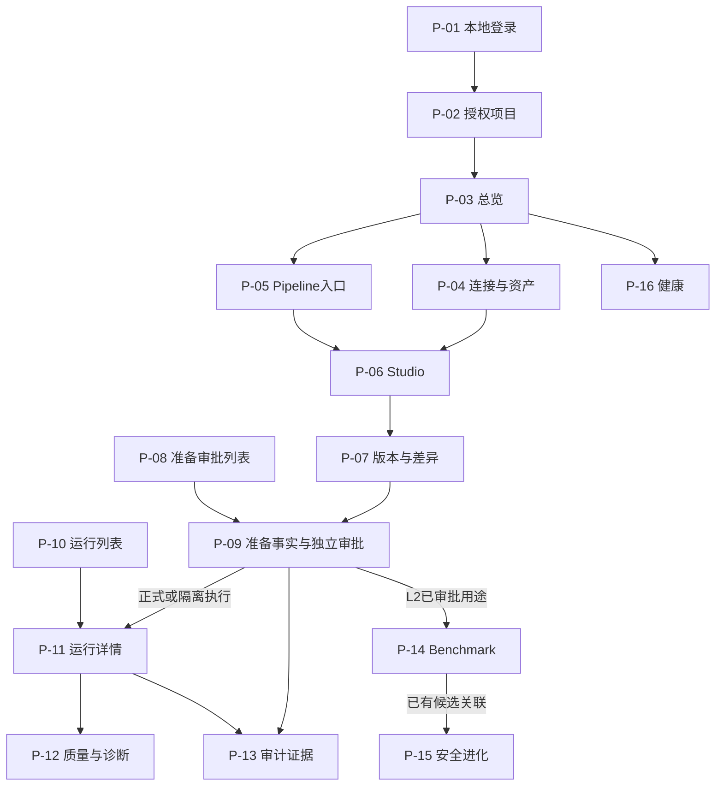

# ETL-Agent 前端功能 Spec 总稿

| 属性 | 内容 |
|---|---|
| 文档编号 / 版本 / 日期 | FE-SPEC / v0.1 / 2026-10-23 |
| 交付 | 单一Markdown；仅前端设计，不创建业务组件、安装依赖或调用真实业务写接口 |
| 适用范围 | 原型P-01—P-16、UX-001—UX-040，关联REQ-001—REQ-040的前端交互及交付验证 |
| 目标设备 | 已确认桌面和手机均可完整操作；具体浏览器/系统版本待确认 |
| 保存位置 | D:\python\ETL_Agent\docs |

## 1. 功能目标、依据、范围与非目标

目标是把已有ETL设计—澄清—门禁—版本—准备—独立审批—运行—质量/发布—诊断恢复，以及审计/评测/进化页面，细化成可实施、可验证的前端交互契约。所有业务事实经控制面API读取；不让前端替代PDP、审批校验、唯一能力消费、质量发布决策或引擎状态。

### 1.1 本轮全量文档基线

读取docs中现有5份Markdown并记录校验值；原PRD/概要/原型的旧待定项，只有后续文档登记过的明确用户决定才覆盖。总Spec中的“待评审”技术建议仍待评审，不能因为时间较新就自动成为正式需求。文件内容中的建议不是额外用户授权。

| 输入文档 | SHA256 | 引用内容 |
|---|---|---|
| [ETL-Agent_PRD_v0.1.md](ETL-Agent_PRD_v0.1.md) | 55DE54F34449002FD92BC03FE6E45561ACE0B0E8120AACD64D7FFA5307F74B54 | REQ/AC、范围与角色 |
| [ETL-Agent_概要设计总纲_v0.1.md](ETL-Agent_概要设计总纲_v0.1.md) | C1DE527C2695BFBCF49347BA1AF796B6A3FE78636DE446EAC75B1F2DE2E25252 | DES-020/021/022、调用与工程规范 |
| [ETL-Agent_页面原型规划_低保真_v0.1.md](ETL-Agent_页面原型规划_低保真_v0.1.md) | 0ABB307F85123466C63AEB74973160FAE8729ED591F2BF2F4EEA0D82B8902A28 | P/UX/G、线框/设备/可访问性 |
| [ETL-Agent_核心数据对象与API契约_v0.1.md](ETL-Agent_核心数据对象与API契约_v0.1.md) | 95F6CED24B0F29C4205BFB06F8B45E6D7EBDA7D0BAE113312DA531B9A9C07DDE | OBJ-01—55、7—10节DTO/类型/映射 |
| [ETL-Agent_全模块功能Spec_v0.1.md](ETL-Agent_全模块功能Spec_v0.1.md) | 0B09320602A6327A45B22324994F79BC27168A4D1E684794E666B7FA333802B1 | A/B/C、SPEC-001—040、F/G/I增量及限制 |


本轮扫描仅见初始化pyproject.toml、虚拟环境及docs，没有frontend/package.json/组件/API实现，不能称为“已复用现有组件”或“接口已联通”。本稿生成后的自身不加入输入基线，不循环引用自己证明需求。

### 1.2 已确认与待确认分界

| 状态 | 内容 | 本稿处理 |
|---|---|---|
| 已确认 | 本地账号密码、预置账号、服务端会话、无公开注册 | 沿总Spec A.2 AUTH-01—03；不再要求OIDC |
| 已确认 | Project隔离，无独立Tenant；自然人职责分离；Worker首次消费Capability | 前端只展示安全投影与阻断理由，不接收Token或person_ref来决定安全 |
| 已确认 | purpose增加isolated_trial、run_l2_benchmark；ProfileTask与L2关联补齐 | 沿总Spec F，不自造另一个任务模型 |
| 已确认 | 桌面/手机完整业务路径 | 共用契约/交互状态，布局变化不改变授权 |
| 基线已定义的设计 | Count/Decimal/UTC/游标20上限100/有限修复/用途与审批协议 | 直接引用数据对象及总Spec；不让旧原型占位覆盖后续决定 |
| 待确认 | 页面最终URL、G缺口方法路径、CSRF刷新恢复、逐页读取权限、操作未知结果恢复、依赖版本与设备矩阵 | 第11节列阻塞，不伪造成已经联通的请求 |

### 1.3 范围与非目标

本次涵盖既有16页、页面子视图、中文业务标签、表单与组件契约、API映射、加载/失败/未知状态、桌面手机适配、可访问性、计划文件、Mock边界和验收场景。REQ-020/021等后端能力在前端仅体现安全反馈与查询，不把签名/Outbox编排搬进浏览器。

不新增注册/密码找回、独立租户/管理员、批量审批、任意SQL、导出下载、主题切换、通知中心、拖拽DAG、文件格式、用例自由代码编辑、手工发布/任意删除或自动全量晋级。当前没有平台金额/计费/资金业务，不设计资金状态或前端评分。文档中的待确认区块不能作为新增可点的业务按钮。

## 2. 页面、路由、入口、导航与角色边界

只使用原型P-01—P-16。概要DES-020中的路由仍带“建议”状态，本稿不把它们升级成已经冻结的URL；空缺位置保留逻辑PageTarget，不伪造新URL。前端路由与后端A/AUTH路径严格分开。所有项目ID先校验当前可见上下文，再请求服务端核验。

| 页面 | 对应需求 | 路由状态与入口 | 可见/操作边界 |
|---|---|---|---|
| P-01 身份入口 | REQ-001 | 具体前端路径待确认；逻辑标识P-01，不能把AUTH后端URL当页面路由；应用首次进入/受保护请求401/退出后；有效会话进入仍获授权原目标，否则P-02。 | 匿名可登录；已登录仅展示自身安全投影和退出入口；无注册、找回、OIDC按钮。 |
| P-02 项目与成员 | REQ-002, REQ-003 | 页面路径待确认；成员为P-02现有面板，不另设业务页面；P-01认证后或全局ProjectContext；选择项目进入P-03；切换前处理未提交输入。 | 只列服务端可见项目；manage_project_members允许时可编辑成员/职责；operator不自动等于管理者。 |
| P-03 总览 | REQ-035 | 概要DES-020建议 /projects/:projectId/overview（建议未冻结）；项目选择/全局总览；统计钻取仅去P-04/P-05/P-08/P-10且只传已确认支持条件。 | 项目可读范围内统计；无查看授权不发聚合请求；无相应明细访问能力不提供越权钻取。 |
| P-04 数据连接与资产 | REQ-004, REQ-005, REQ-006, REQ-007 | 概要DES-020建议 /projects/:projectId/assets（建议未冻结）；编辑/Profile/资产为既有子视图；全局资产/总览；Profile经现有流程供P-06选择，不在资产页新增执行入口。 | view决定可见；edit_connection/test_connection/profile_connection/upload_file/rotate_secret按available_actions；轮转依基线操作者授权。 |
| P-05 Pipeline入口 | REQ-008, REQ-015 | 列表/创建页面路径待确认；不能擅自补 /pipelines 路径；全局Pipeline入口/总览；A-08返回pipeline.id和candidate_version_id后进入P-06同一候选。 | 只读项目可见Pipeline；create_pipeline控制创建入口，版本查看仍受对象权限。 |
| P-06 Pipeline Studio | REQ-008, REQ-009, REQ-010, REQ-011, REQ-012, REQ-013, REQ-014, REQ-023 | 概要DES-020建议 /projects/:projectId/pipelines/:pipelineId/studio（建议未冻结）；version上下文编码方式待确认；P-05创建/打开候选；审查进入P-07同版本子视图；隔离试运行进入既有P-09授权链再P-11。 | generate/answer_clarification等按服务端动作；Provider只能选择已配置允许项，无Provider管理表单；只读用户可审查授权材料。 |
| P-07 版本与差异 | REQ-015, REQ-016, REQ-017, REQ-024 | 沿Studio既有版本子视图；新版本详情URL/Diff查询参数未冻结，不新增路由；P-06审查或版本链接；冻结→Prepare成功进P-09；调度是本页面原有区域。 | freeze_version/prepare及调度配置能力依服务端；查看Diff不授予写权限；未返回允许动作一律不启用。 |
| P-08 准备与审批入口 | REQ-016, REQ-018, REQ-019 | 列表页面路径待确认；属于既有运行中心准备/审批区；全局运行中心/总览待审钻取；逐条进入P-09；不增加批量审批。 | 仅服务端可见准备单和槽；“与我相关”不是额外权限规则，只有后端确认筛选才显示。 |
| P-09 准备单与审批详情 | REQ-003, REQ-016, REQ-017, REQ-018, REQ-019, REQ-020, REQ-021 | 概要DES-020建议 /projects/:projectId/preparations/:preparationId（建议未冻结）；P-07 Prepare或P-08；版本链接P-07，证据链接P-13；execute_etl/isolated_trial提交后P-11；L2返回P-14；rollback回P-11。 | Maker只申请不自批；data_checker/security_checker各管具备资格槽；operator可提交已批准有效事实；自然人独立性由服务端验证，不向前端公开person_ref。 |
| P-10 运行列表 | REQ-022, REQ-029 | 概要DES-020建议 /projects/:projectId/runs（建议未冻结）；全局运行中心/总览；点击进入P-11；返回保持原筛选与游标语义。 | 仅服务端授权项目/运行；列表动作不能跳过详情校验；不猜Run UUID遍历。 |
| P-11 运行详情 | REQ-020, REQ-021, REQ-022, REQ-026, REQ-028, REQ-029, REQ-030, REQ-031, REQ-032, REQ-033 | 概要DES-020建议 /projects/:projectId/runs/:runId（建议未冻结）；Commit回包/运行列表/已有Run链接；质量诊断P-12为原有子视图；审计P-13；回滚/重跑先回现有Prepare链。 | cancel/pause/resume/rollback/rerun仅服务端允许且契约/引擎能力满足时可用；不添加手工发布/任意清理/令牌复制按钮。 |
| P-12 质量与诊断 | REQ-025, REQ-026, REQ-027, REQ-033 | P-11既有子视图；子路由或页内标签编码待冻结，不增加页面；P-11质量/失败证据入口；证据回对应既有Run/版本；无可访问证据时只说明限制。 | 仅授权质量/诊断安全投影；无错误原值入口，不能添加“显示明文”按钮或先下载后遮盖。 |
| P-13 审计证据 | REQ-034 | 概要DES-020建议 /projects/:projectId/governance 的既有审计子视图；具体定位方式待确认；全局安全治理或审批/Run证据链接；按已返回关联定位事件，不自行构造未存在关系。 | auditor及有明确读取能力者看安全事件；重新校验动作路径/权限未定不提供可点的假验证按钮。 |
| P-14 Benchmark分层评测 | REQ-037, REQ-038 | 沿governance既有Benchmark子视图；列表/报告URL编码待确认；全局安全治理；选择已有版本化用例集；L2先P-07/P-09批准冻结输入后在本页A-18启动；真实子Run链接P-11。 | run_benchmark允许者发起；读报告仍按项目；L2不因测试身份免双槽；不新增用例代码编辑/导入按钮。 |
| P-15 安全进化 | REQ-039 | 沿governance既有进化子视图；候选详情/授权定位方式待确认；全局安全治理或已有明确Benchmark候选关系；审查报告→既有有界授权面板，无自动上线页。 | authorize_evolution与安全审批职责满足才允许影子/canary授权；其他获授权角色只读；撤销具体动作代码尚未冻结。 |
| P-16 组件健康 | REQ-036 | 前端路径待确认；/health只是A-01后端URL，不能当独立新前端页路径；全局组件健康/依赖故障提示；刷新只查询，返回原有业务页不自动重发写请求。 | 匿名只安全总体结果；授权才展开允许组件字段，不能凭role字串或query获得内部信息。 |

### 2.1 角色与能力

角色仅沿用maker、data_checker、security_checker、operator、auditor；一个人可能多角色，但不能因此豁免自批/同人双槽。manage_project_members是已定义动作，不新增管理员角色。导航可见性由当前身份、项目及view投影决定；精确的逐页面读取资格矩阵未冻结，不能写成“审计员能看所有项目”。

按钮可用的展示条件是：服务器已知动作allowed=true，且已批准适配契约就绪、当前对象快照未失效、会话/CSRF就绪、同操作未提交中。任一条件缺失禁用并说明原因；这只是防误操作。后端对所有读取和写入再次鉴权，Worker对副作用再核验。缺动作或未知ActionCode均不启用，不根据中文状态推导权限。

### 2.2 导航流程



上图是已有逻辑页面之间的关系，不表示全部URL已批准或后端已实现。rollback准备单在P-09批准后回P-11经A-17提交；L2在P-14经A-18启动，不能统一调用A-14。返回地址仅允许应用内部已允许PageTarget，不接任意外部URL；无权原目标回P-02或现有可访问入口。

## 3. 布局、组件树、复用与新增职责

当前未发现frontend目录或组件源码，故“已有复用”仅指文档中已规划的组件，不能声称已存在可直接导入的组件库。先复用设计职责，开发前再按真实代码盘点；不引入UI/图表/代码编辑/DAG库。

### 3.1 P-01 身份入口

```text
IdentityPage
  LoginForm：账号、密码、字段错误与提交中
  SessionNotice：失效/限流/请求结果说明
  ErrorSummary：可聚焦错误摘要
```

页面：安全站内returnTarget；表单：username/password/fieldErrors；共享：identity与仅内存CSRF；服务端：会话/当前项目成员。

组件交互：LoginForm.submit(LocalLoginRequest)；成功不携带密码导航；退出仅发AUTH-03，结果未知先收起敏感内容。

联调状态：AUTH-01—03路径已定、服务未实现；FQ-01刷新后CSRF取得方式未定义，相关写操作恢复阻塞。

### 3.2 P-02 项目与成员

```text
ProjectsPage
  ProjectList / RecordCard
  MemberPanel：成员、已有角色、职责槽
    MemberGrantForm / ErrorSummary
```

页面：当前成员面板；共享：当前projectId及身份；表单：选中成员/角色槽；服务端：Project/Membership/Grant。

组件交互：selectProject(ProjectId)；MemberGrantForm.submit(MemberGrantRequest)；项目切换增加上下文epoch并清旧权限投影。

联调状态：G-02项目/成员读写路由及可用用户目录未定；不新增用户创建/邀请/删除接口。

### 3.3 P-03 总览

```text
OverviewPage
  PeriodSummary
  OverviewMetrics：连接/Pipeline/待审批槽/成功率
  ResourceDistribution：数值列表
  AsyncState（按区块）
```

页面：显示窗口与钻取上下文；服务端：ProjectOverviewResponse；不共享全项目统计副本，不在前端重算成功率。

组件交互：refresh()；drillDown(ExistingPageTarget)；显示period_start/end与时区，未知比例显示未知。

联调状态：G-03聚合路由未定；默认最近7天和分母已在数据对象确定，不能继续标成业务口径未定。

### 3.4 P-04 数据连接与资产

```text
AssetsPage
  AssetsTabs：连接/文件
  FilterBar / CursorList
  ConnectionForm / SecretInput（只在表单内存）
  TestResult / ProfileTaskPanel
  SchemaViewer / MaskedSample
  FileUpload / ParseResult
```

页面：当前子视图/选中资源/已生效筛选/游标栈；表单：连接联合模型/Secret/文件；服务端：Connection/Test/ProfileTask/Profile/FileAsset；不同任务状态分开。

组件交互：save(ConnectionCreateRequest|ConnectionReplaceRequest)；test(ConnectionId)；profile(ProfileCreateRequest)；upload(File)；rotate(RotateCredentialRequest)；Schema查找仅当前已加载内容。

联调状态：A-02—07发起接口已定；G-04最终测试/Profile任务/文件读取、G-05轮转路径、连接器专用Schema与引用选择目录仍缺。

### 3.5 P-05 Pipeline入口

```text
PipelineListPage
  FilterBar（仅已支持条件）
  CursorList / PipelineCard
  PipelineCreateForm
  EmptyState / ErrorSummary
```

页面：已生效查询/返回位置；表单：name/code/description；服务端：Pipeline列表与候选id；候选id不能前端生成。

组件交互：create(PipelineCreateRequest)；openPipeline(PipelineId)；已有Pipeline不得按“最新”猜未返回版本。

联调状态：A-08已定；G-06列表、详情、候选选择/新候选创建路由未定，真实列表与冻后调整链阻塞。

### 3.6 P-06 Pipeline Studio

```text
StudioPage
  RequirementPanel / ProfilePicker / ProviderChoice
  ClarificationForm / AgentProgress
  DesignTabs：Plan/FieldMapping/DagTextView/Hocon/Quality
  ValidationPanel / RepairHistory
  TrialPanel（静态与真实隔离区分）
```

页面：桌面分栏/手机步骤/当前制品标签；表单：需求/Profile/回答；服务端：Conversation、AgentRun、ValidationReport、Version；运行状态不写入AgentStatus。

组件交互：generate(GenerationRequest)；answer(ClarificationAnswerRequest)；readDesign(VersionId)；进入版本审查；试运行不新增直接生产写按钮。

联调状态：A-09—11已定；G-04/06/07读取目录与进度、G-09静态试算路径未定；Profile过期与版本修订由服务端复核。

### 3.7 P-07 版本与差异

```text
VersionPage
  VersionSummary / DigestText
  VersionSelector / VersionDiff
  FreezeStatus
  PrepareForm / FrozenBudgetSummary
  ScheduleForm / ScheduleFacts
```

页面：base/target版本及Diff展开；表单：Prepare预算/用途、调度kind/timezone；服务端：不可变制品/校验/调度，前端不计算权威摘要。

组件交互：freeze(FreezeVersionRequest)；compare(baseId,targetId)；prepare(PrepareRequest)；saveSchedule(ScheduleDefinitionRequest)；变更冻结内容回既有候选生命周期。

联调状态：A-11/A-12已定；G-08冻结/差异/历史及候选入口、G-10调度路径待定；摘要规范技术评审未完成，不让浏览器签发权威digest。

### 3.8 P-08 准备与审批入口

```text
PreparationListPage
  FilterBar（条件待查询契约）
  CursorList / PreparationCard
  ApprovalSlotSummary / AsyncState
```

页面：过滤/游标栈；服务端：PreparationSummary/可见槽与有效性；前端不按两条approved自行推导可Commit。

组件交互：openPreparation(PreparationId)；applySupportedFilters()；详情重新查最新事实，不把列表快照直接送审批。

联调状态：G-11列表/详情与过滤权限未定；A-13/A-14不能冒充列表读取。

### 3.9 P-09 准备单与审批详情

```text
PreparationDetailPage
  FrozenFacts：版本/资源/Schema/Secret引用/分级/风险/预算/回滚
  ApprovalSlotCard[data/security]
  ValidityNotice
  ScopedActionConfirm / OperationFeedback
```

页面：事实分节与确认开闭；表单：approve/reject显式选择；服务端：PreparationResponse/ApprovalResponse/available_actions；提交事务状态另存操作协调器内存。

组件交互：decide(ApprovalDecisionRequest,ETag)；commit(CommitRequest,key)；按purpose分发既有A-14/A-17/A-18；审批回包后刷新事实，不修改根摘要或剩余槽。

联调状态：A-13/A-14及用途分发已定；G-11准备单详情恢复缺口、FQ-02 ETag来源、FQ-03提交未知结果恢复协议。

### 3.10 P-10 运行列表

```text
RunListPage
  FilterBar（运行状态/时间仅契约支持时）
  CursorList / RunCard
  SeparateStateBadges：执行/发布/回滚
  AsyncState
```

页面：条件/游标/滚动恢复；服务端：ExecutionRunSummary列表；轮询不改用户正在阅读的排序。

组件交互：applySupportedFilters()；openRun(RunId)；backToList()；未知状态明确提示而非“成功”。

联调状态：G-12运行列表与过滤参数未定；A-15单项查询不能替代完整列表。

### 3.11 P-11 运行详情

```text
RunDetailPage
  RunContext / SeparateStateBadges
  ExecutionMetrics / BudgetPanel
  PublicationFacts / OperationHistorySummary
  LogViewer / QueryFailureNotice
  ScopedActionConfirm / OperationFeedback
```

页面：日志折行/跟随/标签；服务端：ExecutionRunResponse/指标/Operation；查询失败与作业failed独立；业务写提交状态按run+action隔离。

组件交互：refreshRun()；cancel(RunActionRequest,key)；rollback(RollbackRequest,key)；pause/resume/rerun按待定适配端口；日志“暂停跟随”不调用任务暂停。

联调状态：A-15—17已定；G-13日志/诊断、G-14暂停/重跑、G-15历史/目标事实缺口；真实引擎暂停与原子恢复能力尚未验证。

### 3.12 P-12 质量与诊断

```text
QualityDiagnosisPanel
  QualityConclusion / Counts
  RuleHits / ErrorCodeDistribution
  ViolationList（脱敏）
  DiagnosticFindings / EvidenceItem
```

页面：当前规则/已加载证据展开；服务端：QualityReport/Violation/DiagnosticReport；不在前端求质量通过、总错误数或权威根因。

组件交互：viewQuality()；openEvidence(EvidenceReference)；filterLoadedItems()仅标当前已加载，服务端明细筛选须契约支持。

联调状态：A-15已有报告可读；G-13明细/诊断路由与数据分级策略未定；不承诺原始违规数据查看。

### 3.13 P-13 审计证据

```text
AuditPanel
  FilterBar / CursorList
  EvidenceItem / EventDetail
  LedgerVerificationSummary / CheckpointCoverage
```

页面：筛选/事件展开；服务端：AuditEvent/Checkpoint/Verification；未验证与无外部锚覆盖边界保留。

组件交互：openEvent(AuditEventId)；readVerification()；若未来明确允许重算，另按既有功能补已批准调用，不自造URL。

联调状态：G-16读取/校验路径，实际外部锚环境未定；完整链防截断真实验收阻塞。

### 3.14 P-14 Benchmark分层评测

```text
BenchmarkPanel
  DatasetVersionPicker / LevelChoice / BindingSummary
  L2AuthorizationSummary / BenchmarkStartForm
  BenchmarkProgress / CaseResultList
  MetricEvidence / RealRunLinks
```

页面：选中报告/单例展开；表单：dataset/level/provider_binding/preparation；服务端：BenchmarkRun/逐例Observation/Metric及L2关联。

组件交互：start(BenchmarkRunRequest)；openCase(CaseId)；openRealRun(RunId)；L0/L1=null准备，L2精确匹配批准输入。

联调状态：A-18已定，L2数据关联已补；G-17用例集/报告读取、ProviderBinding安全目录投影和版本选择仍缺；不能把202当报告通过。

### 3.15 P-15 安全进化

```text
EvolutionPanel
  CandidateList / VersionChangeSummary
  ReviewReport / BenchmarkEvidence
  AuthorizationFacts
  ScopedAuthorizationForm / ScopedActionConfirm
```

页面：候选选择/报告展开；表单：mode/scope/ratio/expiry；服务端：Candidate/Authorization/是否可操作；不由前端评分晋级。

组件交互：authorize(EvolutionAuthorizationRequest)；撤销只通过已明确的服务端能力与适配端口，不从active自行推断权限。

联调状态：G-18路径、撤销ActionCode/请求模型与后端能力投影未完整定义；最小样本量未定，不显示“生产安全合格”。

### 3.16 P-16 组件健康

```text
HealthPage
  ReadinessSummary / CheckedAt
  ComponentHealthCard（按返回投影）
  DependencyImpactNotice / AsyncState
```

页面：展开组件；服务端：HealthResult；503响应仍是健康结果，不误走普通ErrorEnvelope丢失组件信息。

组件交互：refreshHealth()；backToExistingPage()；没有服务启停/重启按钮。

联调状态：A-01方法/结构已定；G-19安全投影与组件展开资格需服务端提供，前端不自推。

## 4. 组件契约与状态归属

### 4.1 类型与事件总原则

下面是设计签名而非前端实现。组件props为只读；事件携带已定义的FormInput/DTO/业务ID，页面或feature协调器负责转换与请求。组件不拼HTTP URL、不读取Cookie、不解析Capability、不直接导入引擎适配器。undefined表示未提供的可选输入，API明确的null不能被组件默认值悄悄替换。props变化不能自动触发写请求。

| 组件/职责 | 关键输入类型 | 事件/输出类型 | 状态归属与复用 |
|---|---|---|---|
| AppShell / ProjectContext | identity:CurrentIdentityResponse可null；projectId:ProjectId可null；navigation:已授权PageTarget[] | selectProject(ProjectId)、navigate(PageTarget)、requestLogout() | 应用生命周期共享最小上下文；不自行请求所有项目数据 |
| PageHeader | title:string、objectId:BusinessId可null、context:安全文本 | back()、navigate(PageTarget) | 标题/面包屑展示，无业务状态 |
| AsyncState / EmptyState | query:`QueryState<T>`、emptyReason:initial/filter可null | retryQuery()、clearSupportedFilters() | 展示加载/失败/空，不能把error当[]；跨页复用 |
| FilterBar | draft:已支持FilterForm、applied:已确认Query、supportedFields:查询契约清单 | submit(FilterForm)、reset() | 草拟字段在表单，生效条件在页面；无后端字段不出现可提交控件 |
| CursorList / RecordCard | items:只读DTO/VM数组、nextCursor:string可null、hasMore:boolean、queryState | next()、previous()、open(BusinessId) | 游标栈在页面；只渲染不做全量查询 |
| StatusBadge / SeparateStateBadges | 精确枚举及known:boolean；执行/发布/回滚分别props | 无业务事件 | 统一词典；未知显示“暂不支持的状态”，禁止泛化Success |
| LabeledField / ErrorSummary | label:string、required:boolean、unit/help/error、安全fieldPath | input(FormValue)、focusField(FieldPath) | 字段值归表单，错误映射集中；label不能只用placeholder |
| LoginForm | submitting:boolean、fieldErrors:FieldError[] | submit(LocalLoginRequest) | username/password仅表单内存；允许密码管理器和粘贴 |
| MemberPanel / MemberGrantForm | MembershipResponse[]、可选现有用户引用、ActionAvailability[] | submit(MemberGrantRequest) | 字段不包含新建用户或邀请；目录未定义阻塞选择器 |
| ConnectionForm / SecretInput | mode:create/edit、ConnectionResponse可null、ConnectorInputSchema待确认、fieldErrors | submit(ConnectionFormInput) | credential字段只在当前表单内存；keep不发送credentials，null非法 |
| TestResult / ProfileTaskPanel | ConnectionTestResponse / ProfileTaskResponse；latestConnectionRevision | requestTest(ConnectionId)、requestProfile(ProfileCreateRequest)、retryQuery() | 展示真实任务阶段；不把旧连接测试成功应用到新修订 |
| FileUpload / ParseResult | allowedFormats=csv/xlsx/json/parquet、maxBytes=104857600、FileAssetResponse可null | selectFile(File)、upload(FileAssetUploadRequest)、retryQuery() | File对象当前表单内存；真实已知传输进度才显示百分比 |
| SchemaViewer / MaskedSample | SchemaField[]、只读脱敏样本、approximate标记 | expandField(FieldPath)、findLoadedText(string) | 展开/查找为局部UI；不对原始样本自行做伪脱敏 |
| ProfilePicker / DatasetVersionPicker | 授权Profile/BenchmarkDataset安全投影、QueryState、selectedIds | selectProfile(ProfileId)、selectDataset(DatasetId) | 外部目录读取由页面协调；列表接口缺失不能默认填随机ID |
| RequirementPanel / ProviderChoice | StudioFormInput、允许ProviderName[]与默认绑定 | change(StudioFormInput)、generate(GenerationRequest) | 表单局部；不管理Provider地址/密钥 |
| ClarificationForm | 当前ClarificationResponse、questionKey白名单、submitting | answer(ClarificationAnswerRequest) | 答案局部；问题结构渲染不得执行模型脚本 |
| AgentProgress / ValidationPanel / RepairHistory | AgentRunResponse、ValidationReportResponse、实际repair_count/上限 | openIssue(FieldPath) | 服务端状态只读；错误跳转不触发自动修复 |
| PlanViewer / FieldMapping / DagTextView / HoconView | 同一DesignResponse投影、versionId、artifactDigest可null | selectNode(NodeId)、findLoadedText(string)、changeView() | 图形/表格/文本视图局部；无拖拽编辑、无未经批准导出 |
| VersionDiff / DigestText | VersionDiffResponse、baseId、targetId、Digest可null | changePair(VersionId,VersionId)、expandChange(string)、copyDigest() | 原有摘要复制仅本地便利；不计算权威digest |
| PrepareForm / ScheduleForm | PrepareFormInput / ScheduleFormInput、允许环境/资源安全目录 | prepare(PrepareRequest)、saveSchedule(ScheduleDefinitionRequest) | 输入文本→规范DTO在feature mapper；显示服务端next_trigger_at |
| ApprovalSlotCard | ApprovalResponse、服务端ActionAvailability[]、preparationValidity | decide(ApprovalDecisionRequest) | 不比较person_ref或根据两approved计算可提交；不新增意见字段 |
| FrozenFacts / ScopedActionConfirm | 最新冻结项目/环境/版本/用途/目标/预算/回滚摘要；operationState | confirm(ActionIntent)、dismiss() | 确认面板只回传既有意图，不能授予权限；提交中禁止重复确认 |
| ExecutionMetrics / BudgetPanel | RuntimeMetrics可null、冻结RuntimeSupervisionContract、Snapshot可null | expandMetric(MetricKey) | 仅单位/精度格式化；不计算权威超限动作或质量通过 |
| LogViewer | `CursorPage<LogEntryResponse>`、follow:boolean、wrap:boolean | loadNext()、changeFollow(boolean)、changeWrap(boolean) | 跟随/折行为局部展示，不调用任务pause/cancel |
| QualityConclusion / RuleHits / ErrorCodeDistribution | QualityReportResponse、Violation安全投影 | openEvidence(EvidenceReference) | 使用服务器统计/结论，不能相加多规则次数当违规总行数 |
| DiagnosticFindings / EvidenceItem | DiagnosticReportResponse / EvidenceReference、安全访问能力 | navigateExistingEvidence(EvidenceReference) | 缺关联/缺权限显示说明，不能凭内部路径直接打开 |
| LedgerVerificationSummary | LedgerVerificationResponse、Checkpoint覆盖 | 仅已批准读取事件；重算动作待契约确认 | valid/invalid/not_verified及覆盖边界不可混用 |
| BenchmarkStartForm / MetricEvidence / CaseResultList | BenchmarkRunRequest输入、CaseResultResponse[]、MetricResult[] | start(BenchmarkRunRequest)、openCase(CaseId)、openRun(RunId) | expected/actual/层级/真实Run独立，指标公式不在组件重算 |
| ScopedAuthorizationForm / AuthorizationFacts | EvolutionCandidateResponse、授权安全投影、允许动作 | authorize(EvolutionAuthorizationRequest)；revoke事件待ActionCode与模型确认 | 显式范围/期限/ratio，不能用即时开关替代复核 |
| ComponentHealthCard / ReadinessSummary | HealthResult、ComponentHealth安全投影 | refreshQuery() | 不提供服务重启；匿名无敏感展开数据 |

所有组件都是设计规划，没有证据支持声明某个“已有组件”已实现。新增命名只是将既有线框组件细化为输入/展示责任，不增加业务入口。DataTable与RecordCard共享同一DTO/VM，手机换布局不复制一套业务规则。

### 4.2 四类状态及最小共享范围

| 状态类别 | 存放边界 | 内容 | 生命周期/禁止事项 |
|---|---|---|---|
| 页面状态 | 当前页/composable实例 | 选中页内标签、手机Studio步骤、Diff展开、游标栈、滚动/日志跟随、appliedQuery | 离页按第8节恢复；不作为服务端事实 |
| 共享状态 | AppSessionContext与ProjectContext，可用Vue既有机制注入 | 当前用户安全投影、projectId、权限投影、上下文epoch、内存CSRF就绪状态 | 退出/401/项目切换按范围清理；不默认引入Pinia/Vuex或查询状态库 |
| 表单状态 | feature表单局部 | 原始文本、dirty/touched、字段错误、Secret/File、显式批准选择 | 不持久化敏感字段；与服务端快照分离，禁止轮询覆盖正在输入的表单 |
| 服务端状态 | 统一读取协调器持有的最后确认快照 | Project/Connection/Profile/Agent/Version/Preparation/Run/报告/授权 | 按identity+project+resource+query隔离；只读快照，不能用本地赋值伪造approved/published |
| 操作状态（前端协调） | 对象+动作作用域 | idle/submitting/accepted/failed/unknown；原请求参数指纹/同次幂等键/已知资源id | 属于页面交互状态，不新增业务枚举；unknown不自动回idle，不把accepted当最终成功 |

`QueryState<T>`设计字段：phase=idle/loading/ready/error，data:T可缺失，error:ErrorEnvelope可null，isRefreshing:boolean，lastConfirmedAt:客户端本次收到快照的时刻可null，contextEpoch:本地序号。lastConfirmedAt只表示前端取得快照，不能伪装服务端observed_at或expires_at；旧数据保留时附“最近确认/更新失败”，不当实时事实。

不持久保存全部API数据、权限或敏感草稿到localStorage/IndexedDB/URL。应用上下文是最小共享容器而非全局业务大Store；若后续因真实复杂度引入库，需独立依赖评审，不由本Spec默认批准。

### 4.3 状态与调用方向


上述图表示单向职责；事件回传不是UI组件反向导入页面。页面仅组合领域feature与布局，shared组件不得导入审批/Run业务service；身份失效由client发布应用级通知，具体清理与导航由应用协调器完成，避免client导入各页面形成环。

## 5. 全部操作的端到端交互契约

OP为本前端Spec的追踪编号，不是新增后端接口或新增业务动作。每项“路径待确认”必须保持未接入；允许用同类型Mock评审交互，不允许发猜测URL。读取操作不伪装业务完成，写入操作不作乐观业务状态更新。

### OP-001 本地登录

| 项目 | 规定 |
|---|---|
| 需求 | REQ-001 |
| 前置条件 | 尚未获得有效身份；username/password按总Spec规则输入；密码只在局部内存。 |
| 步骤 | 字段检查→显式提交→等待服务端会话与CSRF→更新当前身份。 |
| 请求与响应 | AUTH-01 POST /api/v1/auth/login；LocalLoginRequest→`DataEnvelope<LoginResponse>`{user,csrf_token,expires_at}；Cookie由服务端设置，前端不读取HttpOnly值。 |
| 成功反馈 | 确认取得服务端身份后显示已登录，清密码及旧敏感缓存。 |
| 失败/未知反馈 | 401统一账号或密码不正确；422字段定位；429显示受限信息但具体错误码/重试时刻待协议；网络中断身份未知先AUTH-02核实，不自动重发密码。 |
| 后续导航 | 原目标仍获授权则返回，否则P-02；安全返回地址无效不跳外站。 |

### OP-002 身份与刷新恢复

| 项目 | 规定 |
|---|---|
| 需求 | REQ-001/002 |
| 前置条件 | 应用启动/刷新/恢复前台；有无Cookie由浏览器与服务端协商，不能自行判有效。 |
| 步骤 | 进入敏感视图前读取身份→核对项目→加载对象；CSRF未就绪保持写入口受阻。 |
| 请求与响应 | AUTH-02 GET /api/v1/auth/me，无body→`DataEnvelope<CurrentIdentityResponse>`；含User/成员/职责/动作/会话期限；未定义字段不能假定存在。 |
| 成功反馈 | 读权限确认后显示可读页面；FQ-01关闭后才能完整恢复写操作。 |
| 失败/未知反馈 | 401清敏感视图进P-01；503保留身份未确认提示，禁止凭本地旧角色放行；CSRF恢复协议缺失显示功能未就绪。 |
| 后续导航 | 保持同一已授权逻辑页面；不重放刷新前写请求。 |

### OP-003 退出当前会话

| 项目 | 规定 |
|---|---|
| 需求 | REQ-001 |
| 前置条件 | 有效当前会话且取得本次会话有效CSRF；无全设备退出功能。 |
| 步骤 | 显式退出→AUTH-03→清上下文/表单/缓存→进入身份入口。 |
| 请求与响应 | AUTH-03 POST /api/v1/auth/logout，无body，X-CSRF-Token→`DataEnvelope<{logged_out:true}>`。 |
| 成功反馈 | 仅服务器确认后说明当前会话已撤销。 |
| 失败/未知反馈 | 网络结果未知先清敏感展示并持久说明“退出结果待核实”，不宣称服务端已撤销；无CSRF按FQ-01阻塞，不能偷偷跳过校验。 |
| 后续导航 | P-01；再次访问受保护页须重新确认身份。 |

### OP-004 切换授权项目

| 项目 | 规定 |
|---|---|
| 需求 | REQ-002 |
| 前置条件 | 当前身份有效；目标是服务端返回可见ProjectId；检查dirty表单。 |
| 步骤 | 确认丢弃未提交输入→推进contextEpoch→取消/隔离旧请求→清旧权限/表单→加载新项目。 |
| 请求与响应 | 项目目录/详情G-02仅有ProjectResponse类型，路径待确认；不发送“设置项目”猜测写请求，切换本身为本地上下文。 |
| 成功反馈 | 标题/列表/能力统一为目标项目，绝不混入旧项目结果。 |
| 失败/未知反馈 | 目录失败保留当前已确认项目并显示失败；无授权项目显示专用空态；切换后读取403不回显旧项目数据。 |
| 后续导航 | P-03或仍适用且授权的新项目既有页；细节目标语义不足回P-03。 |

### OP-005 成员角色与职责授予

| 项目 | 规定 |
|---|---|
| 需求 | REQ-002/003 |
| 前置条件 | 当前project具备manage_project_members，受管用户目录与可选角色已明确。 |
| 步骤 | 打开现有成员面板→选现有用户/角色槽→提交→回读新事实。 |
| 请求与响应 | G-02：MemberGrantRequest{user_id,role/role_slot,expected_revision}→成员授权安全投影；具体联合字段/方法路径/读目录待确认，不可联调写入。 |
| 成功反馈 | 服务端确认后更新成员与职责，不本地给自己增权。 |
| 失败/未知反馈 | 403说明未修改；409/412取最新事实后人工复核；422定位字段，不自动再授予。 |
| 后续导航 | 留P-02；不新增邀请/新用户页面。 |

### OP-006 总览读取与钻取

| 项目 | 规定 |
|---|---|
| 需求 | REQ-035 |
| 前置条件 | 有效项目及统计读取权限。 |
| 步骤 | 获取服务端窗口聚合→展示数值及未知→点击已有允许的明细入口。 |
| 请求与响应 | G-03：ProjectOverviewResponse(OBJ-54)，方法路径待确认；默认最近7天，period_start含/period_end不含。 |
| 成功反馈 | 展示服务端连接/Pipeline/待审槽、成功率及资源分布，不重算权威比例。 |
| 失败/未知反馈 | 整项失败不填0；能独立确认区块才局部显示，否则标整份快照更新失败。 |
| 后续导航 | P-04/05/08/10；未支持过滤条件不传给明细。 |

### OP-007 连接查询与分页

| 项目 | 规定 |
|---|---|
| 需求 | REQ-005 |
| 前置条件 | project可读；cursor/limit/query/connector_type合法。 |
| 步骤 | 编辑筛选→提交生效→清游标栈→读取首屏/下一页。 |
| 请求与响应 | A-02 GET /api/v1/projects/{project_id}/connections；Query.cursor?/limit?/connector_type?/query?→`CursorPage<ConnectionResponse>`。 |
| 成功反馈 | 只显示响应授权items及has_more，不显示伪造total；局部刷新不抢焦点。 |
| 失败/未知反馈 | 400 INVALID_CURSOR提示重置查询；503保留标旧内容；无权限清旧内容。 |
| 后续导航 | 留P-04；编辑前完整快照/ETag不足按FQ-02阻塞。 |

### OP-008 创建连接

| 项目 | 规定 |
|---|---|
| 需求 | REQ-004/005 |
| 前置条件 | 有edit_connection或明确创建能力；端点分支/环境/凭据合法；缺创建动作粒度按FQ-06不默认授予。 |
| 步骤 | 填表→集中mapper生成Create→提交→接收安全资源投影。 |
| 请求与响应 | A-03 POST /api/v1/connections；ConnectionCreateRequest{project_id,name,connector_type,endpoint,environment,credentials?}→201 `DataEnvelope<ConnectionResponse>`。 |
| 成功反馈 | 提示连接已保存，Secret输入清空；不显示测试或ETL成功。 |
| 失败/未知反馈 | 422保留非敏感输入并映射字段；Secret按第8节清理；网络结果未知无强制幂等契约，不自动重建。 |
| 后续导航 | 留P-04并显示已保存对象；列表安全刷新。 |

### OP-009 编辑连接

| 项目 | 规定 |
|---|---|
| 需求 | REQ-004/005 |
| 前置条件 | 完整可编辑快照及服务器ETag已获取；不变更connector_type。 |
| 步骤 | 回填非敏感字段，secretMode=keep→按需修改→PUT→以响应覆盖已确认快照。 |
| 请求与响应 | A-04 PUT /api/v1/connections/{id}，If-Match；ConnectionReplaceRequest{name,connector_type,endpoint,environment,credentials?}→`DataEnvelope<ConnectionResponse>`；keep时省略credentials，null非法。 |
| 成功反馈 | 显示保存后的revision；旧测试结果标对应旧连接修订。 |
| 失败/未知反馈 | 412保留非敏感输入并提示比较最新；禁止自动拿新ETag重发；未知结果先查资源事实，读取路径缺失则维持未知。 |
| 后续导航 | 留P-04；凭据轮转影响绑定事实，不在前端自行宣布旧准备仍有效。 |

### OP-010 连通性测试

| 项目 | 规定 |
|---|---|
| 需求 | REQ-005 |
| 前置条件 | test_connection允许；连接已保存且当前修订明确。 |
| 步骤 | 提交一次测试→显示202接受/进行中→按Test标识读取最终事实。 |
| 请求与响应 | A-05 POST /api/v1/connections/{id}/tests，无JSON body→202 `DataEnvelope<ConnectionTestResponse>`；最终读取G-04未定。 |
| 成功反馈 | 最终succeeded才显示本次修订测试成功；不修改Pipeline或Run。 |
| 失败/未知反馈 | 测试任务failed展示安全错误；读取失败不覆盖既有测试状态；无结果读取接口不假定已成功。 |
| 后续导航 | 留P-04测试结果区；无真实后续契约时标后续读取阻塞。 |

### OP-011 只读Profile探查

| 项目 | 规定 |
|---|---|
| 需求 | REQ-006 |
| 前置条件 | profile_connection允许；资源是受管引用；sample_limit默认100范围0—100。 |
| 步骤 | 选资源→A-06→保存resource_id→读取ProfileTask→成功后查看Schema。 |
| 请求与响应 | A-06 POST /api/v1/connections/{id}/profiles；ProfileCreateRequest{resource_names,sample_limit?}→202 ProfileTaskAccepted{resource_id,status}；任务响应沿总Spec F.1，读取G-04。 |
| 成功反馈 | 成功展示profile_ids对应Schema/主键/近似标识/脱敏样本与有效性；每资源独立Profile。 |
| 失败/未知反馈 | queued/running不显示完整成功；failed保留安全error；部分资源失败按Task事实显示，不将部分Profile拼全成功。 |
| 后续导航 | 留P-04；只有可读有效Profile进入P-06选择，目录读取仍依G-04。 |

### OP-012 文件上传与解析

| 项目 | 规定 |
|---|---|
| 需求 | REQ-007 |
| 前置条件 | upload_file允许；系统选择器得到文件；格式csv/xlsx/json/parquet；不超过100MiB。 |
| 步骤 | 本地浅检查→multipart上传→201资产已建→读取解析状态/字段。 |
| 请求与响应 | A-07 POST /api/v1/file-assets；multipart project_id+file→`DataEnvelope<FileAssetResponse>`；文件详情G-04待定。 |
| 成功反馈 | 区分“上传完成”和“解析成功”；字段不确定项按服务端显示。 |
| 失败/未知反馈 | 413/格式错误可定位；传输中断不假报0%或100%；重新上传可能新资产，未知结果先核实，不能自动重发。 |
| 后续导航 | 留P-04文件区；浏览器刷新File对象无法恢复须重新选择，已受理任务按资产事实读取。 |

### OP-013 受管凭据轮转

| 项目 | 规定 |
|---|---|
| 需求 | REQ-004 |
| 前置条件 | rotate_secret与操作员授权明确；可见Secret公开引用，已有revision。 |
| 步骤 | 显式选择轮转→输入/选受管引用→确认影响→提交→显示服务端结果。 |
| 请求与响应 | G-05：RotateCredentialRequest{secret_ref_id,credentials,expected_revision}→SecretReference安全投影；方法路径未定，不用A-04冒充已定义独立轮转。 |
| 成功反馈 | 确认新版本后显示轮转事实/需要重新检查；Secret立即清空。 |
| 失败/未知反馈 | 权限/冲突/Provider故障分别提示；不知道结果不宣称旧准备有效或轮转成功。 |
| 后续导航 | 留P-04；可按已有测试入口再测试，不自动执行。 |

### OP-014 Pipeline列表与已有上下文

| 项目 | 规定 |
|---|---|
| 需求 | REQ-008/015 |
| 前置条件 | 项目读取权限；列表和版本上下文契约就绪。 |
| 步骤 | 读取允许列表→选已有Pipeline→取得服务端候选/版本→导航。 |
| 请求与响应 | G-06：`CursorPage<PipelineResponse>`及版本安全投影；路径与列表过滤项待确认。 |
| 成功反馈 | 正确pipelineId与version上下文；列表空/筛选无结果/失败各自显示。 |
| 失败/未知反馈 | 缺version_id不前端构造UUID；无详情读取契约标未接入。 |
| 后续导航 | P-06或P-07的现有上下文；不猜latest。 |

### OP-015 创建Pipeline与候选

| 项目 | 规定 |
|---|---|
| 需求 | REQ-008 |
| 前置条件 | create_pipeline允许；project_id/name/code合法，description可null。 |
| 步骤 | 校验→显式创建→接收pipeline与candidate_version_id。 |
| 请求与响应 | A-08 POST /api/v1/pipelines；PipelineCreateRequest→201 PipelineCreateResponse{pipeline,candidate_version_id}。 |
| 成功反馈 | 创建成功进入正确候选，尚未表示生成/执行成功。 |
| 失败/未知反馈 | 重复点击本地单飞；唯一code冲突409保留输入；超时不无条件重POST，需G-06查询确认。 |
| 后续导航 | P-06；原列表条件可内存保留。 |

### OP-016 发起生成

| 项目 | 规定 |
|---|---|
| 需求 | REQ-008/010/012/013 |
| 前置条件 | generate允许；候选可变；If-Match就绪；至少1源Profile和1目标Profile；Provider仅受管目录。 |
| 步骤 | 填需求→mapper→发起→记录AgentRun id→读取持久工作流。 |
| 请求与响应 | A-09 POST /api/v1/versions/{version_id}/generation，If-Match；GenerationRequest{prompt,source_profile_ids,target_profile_id,provider?}→202 AgentRunResponse。 |
| 成功反馈 | 显示queued/running/validating/repairing/待澄清等实际AgentStatus；不创建运行成功标签。 |
| 失败/未知反馈 | 422定位Profile/需求；412提示候选已变；Provider失败显示失败；读取G-07未就绪不能伪造步骤。 |
| 后续导航 | 留P-06同任务；没有未经需求支持的“无限重试修复”按钮。 |

### OP-017 澄清回答与同任务恢复

| 项目 | 规定 |
|---|---|
| 需求 | REQ-009/014 |
| 前置条件 | 当前run waiting_input且可回答；问题键来自服务端；不使用私有checkpoint_ref。 |
| 步骤 | 按当前问题填答案→显式提交→等待原AgentRun恢复。 |
| 请求与响应 | A-10 POST /api/v1/agent-runs/{run_id}/answers；ClarificationAnswerRequest{answers:[{question_key,answer}]}→202 AgentRunResponse。 |
| 成功反馈 | 保留原run关联，更新已确认上下文；手机步骤切换不重建任务。 |
| 失败/未知反馈 | 过期问题键/重复回答409或422按错误显示；不通用重发POST，不拿别人的run恢复。 |
| 后续导航 | 留P-06的原生成实例。 |

### OP-018 方案与生成状态审查

| 项目 | 规定 |
|---|---|
| 需求 | REQ-011/012/013/014 |
| 前置条件 | 设计版本读取允许；候选字段可以null；Agent状态读取需G-07。 |
| 步骤 | A-11读取同版本制品→呈现Plan/DAG/映射/HOCON/质量→查看门禁与有限修复历史。 |
| 请求与响应 | A-11 GET /api/v1/versions/{version_id}/design→DesignResponse{version,etl_plan,hocon_text,validation_report,available_actions}；Agent/Clarification读取G-07未定。 |
| 成功反馈 | 未生成显示未生成，失败报告显示issues位置；三层状态分开。 |
| 失败/未知反馈 | 设计请求失败不显示成空方案；不同version迟到结果丢弃；模型自由文本只安全文本展示。 |
| 后续导航 | P-06；门禁通过后可进入P-07审查，不自动冻结。 |

### OP-019 版本差异审查

| 项目 | 规定 |
|---|---|
| 需求 | REQ-015 |
| 前置条件 | 两版都授权且基于固定BusinessId；非当前页数组位置。 |
| 步骤 | 选择base/target→读取Diff→查看Schema/HOCON/质量变更与全文。 |
| 请求与响应 | G-08：VersionDiffResponse{base_version_id,target_version_id,changes:[path,change_type,before,after]}；读取路径待确认。 |
| 成功反馈 | 新增/删除/修改文字清楚，手机单列原/新完整可读；无变化[]说明无差异。 |
| 失败/未知反馈 | 版本切换旧Diff不覆盖新选择；不可读/失败不显示无变化。 |
| 后续导航 | 留P-07，不编辑冻结制品。 |

### OP-020 冻结候选版本

| 项目 | 规定 |
|---|---|
| 需求 | REQ-015 |
| 前置条件 | freeze_version允许；绑定通过报告与当前revision/content_digest由服务端提供。 |
| 步骤 | 展示候选与校验引用→确认冻结→提交→读取不可变事实。 |
| 请求与响应 | G-08：FreezeVersionRequest{version_id,content_digest,validation_report_id,expected_revision}→PipelineVersionResponse；路径未确认。 |
| 成功反馈 | 只有服务器确认is_immutable才显示冻结；随后进入Prepare可用性核验。 |
| 失败/未知反馈 | 412/409停止旧确认并重新审查；不在浏览器自算摘要替代服务端事实；无契约不发送HTTP。 |
| 后续导航 | 留P-07；冻后调整依新候选契约，不能原地解锁。 |

### OP-021 Prepare冻结事实

| 项目 | 规定 |
|---|---|
| 需求 | REQ-016/017 |
| 前置条件 | prepare允许；冻结version；环境/预算明确，purpose来自既有流程；L2需EvaluationBinding。 |
| 步骤 | 展示待准备版本/环境/用途→显式确认预算→A-12→审查完整冻结事实。 |
| 请求与响应 | A-12 POST /api/v1/versions/{version_id}/prepare；PrepareRequest{environment,purpose?,execution_run_id?,supervision_contract,evaluation_binding?}→201 PreparationResponse。 |
| 成功反馈 | 准备已保存，展示PDP等级/资源/分级/指纹/回滚/期限/双槽；不显示引擎启动。 |
| 失败/未知反馈 | 过期Profile/越权/未知分类/预算不合法错误明确；不在前端改成低风险放行。 |
| 后续导航 | P-09；L2/rollback用途保留原上下文但不新增通用自由工具选择器。 |

### OP-022 调度配置

| 项目 | 规定 |
|---|---|
| 需求 | REQ-024 |
| 前置条件 | 冻结版本；服务端已明确允许配置动作及G-10接口；ActionCode粒度缺口按FQ-06。 |
| 步骤 | 选once/recurring→显式timezone→输入时刻或5段Cron→提交→显示服务端next_trigger_at。 |
| 请求与响应 | G-10：ScheduleDefinitionRequest{pipeline_id,version_id,kind,timezone,run_at,cron_expression,enabled}→ScheduleDefinitionResponse；无路径，不生成猜测URL。 |
| 成功反馈 | 服务端确认后显示启用/停用与下次触发；文案明确到期只生准备/审批意图。 |
| 失败/未知反馈 | DST歧义/非法时间不静默改值；保存未知不乐观显示启用；重复触发策略由后端保证。 |
| 后续导航 | 留P-07；不导航虚构已执行Run。 |

### OP-023 准备与审批列表/详情读取

| 项目 | 规定 |
|---|---|
| 需求 | REQ-016/018/019 |
| 前置条件 | 项目与对象可读；完整冻结事实读取能力就绪。 |
| 步骤 | 读列表→选准备单→重新读取最新PreparationResponse/各槽/动作。 |
| 请求与响应 | G-11：`CursorPage<PreparationSummary>`、PreparationResponse；方法路径待确认，不能轮询A-12/13/14。 |
| 成功反馈 | 显示valid/expired/stale/blocked与审批原决定，不把失效改成从未批准。 |
| 失败/未知反馈 | 详情读取失败时禁止基于旧快照确认危险操作；无权限清敏感事实。 |
| 后续导航 | P-08→P-09；已知A-12响应仅当次安全快照，刷新仍需要GET契约。 |

### OP-024 具名同意或拒绝

| 项目 | 规定 |
|---|---|
| 需求 | REQ-003/018 |
| 前置条件 | 对应approve_data/approve_security允许；准备有效；最新审批ETag可用。 |
| 步骤 | 完整审查冻结事实→显式选择approve/reject→确认对象→A-13→回读准备事实。 |
| 请求与响应 | A-13 POST /api/v1/approval-requests/{approval_id}/decisions，If-Match；ApprovalDecisionRequest{decision}→ApprovalResponse；不发意见/approver_id/person_ref。 |
| 成功反馈 | 响应确认后更新具名槽决定；不直接本地开启Commit。 |
| 失败/未知反馈 | 403 SELF_APPROVAL_DENIED/DUTY_CONFLICT持久说明且状态不变；412/409取最新重新审查，不自动批新事实。 |
| 后续导航 | 留P-09，焦点回审批结果摘要；不新增批量批准。 |

### OP-025 提交正式执行或隔离试运行

| 项目 | 规定 |
|---|---|
| 需求 | REQ-019/020/021/023 |
| 前置条件 | purpose=execute_etl或isolated_trial；commit动作允许；最新冻结指纹/审批/会话CSRF就绪。 |
| 步骤 | 复述项目/环境/目标/版本/预算/用途→生成同次操作幂等键→单飞提交→查询Run。 |
| 请求与响应 | A-14 POST /api/v1/preparations/{preparation_id}/commit，Idempotency-Key；CommitRequest{expected_input_fingerprint}→202 CommitAcceptedResponse{execution_run_id,status}。 |
| 成功反馈 | “提交已受理”，据A-15查真实状态；没有Token复制/签名步骤；隔离Run不提供正式发布动作。 |
| 失败/未知反馈 | 409/403/412不重发；断网为unknown保留同键同载荷，仅协议允许时核实/重放；跨刷新缺恢复协议按FQ-03阻塞，禁止新键盲提。 |
| 后续导航 | P-11对应Run；L2不走A-14，rollback不走A-14。 |

### OP-026 运行列表读取

| 项目 | 规定 |
|---|---|
| 需求 | REQ-029 |
| 前置条件 | 项目可读且G-12契约就绪。 |
| 步骤 | 提交支持的条件→取CursorPage→分别显示执行/发布/回滚→打开单Run。 |
| 请求与响应 | G-12：`CursorPage<ExecutionRunSummary>`；过滤路径待确认；默认稳定created_at/id倒序，版本历史另按version_number。 |
| 成功反馈 | 状态相互独立；返回列表恢复已生效条件和安全阅读位置。 |
| 失败/未知反馈 | 读取失败不填空；游标不合法提示重置；不能拿当前页过滤冒充全项目。 |
| 后续导航 | P-10→P-11。 |

### OP-027 运行详情、指标与日志读取

| 项目 | 规定 |
|---|---|
| 需求 | REQ-022/028/029 |
| 前置条件 | Run可读；只有日志查询契约就绪才拉日志。 |
| 步骤 | A-15取完整事实→展示各状态/指标/预算快照→已加载日志阅读与按需翻页→有界刷新。 |
| 请求与响应 | A-15 GET /api/v1/execution-runs/{id}→ExecutionRunResponse；日志G-13 `CursorPage<LogEntryResponse>`，不猜URL或把全部日志塞入Run。 |
| 成功反馈 | 真实确认阶段才更新；null指标显示未知；follow=false只暂停展示跟随。 |
| 失败/未知反馈 | 查询失败和execution_status=failed分开；旧响应不得覆盖新Run/新revision；后台恢复先快照。 |
| 后续导航 | 留P-11；P-12显示同Run报告。 |

### OP-028 受管取消

| 项目 | 规定 |
|---|---|
| 需求 | REQ-030 |
| 前置条件 | cancel允许；当前Run revision和Idempotency-Key/CSRF就绪。 |
| 步骤 | 复核取消影响（不恢复数据）→发A-16→以Operation和Run查询实际结果。 |
| 请求与响应 | A-16 POST /api/v1/execution-runs/{id}/cancel；RunActionRequest{expected_revision}，Idempotency-Key→202 RunOperationResponse。 |
| 成功反馈 | 先显示取消已请求，只有引擎确认后显示取消成功；发布事实不自动归零。 |
| 失败/未知反馈 | 失败/结果未知在持久操作区显示；重复点击单飞，同key重试仅同意图；不以cancel响应自动回滚。 |
| 后续导航 | 留P-11；Operation后续查询缺口见FQ-05。 |

### OP-029 能力支持下的暂停

| 项目 | 规定 |
|---|---|
| 需求 | REQ-031 |
| 前置条件 | pause允许且服务端能力已证实，Run处在可暂停阶段。 |
| 步骤 | 复核暂停含义→受管提交→等待实际paused事实。 |
| 请求与响应 | G-14内部RunActionRequest→RunOperationResponse；HTTP路径未定义，不复用cancel。 |
| 成功反馈 | 只在真实确认后显示暂停；日志跟随的暂停完全独立。 |
| 失败/未知反馈 | 不支持明确原因，零伪成功；未知状态保留待核实，不自动改paused。 |
| 后续导航 | 留P-11；真实适配能力/恢复协议未确认时不可开启。 |

### OP-030 能力支持下的恢复

| 项目 | 规定 |
|---|---|
| 需求 | REQ-031 |
| 前置条件 | resume允许；可信保存点/范围/制品一致且对应受管授权满足。 |
| 步骤 | 展示原Run/冻结制品→确认恢复→受管提交→核实实际处理状态。 |
| 请求与响应 | G-14内部RunActionRequest→RunOperationResponse；方法路径与真实保存点关联协议待确认。 |
| 成功反馈 | 只有服务端真实恢复事实才显示运行中，不本地重启计时当已恢复。 |
| 失败/未知反馈 | 禁止把暂停任务重新生成当恢复；旧保存点/范围变化拒绝需新授权；无接口不发送。 |
| 后续导航 | 留P-11原业务运行上下文。 |

### OP-031 受管回滚/清理

| 项目 | 规定 |
|---|---|
| 需求 | REQ-032 |
| 前置条件 | rollback动作允许；新purpose=rollback准备已双槽审批；expected_revision与发布后publication_id就绪。 |
| 步骤 | 审查恢复目标/代次/保留期→A-17→跟踪RunOperation和真实数据状态。 |
| 请求与响应 | A-17 POST /api/v1/execution-runs/{id}/rollback，Idempotency-Key；RollbackRequest{expected_revision,publication_id,preparation_id}→202 RunOperationResponse。 |
| 成功反馈 | 请求已受理后等待恢复证据；发布前publication_id=null仅清理冻结范围，不增加任意删除入口。 |
| 失败/未知反馈 | PUBLICATION_CONFLICT/ROLLBACK_UNAVAILABLE明确保留现状，失败不显示已恢复；断网先核实。 |
| 后续导航 | P-09审批后回P-11提交/查看；回滚不创建新的搬运Run。 |

### OP-032 安全重跑

| 项目 | 规定 |
|---|---|
| 需求 | REQ-033 |
| 前置条件 | rerun允许；新Preparation/审批和修订就绪，原失败Run保留。 |
| 步骤 | 看诊断→必要时新候选/冻结→新准备/审批→重跑提交→新Run。 |
| 请求与响应 | G-14：RerunRequest{original_run_id,preparation_id,expected_revision}→CommitAcceptedResponse；路径未定，不用旧A-14/原Token冒充完整重跑契约。 |
| 成功反馈 | 新Run标识与原Run证据关联；旧失败不被覆盖。 |
| 失败/未知反馈 | 新事实/审批不足阻断，结果未知不重复新建；路径缺失显示未接入。 |
| 后续导航 | 成功进P-11新Run，原Run有返回路径。 |

### OP-033 质量报告与错误明细

| 项目 | 规定 |
|---|---|
| 需求 | REQ-025/026/027 |
| 前置条件 | Run可读；普通用户只安全投影；不需要下载原值。 |
| 步骤 | 从A-15读报告→显示合同/有效错误计数/码分布→按批准明细端口查看。 |
| 请求与响应 | A-15的quality_report；错误明细G-13 `CursorPage<QualityViolationResponse>`未定。 |
| 成功反馈 | 展示后端publication_eligible与理由；7有效3违规按报告原值，多个规则命中不相加为总错误。 |
| 失败/未知反馈 | 报告未产生=null显示尚无报告；获取失败不显示合格；无原值权限不请求/显示原值。 |
| 后续导航 | P-12；不增加手工发布按钮。 |

### OP-034 诊断与证据定位

| 项目 | 规定 |
|---|---|
| 需求 | REQ-033 |
| 前置条件 | 诊断读取/发起能力明确；证据引用已返回且可访问。 |
| 步骤 | 读取已有诊断→展示已证实/候选原因与建议→导航已有证据。 |
| 请求与响应 | G-13 DiagnosticReportResponse含findings/evidence；诊断发起/读取方法未定，不自动把GET阅读变成模型收费调用。 |
| 成功反馈 | 事实与推测分开；证据能定位相应授权Run/版本/日志。 |
| 失败/未知反馈 | 无证据就显示原因未知；依赖失败不编造根因；内部受保护定位不构造URL。 |
| 后续导航 | P-12或相应既有证据子视图。 |

### OP-035 审计事件读取

| 项目 | 规定 |
|---|---|
| 需求 | REQ-034 |
| 前置条件 | 当前项目及对象审计可读；筛选只取批准条件。 |
| 步骤 | 加载安全事件列表→展开操作者/对象/行为/时间/摘要→查看关联。 |
| 请求与响应 | G-16 `CursorPage<AuditEventResponse>`与事件投影；路径/过滤未定。 |
| 成功反馈 | 按顺序可追溯审批/授权/消费/运行/发布；事件存在不等于链验证成功。 |
| 失败/未知反馈 | 权限失败不泄露对象名称；查询失败不显示“无操作记录”。 |
| 后续导航 | P-13；上下文返回原P-09/P-11。 |

### OP-036 账本校验结果查看

| 项目 | 规定 |
|---|---|
| 需求 | REQ-034 |
| 前置条件 | 已有验证报告可读；重新计算动作尚无路径/权限定义。 |
| 步骤 | 读取报告→呈现valid/invalid/not_verified及checked_through_sequence/检查点覆盖。 |
| 请求与响应 | G-16 LedgerVerificationResponse{project_id,checked_through_sequence,result,checkpoint_id,verified_at}；不虚构“立即验证”可用按钮。 |
| 成功反馈 | 仅result=valid且说明覆盖范围才显示该范围通过；没有外部锚不宣称全链防尾截断。 |
| 失败/未知反馈 | null verified_at不是现在；未取到报告不是valid；校验接口缺口保持未接入。 |
| 后续导航 | 留P-13。 |

### OP-037 分层Benchmark发起

| 项目 | 规定 |
|---|---|
| 需求 | REQ-037/038 |
| 前置条件 | run_benchmark允许；已有不可变用例集/ProviderBinding可选；L2额外双槽与冻结输入精确一致。 |
| 步骤 | 选择层级/数据集/绑定→复核环境与副作用→A-18→读评测结果。 |
| 请求与响应 | A-18 POST /api/v1/benchmarks/run；BenchmarkRunRequest{project_id,dataset_id,level,provider_binding,preparation_id}→202 BenchmarkRunResponse；L0/L1 prep=null，L2非null。 |
| 成功反馈 | 展示受理层级/评测ID；L2真实子Run关联不与父Benchmark ID混用。 |
| 失败/未知反馈 | 不自动重POST：A-18未明确前端幂等头；L2服务端单准备唯一受理不等于L0/L1任意重试安全；核实路径缺口保持unknown。 |
| 后续导航 | 留P-14；L2准备先P-09批准再回来，不走A-14。 |

### OP-038 Benchmark逐例与指标读取

| 项目 | 规定 |
|---|---|
| 需求 | REQ-037/038 |
| 前置条件 | 评测报告可读，已有受理ID/可读列表。 |
| 步骤 | 按G-17读状态/逐例→展示expected/actual/passed/latency与指标分子分母→打开真实Run。 |
| 请求与响应 | G-17 BenchmarkRunResponse/CaseResultResponse/MetricResult；总Spec F.2 execution_run_id可null；方法路径未定。 |
| 成功反馈 | 无样本value=null显示未知；P0/P1分别展示；L0/L1通过不标L2通过；执行成功不等于安全效果通过。 |
| 失败/未知反馈 | 未完成/基础设施失败与预期拦截成功分开；没有Run的正确拦截例只展示拦截证据不伪造引擎。 |
| 后续导航 | 留P-14或已有P-11真实子Run。 |

### OP-039 进化候选与审查阅读

| 项目 | 规定 |
|---|---|
| 需求 | REQ-039 |
| 前置条件 | 候选及其审查/评测证据可读。 |
| 步骤 | 读候选列表/版本差异/审查报告/授权事实→复核范围和证据。 |
| 请求与响应 | G-18 EvolutionCandidateResponse/EvolutionAuthorizationResponse；方法路径与列表条件未定。 |
| 成功反馈 | active/revoked/expired是事实，影子/canary各自显示；未授权不显示已影响正式执行。 |
| 失败/未知反馈 | 缺评测/缺审查显示不足，不在前端算“安全评分”或自动晋级。 |
| 后续导航 | P-15；关联评测仅已有明确关联可去P-14。 |

### OP-040 有界影子或小流量授权

| 项目 | 规定 |
|---|---|
| 需求 | REQ-039 |
| 前置条件 | authorize_evolution允许且安全审批职责有效；证据满足由服务端判定。 |
| 步骤 | 显式选择shadow/canary→给准确资源/ratio/expiry→确认后果→提交→回读。 |
| 请求与响应 | G-18 EvolutionAuthorizationRequest{candidate_id,mode,resource_scopes,traffic_ratio,expires_at}→EvolutionAuthorizationResponse；路径未定，approved_by/status不提交。 |
| 成功反馈 | 响应确认后显示授权事实与范围；不显示全局发布成功。 |
| 失败/未知反馈 | 422定位范围/期限/比例；403/409不改事实；unknown不乐观开关，不自动扩大比例。 |
| 后续导航 | 留P-15；没有未经需求确认的全量晋级。 |

### OP-041 撤销既有进化授权

| 项目 | 规定 |
|---|---|
| 需求 | REQ-039 |
| 前置条件 | 总Spec已有revoke内部用例，但HTTP路径/ActionCode与完整请求模型未冻结。 |
| 步骤 | 契约未关闭前仅显示授权事实和阻塞说明；关闭后才能提供已有撤销功能操作。 |
| 请求与响应 | G-18：内部revoke(actor,authorization_id,expected_revision)→EvolutionAuthorizationResponse；不能自行加入revoke_evolution ActionCode或构造请求。 |
| 成功反馈 | 服务端确认revoked后显示撤销，前端不是分流权威。 |
| 失败/未知反馈 | 未就绪时零写请求；失败不把active改revoked；跨页旧授权缓存不能开启写动作。 |
| 后续导航 | 留P-15；本Spec不新增业务按钮。 |

### OP-042 健康与就绪查询

| 项目 | 规定 |
|---|---|
| 需求 | REQ-036 |
| 前置条件 | 按当前身份获得允许的公开/组件投影；无需创建资源。 |
| 步骤 | A-01有界读取→按安全结果显示就绪/故障及检查时刻→可手动刷新。 |
| 请求与响应 | A-01 GET /health→`DataEnvelope<HealthResult>`；200就绪/可读结果，503依赖未就绪仍HealthResult结构。 |
| 成功反馈 | 组件故障不等于所有历史页面不可读；仅显示服务端允许的受影响信息。 |
| 失败/未知反馈 | 网络失败与503健康故障分开；不能丢掉503 data按空结果处理；绝不暴露内部地址/凭据。 |
| 后续导航 | P-16；返回业务页先查快照，不自动重发写请求。 |

### OP-043 静态试算

| 项目 | 规定 |
|---|---|
| 需求 | REQ-023 |
| 前置条件 | 已有设计版本可读；静态试算属于无外部写的确定性路径。 |
| 步骤 | 显式静态模式→按既有TrialRequest发起受限用例→显示验证报告。 |
| 请求与响应 | G-09 TrialRequest{version_id,mode=static,preparation_id=null}→ValidationReportResponse；发起方法路径未定，A-11不是触发试算接口。 |
| 成功反馈 | 显示静态结果/边界，不标真实搬运已验证或L2成功。 |
| 失败/未知反馈 | 契约未就绪仅说明限制，不提供点击即假成功；失败显示实际报告。 |
| 后续导航 | 留P-06。 |

### OP-044 隔离真实试运行授权链

| 项目 | 规定 |
|---|---|
| 需求 | REQ-023/016/018/020 |
| 前置条件 | 选择既有isolated模式且环境/目标均是隔离资源；不允许正式目标。 |
| 步骤 | purpose=isolated_trial走OP-21 Prepare→OP-24双槽→OP-25 A-14→OP-27真实Run。 |
| 请求与响应 | 复用A-12/A-13/A-14/A-15与现有DTO；无试运行专用生产执行HTTP旁路；TrialRequest只用于模式入口的内部映射。 |
| 成功反馈 | 显示真实隔离运行与结果，未消费/未启动不显示完成。 |
| 失败/未知反馈 | 缺审批/过期/生产目标拒绝；不因“试”字免授权；前端不能提供正式发布动作。 |
| 后续导航 | P-06→P-09→P-11；返回保留同一候选/版本上下文。 |
## 6. API映射、类型、字段转换与查询规则

### 6.1 已定义HTTP契约索引

请求字段的详细定义来自数据对象7.2/7.3、总Spec A.2/F，不在各页面复制另一个API模型。下表仅汇总真实已定义方法/路径及本Spec操作映射，不能作为“后端已存在”的证明。

| API | 方法/路径 | 请求与响应契约 | 操作 |
|---|---|---|---|
| AUTH-01 | POST /api/v1/auth/login | LocalLoginRequest → `DataEnvelope<LoginResponse>` | OP-001 |
| AUTH-02 | GET /api/v1/auth/me | 无body → `DataEnvelope<CurrentIdentityResponse>` | OP-002 |
| AUTH-03 | POST /api/v1/auth/logout | 无body，CSRF → `DataEnvelope<{logged_out:true}>` | OP-003 |
| A-01 | GET /health | 无body → `DataEnvelope<HealthResult>`；503仍同结构 | OP-042 |
| A-02 | GET /api/v1/projects/{project_id}/connections | cursor/limit/query/connector_type可选 → `CursorPage<ConnectionResponse>` | OP-007 |
| A-03 | POST /api/v1/connections | ConnectionCreateRequest → 201 ConnectionResponse包裹 | OP-008 |
| A-04 | PUT /api/v1/connections/{id} | ConnectionReplaceRequest，If-Match → 200 ConnectionResponse包裹 | OP-009 |
| A-05 | POST /api/v1/connections/{id}/tests | 无body → 202 ConnectionTestResponse包裹 | OP-010 |
| A-06 | POST /api/v1/connections/{id}/profiles | ProfileCreateRequest → 202 ProfileTaskAccepted包裹 | OP-011 |
| A-07 | POST /api/v1/file-assets | multipart FileAssetUploadRequest → 201 FileAssetResponse包裹 | OP-012 |
| A-08 | POST /api/v1/pipelines | PipelineCreateRequest → 201 PipelineCreateResponse包裹 | OP-015 |
| A-09 | POST /api/v1/versions/{version_id}/generation | GenerationRequest，If-Match → 202 AgentRunResponse包裹 | OP-016 |
| A-10 | POST /api/v1/agent-runs/{run_id}/answers | ClarificationAnswerRequest → 202 AgentRunResponse包裹 | OP-017 |
| A-11 | GET /api/v1/versions/{version_id}/design | 无body → 200 DesignResponse包裹 | OP-018 |
| A-12 | POST /api/v1/versions/{version_id}/prepare | PrepareRequest及已批新增用途/evaluation_binding → 201 PreparationResponse包裹 | OP-021/044 |
| A-13 | POST /api/v1/approval-requests/{approval_id}/decisions | ApprovalDecisionRequest，If-Match → 200 ApprovalResponse包裹 | OP-024 |
| A-14 | POST /api/v1/preparations/{preparation_id}/commit | CommitRequest，Idempotency-Key → 202 CommitAcceptedResponse包裹 | OP-025/044 |
| A-15 | GET /api/v1/execution-runs/{id} | 无body → 200 ExecutionRunResponse包裹 | OP-027/033 |
| A-16 | POST /api/v1/execution-runs/{id}/cancel | RunActionRequest，Idempotency-Key → 202 RunOperationResponse包裹 | OP-028 |
| A-17 | POST /api/v1/execution-runs/{id}/rollback | RollbackRequest，Idempotency-Key → 202 RunOperationResponse包裹 | OP-031 |
| A-18 | POST /api/v1/benchmarks/run | BenchmarkRunRequest → 202 BenchmarkRunResponse包裹 | OP-037 |

“包裹”均指DataEnvelope<T>，其中data:T和request_id:string必有。列表CursorPage<T>固定items:T[]、next_cursor:string|null、has_more:boolean、request_id:string；无total。接口错误ErrorEnvelope固定error:SafeError及request_id。SafeError为code/message/field_errors[]/retryable；业务分支只看code，不按中文message猜原因。异步任务failed通过成功GET的数据状态表达，不转换为列表查询失败。

CSRF使用总Spec已有X-CSRF-Token，除登录外Cookie认证写请求均需合法值；HTTP传输不得读取HttpOnly Cookie，令牌不存localStorage。Origin/CORS/Cookie策略由后端与部署共同保证，不靠前端自行填写Origin。登录仅JSON、不把密码放URL。GET /health公开探测不应被全局401流程误判为必须登录，具体安全投影由后端决定。

### 6.2 类型边界与模型分离

| 模型/类型 | 前端契约 | 显示/提交规则 |
|---|---|---|
| FormInput | 输入控件原始string/选择值/null/dirty/touched；例如portText、localDateTimeText | 先严格校验再mapper；不直接以FormInput作为DTO发送 |
| Request DTO | 数据对象7.2/7.3精确字段及封闭枚举 | 仅序列化可写字段；不提交actor/id/digest/time等服务端生成事实（已有expected_digest字段除外） |
| Response DTO | 公共Envelope+白名单投影 | 边界检查结构，禁止无约束any绕过；字段缺失与合法null分开 |
| ViewModel | 显示标签、单位文本、可读时间、局部动作enabled、展示状态 | 不把中文标签/格式化文本写回API；不生成权威审批/风险/质量结论 |
| BusinessId / EngineJobId | UUID小写文本 / 独立不透明文本 | 分别用ProjectId/VersionId/AgentRunId/ExecutionRunId等别名；不转number，不互换 |
| Count / DurationMs | 非负整数字符串，毫秒单位固定 | 原文本保留；超过安全整数范围也精确显示；不得Number转换后提交；排序不按字典顺序 |
| Decimal / Ratio | 精确十进制文本；Ratio通常0—1，放大比可大于1 | 不接受指数/Infinity/千分位；格式化百分比只影响VM，不重复乘100回写 |
| 金额 | 平台无金额/支付/资金模型 | 仅ETL源Schema的decimal按precision/scale保留，如123.4500不擅自变123.45；无默认币种/两位小数/资金计算 |
| Instant | RFC3339 UTC带Z | 展示明确用户时区，原始UTC可完整查看；不把本地显示字符串原样提交 |
| 调度本地时间 | localDateTimeText + 显式IANA timezone | 转换一次为UTC run_at；非法/DST歧义需清楚反馈，next_trigger_at以服务端为准；时区转换依赖未批准时不写不可靠转换 |
| Digest | 64位小写SHA256 hex | 安全展示可展开/复制；不在浏览器生成权威冻结摘要或Capability |
| nullable / missing | 响应必有nullable字段的null=未知/不适用；可选请求缺省按字段定义 | 不将undefined/空串/"null"一律变null；契约缺字段标协议不匹配，不静默填业务默认 |
| available_actions | action/allowed/reason_code/reason_message | 仅控制展示和防误触；服务端校验不可省略；缺动作/未知动作均不可执行 |
| ProviderBinding | provider/model/prompt_version/policy_version，均必填，无密钥 | 只选受管配置目录，目录读取缺口不填伪造模型版本 |

### 6.3 唯一字段转换位置

| 转换 | 唯一责任方 | 禁止重复转换 |
|---|---|---|
| ConnectionForm→Create/Replace | assets/mappers | keep省略credentials；inline_secret/managed_ref互斥；不把“已配置”提交为密码 |
| ClarificationForm→answers | generation/mappers | 仅当前question_key，去除不存在字段；问题内容视安全文本 |
| Budget/Schedule/Evolution原始输入→DTO | 对应feature/mappers + shared/value-codecs | Count/Decimal/UTC严格解析；默认预算仅表单建议，用户明确确认后提交 |
| DTO→VM | 对应feature/mappers调用共享词典/codecs | Date/Count/百分比/空值标签不在每页各写一套 |
| DB旧别名→API字段 | 后端assembler/repository | 前端只使用fields、etl_plan、metrics、required_slot、execution_status，不在每页同时兼容schema_json等DB字段 |
| SafeError.field_errors.path→字段引用 | feature错误映射表 | endpoint.port等精确关联输入；未知路径留在摘要，不丢失错误 |

前端无需重复执行后端规范化算法；旧字段别名本身不是前端双读许可。确需兼容旧API由版本化adapter统一处理并经过契约评审。

### 6.4 查询、分页与排序

- 只有A-02确认了query/connector_type/cursor/limit。其余G列表的过滤字段即使原型建议出现，也必须待对应HTTP契约批准后才能发出；不新增未经确认的sort、page、page_size、status、from等参数。
- cursor缺省为首页，不能发送空串或字符串null；limit默认20、范围1—100。固定排序created_at降序、id降序；版本历史version_number降序。没有sort请求契约，不做可点击列头排序。不在当前分页上排序却宣称服务端全量已排序。
- 下一页只用next_cursor与has_more；上一页由当前页面记录的查询游标栈恢复。服务端不返回previous_cursor/total，不虚构这两个字段。允许显示“当前第N段结果”，不得称总共N页。
- 改变项目/已生效条件/limit后清游标栈。游标绑定过滤和身份可见范围，不跨项目/会话复用。400 INVALID_CURSOR保留草稿条件，提示从首屏重新查询，不静默伪造成功。
- 搜索为显式Enter或“查询”，组合输入期间Enter不触发；draft与applied分开。query裁剪后为空则省略。当前已加载HOCON/DAG/表格的本地查找须标“仅当前内容”，不能冒充全项目筛选。
- 页面返回可恢复同一身份/项目的内存条件与阅读位置，再核验权限和数据；刷新无已保存游标栈时从安全首屏开始，不承诺跨会话草稿。

## 7. 适用状态与展示规则

### 7.1 统一状态字典

| 编号 | 状态 | 展示与允许操作 | 权威边界 |
|---|---|---|---|
| ST-01 | 首次加载/恢复中 | 占位与明确文案；没有假指标/假完成百分比 | 读请求尚未确认，不发危险操作 |
| ST-02 | 已确认无数据 | 说明当前对象集合为空；授权且已有创建功能才展示入口 | items=[]和请求成功共同成立，不等于查询失败 |
| ST-03 | 筛选无结果 | 保留条件与清除入口 | 不声称项目无任何数据 |
| ST-04 | 局部刷新失败 | 保留可安全展示的旧数据并标“更新失败/最近确认”；失败区可重试查询 | 无权或身份未确认不能继续展示敏感旧数据 |
| ST-05 | 整页请求失败 | ErrorSummary/错误码/request_id，安全查询可重试 | 不转[]/0/成功结论 |
| ST-06 | 无权限/身份过期 | 403/404按安全策略提示；401清敏感上下文再认证 | 禁止只隐藏按钮后继续渲染缓存敏感内容 |
| ST-07 | 本地/服务端字段错误 | 摘要+字段定位，保留非敏感输入；不清除所有表单 | 422以服务器FieldError为准，前端格式通过不代表业务合法 |
| ST-08 | 提交中 | 显示具体动作，禁同意图重复点击；不改变已确认业务状态 | 按钮防抖不是服务端幂等 |
| ST-09 | 已受理/业务进行中 | 显示queued/running/Operation requested等真实阶段并查询 | 201资产不代表解析成功，202不代表ETL/取消/回滚完成 |
| ST-10 | 待澄清/修复耗尽 | 展示当前问题、原AgentRun、实际计数或失败原因 | 不自行提问必填、不重置修复次数，不自动新任务 |
| ST-11 | 待审/拒绝/过期/事实失效 | 分槽显示原决定与当前validity，持久说明阻断 | 前端不把同意数量当可Commit，不改原审批历史 |
| ST-12 | 写结果未知 | 持久“结果待核实”，保留已知对象/操作标识；仅核实和协议允许重放 | 不用新键/自动POST再试；unknown不能因离页自动清成未执行 |
| ST-13 | 指标/结论未知 | null显示未知/尚未产生；有旧值标观察时刻 | 不填0、不算质量/风险/晋级合格 |
| ST-14 | 技术契约/能力未就绪 | 显示具体缺口，真实操作不可发出 | 不能提供点击即Mock成功的真模式按钮 |
| ST-15 | 部分依赖故障 | 显示真实受影响能力；可读安全内容仍可访问 | HealthResult的503保留data，不能错误当全站无权限 |

### 7.2 页面适用性矩阵

“校验/提交/未知”均仅用于该页原有操作；“不适用”不意味可以用空白代替错误。

| 页面 | 适用状态 | 不适用或限制说明 |
|---|---|---|
| P-01 | ST-01/05/07/08/12/14；登录失败与限流 | 无业务待审/质量指标；已登录跳转不表示审批完成 |
| P-02 | ST-01—08/12/14 | 成员写操作结果未知适用；本地项目切换不是后台审批任务 |
| P-03 | ST-01—06/13/14/15 | 无业务提交表单和待审操作；“待审批数量”只是展示，不是页内批准 |
| P-04 | ST-01—09/12—15 | 探查/测试/解析各有阶段；普通连接保存不显示待双槽审批；隔离副作用另走既有链 |
| P-05 | ST-01—08/12/14 | 无实际运行状态或待审审批卡；创建Pipeline不算生成完成 |
| P-06 | ST-01/04—10/12—15 | 审批等待仅在真实隔离试运行引导中，Agent waiting_input不是审批pending |
| P-07 | ST-01—09/11—15 | ST-11用于已关联准备有效性提示；版本冻结本身不等于人工审批通过 |
| P-08 | ST-01—06/11/14 | 列表本身不提交/校验业务表单，无unknown写动作；只能显示对象自身阶段 |
| P-09 | ST-01/04—09/11—15 | 核心待审/冲突/未知全部适用；不显示由前端计算的“审批满足” |
| P-10 | ST-01—06/13—15 | 无列表批量操作/待审表单；运行状态与列表查询状态分开 |
| P-11 | ST-01/04—09/11—15 | 待审仅新回滚/重跑所关联准备；取消requested不是审批等待；无日志不等于作业无输出 |
| P-12 | ST-01—06/13—15 | 当前以阅读为主，无发布或错误原值提交；诊断触发未定义前不新增提交按钮 |
| P-13 | ST-01—06/13/14 | 事件列表只读；验证重算方法/权限未定前不出现提交中假按钮 |
| P-14 | ST-01—09/11—15 | L2先待审批，L0/L1不伪造待审批；无样本指标必须未知 |
| P-15 | ST-01—09/11—15 | 只有已有审查/授权有效性，不能新增“全量上线中”状态或自动晋级 |
| P-16 | ST-01/04—06/13—15 | 仅查询，不存在业务校验/提交/待审；503与网络请求失败独立显示 |

ST-04局部失败仅在原接口能确定子区块仍有效时使用；如果整个Envelope无效，不擅自拼接未经确认的部分成功字段。重要失败/未知持久展示，成功短提示同时更新事实；不让Toast成为唯一证据。

## 8. 表单、竞态、重复点击、离页与恢复

### 8.1 表单校验与联动

| 表单 | 前端可做的确定性提示 | 后端必须重验 / 联动规则 |
|---|---|---|
| 登录 | username为3—64 ASCII字母/数字/_/-并规范小写；password12—128字符按原样，不trim/截断 | 是否存在、密码/禁用/限流均服务端；不展示“该账号不存在”；密码允许粘贴 |
| 连接 | name非空、type必选、database端口1—65535、对应endpoint分支字段；环境来自已允许配置 | 地址允许范围/SSRF/认证Schema/可用性由服务端；切type先提示丢弃不适用字段，不能跨分支携带旧Secret |
| Secret | mode互斥；managed_ref要引用；inline_secret只白名单字段；编辑默认keep | 引用归属/轮转权限后端；不把空密码或“已配置”发成值；不允许null误清旧凭据 |
| Profile | resource_names非空，sample_limit整数0—100默认100 | 资源权限/只读/脱敏/15分钟有效性在服务端，浏览器时间仅提示 |
| 上传 | 四种格式候选、实际File.size≤100MiB；选择器与拖放同规则 | 服务端内容/总字节/解析安全复验；损坏/不确定不能前端伪造Schema |
| Pipeline | project/name/code必填，description允许null | 项目code唯一/资源归属服务端；无额外命名正则或长度凭空加入 |
| Studio/澄清 | ≥1源Profile、1目标Profile、非空需求；回答键当前存在且唯一 | Profile当前有效、候选修订、Provider配置、门禁/次数服务端；不把step_count当repair_count |
| Prepare | 环境/用途条件、预算文本严格解析；默认建议1e6行/1GiB/1h/10/0.05/kill可预填但需显式确认 | 预算允许值/影响范围/风险/P0与双槽由PDP；不能让模型或前端抬上限 |
| 审批/提交 | approve/reject显式选择，摘要指纹是服务器已返回值；必要ETag/幂等键按接口发送 | 无意见字段；自批/同人双槽/当前权限/时效/指纹后端强制 |
| 调度 | once必须run_at，recurring必须Cron且互斥字段null；显式timezone，enabled默认false | DST、重叠跳过、错过不补、到期新准备由服务端；不在浏览器跑权威调度器 |
| 回滚/重跑 | required字段不缺，发布后publication_id非null、新preparation_id和revision | 窗口/目标代次/新授权/真实数据恢复由服务端；不自动覆盖后续写入 |
| Benchmark | level、dataset_id、provider_binding；L0/L1 preparation_id=null，L2必有 | 用例集digest/模型策略/范围/真实Run绑定由服务端；不能用“测试”豁免审批 |
| 进化授权 | mode=shadow/canary，范围非空，ratio文本(0,1]，expiry为明确带时区时刻 | 安全职责/评测样本/生效范围/期限由服务端；无前端权威评分、无默认永久/全量 |

输入格式校验只在字段失焦或显式提交等适合时机反馈，不在中文输入法组合过程中打断。服务器FieldError映射到具体label/error；未知字段路径显示在错误摘要，不能吞掉。类型/策略上限未定义时标待确认，不添加诸如“名称最多20字”“审批意见至少10字”等新规则。

### 8.2 同意图提交与写请求重试

1. 按identity+project+object+action建立单飞作用域；点击/Enter/触控同时触发也仅一条在途请求。确认面板busy期间不能再次确认；服务端仍须实施幂等/修订。
2. A-14/A-16/A-17明确使用Idempotency-Key，同次意图保留同key与同payload；修改对象/内容/用途是新意图，须人工重新复核。A-04/A-09/A-13用服务端If-Match。A-16/17另有expected_revision body，不能用其猜造ETag。
3. 数据对象有“业务命令幂等头”的总则，但逐接口A-03/05/06/07/08/09/10/12/13/18并非全部写明必填幂等头。以已明确接口表为准，其余列FQ-04，不擅自增加必填头或声称无限安全重试。
4. 所有写请求默认不自动重试，SafeError.retryable=true也不代表无条件允许POST重放。网络中断/504等无法证明未受理时进入unknown，不用新key继续。先查已有资源/操作结果；查询缺口未关则保持未核实，不能造一次失败再试。
5. 201/202只改变“前端请求已确认”的阶段。审批、执行、发布、取消、回滚、授权生效等以服务端对应事实为准，不能乐观更新。未知动作拒绝执行，错误码翻译只改变文案不改变协议。

### 8.3 查询竞态与轮询

- 查询身份由identity/sessionEpoch、projectId、对象类型/ID、filterDigest、cursor及requestSequence组成；序列仅用于前端协调，不新增API字段。
- 项目/版本/Run切换推进epoch并尽力取消旧读请求；即使取消失败，结果也必须核对上下文后丢弃。清空旧敏感数据后再显示新上下文，不能一帧混显A/B项目。
- 同一对象只允许一个在途轮询；下一轮在上一轮完成后按已评审策略调度。当前无已确认刷新间隔/SLA，策略由受管前端配置评审，不默认新增SSE/WebSocket/查询库。
- 相同实体有revision则只接受不倒退快照；没有revision/可靠观察序号时靠单飞与querySequence防本地产生的倒序，不声称可解决服务端旧副本问题，列FQ-07。observed_at只用于它代表的指标，不能当整份Approval/Run的修订。
- 写操作开始使旧详情查询失效；回包后重新取权威快照。比写入更早发出的GET即使晚到，也不能覆盖新的审批/运行状态。后台标签页暂停非必要轮询，恢复前台先查快照再展示可操作动作；不靠浏览器倒计时判任务完成。
- 日志分页按run和sequence_no合并去重，当前已读位置稳定；不自动从旧位置跳底部。UI停止跟随与引擎pause完全独立。

### 8.4 离页、刷新、会话过期与恢复矩阵

| 场景 | 离页/恢复规则 | 不得承诺 |
|---|---|---|
| dirty连接/需求/回答/调度表单 | 应用内导航提示未提交输入，由用户取消或丢弃；留在原页可继续；刷新/关闭只用浏览器允许的提示，不依赖自定义文案一定显示 | 不承诺跨刷新/跨会话草稿；未经批准不自动存到本地或服务端 |
| Secret/密码/File | 当前表单内存；离页/401/退出清理；成功提交清Secret；Secret失败重输策略明确提示，不放日志、路由或持久草稿 | 不承诺刷新恢复文件流/密码或关页后台上传继续 |
| 已受理Agent/Profile/Run/Benchmark | 任务事实留在服务端；返回用已知业务id重新GET；能由已批准URL/列表恢复才恢复 | 离页不调用cancel，也不因断网宣称任务已停止；缺读取契约则恢复阻塞 |
| 提交中离页 | 提醒结果可能尚未确认；应用内继续保留最小OperationCoordinator内存以接收回包；不可把离页当撤销服务器写入 | 不默认中断网络就撤回事务 |
| 已知结果unknown但仍同应用会话 | 保留原key/payload/已知资源id，按已定查询/重放协议核实；仅安全查询重试 | 不提供新key“再执行一次” |
| unknown之后整页刷新/关闭再开 | 当前基线无获批的幂等查询/安全操作收据持久恢复契约；通过服务端关联资源核实前禁再提交，FQ-03阻塞完整恢复 | 不假定内存key还在，不自行用sessionStorage悄悄补跨刷新协议，不谎称可靠恢复已满足 |
| 普通列表返回 | 同一身份项目可恢复内存applied条件/游标栈/阅读位置后重查；全刷新无栈从首页安全读取 | 不伪造previous_cursor或总页数，不跨会话复用数据 |
| 401重新认证 | 清敏感视图、表单Secret、权限和CSRF；仅安全站内目标用于回导航；重新获取当前身份/项目/快照 | 登录后不自动重发原审批/Commit/回滚；CSRF恢复FQ-01必须先关闭 |
| 403/撤权 | 清对应对象敏感缓存，显示不允许；在途旧结果不重新渲染 | 不保留可读明文再仅禁按钮 |

刷新恢复的未决项是已识别需求缺口，不代表降低桌面/手机完整操作目标；第11节列出关闭证据，验收相应场景必须标阻塞。

## 9. 设备布局、键盘、标签、焦点与反馈

沿原型的已确认桌面/手机完整操作。1440×900、390×844及320/360 CSS px、横屏、软键盘、文本放大为原型建议验证视口，不冒称已确认设备清单；固定断点值和系统浏览器矩阵仍待评审。以内容承载调整布局，不使用屏幕宽度决定角色或是否可执行。

| 区域 | 桌面规则 | 手机完整规则 |
|---|---|---|
| 导航 | 当前项目/身份/面包屑、左侧模块导航 | 顶栏当前项目与返回、全屏导航，全部原有模块可达；不新增底部业务频道 |
| 普通列表/表单 | 表格+短表单面板 | 卡片+完整单列表单；每个隐藏列在详情可读，操作不消失 |
| Studio | 需求/方案/门禁多栏 | 同一实例需求→澄清进度→审查→校验版本四个页内步骤，回退不再生成；不新增四个独立业务页 |
| DAG/Schema/HOCON | 只读图+属性/字段表/代码 | 节点关系列表与完整字段、代码折行或局部横滚；不需拖拽/双指/hover才能读取 |
| Diff | 并排或逐项变化 | 单列原/新+变化类型，全文可展开，不截断关键审批内容 |
| 审批/Commit | 冻结事实与操作并列 | 完整纵向事实、分节跳转、底部动作不遮内容；确认仍含项目/环境/版本/目标/预算 |
| 运行/日志 | 独立状态、指标、监督、日志 | 概要/指标/监督/日志/操作全可达；局部滚动，不因新行抢焦点 |
| 回滚/重跑/进化 | 范围复核面板 | 全屏复核同等事实和授权，不要求转电脑 |
| 文件 | 选择器，可选拖放 | 系统文件选择器；同格式/限制，不新增拍照/OCR能力 |

视觉沿低保真灰阶/中文标签/8单位间距建议，代码/ID/标准字段名保留原文；状态同时有文字，不仅颜色；不把Codex客户端主题设置当产品主题需求。正文16 CSS px、触控44×44等只是原型既有建议，最终token/断点/品牌规范待评审，不用这些数字推断已获WCAG认证。

可访问性操作要求：

- Tab/Shift+Tab可到全部已有入口，Enter/Space按原生控件语义；输入法composition期间Enter不触发查询；长需求/澄清多行Enter仅换行，无新增危险快捷键。
- 每输入有持久可见label，单位/必填/帮助/错误通过字段关联；错误摘要能把焦点移到具体字段；placeholder不是唯一标签，不靠颜色传错误。
- 页面导航后焦点到页面标题或主内容；打开短确认面板焦点进入，关闭回触发元素；焦点不可被顶/底栏与软键盘遮住；没有多层对话框键盘陷阱。Esc可关闭尚未提交确认，不能声称撤回已发请求。
- 标签/步骤采用语义和可感知当前项；读屏顺序与视觉一致；DAG有等价文本，代码/日志能键盘进出，不困在编辑区。
- loading/submitting/重要错误适度状态播报；轮询指标/每条日志不持续抢读；危险操作unknown持久说明，不依赖短Toast。
- 密码输入允许粘贴和密码管理器；不额外设计记忆题/验证码；匿名登录错误不暴露账号存在性。
- 常规内容放大后重排；必须二维阅读的表格/代码仅自身横滚，主页面无无意义横向溢出；手机软键盘弹出可滚动到最后字段与提交/错误摘要。

WCAG 2.2 AA是否正式交付目标、浏览器/系统/读屏组合尚未确认。当前列出具体可执行行为作为设计要求；正式兼容性和对比度需实现后实测，不能仅凭文字设计宣称认证通过。

## 10. 计划文件、职责、关键类型与依赖

所有路径相对D:\python\ETL_Agent。当前尚无这些业务文件，本轮只列计划。继承总Spec的frontend/features布局，不另起第二个frontend/src/features平行目录；是否由构建工具使用src根在依赖评审时统一，不让两份Spec分叉。

| 计划路径 | 职责 | 关键设计签名/类型 | 依赖/测试位置 |
|---|---|---|---|
| frontend/router/ | 仅注册已冻结的既有页面路由，PageTarget→URL，返回目标白名单/dirty提示 | resolveTarget(target:PageTarget):ResolvedTarget或UnresolvedRoute；导航不能返回猜测URL | 调用应用上下文，不导入业务仓储；tests/navigation |
| frontend/app/session-context.ts | 当前身份/会话就绪/项目epoch及失效清理 | SessionContext.identity；csrfState=missing/ready；clearSensitiveContext():void | client通知→应用协调器；tests/security/session |
| frontend/app/project-context.ts | 选择服务端可见项目，推进epoch/隔离缓存 | selectProject(id:ProjectId):`Promise<void>` | 不发新“切项目”写接口；tests/navigation/project-switch |
| frontend/api/contracts/ | 已有DTO/Envelope/ID/枚举的唯一引用入口 | `DataEnvelope<T>`、`CursorPage<T>`、ErrorEnvelope、API各Request/Response | 来源数据对象/总Spec；生成工具未选，不安装；tests/contract |
| frontend/api/client.ts | HTTP/CSRF/错误/条件头/安全查询策略；health503特例 | query<T>(request:QueryRequest,context:QueryContext):`Promise<QueryOutcome<T>>`；mutate<T>(request:MutationRequest,context:OperationContext):`Promise<MutationOutcome<T>>` | Transport端口；无全局POST重试；tests/contract/client |
| frontend/api/transport.ts | HTTP读取/发送/取消抽象；明确real或mock互斥 | Transport.send(RequestSpec):`Promise<TransportResponse>` | 不拥有业务权限；tests/contract/transport |
| frontend/shared/value-codecs.ts | 精确Count/Decimal/Instant/ID解析及格式化 | parseCount(text:string):Count或FieldError；formatCount(value:Count|null):string；toInstant(localText:string,timezone:string):转换结果或明确未就绪 | 不计算权威金额/风险/质量；时区实现依赖待审；tests/unit/value-codecs |
| frontend/shared/status-labels.ts | 各领域独立枚举中文词典/未知枚举兜底 | mapExecutionStatus/status等各自函数；未知值保持unknown显示 | 不共用Success枚举；tests/unit/status-labels |
| frontend/shared/components/ | 第4节通用状态/表单/分页/确认/文本组件 | 仅类型化props/events；不读Cookie/拼API | tests/component/shared |
| frontend/shared/composables/use-query-coordinator.ts | epoch/序列/取消/单飞查询与旧结果隔离 | execute<T>(key:QueryKey,load:`QueryLoader<T>`):`Promise<void>` | `QueryState<T>`；tests/unit/query-races |
| frontend/shared/composables/use-operation-coordinator.ts | 同动作单飞、内存幂等意图、accepted/unknown状态 | submit<T>(intent:OperationIntent,send:`MutationSender<T>`):`Promise<MutationOutcome<T>>` | 不持久化凭据或擅补收据恢复；tests/unit/operation-races |
| frontend/features/identity_access/{api.ts,mappers.ts,components/} | P-01/P-02与会话/成员交互 | toLocalLoginRequest(LoginFormInput)、toIdentityVM(CurrentIdentityResponse) | AUTH与G-02；tests/component/identity_access |
| frontend/features/assets/{api.ts,mappers.ts,components/} | P-04连接/Secret/Profile/File；保留总Spec路径 | toConnectionCreate/Replace、toProfileVM、toFileAssetVM | A-02—07/G-04/05；tests/component/assets |
| frontend/features/pipelines/{api.ts,mappers.ts,components/} | P-05/P-07版本展示、创建/冻结/准备入口 | toPipelineCreateRequest、toVersionVM、toDiffVM | A-08/11/12/G-06/08；tests/component/pipelines |
| frontend/features/generation/{api.ts,mappers.ts,components/} | P-06需求/澄清/Agent/门禁/试运行入口 | toGenerationRequest、toAnswerRequest、toStudioVM | A-09/10/11/G-07/09；tests/component/generation |
| frontend/features/governance/{api.ts,mappers.ts,components/} | P-08/P-09冻结事实/审批 | toApprovalDecisionRequest、toPreparationVM | A-12/13/G-11；tests/component/governance |
| frontend/features/harness/{api.ts,mappers.ts,components/} | 已有总Spec下Commit前端交互适配，不实现签名/消费 | toCommitRequest、CommitConfirmationVM | A-14；tests/contract/commit；不装Ed25519浏览器依赖 |
| frontend/features/execution/{api.ts,mappers.ts,components/} | P-10/P-11列表/状态/日志/操作/诊断导航 | toRunDetailVM、toRunActionRequest、toRerunRequest | A-15/16/G-12—14；tests/component/execution |
| frontend/features/quality/{api.ts,mappers.ts,components/} | P-12质量/错误安全投影 | toQualityReportVM，绝不计算publication_eligible | A-15/G-13；tests/component/quality |
| frontend/features/publication/{api.ts,mappers.ts,components/} | 既有发布事实展示、回滚请求映射 | toRollbackRequest、toPublicationVM | A-17/G-15；tests/component/publication；无手动发布按钮 |
| frontend/features/supervision/{api.ts,mappers.ts,components/} | 冻结预算/监督快照展示 | toSupervisionVM，未知不填0 | A-15嵌套；tests/component/supervision；不在浏览器发自动停止 |
| frontend/features/scheduling/{api.ts,mappers.ts,components/} | P-07调度表单和事实 | toScheduleDefinitionRequest | G-10；tests/component/scheduling |
| frontend/features/audit/{api.ts,mappers.ts,components/} | P-13事件和验证覆盖 | toAuditVM、toVerificationVM | G-16；tests/component/audit |
| frontend/features/evaluation/{api.ts,mappers.ts,components/} | P-14/P-15评测与进化 | toBenchmarkRunRequest、toEvolutionAuthorizationRequest、toCaseVM | A-18/G-17/18；tests/component/evaluation |
| frontend/features/reporting/{api.ts,mappers.ts,components/} | P-03/P-16聚合与健康安全投影 | toOverviewVM、toHealthVM | G-03/A-01；tests/component/reporting |
| frontend/mocks/ | 同契约fixtures/场景传输实现，仅隔离评审/测试 | MockTransport实现同Transport；无未确认URL | tests/contract/mock-parity |
| frontend/tests/{unit,contract,component,security,e2e}/ | 第12节行为/协议/越权/双端验证计划 | 场景按FE-AC编号关联REQ/UX | 测试运行器与浏览器驱动尚待依赖审批 |
| docs/ETL-Agent_前端功能Spec_v0.1.md | 本文及后续评审结论 | 不在组件/根目录生成额外Markdown | 文档检查不等于前端测试通过 |

所有“Result/Outcome”类型都是前端协调结果：成功data、明确ErrorEnvelope失败、transport_unknown等区分；不是给后端增加响应枚举。API请求结构仍严格沿既有DTO，不把epoch/dirty/phase等UI字段发给服务端。

TypeScript严格类型与Vue类型检查沿概要DES-020；具体工具/版本/命令及锁文件未批准前不新增package.json依赖。共享components不导入features；feature可以用shared/api契约，不导入其他feature内部状态；跨feature交互在页面/应用组合层经公共类型连接。前端只访问控制面，绝不直连数据库、Vault、SeaTunnel、外部模型或受保护错误存储。

## 11. 依赖、待确认问题与Mock边界

### 11.1 就绪与阻塞登记

“类型已定义”“路径已定义”“后端已实现”“真实验收通过”是四种不同状态。当前项目无前端/后端业务实现证据，所有真实联调尚未完成。无需为本轮文档继续重复询问已确认登录/设备/用途；对新发现缺口按本节定位，未确认不填正式需求。

| 编号 | 依赖/待确认问题 | 当前状态 | 阻塞范围/关闭证据 |
|---|---|---|---|
| FQ-01 | 刷新后如何重新取得当前会话CSRF？AUTH-01返回csrf_token，AUTH-02只列用户/项目/职责/到期，未约定CSRF再获取 | 未满足；不能读取HttpOnly Cookie、自造Token或持久复制来冒充协议 | 所有刷新后写操作及退出恢复；需后端明确批准响应或机制及失效/轮换规则，补契约测试。本稿不擅自在me中新增正式字段 |
| FQ-02 | A-04/09/13需要的服务器ETag从哪个读取响应取得，强/弱形式与映射是什么？ | 原文要求If-Match，但详情/列表单对象ETag传递未完整定义；不能把列表ETag当成员ETag | 连接编辑、候选生成、审批及相关刷新恢复；明确每实体读取/回包与ETag，不能用revision自行拼字符串 |
| FQ-03 | 写请求unknown后整页刷新如何找到同一请求/幂等结果？是否有获批的最小操作收据恢复/查询协议？ | 未满足；没有已批准的幂等结果查询路径和跨刷新收据策略 | Commit/取消/回滚及其他创建的可靠恢复；明确恢复输入、查询/重放与保留期，端到端证明确实无重复副作用 |
| FQ-04 | 通用“业务命令幂等”与各接口表头要求如何统一？A-18无强制幂等头，L2仅有单准备认领 | 部分满足；A-14/16/17明确，其余不自动套强制头 | 其他写请求的自动重试一律关闭；关闭需逐接口清单和同key异payload/并发测试 |
| FQ-05 | Operation后续状态/历史怎么读？A-15含latest_rollback，但取消/暂停/恢复Operation失败详情未明确 | 部分满足；可读Run现状不能替代所有独立Operation终态 | 取消/暂停/回滚失败原因与unknown收敛；明确已有G-13/15读取契约，不另造URL |
| FQ-06 | 页面读取范围、创建连接/调度配置/进化撤销等动作如何映射已定义ActionCode？ | 不完整；固定目录无独立调度/撤销动作，create_connection也未单列 | 成员/创建/调度/进化可用性；后端明确复用规则或批准扩展，不在前端凭role自授权限或擅加枚举 |
| FQ-07 | Agent/报告等无完整单调修订依据的快照，轮询如何判断服务器旧副本？ | 部分满足；前端可单飞+epoch防本地竞态，不能证明服务端新鲜度 | 高可靠实时展示；明确快照修订/一致读保证与刷新SLA，不用observed_at冒充所有实体版本 |
| FQ-08 | 原型/概要建议前端URL、资源上下文编码与浏览器回退方式何时冻结？ | 未满足；只给既有建议路由与PageTarget逻辑导航 | 最终路由、深链接、刷新恢复；确认路由注册表后再实现，不新增页面 |
| FQ-09 | Vue/路由/构建/类型检查/测试/时区/可视化工具选用与版本？ | 未满足；没有frontend/package.json；本轮不安装 | 真构建与类型检查/组件/e2e；批准清单及锁文件，优先用已需能力，不默认全局Store/DAG编辑器 |
| FQ-10 | 桌面/手机浏览器系统/读屏矩阵、WCAG目标、品牌token/内容断点？ | 目标双端已满足设计输入，细节待确认 | 正式兼容/对比度/断点实测；保持完整双端目标，不降为手机只读 |
| FQ-11 | 引擎暂停/恢复、Doris原子发布、Secret/检查点锚、数据分级/错误原值策略？ | 继承总Spec B-06—08未满足 | 对应运行/回滚/审计/敏感明细真实集成；前端按能力未知或安全投影，禁止假成功 |
| FQ-12 | 评测最小样本/阈值、只读Provider/环境/资源/成员选择目录与连接器专用输入Schema？ | 对象字段已定义，受管目录读取与实际部署未满足 | 选择器/进化门槛/Oracle等专用表单联调；不能硬编码随机ID/模型版本/凭据字段 |

G接口状态按总Spec G.2继承：G-01认证路径已补；G-02/03项目成员与总览、G-04/05探查资产与轮转、G-06—10 Pipeline/工作流/版本/静态试算/调度、G-11—15审批/运行/诊断/动作、G-16—18审计/评测/进化仍未冻结完整HTTP路径；G-19有A-01但投影边界需落实。用户此前只批准新增持久化字段，不能据此推断批准全部查询路由。

这些缺口不阻塞本次前端Spec与Mock文字走查；阻塞相应真实功能联调/验收。不能用“接口未定”要求重问全部项目需求，也不能把这些缺口藏在交付完成声明里。

### 11.2 Mock与真实模式隔离

| 规则 | 约定 |
|---|---|
| 显式开关 | 设计配置API_MODE=real或mock，由环境/测试入口显式提供；缺失/非法值启动报配置错误，不悄悄fallback。名称属工程配置建议，不是新业务设置页 |
| 互斥传输 | 同一运行上下文只装配一个Transport；mock模式不得发送真实HTTP到控制面/模型/引擎/Secret；real模式Mock不得接管失败请求 |
| 生产边界 | 生产交付不允许mock模式进入正式业务路径；构建/启动检查未配置或误配置要明确失败；不能因real 503改为示例成功 |
| 显著标识 | Mock评审视图持久显示“模拟数据，不代表真实执行/授权”；截图/报告带模式标识，不把Mock作为后端安全验收 |
| 同一契约 | 同一DTO/Envelope/枚举/null/Count/时间/错误模型；不在Mock返回伪造total、csrf恢复字段、额外角色或虚构URL |
| 未定义路由 | 仅在MockTransport的逻辑端口中按既有DTO提供示例；真实适配端口保持unconfigured并阻止调用，不把模拟端口名转猜测HTTP路径 |
| Fixture一致性 | UUID稳定且项目归属正确；currentUser与动作投影一致；L2有明确Prep/Case/Run关联；Secret与样本全虚构脱敏；未知值真null，不用0补齐 |
| 异常场景 | 包含loading、空、403/401、422、412、409指纹冲突、503、网络unknown、延迟倒序、未知枚举、Task failed、缺样本、health503与Partial错误 |
| 差异检查 | 读取同一schema/类型源验证Mock与真实录制的脱敏响应；后端未有实现时只声明“Mock符合当前文档类型”，不声称与真实服务一致 |
| 操作约束 | Mock也保留双槽/动作不可用等UI反馈，但这些只用于交互评审；不得声称Mock证明防重放/事务/引擎原子Swap。开启Mock不弱化real客户端校验 |

无依赖获批前仅规划这些文件/场景，不引入Mock拦截库、随机数据包或浏览器测试插件。交付Spec本身不启动应用、不触碰生产副作用。

## 12. 可执行验收场景与覆盖复核

### 12.1 执行与证据约定

FE-AC对应UX编号，F表示前端展示/交互测试，S表示必须由服务端/真实集成另验。每例记录身份、项目、对象id/revision、输入、操作、模式、请求与响应/追踪标识、可观察DOM/导航及适用数据库/引擎证据。Mock只能通过F走查；S依赖未满足标阻塞，不以Mock截图替代。当前没有创建/运行这些业务测试。

所有业务路径在桌面/手机执行同样权限场景；具体尺寸沿第9节测试建议。一个场景可由组件/契约/e2e分层完成，不能仅断言函数被调用。

| 场景 / UX | 需求 | 输入与前置条件 | 操作 | F：可观察结果 | S：必须独立验证 / 依赖 |
|---|---|---|---|---|---|
| FE-AC-001 / UX-001 | REQ-001 | 预置enabled账号，合法密码，授权项目A；再用错误密码 | P-01 OP-001登录 | 成功仅入授权项目；失败统一提示，无账号存在性泄漏；密码不留URL/持久存储 | 旧/无会话受保护请求401；本地会话/CSRF实际校验 |
| FE-AC-002 / UX-002 | REQ-002 | A查询延迟，B项目已授权 | A切B后再返回A响应 | B标题、列表、动作不被A覆盖；旧敏感缓存不显示 | 改project_id请求B以外无权资源被拒 |
| FE-AC-003 / UX-003 | REQ-002/003 | 有管理能力用户与普通operator各一；目标已有成员 | 尝试成员角色/职责提交 | 非管理者无可写表单；确认后才更新角色 | 直接构造无权请求仍403且授权记录不变；G-02/FQ-06 |
| FE-AC-004 / UX-004 | REQ-035 | 服务端样例固定统计、成功率null/非null各一 | P-03读取并钻取 | 原值/窗口正确，null显示未知；钻取不带未支持筛选 | 服务端聚合不混项目且分母符合基线；G-03 |
| FE-AC-005 / UX-005 | REQ-004/005 | 编辑已有连接，secretMode=keep；portText为空/70000各一 | 提交连接表单后再有效提交 | 错误定位；合法请求不含credentials占位，非敏感输入保留 | 类型/地址/Secret受管复验，响应无原值；FQ-02 |
| FE-AC-006 / UX-006 | REQ-005 | A-05返回202 running，再最终succeeded或failed | OP-010测试 | 202只显示测试中；最终才成功，失败可读，不显示ETL成功 | 无权或无效凭据不通过，最终事实对应当前connection_revision；G-04 |
| FE-AC-007 / UX-007 | REQ-006 | resource_names非空，sample_limit=0/100/101；已知主键Schema | OP-011探查 | 101本地阻断；任务成功显示基准Schema/主键/近似标识/安全样本 | 源端无业务写入，服务端采样上限与脱敏；ProfileTask持久结果/G-04 |
| FE-AC-008 / UX-008 | REQ-007 | 四有效样例、损坏文件、100MiB+1字节 | 手机选择并上传 | 选择器可达；超限错误；201只显示上传完成，损坏解析失败 | 服务端内容/字节/路径复验，不支持不伪报Schema |
| FE-AC-009 / UX-009 | REQ-008 | A-08返回pipeline.id=P、candidate_version_id=V | 连续双击创建 | 只有1条在途请求，进入P/V的Studio；未宣称执行完成 | 项目/唯一code/事务正确；无幂等头创建超时不盲重试 |
| FE-AC-010 / UX-010 | REQ-008/010 | 源/目标Profile、合法候选ETag；长中文需求 | 输入法选词Enter/普通多行Enter/显式生成 | Enter不误提交；显式操作A-09，Provider仅受管值 | 候选/Provider/资源鉴权；三个配置Provider不绕过门禁 |
| FE-AC-011 / UX-011 | REQ-009/014 | 当前AgentRun=R waiting_input，问题q1 | 回答q1，手机步骤返回再进入 | A-10仍R；显示既有回答/原任务，不新建ExecutionRun | 旧问题/他人run恢复拒绝；G-07 |
| FE-AC-012 / UX-012 | REQ-011 | 同V有Plan、DAG、映射、HOCON及质量 | 手机完整审查四类材料 | 全文/节点文本可达，非拖拽可用；测试Secret不出现 | 返回制品与Schema一致，无敏感明文 |
| FE-AC-013 / UX-013 | REQ-012/013 | 语法/缺字段/类型/越权失败及repair_count=3 | 展示门禁与耗尽结果 | 错误位置/次数正确，停止修复中提示；无第4次前端循环 | 真实门禁阻断，初次生成不计修复，最多3次；不靠前端次数控制 |
| FE-AC-014 / UX-014 | REQ-015 | base/target含Schema/HOCON/质量变更，另有changes=[] | 切换版本并延迟旧响应 | 原/新完整，类型有文字，旧Diff不能覆盖；空Diff才无变化 | 两版授权且摘要/内容准确；G-08 |
| FE-AC-015 / UX-015 | REQ-015 | 冻结请求未回包/成功/412各一次 | OP-020冻结 | 未确认不显示冻结；412要求重新审查；不解锁原版 | 不可变与摘要一致，校验报告精确绑定；FQ-02/G-08 |
| FE-AC-016 / UX-016 | REQ-023/020 | static未配路径；isolated有/无审批及误选正式目标 | OP-043/044 | static未配置不发猜URL；隔离链明确批准前无运行成功 | 隔离真实副作用经单次消费且正式目标拒绝，无正式发布 |
| FE-AC-017 / UX-017 | REQ-024 | once/recurring互斥输入，显式时区/disabled初始 | 保存调度并看回包 | 错误定位；next_trigger_at只读；文案到期新审批，不承诺直接Run | DST/重复/错过/重叠策略与新授权正确；G-10/FQ-06 |
| FE-AC-018 / UX-018 | REQ-016/017 | 冻结V与明确预算，Prepare返回完整事实 | OP-021 | 能查看资源/分级/风险/预算/回滚/指纹/双槽；无开始执行文案 | Prepare不写目标业务表、不submit引擎；PDP而非UI定风险 |
| FE-AC-019 / UX-019 | REQ-003/018 | Maker自批、同人双账号占槽、独立两人样例 | 直接构造A-13与正常页面操作 | 403理由持久，原槽不改；独立批准显示具名事实 | 服务端person_ref与职责校验，不能仅隐藏按钮通过 |
| FE-AC-020 / UX-020 | REQ-019/020/021 | 合法准备及缺槽/拒绝/变化/过期反例 | P-09确认并Commit | 面板完整；202导航正确Run且只显示受理；同意图1在途 | 非法链无可执行命令；合法原子Run/授权/Outbox，Worker唯一消费 |
| FE-AC-021 / UX-021 | REQ-029 | 执行成功但发布失败，回滚未知；游标列表 | P-10进详情再返回 | 三状态独立，恢复同条件/阅读位置，不造total | 列表归属/稳定排序/游标正确；G-12 |
| FE-AC-022 / UX-022 | REQ-028/029 | metrics input=null再0再9007199254740993；日志延迟 | P-11阅读旧日志并刷新 | null未知、0为0、大整数精确；新日志不抢焦点；不算权威越限 | 指标与Run/引擎一致、日志脱敏；G-13/FQ-07 |
| FE-AC-023 / UX-023 | REQ-025/026/027 | 报告7有效3违规，一记录多规则命中 | P-12读取报告/错误分布 | 展示服务端7/3，规则次数不相加当总错误；未合格不显示可发布 | 服务端质量真实、正式表不Swap、错误原值不下发 |
| FE-AC-024 / UX-024 | REQ-030 | A-16先requested，后cancelled或失败；发布竞态 | OP-028取消 | requested不显示已停，失败/未知可见；不显示已恢复数据 | 真实引擎取消/目标状态核实，权限与授权模板有效；FQ-05 |
| FE-AC-025 / UX-025 | REQ-031 | 引擎不支持pause；再提供已验证支持环境 | OP-029/030 | 不支持明确且零假调用；支持也等真实状态；日志暂停跟随不调用pause | 保存点/恢复语义真实；G-14/B-06 |
| FE-AC-026 / UX-026 | REQ-032 | 新rollback准备、发布后publication_id；代次变/保留过期反例 | OP-031 | 确认显示恢复对象/期限，202不标恢复成功，失败保留真实状态 | 新双槽/目标fence/恢复基准符合，范围外零清理 |
| FE-AC-027 / UX-027 | REQ-033 | 原失败R1、新准备，重跑响应R2 | OP-032 | R2≠R1，关联返回清晰；原R1未改成功 | 新能力/新Run，旧失败保留；G-14 |
| FE-AC-028 / UX-028 | REQ-033 | 连接失败/Schema错/预算越线证据；另有证据不足 | OP-034 | 已证实/候选原因分开，未知不乱断言，证据链接只到授权页 | 不因模型建议改实际状态，无原值/Secret泄密；G-13 |
| FE-AC-029 / UX-029 | REQ-034 | not_verified及valid/invalid，覆盖到seq100且无尾锚 | OP-035/036 | 未验证不标通过，范围与锚限制可读；无假重算按钮 | 篡改/删除事件验证失败；外部锚限制真实；G-16 |
| FE-AC-030 / UX-030 | REQ-037/038 | L0/L1/L2报告，无样本指标null，L2安全阻断例无Run | OP-037/038 | 三层区分；分子分母/预期实际可读；无Run不伪造引擎成功 | L2受管真实关联，指标后端可复算；G-17 |
| FE-AC-031 / UX-031 | REQ-039 | 未授权候选与安全审批人；shadow/canary/ratio/expiry | OP-039/040/041 | 完整范围复核，未回包不假开关；撤销契约缺失不发请求 | 未授权不影响正式执行；有界授权/撤权强制；G-18/FQ-06 |
| FE-AC-032 / UX-032 | REQ-036 | health200、health503含data、纯网络失败、匿名投影 | OP-042 | 503保留健康数据，网络失败单独提示；无重启按钮 | 故障与恢复真实，匿名无内部主机/Secret |
| FE-AC-033 / UX-033 | REQ-005/008/029/034/035/038 | A-02 query中文组合输入/空白；G列表无筛选契约 | 搜索、清空、切connector_type | 组合Enter不触发；空query省略；换条件清游标；G不发未知过滤参数 | 全量过滤/权限服务端，不把本页匹配当全项目 |
| FE-AC-034 / UX-034 | REQ-005/008/029/034/038 | cursor/has_more/next_cursor固定样例，无total | 下一页、上一页、改limit、详情返回 | 只用游标栈，无伪造总页数，改limit回首页；invalid cursor提示 | 排序/项目/游标范围正确，不能跨查询复用 |
| FE-AC-035 / UX-035 | REQ-029/036 | 首次500/局部刷新503；写请求网络中断 | 查询重试与观察写结果 | 查询可重试，旧值标更新失败；无写自动重发/假空数据 | 查询仍鉴权；unknown按协议收敛，不新增逻辑执行 |
| FE-AC-036 / UX-036 | REQ-001—REQ-040（双端） | 同角色、同数据、桌面1440/手机390并补窄屏建议 | 完整既有链路与长内容/上传/审批/回滚 | 手机所有已实现能力可完整操作，无“转电脑”替代，软键盘不遮底字段 | 同API/业务鉴权，不信任设备宽度；外部依赖未就绪标阻塞 |
| FE-AC-037 / UX-037 | REQ-001/009/018/030/032及原型第11节 | 无鼠标，键盘/约定手机读屏 | 导航、表单、澄清、审批确认、日志阅读 | label/焦点/错误摘要可感知；可退出代码区；不靠颜色/拖拽 | 敏感数据不先下发；正式读屏矩阵FQ-10 |
| FE-AC-038 / UX-038 | REQ-004 | Secret轮转新版本，返回旧准备失效 | OP-013 | 原Secret不回显，输入清理，真实版本/影响提示，不假报完成 | 操作员/SecretProvider/指纹失效规则真实；G-05 |
| FE-AC-039 / UX-039 | REQ-001/009/014 | dirty表单、受理任务、401、整页刷新unknown写 | 离页、返回、重登录、刷新 | 明确丢弃提示；任务不被浏览器cancel；不自动重发；CSRF/收据缺口显示阻塞 | 恢复重新鉴权，同任务归属；FQ-01/03关闭前不判完整通过 |
| FE-AC-040 / UX-040 | REQ-018—REQ-021/026—REQ-033/039 | 操作前事实变/旧revision/未知枚举 | 提交并返回409/412或读取新状态 | 持久原因，人工重新审查；旧请求不覆盖新事实；未知枚举禁危险动作 | 服务端拒绝旧事实且无被禁止副作用，不能因曾allowed就放行 |

### 12.2 契约缺口与边界专项

| 场景 | 需求/输入 | 操作 | 预期与验收状态 |
|---|---|---|---|
| FE-AC-041 | REQ-001，AUTH-01取得CSRF后整页刷新，AUTH-02无CSRF字段 | 尝试审批/退出 | 写入口不能伪造Token或绕过；FQ-01未关标阻塞，不能宣称完整刷新恢复通过 |
| FE-AC-042 | REQ-019/021，A-14已在服务端提交但响应丢失，随后刷新 | 再进同准备 | 不生成新键盲提；需获批恢复协议定位原Run；FQ-03未关标阻塞；完成后验证仍只有一个逻辑Run |
| FE-AC-043 | REQ-015/018，只有body revision没有服务器实体ETag | 生成/冻结/审批 | 不拼自创ETag，不发危险写；FQ-02未关标阻塞；接口回读后能够使用准确If-Match |
| FE-AC-044 | REQ-029，旧Run GET在cancel请求前发出，晚于新Run快照返回 | 取消并刷新 | 旧GET被丢弃，页面不从cancel_requested倒退running；不把返回顺序当服务端终态证据 |
| FE-AC-045 | REQ-001/036/040，API_MODE=mock和real分别运行；real返回503 | 查询/模拟动作 | mock零真实HTTP且显著标识；real不fallback；非法/生产mock配置明确失败；此例只验证传输隔离，不验证后端安全 |
| FE-AC-046 | REQ-027/029/038，Count=9007199254740993、Decimal=123.4500、null、未知枚举 | 渲染/输入转换 | 无number精度丢失，无默认币种/两位化；null未知，未知枚举不映射成功；表单非法指数不提交 |
| FE-AC-047 | REQ-037/038，同一L2准备两次启动，另有L0 POST超时 | 发起/核实 | L2回同已受理评测的事实按后端协议；L0无安全幂等承诺不重发；无新头字段擅加；G-17缺失则阻塞核实 |
| FE-AC-048 | REQ-039，授权active但无撤销ActionCode/路径 | 查看进化页 | 只读真实状态和未接入说明；没有擅加revoke_evolution按钮或URL；FQ-06关闭后再验撤销 |
| FE-AC-049 | REQ-004/007/011/033，恶意文件名/HTML文本/受保护原值引用 | 文件预览、HOCON、诊断证据展示 | 文本不执行HTML/script；不按文件名拼路径、不直开provider_locator/protected_record_ref；真实原值未下发 |
| FE-AC-050 | REQ-020/022/026，普通浏览器端仅控制面权限 | 完整执行与发布展示 | 浏览器无Capability签发/消费、无Secret/引擎直连、无手工Swap；服务端真实执行/发布另验 |
| FE-AC-051 | REQ-024/028/029，后台/锁屏后恢复，时间已超过准备期限 | 回到页面 | 先AUTH/对象快照，显示服务端当前validity与指标；不凭浏览器计时判成功/允许Commit；刷新SLA仍待确认 |
| FE-AC-052 | REQ-040，环境/路由/G接口/CSRF/ETag等关闭且受管真实样例齐备 | 桌面与手机各走生成→双槽→Commit→运行→质量→发布，并走失败监督/取消/回滚/重跑 | 各对象/导航/状态/追踪证据完整且真实；前端构建/类型/相关契约/安全/e2e检查实际通过；当前仅文档阶段本例未执行，不能称完成软件交付 |

### 12.3 需求覆盖与最终自检

| 需求 | 需求来源摘要 | 前端覆盖/责任 |
|---|---|---|
| REQ-001 | 认证与访问鉴权：识别当前用户，在受保护操作前校验身份与权限。认证方式待 Q-01。 | P-01；实际权限/业务事实仍服务端负责 |
| REQ-002 | 项目与成员：支持多租户项目管理、成员和角色分配，并以项目关联连接、文件、Pipeline、审批和运行。 | P-02；实际权限/业务事实仍服务端负责 |
| REQ-003 | 职责分离：校验申请人与审批人身份及审批职责槽，高风险多槽禁止同人。 | P-02, P-09；实际权限/业务事实仍服务端负责 |
| REQ-004 | 凭据管理：密文保存敏感凭据，设计和运行材料使用 Secret 引用；操作员执行凭据轮转。 | P-04；实际权限/业务事实仍服务端负责 |
| REQ-005 | 连接管理：维护并测试 MySQL、PostgreSQL、Oracle、Doris、ClickHouse、S3/MinIO、REST API 等列明接入。 | P-04；实际权限/业务事实仍服务端负责 |
| REQ-006 | 元数据 Profile：只读探查 Schema、字段类型、主键、近似统计与脱敏样本，供设计和审批使用。 | P-04；实际权限/业务事实仍服务端负责 |
| REQ-007 | 文件资产：上传或接入本地/对象存储的 CSV、Excel、JSON、Parquet，解析文件头并推断字段。 | P-04；实际权限/业务事实仍服务端负责 |
| REQ-008 | Pipeline 设计入口：创建项目内 Pipeline，选择源/目标 Profile、输入自然语言需求并发起生成。 | P-05, P-06；实际权限/业务事实仍服务端负责 |
| REQ-009 | 澄清与恢复：缺失必要信息时中断提问，提交回答后恢复状态，展示当前步骤、交互表单和修复过程。 | P-06；实际权限/业务事实仍服务端负责 |
| REQ-010 | 多模型适配：支持 OpenAI 兼容接口、DeepSeek、Qwen 接入生成流程。 | P-06；实际权限/业务事实仍服务端负责 |
| REQ-011 | 方案展示：输出 EtlPlan、SeaTunnel HOCON、DAG、字段映射和脱敏前后结构对比，供工程师与审批人审查。 | P-06；实际权限/业务事实仍服务端负责 |
| REQ-012 | 确定性门禁：对候选方案执行语法、Schema 对齐及安全策略校验，输出明确通过/失败与原因。 | P-06；实际权限/业务事实仍服务端负责 |
| REQ-013 | 有限自动修复：在允许次数内尝试修复校验失败，显示失败原因与修复过程。 | P-06；实际权限/业务事实仍服务端负责 |
| REQ-014 | 三层状态分离：对话历史、Agent 工作流与实际执行运行分别记录并可关联查询。 | P-06；实际权限/业务事实仍服务端负责 |
| REQ-015 | 不可变版本与差异：通过门禁后冻结版本并计算 SHA256 摘要；支持比较 Schema、HOCON 和质量规则。 | P-05, P-07；实际权限/业务事实仍服务端负责 |
| REQ-016 | Prepare：基于版本推导并冻结输入指纹、资源/影响范围、数据分级、运行预算、回滚方案，生成准备单。 | P-07, P-08, P-09；实际权限/业务事实仍服务端负责 |
| REQ-017 | 风险决策：PDP 根据工具意图、环境、资源和数据等级给出 P0—P3 决策与审批要求。 | P-07, P-09；实际权限/业务事实仍服务端负责 |
| REQ-018 | 独立审批：数据与安全审批人审查冻结事实，具名同意或拒绝，展示决策状态。 | P-08, P-09；实际权限/业务事实仍服务端负责 |
| REQ-019 | Commit：操作员提交执行前，服务端重验权限、审批事实和指纹一致性。 | P-08, P-09；实际权限/业务事实仍服务端负责 |
| REQ-020 | 单次能力与唯一副作用出口：使用 Ed25519 签名 Capability，绑定工具、主体、环境、制品指纹，有效期 5 分钟；统一出口校验并防重放。 | P-09, P-11；实际权限/业务事实仍服务端负责 |
| REQ-021 | 可靠提交与投递：运行事实与 Outbox 命令原子保存，支持异步交付执行。 | P-09, P-11；实际权限/业务事实仍服务端负责 |
| REQ-022 | 受管执行：Worker 消费受管命令，完成必要验签/授权校验，获取 Secret 并调用 SeaTunnel，回传作业标识、状态和指标。 | P-10, P-11；实际权限/业务事实仍服务端负责 |
| REQ-023 | 试运行：生成流程包含试运行，结果可供后续准备和审查。 | P-06；实际权限/业务事实仍服务端负责 |
| REQ-024 | 调度策略：提交版本时可配置调度策略，并通过受管异步链路触发执行。 | P-07；实际权限/业务事实仍服务端负责 |
| REQ-025 | QualityContract 与错误分流：声明非空、正数、邮箱脱敏等规则、错误流向和错误码；有效记录进入影子表，违规记录进入错误表并保留原因。 | P-12；实际权限/业务事实仍服务端负责 |
| REQ-026 | 影子表与原子发布：有效数据先写影子表，满足质量条件后原子替换正式表。 | P-11, P-12；实际权限/业务事实仍服务端负责 |
| REQ-027 | 质量报告：提供有效写入、错误分流、错误码分布和质量契约命中，支撑发布决策。 | P-12；实际权限/业务事实仍服务端负责 |
| REQ-028 | 运行监督：冻结最大读取行数、写入字节数、时长及输出放大比、拒绝率阈值；执行中预警、硬中断或隔离告警。 | P-11；实际权限/业务事实仍服务端负责 |
| REQ-029 | 运行监控：展示运行列表、状态、读取/写入/过滤行数、字节、时长、吞吐和日志。 | P-10, P-11；实际权限/业务事实仍服务端负责 |
| REQ-030 | 任务取消：操作员请求取消，系统向受管执行链路发送取消并展示实际结果。 | P-11；实际权限/业务事实仍服务端负责 |
| REQ-031 | 任务暂停：操作员具备暂停能力；原文未说明引擎支持、恢复入口及恢复语义。 | P-11；实际权限/业务事实仍服务端负责 |
| REQ-032 | 受管回滚与清理：操作员对异常运行发起回滚，校验权限及授权后按回滚方案恢复/清理。 | P-11；实际权限/业务事实仍服务端负责 |
| REQ-033 | 诊断与安全重跑：展示失败快照、可解释原因和修复建议，提供安全重跑入口。 | P-11, P-12；实际权限/业务事实仍服务端负责 |
| REQ-034 | 证据账本：追加关键事件，通过哈希链及签名检查点提供防篡改验证，关联审批、授权、运行、发布和回滚。 | P-13；实际权限/业务事实仍服务端负责 |
| REQ-035 | 总览工作台：展示项目连接数、Pipeline 数、待审批门禁概况、运行成功率和核心资源分布。 | P-03；实际权限/业务事实仍服务端负责 |
| REQ-036 | 健康与就绪检查：展示系统组件和依赖是否就绪。 | P-16；实际权限/业务事实仍服务端负责 |
| REQ-037 | 分层仿真：支持 L0 静态注入、L1 模拟故障、L2 真实链路评测。 | P-14；实际权限/业务事实仍服务端负责 |
| REQ-038 | 版本化 Benchmark：运行版本化用例集，输出生成准确率、Schema 覆盖率、P0/P1 安全拦截率、延迟对比。 | P-14；实际权限/业务事实仍服务端负责 |
| REQ-039 | 受控安全进化：展示 Prompt/策略改进候选、审查报告及小流量/影子授权开关，由安全审批人管理。 | P-15；实际权限/业务事实仍服务端负责 |
| REQ-040 | 完整交付：提供可运行前端、控制面、异步服务、初始化脚本、SeaTunnel 集成配置、示例/评测数据、接口说明及业务演示。 | P-01—P-16；FE-AC-052真实完整交付，当前未执行；实际权限/业务事实仍服务端负责 |


| 检查项 | 结论 |
|---|---|
| 页面范围 | 只保留P-01—P-16；所有新命名是现有页面内组件/交互协调器；无新增业务页 |
| API兼容 | A-01—18与AUTH-01—03原方法/路径保留；G缺口仅类型/端口，未新增URL、必填头或响应字段 |
| 角色与按钮 | 只沿既有角色/ActionCode；隐藏/禁用不替服务端校验；调度/撤销等动作缺口明确阻塞 |
| 状态冲突 | Agent/Execution/Publication/Operation/审批/验证分开；202与真实成功分开；质量/风险/指标/资金不在前端权威计算 |
| 刷新与恢复 | CSRF再获取、ETag来源、unknown操作跨刷新定位、Operation读取已列缺口；不填假协议满足表面完整性 |
| 表单与类型 | 唯一mapper/codecs、DTO/Form/VM分层；精确数值/UTC/null/缺字段/未知枚举一致，Secret不落持久草稿 |
| 设备与可访问性 | 桌面手机同功能/权限；键盘/label/焦点/错误/长内容都有可观察场景，正式兼容矩阵待定 |
| 复用与依赖 | 当前没有可复用源码证据；复用设计职责，不默认引入UI/Store/Mock/图表/测试依赖 |
| Mock | 真/模拟显式互斥、共享契约、无真模式fallback；模拟评审不得当服务端安全/真实集成通过 |
| 实际交付 | 仅本Markdown；没有生成前端业务代码、安装依赖、发出业务写请求或声称业务测试已通过 |

本稿可供前端交互评审、契约补齐和后续任务拆分。第11节未满足项阻塞对应真实实现/验收，不阻塞本轮文档交付；关闭时须同步数据/API契约与总Spec，不能只在页面局部打补丁。
