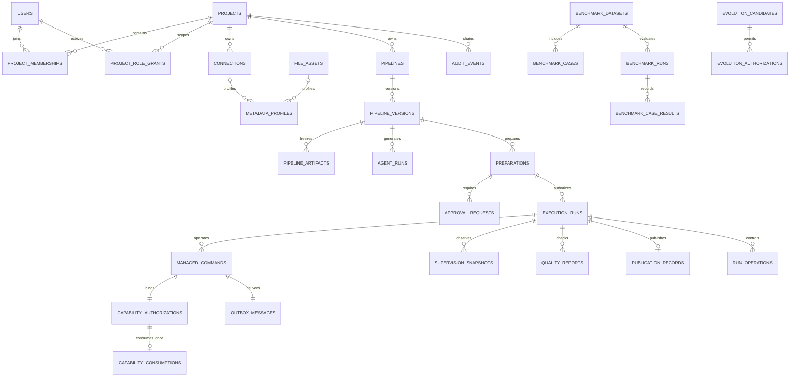
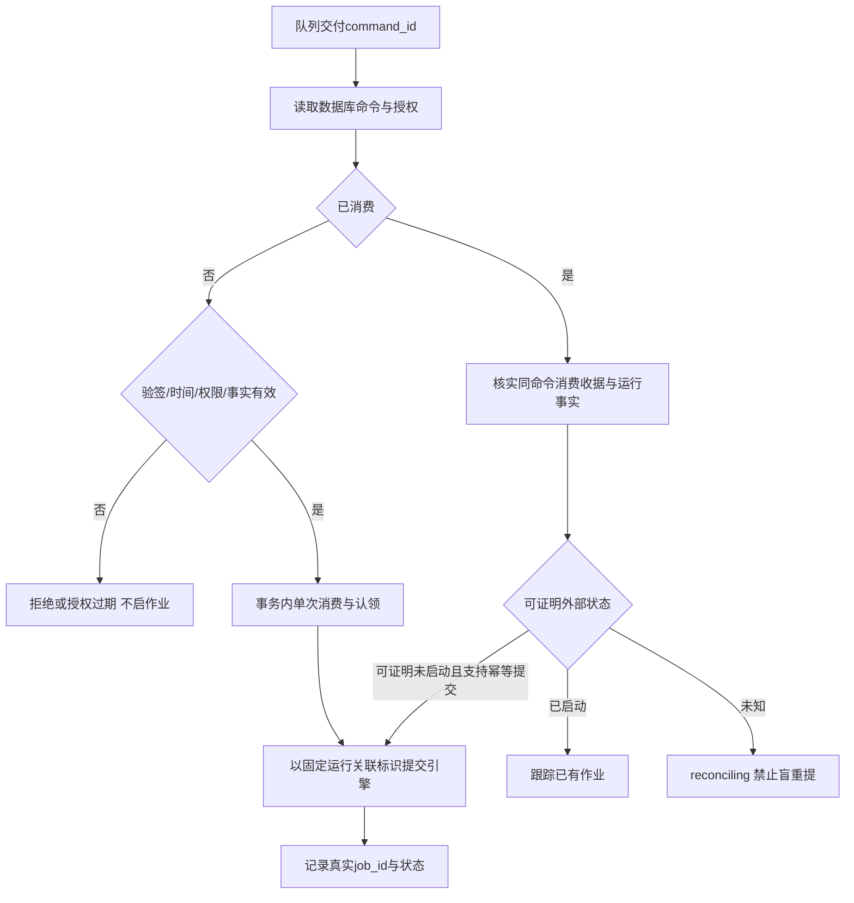

# ETL-Agent 核心数据对象与 API 类型契约

| 属性 | 内容 |
|---|---|
| 文档版本 / 日期 | v0.1 / 2026-10-23 |
| 项目及保存位置 | `D:\python\ETL_Agent\docs` |
| 阶段 | 数据与契约设计；不创建业务代码、数据库迁移或真实接口 |
| 适用范围 | PRD REQ-001—REQ-040、概要设计 C-01—C-12、页面 P-01—P-16及UX-001—UX-040 |

## 1. 基线、用户决定与本轮设计决策

### 1.1 docs 全量输入登记

本轮读取时 `docs` 递归目录只有以下三份文件；全部作为设计输入，不只参考PRD。原文2.8.7/2.8.8仅用于核实三份文档已经引用的表字段及既有接口，不引入其他章节需求。

| 文档 | SHA256 | 使用内容 |
|---|---|---|
| [PRD](ETL-Agent_PRD_v0.1.md) | `55DE54F34449002FD92BC03FE6E45561ACE0B0E8120AACD64D7FFA5307F74B54` | 业务范围、40项需求、权限、异常和验收 |
| [概要设计](ETL-Agent_概要设计总纲_v0.1.md) | `C1DE527C2695BFBCF49347BA1AF796B6A3FE78636DE446EAC75B1F2DE2E25252` | 分层、事实归属、事务、受管命令、12类契约 |
| [低保真页面原型](ETL-Agent_页面原型规划_低保真_v0.1.md) | `0ABB307F85123466C63AEB74973160FAE8729ED591F2BF2F4EEA0D82B8902A28` | 展示数据、表单输入、19类接口缺口、桌面/手机完整操作 |

### 1.2 本轮明确的用户决定

1. **项目是隔离单元，暂不设独立租户。** 不建立tenants表、不增加tenant_id；身份可以全局存在，但资源访问必须按project_id授权。
2. **Capability由Worker消费。** 不采用概要设计DES-005/TD-06中建议的Broker事务消费方案。
3. 用户授权对其他未确认规则依据设计经验作出判断。本稿提供可落Spec的确定方案，并标注为**本轮设计决策**；不将其冒称为原PRD已写明的事实。

既有三份文档不在本次原地改写。本稿第1.2、1.3及第6节作为差异决定记录，后续Spec遇到冲突时优先采用本轮明确决定；正式冻结时同步更新旧文档。

### 1.3 设计决策表

| 决策 | 本轮确定方案 | 需求依据 |
|---|---|---|
| D-01 身份与权限 | 身份主体由可信认证提供方识别；全局用户关联稳定subject_ref；项目内角色多选，数据/安全审批职责单独授予；不新增超级管理员业务 | REQ-001—REQ-003、Q-01 |
| D-02 ID/精度 | 业务ID采用服务端UUID，数据库uuid，JSON规范字符串；大整数计数和精确十进制以字符串传输；引擎ID作为独立不透明字符串 | DES-013、C-01/C-09 |
| D-03 版本生命周期 | pipeline_versions兼容可编辑候选和冻结版本；冻结前未齐字段可null，冻结后全部核心制品必填；修改冻结内容须新版本 | REQ-008—REQ-015、UI G-06/G-08 |
| D-04 权限快照 | 当前身份由认证上下文取得；服务端计算ActionAvailability，供前端提示；每次写操作仍重验 | REQ-001—REQ-003、DES-021 |
| D-05 准备/审批有效性 | 准备单默认30分钟有效；审批不超过准备单有效期。角色撤销、资源/Schema/Secret版本或已批事实变化使提交/消费失效 | REQ-016—REQ-020、Q-07/Q-08；数值为本轮默认策略 |
| D-06 授权与重试 | Commit签发5分钟能力并保存Run/Command/Outbox；Worker在执行前事务内消费。过期不自动续期，重新提交必须重验准备单/审批，创建新运行与新令牌 | REQ-020—REQ-022、本轮用户决定 |
| D-07 审批 | 每次正式ETL执行需数据和安全两槽、独立自然人审批，Maker不得占任一槽。其他操作按工具与冻结授权模板判定，不根据未定义的P等级猜测自动放行 | REQ-003、REQ-017、REQ-018 |
| D-08 风险与结果 | 本轮约定P0为禁止级、P1高风险、P2中风险、P3低风险；P0拒绝，P1须独立双槽，正式ETL无论P级均双槽；安全策略规则与版本可复现 | REQ-017、Q-06；该高低含义为本轮决策 |
| D-09 超时/修复 | 自动修复最多3次，初次生成不计入；Profile默认15分钟有效，探查最多100行脱敏样本；限制为受管策略，不由浏览器或模型改写 | REQ-006、REQ-013；本轮技术默认值 |
| D-10 质量/隐私 | 非空/正数是校验规则，邮箱脱敏是变换规则；转换失败或校验失败才记违规。默认零违规才发布；空输入默认不发布；原始违规值只进入受保护错误存储，不进入普通API | REQ-025—REQ-027、Q-12 |
| D-11 发布/恢复 | Doris保留旧表默认24小时；同一目标发布串行，按发布代次核验；回滚有后续写入/发布时拒绝自动覆盖。独立发布/回滚/取消等副作用有各自工具授权 | REQ-026、REQ-030—REQ-032 |
| D-12 试运行/调度/暂停 | 默认试运行只作静态验证；隔离真实试运行须同等授权。支持一次性/周期调度；每次到期建立新准备单，仍双槽审批，不自动复用能力。暂停仅引擎能力验证通过时启用 | REQ-023、REQ-024、REQ-031 |
| D-13 列表与错误 | 稳定游标分页，默认20/最多100条；固定公共错误结构；不强制返回总数；写操作使用幂等键与明确并发版本 | C-01、UI第5节 |
| D-14 时间与未知 | 时间存UTC带时区，API输出RFC3339 UTC字符串；未知值使用null或明确未知状态，禁止用0/空字符串掩盖 | DES-013、UX-022 |

上述默认策略在新准备单生成前可通过授权配置选择；准备单生成后引用策略版本并冻结实际值，不因默认配置更新改变已审批事实。运维容量、外部连接器和目标部署版本仍需环境验证，不能仅凭本稿宣称已支持。

## 2. 模型层次、通用类型与字段记法

### 2.1 不同层次分别建模

| 层次 | 命名例 | 用途 | 不直接复用的原因 |
|---|---|---|---|
| 业务对象 | PipelineVersion、Preparation | 业务不变量、权限和状态转换 | 不依赖HTTP/ORM；冻结、审批规则不放在页面 |
| 数据库记录 | PipelineVersionRecord | 列、主外键、索引、持久化布局 | 可能有jsonb、内部路径和关联字段，不能直接返回浏览器 |
| API请求DTO | ConnectionCreateRequest | 客户端允许提供的字段 | 不允许客户端设置actor、digest、审批时间等服务端事实 |
| API响应DTO | ExecutionRunResponse | 对授权用户提供的安全投影 | 不含凭据、完整能力令牌、内部Secret路径和数据库行对象 |
| 表单输入 | ConnectionFormInput | 用户输入字符串、临时选择与字段错误 | 空串、数值文本、未提交选项不等于合法API值 |
| 页面展示模型 | RunDetailViewModel | 状态标签、格式化时间、指标及按钮说明 | 中文标签/缩略文案不能反向用于业务判断 |

采用显式映射：表单→feature级请求适配器→API DTO→应用用例→领域对象→仓储记录；响应经服务端assembler→API DTO→前端共享adapter/selector→ViewModel。禁止ORM直接序列化、禁止把表单对象直接传仓储。

### 2.2 基础类型

| 类型名 | 领域 / PostgreSQL / JSON | 规则 |
|---|---|---|
| BusinessId | UUID / uuid / string | 规范小写UUID文本；客户端不解析排序含义；不同对象ID类型分别命名 |
| EngineJobId | 不透明文本 / text / string | 不转JavaScript number，不作为平台run_id |
| Instant | 带时区时间 / timestamptz / string | UTC输出如`2026-10-23T08:30:00.000Z`；不接受无时区本地时间 |
| Count | 非负整数 / bigint / decimal字符串 | API如`"0"`；无小数/负号；null是未知；前端用BigInt或安全十进制工具 |
| SmallInt | 有界整数 / integer / number | 用于尝试数、版本号、顺序号和页大小；必须安全整数 |
| Decimal | 精确十进制 / numeric / string | 不使用IEEE浮点作为契约；保留业务需要的scale，禁止NaN/Infinity |
| DurationMs | 非负整数 / bigint / Count字符串 | 单位固定毫秒；不得有时传秒有时传毫秒 |
| Ratio | 精确十进制 / numeric / string | 拒绝率范围0—1；放大比可大于1；展示百分比只在ViewModel转换 |
| Digest | SHA256 / char(64) / string | 64位小写hex；规范化规则与格式版本一起固定；空字符串非法 |
| SecretRef | 受管引用 / text或独立表FK / 安全公开标识 | 不是密码；浏览器只见不含Vault内部路径的引用别名 |
| SafeText | 脱敏文本 / text / string | 不能包含凭据和未经授权样本；长度按具体字段资源上限限制 |
| VersionedJSON<T> | 类型化对象 / jsonb / object | 必须有schema_version；不以无约束任意字典替代T |

API未定义业务金额字段，因为平台并无付款/计费等需求。ETL源字段中的金额通过Schema的decimal precision/scale保持精度，示例`"123.4500"`按源scale处理；不能全局强制两位、默认币种或把货币值转number。

### 2.3 公共字段组：明确继承，不隐式添加

字段表“必填”表示有效对象必有该字段；`可null`是字段存在但暂未有值；“条件”必须按规则判断。默认“无”表示不能自动填业务值；服务端生成不是允许客户端传入。

| 组/字段 | 类型 | 必填 | 默认值 | 含义与约束 |
|---|---|---|---|---|
| I.id | BusinessId | 是 | 服务端生成 | 独立记录主键；所有引用必须同对象类型 |
| I.created_at | Instant | 是 | 服务端当前时间 | 记录首次创建时间，后续不得改写 |
| M.updated_at | Instant | 是 | 创建时同created_at | 可变记录更新时间；I+M不用于追加事实 |
| M.revision | SmallInt | 是 | 1 | 可变对象并发修订号，每次有效修改+1；不替代pipeline版本号 |
| S.project_id | BusinessId | 是 | 无 | 项目隔离边界；按认证校验授权，客户端传值不证明权限 |
| V.schema_version | SmallInt | 是 | 1 | 载荷格式版本；升级走显式迁移，不代表制品内容版本 |

对象标题声明继承I、M、S、V即包含对应全部字段。值对象只声明V或不声明，不自动得到id、时间戳或project_id。原文已有表保留created_at/updated_at；新增revision是DES-012并发契约的技术支撑，不新增业务功能。

为便于逐项核对原文字段，第3节中明确注明“原文字段”的名称同时给出DB兼容语义；若第9.2节规定了API/领域规范名，以该显式映射为准，不把DB别名复制到所有层。例如Approval的DB required_role在领域和API均叫required_slot。

## 3. 核心业务对象及字段字典

### 3.1 OBJ-01 User；OBJ-02 Project

用途：可信身份关联与项目隔离。User继承I/M；Project继承I/M。依据REQ-001—REQ-003、DES-009、P-01/P-02。

| 对象.字段 | 类型 | 必填 | 默认值 | 含义和约束 |
|---|---|---|---|---|
| User.subject_ref | string | 是 | 无 | 认证提供方+稳定主体组合，唯一；不同登录名不能绕过同一自然人职责约束 |
| User.username | string | 是 | 无 | 登录/展示识别名，非身份授权依据；无注册功能 |
| User.display_name | string | 是 | 无 | 人类可读姓名/称呼，不作为唯一身份 |
| User.email | string可null | 是 | null | 认证来源可提供的联系属性；没有邮箱不伪造；不自动当成账户关联键 |
| User.status | UserStatus | 是 | enabled | enabled/disabled；禁用后阻止新受保护动作 |
| Project.name | string | 是 | 无 | 项目显示名称，去除首尾空白后非空 |
| Project.code | string | 是 | 无 | 项目稳定业务代码；全局唯一、创建后不随意修改 |
| Project.description | string可null | 是 | null | 项目说明，不以空串/占位词代表未知 |

不新增tenant_id。项目管理主体是既有项目授权能力中的管理动作，不新增“超级管理员”业务角色；在配置/初始化中显式授予项目管理权限。

### 3.2 OBJ-03 ProjectMembership；OBJ-04 ProjectRoleGrant

两者继承I/M/S。依据REQ-002、REQ-003、REQ-018；原文两张表保留但不将角色与审批槽混为一谈。

| 对象.字段 | 类型 | 必填 | 默认值 | 含义和约束 |
|---|---|---|---|---|
| Membership.user_id | BusinessId | 是 | 无 | 项目内用户，FK User |
| Membership.role | ProjectRole | 是 | 无 | maker/data_checker/security_checker/operator/auditor；一人可多行多角色 |
| RoleGrant.user_id | BusinessId | 是 | 无 | 获得职责槽资格的项目成员 |
| RoleGrant.role_slot | ApprovalSlot | 是 | 无 | data/security，仅表示可承担该类审批，不是某申请已分配/已同意 |

唯一约束分别为(project_id,user_id,role)和(project_id,user_id,role_slot)。职责槽资格要求存在相应角色。删角色同时收回相关资格，并使依赖当前权限的未执行授权在复核时失效；审批历史仍保留。

### 3.3 OBJ-05 Connection；OBJ-06 SecretReference；OBJ-07 ConnectionTestResult

Connection继承I/M/S；SecretReference继承I/M/S；测试结果为追加记录继承I/S。依据REQ-004—REQ-006、UX-005—UX-007/038。

| 对象.字段 | 类型 | 必填 | 默认值 | 含义和约束 |
|---|---|---|---|---|
| Connection.name | string | 是 | 无 | 项目内可辨连接名，建议(project_id,name)唯一 |
| Connection.connector_type | ConnectorType | 是 | 无 | mysql/postgresql/oracle/doris/clickhouse/s3/minio/rest_api |
| Connection.endpoint | ConnectionEndpoint | 是 | 无 | 经过类型校验的非敏感地址与资源定位；不能含密码/令牌 |
| Connection.secret_ref_id | BusinessId可null | 是 | null | 受管凭据引用；连接器需要身份时必填，同项目 |
| Connection.environment | string | 是 | 无 | 执行环境业务标识；必须来自部署允许环境，不能由任意字符串扩大访问范围 |
| SecretReference.provider | string | 是 | 无 | SecretProvider实现标识，如vault_kv_v2；服务端允许集 |
| SecretReference.public_alias | string | 是 | 无 | 可向授权前端展示的引用名，非Vault路径 |
| SecretReference.provider_locator | string | 是 | 无 | 内部存储定位，仅受管凭据适配器可读，不进入普通API |
| SecretReference.secret_version | string | 是 | 无 | 精确受管版本，冻结审批/指纹时使用，不使用含糊latest |
| Test.connection_id | BusinessId | 是 | 无 | 测试对象；记录当时connection_revision |
| Test.connection_revision | SmallInt | 是 | 无 | 测试使用的连接修订，连接改后旧成功不能证明新连接可用 |
| Test.status | TestStatus | 是 | 无 | running/succeeded/failed |
| Test.finished_at | Instant可null | 是 | null | 结束时间；运行中可null |
| Test.error | SafeError可null | 是 | null | 失败原因，脱敏；失败时必有稳定错误码 |

ConnectionEndpoint为鉴别联合，不是开放JSON：

| 字段 | 类型 | 必填/条件 | 默认值 | 含义/约束 |
|---|---|---|---|---|
| kind | enum database/object_storage/http | 是 | 无 | 与connector_type匹配 |
| host | string | database | 无 | 数据库主机，经过受管网络策略，不含端口和凭据 |
| port | integer | database | 无 | 1—65535；表单可提示连接器惯例但API须明确值 |
| database | string | database | 无 | 库名/服务定位；Oracle定位模式在连接器描述中区分，不能冒充同一物理概念 |
| schema | string可null | database | null | 默认Schema，不适用连接器为null |
| base_url | string | object_storage/http | 无 | 不含认证信息的根地址；校验scheme/重定向后目标 |
| bucket | string | object_storage | 无 | 已批准对象存储桶 |
| prefix | string可null | object_storage | null | 允许前缀边界，null不自动表示全桶权限 |

Oracle专用地址细节和HTTP认证参数由版本化连接器输入Schema描述，须在连接器Spec逐项定义，不引入任意extra_options执行旁路。SecretReference不保存凭据明文；非Vault实现也只能保存加密引用，密钥不得同表暴露。

### 3.4 OBJ-08 FileAsset；OBJ-09 MetadataProfile；OBJ-10 SchemaField

FileAsset继承I/M/S；Profile继承I/S/V；SchemaField为Profile内值对象。依据REQ-006、REQ-007、C-02、P-04。

| 对象.字段 | 类型 | 必填 | 默认值 | 含义和约束 |
|---|---|---|---|---|
| FileAsset.file_name | string | 是 | 无 | 原文件展示名，不作为服务器路径 |
| FileAsset.file_path | string | 是 | 无 | 兼容原文字段，受管内部存储定位；响应不返回物理路径 |
| FileAsset.file_size | Count | 是 | 无 | 原文件字节数，0为确知空文件 |
| FileAsset.file_format | FileFormat | 是 | 无 | csv/xlsx/json/parquet；Excel旧格式是否加入由适配器验证，不假称已支持 |
| FileAsset.parse_status | ParseStatus | 是 | pending | pending/parsing/succeeded/failed |
| FileAsset.schema_json | SchemaField[]可null | 是 | null | 兼容原文字段，解析完成才有；空字段集合不能当解析成功 |
| FileAsset.content_digest | Digest | 是 | 完成上传后计算 | 文件内容指纹；文件替换须新资产，不改旧指纹 |
| Profile.connection_id | BusinessId可null | 是 | null | 数据库/API/对象源关联；与file_asset_id二者恰有一个 |
| Profile.file_asset_id | BusinessId可null | 是 | null | 文件来源关联；同项目 |
| Profile.resource_name | string | 是 | 无 | 表/接口/文件中的受管资源标识，不是自由SQL |
| Profile.fields | SchemaField[] | 是 | 无 | 有序字段定义，同资源field_name唯一 |
| Profile.statistics | ApproximateStatistics | 是 | 无 | 统计值与是否近似标记，允许数值未知 |
| Profile.masked_samples | MaskedSample[] | 是 | [] | 已脱敏样本；最多受管limit，不允许原值绕过 |
| Profile.profile_digest | Digest | 是 | 服务端计算 | Schema及探查事实的规范化指纹 |
| Profile.expires_at | Instant | 是 | created_at+15分钟 | 新准备/执行复核的有效性边界，不能前端自行延长 |
| Field.field_name | string | 是 | 无 | 源/目标字段真实名，保持大小写/方言语义 |
| Field.ordinal | SmallInt | 是 | 无 | 资源内从0开始的字段序号，唯一 |
| Field.native_type | string可null | 是 | null | 原数据库/格式类型文本；文件推断未知或无原生类型时null |
| Field.logical_type | LogicalType | 是 | unknown | string/integer/decimal/boolean/date/timestamp/binary/object/array/unknown；未知项须在冻结前明确 |
| Field.nullable | boolean可null | 是 | null | 业务字段是否允许null；未知不能伪报false，不等于API属性可缺失 |
| Field.is_primary_key | boolean | 是 | false | Schema主键组成，允许复合主键多字段true |
| Field.precision | SmallInt可null | 是 | null | decimal的总有效位数；已知decimal需有效值 |
| Field.scale | SmallInt可null | 是 | null | decimal小数位数，0≤scale≤precision |
| Field.sensitivity | string | 是 | 无 | 数据敏感分级代码，按冻结策略，不由前端猜测 |

ApproximateStatistics字段：`row_count: Count|null`（必有，默认null，近似行数）、`is_approximate: boolean`（必有，无默认，是否估算）；MaskedSample字段：`values: Record<field_name,JSONValue>`（必有，无默认，仅Profile字段、已脱敏，decimal/大整数为文本）、`masked_fields: string[]`（必有，默认[]，明确处理过的字段名）。不在控制库存海量源数据。

### 3.5 OBJ-11 Pipeline；OBJ-12 PipelineVersion；OBJ-13 PipelineArtifact

Pipeline继承I/M/S；Version继承I/M/S；Artifact继承I/S。依据REQ-008、REQ-011、REQ-015、C-03、P-05—P-07。

| 对象.字段 | 类型 | 必填 | 默认值 | 含义和约束 |
|---|---|---|---|---|
| Pipeline.name | string | 是 | 无 | 名称，不等于稳定业务代码 |
| Pipeline.code | string | 是 | 无 | 项目内唯一代码，唯一(project_id,code) |
| Pipeline.description | string可null | 是 | null | 需求背景说明 |
| Pipeline.status | PipelineStatus | 是 | draft | draft/ready；ready表示存在可引用冻结版本，不代表已发布 |
| Version.pipeline_id | BusinessId | 是 | 无 | 所属Pipeline，复合项目归属一致 |
| Version.version_number | SmallInt | 是 | 服务端分配 | ≥1，Pipeline内唯一；数据库约束分配防并发重复 |
| Version.etl_plan_json | EtlPlan可null | 是 | null | 原文字段；候选未生成允许null，冻结必填 |
| Version.hocon_text | string可null | 是 | null | 原文字段；Secret引用版配置，冻结时有效且必填 |
| Version.artifact_digest | Digest可null | 是 | null | 冻结制品包根摘要；候选未冻结可null |
| Version.is_immutable | boolean | 是 | false | true后制品/契约/Profile引用不得改；revision不提供解冻能力 |
| Version.validation_report_id | BusinessId可null | 是 | null | 冻结需引用当前制品对应的通过报告 |
| Artifact.version_id | BusinessId | 是 | 无 | 所属Version |
| Artifact.artifact_type | ArtifactType | 是 | 无 | etl_plan/hocon/dag/quality_contract/supervision_contract |
| Artifact.artifact_digest | Digest | 是 | 计算值 | 单项规范内容摘要，不与根摘要混用 |
| Artifact.content | JSON对象或文本 | 是 | 无 | 对应类型的冻结内容；受类型鉴别，不是任意文件 |

权威副本：Version的etl_plan_json/hocon_text保留原文要求；Artifact是同一冻结事务生成的不可变内容快照。不得让两份副本分别可编辑；根摘要基于按artifact_type排序的(类型,单项摘要,格式版本)清单计算。候选阶段报告必须绑定内容摘要，修改后原报告不再支撑冻结。

### 3.6 OBJ-14 EtlPlan及结构化映射/DAG

EtlPlan继承V，非独立可变表。依据REQ-011、REQ-012、REQ-025、REQ-028、C-03。

| 对象.字段 | 类型 | 必填 | 默认值 | 含义和约束 |
|---|---|---|---|---|
| Plan.source_profile_ids | BusinessId[] | 是 | 无 | ≥1，同项目、受管有效Profile |
| Plan.target_profile_id | BusinessId | 是 | 无 | 已知目标Schema/资源Profile，不是任意地址 |
| Plan.field_mappings | FieldMapping[] | 是 | 无 | 目标字段映射，需覆盖门禁要求字段 |
| Plan.nodes | DagNode[] | 是 | 无 | DAG节点，node_id在本计划唯一 |
| Plan.edges | DagEdge[] | 是 | [] | 节点关系，不能引用不存在节点、不能成环 |
| Plan.quality_contract | QualityContract | 是 | 无 | 字段质量与分流规则 |
| Plan.supervision_contract | RuntimeSupervisionContract | 是 | 无 | 运行预算，不允许模型提升已批预算 |
| FieldMapping.source_fields | string[] | 是 | 无 | Profile已存在字段路径；常量映射可空但expression需明确 |
| FieldMapping.target_field | string | 是 | 无 | 目标Schema已存在字段名 |
| FieldMapping.expression | string | 是 | 无 | 受限转换表达，不是任意代码或shell |
| FieldMapping.target_type | LogicalType | 是 | 无 | 目标逻辑类型，与目标Profile一致 |
| DagNode.node_id | string | 是 | 无 | 当前计划内节点标识，不当全局业务ID |
| DagNode.kind | enum source/transform/sink/error_sink | 是 | 无 | 节点作用，四类均来自既有数据流 |
| DagNode.resource_ref | string可null | 是 | null | source/sink指向受管资源；纯transform可null |
| DagEdge.from_node_id | string | 是 | 无 | 边的起点 |
| DagEdge.to_node_id | string | 是 | 无 | 边的终点，不同于起点 |

### 3.7 OBJ-15 QualityContract；OBJ-16 QualityRule；OBJ-17 RuntimeSupervisionContract

两类契约继承V，嵌入冻结制品。依据REQ-025—REQ-028、C-08、UX-023。

| 对象.字段 | 类型 | 必填 | 默认值 | 含义和约束 |
|---|---|---|---|---|
| Quality.rules | QualityRule[] | 是 | [] | 本轮规则清单；冻结时显式确认空规则是否符合任务意图 |
| Quality.error_resource | ResourceScope | 是 | 无 | 专用受保护错误目标，必须包含在授权范围 |
| Quality.max_rejection_ratio | Ratio | 是 | "0" | 发布允许的最大违规记录比例，0—1 |
| Quality.allow_empty_input | boolean | 是 | false | 确认0条输入是否可发布，不依据缺失指标判空 |
| Rule.rule_id | string | 是 | 无 | 契约内唯一规则标识，用于命中报告 |
| Rule.field_name | string | 是 | 无 | 规则作用字段，必须存在 |
| Rule.kind | enum not_null/positive/mask_email | 是 | 无 | 既有示例规则的正式代码 |
| Rule.stage | enum validate/transform | 是 | 根据kind确定 | 前两者validate，mask_email为transform；不可任意组合 |
| Rule.error_code | string | 是 | 无 | 校验不通过/转换失败的稳定错误码，不能用中文原因当代码 |
| Supervision.max_input_records | Count | 是 | 无 | 最大读取记录数；必须明确，禁止无声无限制 |
| Supervision.max_output_bytes | Count | 是 | 无 | 最大写入字节数；与读取/处理字节区别 |
| Supervision.max_duration_ms | DurationMs | 是 | 无 | 作业开始后的运行时长预算，不是令牌消费时限 |
| Supervision.max_amplification_ratio | Decimal | 是 | 无 | 输出行数/输入行数上限，≥0；输入0且输出>0视作超限 |
| Supervision.max_rejection_ratio | Ratio | 是 | 无 | 运行监督阈值；不同于Quality发布条件，可更宽但不能放宽发布条件 |
| Supervision.on_exceed | enum warn/kill/isolate_alert | 是 | 无 | 逐契约冻结的超限动作；不能前端改成告警来绕过kill |

同一记录违反多个规则只计1条error_records，可有多个违规明细。拒绝率=error_records/input_records；输入0且错误0时指标null并由空输入规则判定；一般过滤行数不计违规。放大比=output_records/input_records，不把过滤或聚合强行套用“输入=输出+错误”。

### 3.8 OBJ-18 Conversation；OBJ-19 ConversationMessage；OBJ-20 AgentRun

Conversation继承I/M/S；Message继承I/S；AgentRun继承I/M/S。依据REQ-009、REQ-010、REQ-013、REQ-014、DES-004、P-06。

| 对象.字段 | 类型 | 必填 | 默认值 | 含义和约束 |
|---|---|---|---|---|
| Conversation.pipeline_id | BusinessId | 是 | 无 | 对话所属Pipeline，消息与运行不混表 |
| Conversation.creator_id | BusinessId | 是 | 当前认证用户 | 原始发起人，不由客户端冒填 |
| Message.conversation_id | BusinessId | 是 | 无 | 对话归属 |
| Message.role | enum user/assistant/tool | 是 | 无 | 内容来源，不等于系统权限角色 |
| Message.content | SafeText | 是 | 无 | 原始对话/工具摘要，禁止凭据和未授权样本 |
| Message.seq_no | SmallInt | 是 | 服务端分配 | 对话内单调序号且唯一 |
| AgentRun.version_id | BusinessId | 是 | 无 | 当前候选Version，必须未冻结 |
| AgentRun.conversation_id | BusinessId | 是 | 无 | 与对话关联 |
| AgentRun.thread_id | string | 是 | 服务端生成 | LangGraph恢复标识，不作为授权凭证 |
| AgentRun.prompt | SafeText | 是 | 无 | 本次需求输入，保留原文字段 |
| AgentRun.provider_binding | ProviderBinding | 是 | 无 | 模型与Prompt/策略版本快照，无API密钥 |
| AgentRun.status | AgentStatus | 是 | queued | queued/running/waiting_input/validating/repairing/succeeded/failed |
| AgentRun.step_count | SmallInt | 是 | 0 | 已确认工作流步数，不等于修复次数 |
| AgentRun.repair_count | SmallInt | 是 | 0 | 已开始自动修复次数，最多3 |
| AgentRun.error_message | SafeText可null | 是 | null | 原文字段兼容；失败解释，不替代结构错误码 |
| AgentRun.checkpoint_ref | string可null | 是 | null | 内部持久化Checkpoint引用，不返回原始序列化数据 |

ProviderBinding字段：`provider`（enum openai_compatible/deepseek/qwen，必填无默认）、`model`（string必填，提供方模型标识）、`prompt_version`（string必填）、`policy_version`（string必填）。后三者用于复现；模型密钥只由受管配置引用，不进入该对象。

### 3.9 OBJ-21 Clarification；OBJ-22 ValidationReport；OBJ-23 ValidationIssue

Clarification和Report继承I/S；Issue为报告内值对象。依据REQ-009、REQ-012、REQ-013、C-04。

| 对象.字段 | 类型 | 必填 | 默认值 | 含义和约束 |
|---|---|---|---|---|
| Clarification.agent_run_id | BusinessId | 是 | 无 | 问题所属生成任务 |
| Clarification.question_key | string | 是 | 无 | 当前任务内稳定问题键，唯一 |
| Clarification.question | SafeText | 是 | 无 | 用户可读提问，不是可执行脚本 |
| Clarification.answer | SafeText可null | 是 | null | 未回答为null，不接受只含空白的回答 |
| Clarification.answered_by | BusinessId可null | 是 | null | 服务端认证回答人，答复后必有 |
| Clarification.answered_at | Instant可null | 是 | null | 已确认答复时间 |
| Report.version_id | BusinessId | 是 | 无 | 受检候选版本 |
| Report.content_digest | Digest | 是 | 无 | 受检内容快照摘要，防止旧报告批准新内容 |
| Report.rule_version | string | 是 | 无 | 确定性校验规则版本 |
| Report.passed | boolean | 是 | 无 | 整体是否通过，不由模型决定 |
| Report.issues | ValidationIssue[] | 是 | [] | 明确错误/警告；有error则passed=false |
| Issue.code | string | 是 | 无 | 稳定机器错误码 |
| Issue.location | string | 是 | 无 | 类型化字段路径/配置位置，不是任意服务器路径 |
| Issue.severity | enum warning/error | 是 | 无 | 当前问题是否阻断 |
| Issue.message | SafeText | 是 | 无 | 可理解说明 |
| Issue.repairable | boolean | 是 | false | 规则判定可自动修复，不等于允许无限修复 |

### 3.10 OBJ-24 ResourceScope；OBJ-25 RollbackPlan

均为冻结值对象，RollbackPlan继承V。依据REQ-016、REQ-019、REQ-020、REQ-026、REQ-032、C-05/C-09。

| 对象.字段 | 类型 | 必填 | 默认值 | 含义和约束 |
|---|---|---|---|---|
| Scope.connection_id | BusinessId可null | 是 | null | 受管连接；与file_asset_id恰有一个非null，不接受任意主机 |
| Scope.file_asset_id | BusinessId可null | 是 | null | 本地文件资产引用；与connection_id恰有一个，同项目 |
| Scope.resource_name | string | 是 | 无 | 准确表/对象前缀等资源定位，按连接器解释 |
| Scope.operations | ToolName[] | 是 | 无 | 允许动作集合，不能通过通配符扩大 |
| Scope.environment | string | 是 | 无 | 与连接/准备单环境一致 |
| RollbackPlan.target | ResourceScope | 是 | 无 | 正式目标身份 |
| RollbackPlan.shadow_resource | string | 是 | 无 | 当前运行影子资源的受管命名模板/引用 |
| RollbackPlan.retained_resource | string可null | 是 | null | 旧版本保留资源；发布前可未形成 |
| RollbackPlan.retention_ms | DurationMs | 是 | "86400000" | 默认24小时保留期 |
| RollbackPlan.expected_generation | Count可null | 是 | null | 准备时已知目标代次，未知需在发布前取得且重新校验 |
| RollbackPlan.steps | SafeText[] | 是 | 无 | 确定可执行恢复步骤说明，不接受任意shell |

### 3.11 OBJ-26 Preparation；OBJ-27 ApprovalRequest

Preparation继承I/S/V；ApprovalRequest继承I/M/S。依据REQ-003、REQ-016—REQ-019、P-08/P-09。

| 对象.字段 | 类型 | 必填 | 默认值 | 含义和约束 |
|---|---|---|---|---|
| Preparation.version_id | BusinessId | 是 | 无 | 必须冻结版本 |
| Preparation.purpose | enum execute_etl/rollback | 是 | execute_etl | 首次执行或人工恢复用途，冻结后不可变 |
| Preparation.execution_run_id | BusinessId可null | 是 | null | rollback时必填，指向待恢复原Run；execute_etl时null |
| Preparation.maker_id | BusinessId | 是 | 当前认证Maker | 申请主体，不能随审批切换 |
| Preparation.input_fingerprint | Digest | 是 | 计算值 | 版本、Profile、连接/Secret版本、环境、预算/质量/回滚/策略事实总指纹 |
| Preparation.input_bindings | FrozenInputBinding[] | 是 | 无 | 保存可重建的冻结输入清单；仅有总哈希不能重建当时连接/Profile/Secret版本 |
| Preparation.resource_scopes | ResourceScope[] | 是 | 无 | 包括读取、写影子/错误、目标管理等完整批准范围 |
| Preparation.impact_summary | SafeText | 是 | 无 | 影响范围说明 |
| Preparation.data_classification | string | 是 | 无 | 受检数据等级，按策略版本 |
| Preparation.environment | string | 是 | 无 | 目标执行环境 |
| Preparation.risk_level | RiskLevel | 是 | PDP计算 | P0/P1/P2/P3，使用D-08约定 |
| Preparation.required_slots | ApprovalSlot[] | 是 | 无 | 正式ETL固定[data,security]，不能客户端删槽 |
| Preparation.quality_contract | QualityContract | 是 | 冻结版本快照 | 本次实际批准条件 |
| Preparation.supervision_contract | RuntimeSupervisionContract | 是 | 冻结版本快照 | 本次实际预算 |
| Preparation.rollback_plan | RollbackPlan | 是 | 无 | 本次恢复计划 |
| Preparation.policy_version | string | 是 | 无 | 风险/审批/监督适用策略版本 |
| Preparation.expires_at | Instant | 是 | created_at+30分钟 | 超过即不能Commit/消费 |
| Approval.preparation_id | BusinessId | 是 | 无 | 审批绑定准确冻结准备单 |
| Approval.version_id | BusinessId | 是 | 从Preparation取得 | 保留原文字段；必须与准备单一致 |
| Approval.required_role | ApprovalSlot | 是 | 无 | 原文字段存槽代码data/security，不存中文角色名 |
| Approval.status | ApprovalStatus | 是 | pending | pending/approved/rejected；过期由准备有效性表达，不伪造原决定 |
| Approval.decision | enum approve/reject可null | 是 | null | 未决定null；与status一致 |
| Approval.approver_id | BusinessId可null | 是 | null | 实际审批人；已决定必填且非Maker |
| Approval.decided_at | Instant可null | 是 | null | 已决定必填，服务器时间 |

本轮不增加审批意见必填；原文未要求意见字段，暂不把它加入请求/表。拒绝后修改产生新版本/准备单，不覆盖历史决定。Preparation状态为派生响应：blocked/pending_approval/approved/rejected/expired/stale/submitted；过期/失效优先阻止动作，原批准记录仍可追溯。

FrozenInputBinding字段表（REQ-016/019/020、C-05要求冻结事实和复核，不增加新业务）：

| 字段 | 类型 | 必填 | 默认值 | 含义和约束 |
|---|---|---|---|---|
| resource_type | enum connection/profile/secret/file | 是 | 无 | 冻结输入种类 |
| resource_id | BusinessId | 是 | 无 | 本项目资源标识 |
| resource_revision | SmallInt可null | 是 | null | 可变连接/凭据引用需填写；不可变Profile/文件用摘要 |
| content_digest | Digest可null | 是 | null | 有内容摘要的资源需填写，用于版本复核 |
| secret_version | string可null | 是 | null | secret种类必填准确版本；其他种类为null |

所有准备引用的源/目标及Secret必须有对应清单项；清单按种类和ID稳定排序参与指纹。Response只输出安全公共标识和版本，不提供内部provider_locator。

### 3.12 OBJ-28 CapabilityClaims；OBJ-29 CapabilityConsumption

Claims继承V，为内部签名载荷；Consumption为不可变数据库事实。依据REQ-020、REQ-021、DES-005、用户明确Worker消费。

| 对象.字段 | 类型 | 必填 | 默认值 | 含义和约束 |
|---|---|---|---|---|
| Claims.capability_id | BusinessId | 是 | 签发时生成 | 单次消费nonce，全局唯一 |
| Claims.command_id | BusinessId | 是 | 无 | 只能授权该受管命令，防止复用于另一Run |
| Claims.subject_id | BusinessId | 是 | 认证提交主体 | 已批准操作执行主体；不是Worker任意代填用户 |
| Claims.project_id | BusinessId | 是 | 无 | 项目边界 |
| Claims.preparation_id | BusinessId | 是 | 无 | 所依据准备事实 |
| Claims.authorization_basis | enum preparation/execution_receipt | 是 | preparation | 首次执行/人工操作用新准备事实；已批准条件式发布/监督动作可引用执行授权收据 |
| Claims.parent_command_id | BusinessId可null | 是 | null | execution_receipt时必填，指向已消费授权且已批准包含该后续动作的命令 |
| Claims.tool | ToolName | 是 | 无 | 单一受管工具，如execute_etl、publish、cancel、rollback |
| Claims.environment | string | 是 | 无 | 批准环境 |
| Claims.resource_scopes | ResourceScope[] | 是 | 无 | 批准资源边界 |
| Claims.artifact_digest | Digest | 是 | 无 | 与冻结版本根摘要一致 |
| Claims.input_fingerprint | Digest | 是 | 无 | 与准备单一致 |
| Claims.issued_at | Instant | 是 | 签发时刻 | 可信服务端时间 |
| Claims.expires_at | Instant | 是 | issued_at+5分钟 | Worker首次消费截止；到期恰等时视为过期 |
| Claims.key_id | string | 是 | 当前签名密钥标识 | 用于验签和轮转，不含私钥 |
| Claims.signature | string | 是 | Ed25519签名 | 签规范载荷，签名字段自身不参与被签内容 |
| Consumption.capability_id | BusinessId | 是 | 无 | PK/FK，单次消费唯一约束 |
| Consumption.command_id | BusinessId | 是 | 无 | 唯一消费命令 |
| Consumption.execution_run_id | BusinessId | 是 | 无 | 对应实际逻辑Run |
| Consumption.token_digest | Digest | 是 | 计算值 | 令牌整体摘要；非令牌明文 |
| Consumption.consumed_at | Instant | 是 | 事务内服务器时间 | 必须早于expires_at，提交后不可修改 |

签名令牌只在受保护内部授权存储中保存或密文引用，不能放普通Outbox正文/Redis消息/前端响应。公开审计只见摘要与事实，不暴露可消费令牌。

### 3.13 OBJ-30 ManagedCommand；OBJ-31 OutboxMessage

Command继承I/M/S/V；Outbox继承I/M。依据REQ-020—REQ-022、C-06/C-07、可靠执行。

| 对象.字段 | 类型 | 必填 | 默认值 | 含义和约束 |
|---|---|---|---|---|
| Command.execution_run_id | BusinessId | 是 | 无 | 归属Run，所有操作有准确运行目标 |
| Command.preparation_id | BusinessId | 是 | 无 | 批准事实 |
| Command.tool | ToolName | 是 | 无 | 工具目录允许代码，不接受任意命令字符串 |
| Command.capability_id | BusinessId | 是 | 无 | 本命令专属能力 |
| Command.authorization_ref | string | 是 | 无 | 内部受保护令牌定位，不出普通API |
| Command.payload_digest | Digest | 是 | 计算值 | 指令事实指纹，不相信队列传入载荷 |
| Command.status | CommandStatus | 是 | pending | pending/claimed/started/completed/failed/expired/reconciling |
| Command.claim_owner | string可null | 是 | null | Worker认领者技术标识，无业务授权含义 |
| Command.lease_until | Instant可null | 是 | null | 认领租约；过期允许对账认领，不允许盲目重建引擎作业 |
| Command.idempotency_key | string | 是 | 无 | 同一主体/项目/动作的请求幂等键，不能跨载荷复用 |
| Outbox.command_id | BusinessId | 是 | 无 | 仅引用持久化命令；一命令一逻辑事件 |
| Outbox.event_type | string | 是 | command_ready | 内部派发事件代码 |
| Outbox.delivery_status | enum pending/sent | 是 | pending | sent仅表示已投递，不表示已消费/已执行 |
| Outbox.delivery_attempts | SmallInt | 是 | 0 | 投递尝试数，≥0 |
| Outbox.next_attempt_at | Instant | 是 | created_at | 下次可靠投递时间，不续签能力 |

队列只传command_id及格式版本等最小引用。数据库可标sent后重投；Worker必须重新取命令并处理重复消息。Run、Command、授权材料和Outbox在Commit事务一起创建；此时没有Consumption记录。

### 3.14 OBJ-32 ExecutionRun；OBJ-33 RuntimeMetrics

Run继承I/M/S；Metrics为类型化快照值。依据REQ-021、REQ-022、REQ-028—REQ-033、P-10/P-11。

| 对象.字段 | 类型 | 必填 | 默认值 | 含义和约束 |
|---|---|---|---|---|
| Run.version_id | BusinessId | 是 | 无 | 冻结版本 |
| Run.preparation_id | BusinessId | 是 | 无 | 首次执行准备单 |
| Run.capability_token_digest | Digest | 是 | 签发令牌摘要 | 原文字段；存在摘要不代表已经消费 |
| Run.status | ExecutionStatus | 是 | queued | queued/authorizing/running/cancel_requested/paused/succeeded/failed/cancelled/authorization_expired/reconciling |
| Run.engine_job_id | EngineJobId可null | 是 | null | 引擎受理标识；提交结果未知时不得臆造已启动/未启动 |
| Run.input_records | Count可null | 是 | null | 实际已知累计读取行数；不是预估Profile行数 |
| Run.output_records | Count可null | 是 | null | 合格输出记录数；不等于正式表已发布行数 |
| Run.error_records | Count可null | 是 | null | 去重后的违规记录数 |
| Run.bytes_processed | Count可null | 是 | null | 原文字段，本轮定义为源端已读取/处理字节；不拿它充当写入预算 |
| Run.started_at | Instant可null | 是 | null | 引擎确认开始时间；排队期不填写假开始 |
| Run.finished_at | Instant可null | 是 | null | 引擎/授权过期等终态确认时间 |
| Run.original_run_id | BusinessId可null | 是 | null | 安全重跑时引用原运行；普通首次执行null |
| Run.metrics | RuntimeMetrics | 是 | 全部未知 | 汇总投影；已列原文字段与Metrics相应值必须一致 |
| Metrics.filtered_records | Count可null | 是 | null | 正常过滤记录数，不混入错误数 |
| Metrics.output_bytes | Count可null | 是 | null | 实际输出字节，供max_output_bytes监督 |
| Metrics.duration_ms | DurationMs可null | 是 | null | 已知运行时长；不包含排队期 |
| Metrics.throughput_records_per_second | Decimal可null | 是 | null | 明确按输出行数/执行秒数计算，零时长为null |
| Metrics.amplification_ratio | Decimal可null | 是 | null | 输出/输入行数；零分母按质量规范处理 |
| Metrics.rejection_ratio | Ratio可null | 是 | null | 错误/输入行数，0分母为null |
| Metrics.observed_at | Instant可null | 是 | null | 最近一次有效采集时间，未采集null |

Run.status=succeeded仅指数据搬运作业成功；publication和rollback从独立对象响应取得。Run不因发布失败把真实引擎成功改成失败；页面分别展示。

### 3.15 OBJ-34 RuntimeSupervisionSnapshot；OBJ-35 QualityReport；OBJ-36 QualityViolation

三个对象继承I/S，分别为监督事实、质量事实和受保护错误定位。依据REQ-025—REQ-029、C-08、P-11/P-12。

| 对象.字段 | 类型 | 必填 | 默认值 | 含义和约束 |
|---|---|---|---|---|
| Snapshot.execution_run_id | BusinessId | 是 | 无 | 所监督运行 |
| Snapshot.metrics_json | RuntimeMetrics | 是 | 无 | 原文字段，类型化为已知指标快照 |
| Snapshot.decision | enum within_budget/exceeded/unknown | 是 | 无 | 确定性预算结论 |
| Snapshot.action_taken | enum none/warn/kill_requested/isolate_alert | 是 | none | 已采取动作意图，不宣称kill已完成 |
| Snapshot.exceeded_metrics | string[] | 是 | [] | 超过哪些预算项，引用契约字段名 |
| QualityReport.execution_run_id | BusinessId | 是 | 无 | 报告所属运行 |
| QualityReport.artifact_digest | Digest | 是 | 无 | 被核验的冻结制品 |
| QualityReport.result | enum passed/failed/unknown | 是 | unknown | 不能由没有错误明细推断通过 |
| QualityReport.valid_records | Count可null | 是 | null | 已核实有效记录数 |
| QualityReport.error_records | Count可null | 是 | null | 已核实违规记录数 |
| QualityReport.rule_results | RuleResult[] | 是 | [] | 每条规则的检查与违规计数 |
| QualityReport.error_code_distribution | ErrorCodeCount[] | 是 | [] | 按错误码统计，可因一条记录多错而合计大于违规记录数 |
| QualityReport.publish_eligible | boolean | 是 | false | 质量满足资格；不代表已具备发布权限或已发布 |
| Violation.execution_run_id | BusinessId | 是 | 无 | 所属运行 |
| Violation.rule_id | string | 是 | 无 | 命中契约规则 |
| Violation.error_code | string | 是 | 无 | 稳定错误标签 |
| Violation.field_name | string | 是 | 无 | 违规字段 |
| Violation.reason | SafeText | 是 | 无 | 脱敏原因 |
| Violation.protected_record_ref | string | 是 | 无 | 错误存储受管记录引用，不是原值/公开URL |

RuleResult字段：`rule_id:string`、`checked_records:Count|null`、`violating_records:Count|null`均必有，计数默认null；ErrorCodeCount字段：`error_code:string`、`record_count:Count`必有且无默认。普通API只输出违规原因和经允许的脱敏字段投影，不输出protected_record_ref的内部定位，不新增原始错误值下载能力。

### 3.16 OBJ-37 PublicationRecord；OBJ-38 RunOperation

两者继承I/M/S。前者单独证明发布，后者记录取消、暂停、恢复、回滚、清理等动作。依据REQ-026、REQ-030—REQ-033、C-09、UX-024—UX-027。

| 对象.字段 | 类型 | 必填 | 默认值 | 含义和约束 |
|---|---|---|---|---|
| Publication.execution_run_id | BusinessId | 是 | 无 | 本次发布来源运行 |
| Publication.command_id | BusinessId可null | 是 | null | 尚未发起可null，发布中必须有独立受管命令 |
| Publication.target | ResourceScope | 是 | 无 | 正式目标唯一定位 |
| Publication.target_key | Digest | 是 | 规范目标计算 | 项目+环境+连接+规范资源名的目标锁/代次键 |
| Publication.expected_generation | Count | 是 | 无 | 发布前核实目标代次 |
| Publication.published_generation | Count可null | 是 | null | 成功后的新代次，必须大于expected |
| Publication.status | PublicationStatus | 是 | not_published | not_published/publishing/published/failed/reconciling |
| Publication.retained_resource | string可null | 是 | null | 成功发布后保留的旧数据定位，受保护 |
| Publication.retained_until | Instant可null | 是 | null | 旧版本留存截止；过期不可宣称可回滚 |
| Operation.execution_run_id | BusinessId | 是 | 无 | 被操作Run |
| Operation.kind | enum cancel/pause/resume/rollback/cleanup | 是 | 无 | 动作语义分开，resume不是新ETL重跑 |
| Operation.command_id | BusinessId | 是 | 无 | 授权与执行命令 |
| Operation.requested_by | BusinessId | 是 | 当前认证主体或受管监督主体 | 可追溯操作发起方；监督主体有明确工具范围 |
| Operation.status | OperationStatus | 是 | requested | requested/running/succeeded/failed/reconciling |
| Operation.publication_id | BusinessId可null | 是 | null | 发布后回滚必须绑定具体发布事实；取消可null |
| Operation.error | SafeError可null | 是 | null | 失败/不确定原因，不含原始凭据 |

回滚状态从kind=rollback的操作取得，不能在Run.status中塞rollback_success。清理没有批量任意路径字段；资源从冻结计划和已核实运行事实推导。

### 3.17 OBJ-39 DiagnosticReport；OBJ-40 DiagnosticFinding；OBJ-41 EvidenceReference

Report继承I/S；Finding/Reference为内嵌值对象。依据REQ-033、REQ-034、UX-028。

| 对象.字段 | 类型 | 必填 | 默认值 | 含义和约束 |
|---|---|---|---|---|
| DiagnosticReport.execution_run_id | BusinessId | 是 | 无 | 诊断运行 |
| DiagnosticReport.findings | DiagnosticFinding[] | 是 | [] | 原因列表，不把建议写成事实 |
| DiagnosticReport.suggestions | SafeText[] | 是 | [] | 可供工程师处理的建议，不是自动执行命令 |
| Finding.certainty | enum confirmed/hypothesis/insufficient | 是 | 无 | 已证实、候选、证据不足 |
| Finding.explanation | SafeText | 是 | 无 | 可理解原因 |
| Finding.evidence | EvidenceReference[] | 是 | [] | confirmed须有可定位证据 |
| Evidence.source_type | enum log/profile/validation/supervision/audit | 是 | 无 | 现有证据类别 |
| Evidence.resource_id | string | 是 | 无 | 相关记录/片段的受管引用，不能任意URL |
| Evidence.summary | SafeText | 是 | 无 | 授权可见摘要 |

### 3.18 OBJ-42 AuditEvent；OBJ-43 LedgerCheckpoint

Audit继承I/S；Checkpoint继承I/S。依据REQ-034、C-11、P-13。

| 对象.字段 | 类型 | 必填 | 默认值 | 含义和约束 |
|---|---|---|---|---|
| Audit.actor_id | BusinessId可null | 是 | 无 | 人工事件需User；系统事件null并由actor_kind区分，不删除历史主体 |
| Audit.actor_kind | enum user/system | 是 | 无 | 区分具名用户与受管系统动作 |
| Audit.event_type | string | 是 | 无 | 版本化事件目录代码，不用中文标签替代 |
| Audit.resource_type | string | 是 | 无 | Pipeline/Preparation/Run等类型代码 |
| Audit.resource_id | string | 是 | 无 | 所引用对象标识；多态关联由服务端验证，不伪造数据库多表FK |
| Audit.payload_digest | Digest | 是 | 计算值 | 事件业务事实摘要，不含敏感明文 |
| Audit.prev_event_hash | Digest可null | 是 | null仅首条 | 本项目链前序，其他记录不可null |
| Audit.event_hash | Digest | 是 | 计算值 | 事件规范内容与前序的链哈希 |
| Audit.sequence_no | Count | 是 | 事务内分配 | 项目链严格递增，唯一(project_id,sequence_no) |
| Checkpoint.sequence_no | Count | 是 | 无 | 已签名覆盖到的事件序号 |
| Checkpoint.event_hash | Digest | 是 | 无 | 对应末事件哈希 |
| Checkpoint.key_id | string | 是 | 无 | 签名公钥版本 |
| Checkpoint.signature | string | 是 | 无 | 检查点签名 |
| Checkpoint.anchor_ref | string | 是 | 无 | 独立受保护锚定位置引用，不将同库可改副本当成可信外部锚 |

按项目链追加时串行化前序；关键业务变更和事件一起落库。Checkpoint独立保护副本用于检测尾部截断；普通用户不接触签名密钥。日志不是该表的替代品。

### 3.19 OBJ-44 ScheduleDefinition

继承I/M/S。依据REQ-024、UI G-10，本轮根据授权确定最小一次性/周期模型，不新增无限期预授权执行。

| 字段 | 类型 | 必填 | 默认值 | 含义和约束 |
|---|---|---|---|---|
| pipeline_id | BusinessId | 是 | 无 | 所调度Pipeline |
| version_id | BusinessId | 是 | 无 | 精确冻结版本，不以latest暗中切版本 |
| kind | enum once/recurring | 是 | 无 | 一次触发或周期触发 |
| timezone | string | 是 | 无 | IANA时区，显式如Asia/Shanghai；不依赖服务器本地时区 |
| run_at | Instant可null | 是 | null | once时必填，recurring时必须null |
| cron_expression | string可null | 是 | null | recurring时必填，5段标准Cron；once必须null |
| enabled | boolean | 是 | false | 用户完成配置后显式启用 |
| next_trigger_at | Instant可null | 是 | null | 服务端解析得出的下次触发，停用/已完成可null |

调度到期仅生成本次准备/审批意图；未审批不执行。若同Pipeline有未结束的到期意图，本轮默认跳过重叠触发并留审计，不叠加无限待办；错过触发不补跑历史批次。DST不存在的本地时刻跳过，重复时刻只触发一次，触发幂等键以schedule_id+UTC触发点确定。上述是本轮明确设计策略，后续改动须版本化。

### 3.20 OBJ-45 BenchmarkDataset；OBJ-46 BenchmarkCase；OBJ-47 BenchmarkRun

Dataset/Case继承I/S/V，Run继承I/M/S。依据REQ-037、REQ-038、C-12、P-14。

| 对象.字段 | 类型 | 必填 | 默认值 | 含义和约束 |
|---|---|---|---|---|
| Dataset.name | string | 是 | 无 | 用例集名称 |
| Dataset.version | string | 是 | 无 | 不可变业务版本，同项目名称+版本唯一 |
| Dataset.content_digest | Digest | 是 | 计算值 | 数据集清单/预期集合摘要 |
| Case.dataset_id | BusinessId | 是 | 无 | 所属数据集版本 |
| Case.case_key | string | 是 | 无 | 数据集内唯一用例标识 |
| Case.level | enum L0/L1/L2 | 是 | 无 | 静态、故障模拟、真实链路 |
| Case.input | BenchmarkInput | 是 | 无 | 类型化输入：需求、Profile/制品引用或故障场景标识；无真实生产凭据 |
| Case.expected | BenchmarkExpectation | 是 | 无 | 预期生成/Schema/风险拦截/故障行为，按用例类别校验 |
| BenchmarkRun.dataset_id | BusinessId | 是 | 无 | 精确用例集版本 |
| BenchmarkRun.level | enum L0/L1/L2 | 是 | 无 | 当前评测层，不混合冒充全链路 |
| BenchmarkRun.provider_binding | ProviderBinding | 是 | 无 | 被测模型/Prompt/策略版本 |
| BenchmarkRun.status | enum queued/running/succeeded/failed | 是 | queued | 评测执行状态，不等于安全效果合格 |
| BenchmarkRun.started_at | Instant可null | 是 | null | 实际开始时间 |
| BenchmarkRun.finished_at | Instant可null | 是 | null | 结束时间 |

BenchmarkInput最小字段：`prompt:SafeText|null`、`profile_ids:BusinessId[]`、`version_id:BusinessId|null`、`fault_scenario:string|null`，均显式存在，分别默认null/[]/null/null；按Case.level和预期类型要求至少一类有效输入。BenchmarkExpectation：`expected_gate_pass:boolean|null`、`expected_risk_level:RiskLevel|null`、`expected_schema_fields:string[]`、`expected_error_code:string|null`，默认null/null/[]/null；不相关字段保持null/[]，不能所有期望都空。

### 3.21 OBJ-48 BenchmarkCaseResult；OBJ-49 MetricResult

Result继承I/S；Metric为值对象。依据REQ-038、C-12。

| 对象.字段 | 类型 | 必填 | 默认值 | 含义和约束 |
|---|---|---|---|---|
| CaseResult.benchmark_run_id | BusinessId | 是 | 无 | 所属评测 |
| CaseResult.case_id | BusinessId | 是 | 无 | 对应冻结用例 |
| CaseResult.passed | boolean | 是 | 无 | 预期与实际比较结果，不能用请求成功替代 |
| CaseResult.actual | BenchmarkObservation | 是 | 无 | 实际结构化观察与证据，固定类型，不依赖未标识联合 |
| CaseResult.latency_ms | DurationMs | 是 | 无 | 该例测量时长，0为实际0，不能未知填0 |
| Metric.name | enum generation_accuracy/schema_coverage/safety_interception/latency_ms | 是 | 无 | 既有评测指标代码 |
| Metric.numerator | Count可null | 是 | null | 比例分子；延迟指标不适用为null |
| Metric.denominator | Count可null | 是 | null | 比例分母，不适用或无样本为null |
| Metric.value | Decimal可null | 是 | null | 比例/延迟计算值；无有效样本null |
| Metric.risk_level | RiskLevel可null | 是 | null | 安全指标分别报告P0/P1，其余null |

BenchmarkObservation最小字段：`gate_pass:boolean|null`、`error_code:string|null`、`risk_level:RiskLevel|null`、`schema_fields:string[]`、`evidence:EvidenceReference[]`，必有，默认null/null/null/[]/[]。生成准确率按用例预期全部通过的生成例/可判定生成例计算；Schema覆盖为匹配字段/预期字段；拦截率为应拦截且实际拦截/应拦截例；没有样本不报告100%。本轮默认安全候选晋级需P0/P1全部拦截，其他指标不低于基线；样本不足不准自动晋级。

### 3.22 OBJ-50 EvolutionCandidate；OBJ-51 EvolutionAuthorization

Candidate继承I/S，Authorization继承I/M/S。依据REQ-039、C-12、P-15。

| 对象.字段 | 类型 | 必填 | 默认值 | 含义和约束 |
|---|---|---|---|---|
| Candidate.kind | enum prompt/policy | 是 | 无 | 改进对象类别 |
| Candidate.base_version | string | 是 | 无 | 基线版本 |
| Candidate.candidate_version | string | 是 | 无 | 候选版本，不覆盖基线 |
| Candidate.change_summary | SafeText | 是 | 无 | 可审查差异说明 |
| Candidate.benchmark_run_ids | BusinessId[] | 是 | [] | 关联评测证据；授权前须满足层级/阈值 |
| Candidate.review_report | SafeText可null | 是 | null | 审查报告，授权前必有 |
| Authorization.candidate_id | BusinessId | 是 | 无 | 授权的候选 |
| Authorization.mode | enum shadow/canary | 是 | shadow | 影子无正式副作用，小流量需限定实际资源 |
| Authorization.resource_scopes | ResourceScope[] | 是 | 无 | 批准范围，不允许空范围表示全局 |
| Authorization.traffic_ratio | Ratio | 是 | 无 | (0,1]，由安全审批人显式设定；没有后台自动扩大 |
| Authorization.approved_by | BusinessId | 是 | 认证安全审批人 | 当前具备安全管理权限 |
| Authorization.expires_at | Instant | 是 | 无 | 有界授权窗口，不允许永久默认 |
| Authorization.status | enum active/revoked/expired | 是 | active | 撤销/过期不能继续参与分流 |

本轮不定义自动正式发布按钮或晋级任务。影子比较不改变正式工具调用，实际canary动作仍经Harness；稳定分配按运行标识和授权版本计算，跨请求不随机反复切换。

### 3.23 OBJ-52 HealthResult；OBJ-53 ComponentHealth；OBJ-54 ProjectOverview

均为查询投影，不为每次查询建新可变业务表。依据REQ-035、REQ-036、UI G-03/G-19。

| 对象.字段 | 类型 | 必填 | 默认值 | 含义和约束 |
|---|---|---|---|---|
| Health.status | enum ready/degraded/not_ready | 是 | 无 | 组件就绪聚合，不等于所有功能已可执行 |
| Health.checked_at | Instant | 是 | 无 | 实际检查时间 |
| Health.components | ComponentHealth[] | 是 | 无 | 授权可见组件明细；公开健康入口不暴露内部地址 |
| Component.name | string | 是 | 无 | 组件业务代码，例如control_database/queue/engine |
| Component.status | enum ready/not_ready/unknown | 是 | 无 | 未测量不能当ready |
| Component.message | SafeText可null | 是 | null | 脱敏错误解释 |
| Overview.project_id | BusinessId | 是 | 无 | 精确授权项目 |
| Overview.connection_count | Count | 是 | 无 | 项目连接数，不从当前页估算 |
| Overview.pipeline_count | Count | 是 | 无 | 项目Pipeline数 |
| Overview.pending_approval_count | Count | 是 | 无 | 当前用户可见待审批槽数，明确不是准备单数 |
| Overview.period_start | Instant | 是 | 查询默认最近7天起点 | 统计区间起点，含该时刻 |
| Overview.period_end | Instant | 是 | 查询时服务器时刻 | 统计区间终点，不含该时刻；必须大于start |
| Overview.run_success_rate | Ratio可null | 是 | null | 窗口内引擎终态成功/(成功+失败+取消)，授权过期不入分母；无样本null |
| Overview.resource_distribution | ResourceCount[] | 是 | [] | 按connector_type分布，非额外风险预测 |

ResourceCount字段：`connector_type:ConnectorType`、`resource_count:Count`，必填且无默认；统计范围和枚举口径与Connection一致。

### 3.24 OBJ-55 ActionAvailability：前端权限响应

只作响应投影，不是角色表或授权令牌。依据REQ-001—REQ-003、DES-021、UI第12节。

| 字段 | 类型 | 必填 | 默认值 | 含义和约束 |
|---|---|---|---|---|
| action | ActionCode | 是 | 无 | 当前对象上的已定义动作代码 |
| allowed | boolean | 是 | false | 服务端此刻是否允许；客户端不能提交此值授予自己 |
| reason_code | string可null | 是 | null | 阻断原因，allowed=false时必有 |
| reason_message | SafeText可null | 是 | null | 用户可读说明，不泄露无权资源 |

ActionCode固定目录：view/edit_connection/test_connection/profile_connection/upload_file/create_pipeline/generate/answer_clarification/freeze_version/prepare/approve_data/approve_security/commit/cancel/pause/resume/rollback/cleanup/rerun/run_benchmark/authorize_evolution/rotate_secret/manage_project_members。只有本来有需求依据的动作；是否允许由对象状态、角色、策略和环境决定。

## 4. 对象关系与 ER 图

### 4.1 关系语义

- Project是所有业务资源的隔离根；User跨项目存在，Membership/RoleGrant决定项目内权限。
- Connection/FileAsset→Profile→Plan→PipelineVersion，冻结版本引用明确Profile及Secret版本，不能跟随latest漂移。
- 一个Pipeline有多个Version；一个候选Version可经历多次AgentRun/ValidationReport，但冻结后不能继续写候选内容。
- Version有多个Preparation；Preparation有每槽一条ApprovalRequest。Preparation对应多次历史执行尝试，重试产生新Run，不能复用capability。
- 一个Run可以有执行、发布、取消、回滚等多个ManagedCommand；每命令专属Capability，最多一条Consumption。
- Run与Publication/Operation/QualityReport分别表达搬运、发布、运维和质量事实。QueryResponse组合这些对象，不能因此让领域对象互相继承。
- AuditEvent引用其他对象的“类型+标识”，是受验证的多态引用，不假装一个外键能指向任意表。
- Benchmark与生产运行分开；L2通过受管Run关联真实链路，不建立无审批执行器。

图是业务基数，不替代数据库建表顺序。Capability授权和命令互绑在同一事务形成，具体FK采用延后校验或单向FK+唯一约束避免插入环；不为满足图形而创建无法插入的循环非空FK。

## 5. 数据库存储模型、键与必要索引

### 5.1 通用数据库规则

- 所有独立记录的PK为id:uuid；CapabilityAuthorization/Consumption使用capability_id:uuid作为PK。嵌套值对象使用类型化jsonb或明确子表，本轮按下表确定，不默认每对象建表。
- 每张项目资源表持久化project_id；父表提供唯一(project_id,id)，子表采用(project_id,parent_id)复合FK，防跨项目“外键合法但归属错误”。跨项目User只用user_id FK。
- PostgreSQL普通FK不能替代资源权限；API鉴权和Worker授权都要查当前身份/事实。
- 不物理级联删除审批、授权消费、运行、发布和审计历史。本轮无删除业务入口，所有历史关系默认RESTRICT；清理影子表不等于删除控制面证据。
- text业务代码非空，字符串上限用API/资源限制；不擅自为描述建立唯一约束。金额/精确比率numeric，不用double precision；jsonb中的类型由应用Schema校验。
- 锁和唯一约束负责并发事实；分页、统计和筛选按实际查询建索引。不对所有JSON字段笼统建GIN索引。

### 5.2 表与模型映射

“原有”是源文档已列字段；“补齐”是既有功能所需技术记录，不是新业务。表列由第3节字段及明确继承组决定，原文字段名称在第9节兼容映射。

| 表 / 记录模型 | 对应业务对象 | 状态 | 主外键与唯一约束 | 必要索引/用途 |
|---|---|---|---|---|
| users / UserRecord | OBJ-01 | 原有+subject_ref | PK id；UQ(subject_ref)；username不默认全局唯一 | subject_ref登录定位 |
| projects / ProjectRecord | OBJ-02 | 原有 | PK id；UQ(code) | code定位 |
| project_memberships | OBJ-03 | 原有 | FK project/user；UQ(project,user,role) | (user_id,project_id)列授权项目 |
| project_role_grants | OBJ-04 | 原有 | FK project/user；UQ(project,user,slot) | (project_id,role_slot,user_id)资格查询 |
| connections | OBJ-05 | 补齐 | FK project/secret；UQ(project,name) | (project,connector_type,id)列表/筛选 |
| secret_references | OBJ-06 | 补齐 | FK project；UQ(project,public_alias,secret_version) | (project,public_alias)定位轮转历史 |
| connection_tests | OBJ-07 | 补齐 | 复合FK connection | (project,connection_id,created_at,id)最近测试 |
| file_assets | OBJ-08 | 原有+解析/指纹 | FK project | (project,created_at,id)资产列表 |
| metadata_profiles | OBJ-09含OBJ-10 | 补齐 | XOR(connection_id,file_asset_id)；各自同项目FK | (project,source_id,created_at,id)，源类型分别建索引 |
| pipelines | OBJ-11 | 原有 | FK project；UQ(project,code) | (project,created_at,id)列表 |
| pipeline_versions | OBJ-12 | 原有 | FK pipeline；UQ(pipeline_id,version_number) | (project,pipeline_id,version_number)版本历史 |
| pipeline_artifacts | OBJ-13 | 原有 | FK version；UQ(version_id,artifact_type) | UQ索引覆盖取制品 |
| conversations | OBJ-18 | 补齐 | FK pipeline/creator | (project,pipeline_id,created_at,id) |
| conversation_messages | OBJ-19 | 补齐 | FK conversation；UQ(conversation_id,seq_no) | 序号索引回放 |
| agent_runs | OBJ-20 | 原有+上下文 | FK version/conversation；UQ(thread_id) | (project,version_id,created_at,id) |
| clarifications | OBJ-21 | 补齐 | FK agent_run；UQ(agent_run_id,question_key) | UQ恢复定位 |
| validation_reports | OBJ-22含OBJ-23 | 补齐 | FK version | (project,version_id,content_digest,created_at)查对应报告 |
| preparations | OBJ-26含OBJ-24/25 | 补齐 | FK version/maker | (project,created_at,id)，(version_id,expires_at) |
| approval_requests | OBJ-27 | 原有 | FK preparation/version/approver；UQ(preparation_id,required_role) | (project,status,created_at,id)待审批 |
| capability_authorizations | OBJ-28 | 补齐内部安全记录 | PK capability_id；UQ(command_id)；FK preparation/subject；只存加密令牌材料 | (expires_at)过期清理/核验，不删除消费证据 |
| capability_consumptions | OBJ-29 | 补齐 | PK/FK capability_id；UQ(command_id)；FK run | command_id幂等恢复 |
| managed_commands | OBJ-30 | 补齐 | FK run/preparation；UQ(project,subject,tool,idempotency_key)在幂等记录中落实 | (project,status,created_at,id)待处理/对账 |
| outbox_messages | OBJ-31 | 补齐 | FK command；UQ(command_id,event_type) | (next_attempt_at,id)部分索引WHERE delivery_status='pending' |
| execution_runs | OBJ-32 | 原有+重跑引用 | FK version/preparation/original_run | (project,created_at,id)、(project,status,created_at,id) |
| runtime_supervision_snapshots | OBJ-34 | 原有 | FK run | (project,execution_run_id,created_at,id) |
| quality_reports | OBJ-35 | 补齐 | FK run；报告追加、不覆盖 | (project,execution_run_id,created_at,id) |
| quality_violations | OBJ-36 | 补齐轻量定位 | FK run；不存海量原始行 | (project,execution_run_id,error_code,id)受限分页 |
| publication_records | OBJ-37 | 补齐 | UQ(execution_run_id)；FK command/run | (project,target_key,published_generation)唯一非null；目标发布串行 |
| run_operations | OBJ-38 | 补齐 | FK run/command/publication/requested_by | (project,execution_run_id,kind,created_at,id) |
| diagnostic_reports | OBJ-39含40/41 | 补齐 | FK run | (project,execution_run_id,created_at,id) |
| audit_events | OBJ-42 | 原有+链序号 | UQ(project,sequence_no)；FK actor；多态对象应用验证 | (project,resource_type,resource_id,sequence_no) |
| ledger_checkpoints | OBJ-43 | 补齐 | UQ(project,sequence_no)；外部锚另存 | (project,sequence_no)验证范围 |
| schedule_definitions | OBJ-44 | 补齐 | FK pipeline/version；CHECK kind与run_at/cron互斥 | (next_trigger_at,id)部分索引WHERE enabled=true |
| benchmark_datasets | OBJ-45 | 补齐 | UQ(project,name,version) | 版本查询 |
| benchmark_cases | OBJ-46 | 补齐 | FK dataset；UQ(dataset_id,case_key) | (dataset_id,level,case_key) |
| benchmark_runs | OBJ-47 | 补齐 | FK dataset | (project,created_at,id)历史 |
| benchmark_case_results | OBJ-48含49 | 补齐 | FK benchmark_run/case；UQ(benchmark_run_id,case_id) | (benchmark_run_id,passed,case_id) |
| evolution_candidates | OBJ-50 | 补齐 | 同项目版本/评测引用；关联清单受FK校验 | (project,kind,created_at,id) |
| evolution_authorizations | OBJ-51 | 补齐 | FK candidate/approved_by | (project,status,expires_at,id)有效授权查询 |

OBJ-14—OBJ-17、OBJ-24/25及ProviderBinding等作为Version/Preparation内不可变JSON结构保存，不重复创建可独立修改的规则表。OBJ-52—OBJ-55为响应投影，不要求一类一表。

### 5.3 必须事务化/条件校验的不变量

1. 冻结事务：Version制品快照、Artifact列表和根摘要一致；通过报告content_digest必须对应当前候选；提交后不可更新冻结内容。
2. 审批事务：锁定准备单/槽，重新查当前身份、资格与Maker，防止两个并发请求让同一人占双槽。唯一槽约束不能独自证明自然人独立。
3. Commit事务：幂等记录、Run、Command、CapabilityAuthorization、Outbox及关键Audit事件原子落库；不写Consumption。
4. Worker消费事务：读取命令与授权→验签/过期/项目/指纹/当前权限/审批→唯一插入Consumption→将Run从queued条件更新到authorizing并认领命令→追加审计→提交；失败全部回滚。
5. Ledger追加：同项目链锁定前序或等效CAS，不允许两个事件共享相同链序号并各自成功。
6. 发布：平台事务认领目标代次，外部Swap后核实事实并落库；两者不组成分布式事务。失去回执进入reconciling；禁止重复Swap导致换回旧表。

### 5.4 必要内部技术记录

这些记录支撑已要求的幂等/调度/发布，不成为额外产品功能。

| 记录 | 字段、类型、必填与默认 | 约束与依据 |
|---|---|---|
| ApiIdempotencyRecord | project_id:ID、subject_id:ID、action:ActionCode、key:string、request_digest:Digest、resource_id:ID可null、created_at:Instant、expires_at:Instant；全部字段必有，resource_id提交前null，其余无默认/时间由服务端 | UQ(project,subject,action,key)；同key异摘要409；默认保留24小时，不能重复发命令；C-01/C-07 |
| TargetHead | project_id:ID、target_key:Digest、generation:Count、current_publication_id:ID可null、revision:SmallInt；必填，generation初始"0"，publication初始null，revision=1 | PK(project,target_key)；发布/回滚认领依据，外部数据变化仍须核实；REQ-026/032 |
| ScheduleTriggerRecord | schedule_id:ID、trigger_at:Instant、preparation_id:ID可null、result:enum created/skipped、created_at:Instant；必填，preparation_id跳过时null | UQ(schedule_id,trigger_at)防Beat重投重复创建；REQ-024 |

上述表引用的subject/action等是内部记录中的明确列；ManagedCommand不重复增加subject列，幂等唯一约束落在ApiIdempotencyRecord，command.command_id关联其resource_id/运行结果。

## 6. Worker消费、过期与重试的完整语义

### 6.1 与旧概要设计的差异

| 事项 | 本轮方案 |
|---|---|
| 签发 | Commit复核通过后签发5分钟Capability，并与Run/Command/Outbox原子保存 |
| 消费 | Worker首次实际接收并准备执行时，在PostgreSQL短事务内唯一消费 |
| 排队超时 | 当前时间≥expires_at且未消费：command=expired、run=authorization_expired，写证据；不创建引擎作业 |
| 自动续期 | 禁止。不得在原签名载荷里改时间，也不得只凭旧消息自动签新令牌 |
| 再次尝试 | 由操作员重新提交/安全重跑用例，重验准备事实与审批；若准备已过期/变化则新Prepare与审批；始终新Run/Command/Capability |
| 投递重试 | 同一Outbox/command的技术重投，不是新业务执行，不签发新能力 |
| 作业运行超过5分钟 | 不因能力消费窗口结束自动停作业；已消费后按冻结max_duration_ms监督 |

### 6.2 消费后崩溃与外部提交不确定

- Consumption证明这条命令的授权已被唯一消费，重复消息不能再次消费；内部恢复只能继续**同一个**命令的已授权执行，不得改资源、制品或工具。
- Worker租约超时后可以换Worker对账，但租约本身不证明引擎未启动。初始技术租约建议60秒、续约15秒，仅用于认领，不承担业务授权。
- SeaTunnel适配器须验证部署版本能否指定/查询稳定job_id。若支持，以同一Run预先分配固定关联标识提交并验证一致性；若不支持可靠幂等/定位，提交超时后只对账和受控恢复，不以“应该没成功”作为重提依据。
- 不把可重复读取Consumption记录设计成公开“已消费令牌再次使用”接口；恢复入口仅内部命令处理器可用，始终限定相同command_id。
- 发布成功但本地更新失败、取消与Swap竞态，同样先查外部事实。接收确认不能替代结果确认。

### 6.3 长作业后续发布与停止授权

30分钟准备单有效期限制**首次执行消费**；已经启动的长作业不能因此被迫无授权发布，也不能无限复用原令牌。

- Prepare显式冻结允许的后续工具/资源和预算停止条件。首次Worker消费后，受保护消费记录成为该执行的授权收据。
- 若发布/预算停止已经包含在冻结范围，可信Harness可基于该收据为**独立后续命令**签发新的5分钟Capability，authorization_basis=execution_receipt、parent_command_id指向原命令。
- 后续Worker核验父命令已消费、Run仍在允许阶段、策略/资源条件未扩大、发布质量满足、任务未结束/撤销。不能只因旧准备单曾审批过就任意发新工具令牌。
- 人工回滚、扩大范围、修改预算、主动重跑不适用自动收据授权，必须重新走对应Prepare/审批/Commit。
- 自动发布期限不超过冻结运行预算及已批准收尾期限；本轮收尾期限默认30分钟。超期或事实变化需人工新授权，不能保留永久执行收据。

## 7. API 请求与响应数据结构

### 7.1 契约地位和公共响应

方法/路径沿用页面原型A-01—A-18；请求/响应字段是本轮依据用户授权制定的具体契约，不声称后端已经实现。G-01—G-19中的缺失接口只定义需要传递的类型，不编造路径。

| 公共类型.字段 | 类型 | 必填 | 默认值 | 含义/规则 |
|---|---|---|---|---|
| DataEnvelope.data | T | 是 | 无 | 单项响应或已接受任务事实 |
| DataEnvelope.request_id | string | 是 | 服务端生成/验证继承 | 追踪标识，不是业务ID |
| CursorPage.items | T[] | 是 | [] | 当前页完整授权结果 |
| CursorPage.next_cursor | string可null | 是 | null | 下一页游标，没有下一页为null，不使用空串 |
| CursorPage.has_more | boolean | 是 | false | 是否还有结果，与next_cursor一致 |
| CursorPage.request_id | string | 是 | 服务端值 | 当前请求追踪 |
| ErrorEnvelope.error | SafeError | 是 | 无 | 失败结构；不用HTTP200伪装所有失败 |
| ErrorEnvelope.request_id | string | 是 | 服务端值 | 追踪关联 |
| SafeError.code | string | 是 | 无 | 稳定错误码，见第8节 |
| SafeError.message | SafeText | 是 | 无 | 面向用户、可本地化但不用于业务分支 |
| SafeError.field_errors | FieldError[] | 是 | [] | 字段级错误，不含用户敏感输入原值 |
| SafeError.retryable | boolean | 是 | false | 是否可在协议允许情况下重试；不代表写请求自动重发 |
| FieldError.path | string | 是 | 无 | DTO字段路径，如endpoint.port |
| FieldError.code | string | 是 | 无 | 字段错误代码 |
| FieldError.message | SafeText | 是 | 无 | 具体提示 |
| AcceptedResponse.resource_id | BusinessId | 是 | 无 | 已创建的对应Task/Run/Test/Profile任务对象 |
| AcceptedResponse.status | 对应状态枚举 | 是 | 无 | 当前已接受阶段，不是最终成功 |

响应投影约定：所有独立资源Response含id、project_id（User除外）、created_at，允许修改的资源另含revision；按对象定义输出业务字段，但**显式排除**provider_locator、file_path、authorization_ref、Capability原令牌/私钥、checkpoint_ref、protected_record_ref内部路径及普通用户不应见的subject_ref。嵌套对象也按相同规则投影。

### 7.2 已有18个接口的数据结构

字段表中的“R.x”表示该请求模型字段；Path/Header字段不混入JSON正文。响应对象引用第3节字段字典及上面的安全投影规则。所有创建/业务命令通过认证，不接收body.actor_id。

| A编号 / 方法路径 | 请求模型 | 响应模型 / HTTP语义 |
|---|---|---|
| A-01 `GET /health` | 无body；公开层只查总体就绪，授权层按身份展开 | DataEnvelope<HealthResult>；200表示就绪/可读检查结果，503表示关键依赖未就绪；不可用结果仍按Health结构，不泄内部凭据 |
| A-02 `GET /api/v1/projects/{project_id}/connections` | Path.project_id:BusinessId必填；Query.cursor?:string、limit?:integer、connector_type?:ConnectorType、query?:string | CursorPage<ConnectionResponse>；200 |
| A-03 `POST /api/v1/connections` | ConnectionCreateRequest，见下表 | DataEnvelope<ConnectionResponse>；201 |
| A-04 `PUT /api/v1/connections/{id}` | Path.id必填；If-Match修订必填；ConnectionReplaceRequest | DataEnvelope<ConnectionResponse>；200，412表示修订过期 |
| A-05 `POST /api/v1/connections/{id}/tests` | Path.id必填；无JSON body | DataEnvelope<ConnectionTestResponse>；202；最终读取使用G-04后续契约 |
| A-06 `POST /api/v1/connections/{id}/profiles` | Path.id必填；ProfileCreateRequest | DataEnvelope<ProfileTaskAccepted>；202，结果读取归G-04 |
| A-07 `POST /api/v1/file-assets` | multipart FileAssetUploadRequest | DataEnvelope<FileAssetResponse>；201表示上传完成资产已建，不代表解析成功 |
| A-08 `POST /api/v1/pipelines` | PipelineCreateRequest | DataEnvelope<PipelineCreateResponse>；201，明确返回candidate_version_id供后续生成 |
| A-09 `POST /api/v1/versions/{version_id}/generation` | Path.version_id必填；If-Match候选修订必填；GenerationRequest | DataEnvelope<AgentRunResponse>；202 |
| A-10 `POST /api/v1/agent-runs/{run_id}/answers` | Path.run_id必填；ClarificationAnswerRequest | DataEnvelope<AgentRunResponse>；202；不是恢复别人的thread入口 |
| A-11 `GET /api/v1/versions/{version_id}/design` | Path.version_id必填，无body | DataEnvelope<DesignResponse>；200，候选未生成字段null，不等于404 |
| A-12 `POST /api/v1/versions/{version_id}/prepare` | Path.version_id必填；PrepareRequest | DataEnvelope<PreparationResponse>；201；不启动业务数据搬运 |
| A-13 `POST /api/v1/approval-requests/{approval_id}/decisions` | Path.approval_id必填；If-Match审批修订必填；ApprovalDecisionRequest | DataEnvelope<ApprovalResponse>；200；身份从认证取 |
| A-14 `POST /api/v1/preparations/{preparation_id}/commit` | Path.preparation_id必填；CommitRequest；Idempotency-Key必填 | DataEnvelope<CommitAcceptedResponse>；202；不含Capability令牌 |
| A-15 `GET /api/v1/execution-runs/{id}` | Path.id必填，无body | DataEnvelope<ExecutionRunResponse>；200 |
| A-16 `POST /api/v1/execution-runs/{id}/cancel` | Path.id必填；RunActionRequest；Idempotency-Key必填 | DataEnvelope<RunOperationResponse>；202；仅表示取消已请求 |
| A-17 `POST /api/v1/execution-runs/{id}/rollback` | Path.id必填；RollbackRequest；Idempotency-Key必填 | DataEnvelope<RunOperationResponse>；202；不是直接成功Swap |
| A-18 `POST /api/v1/benchmarks/run` | BenchmarkRunRequest | DataEnvelope<BenchmarkRunResponse>；202 |

#### 7.2.1 写入请求字段表

| 模型.字段 | 类型 | 必填 | 默认值 | 含义与约束 |
|---|---|---|---|---|
| ConnectionCreate.project_id | BusinessId | 是 | 无 | 目标项目，必须有登记权限 |
| ConnectionCreate.name | string | 是 | 无 | 复用Connection定义 |
| ConnectionCreate.connector_type | ConnectorType | 是 | 无 | 明确类型，不从URL猜 |
| ConnectionCreate.endpoint | ConnectionEndpoint | 是 | 无 | 已验证非敏感地址 |
| ConnectionCreate.environment | string | 是 | 无 | 部署允许环境 |
| ConnectionCreate.credentials | CredentialInput可null | 否 | null | 创建时需要身份的连接器必有 |
| ConnectionReplace.name | string | 是 | 无 | PUT提交完整可编辑非敏感字段 |
| ConnectionReplace.connector_type | ConnectorType | 是 | 无 | 本轮已建连接类型不允许变更；类型变化新建连接 |
| ConnectionReplace.endpoint | ConnectionEndpoint | 是 | 无 | 完整替换非敏感地址 |
| ConnectionReplace.environment | string | 是 | 无 | 环境改变将使相关准备事实失效 |
| ConnectionReplace.credentials | CredentialInput | 否 | 缺失=保留既有 | 显式null非法，不等于清除凭据；轮转按授权校验 |
| ProfileCreate.resource_names | string[] | 是 | 无 | ≥1个受管表/资源；每资源产生独立Profile |
| ProfileCreate.sample_limit | SmallInt | 否 | 100 | 0—100，不能通过body扩大策略上限 |
| FileAssetUpload.project_id | BusinessId | 是 | 无 | multipart文本UUID |
| FileAssetUpload.file | binary file | 是 | 无 | 文件输入，大小限制默认100MiB，本轮技术限额；解析类型需识别内容 |
| PipelineCreate.project_id | BusinessId | 是 | 无 | 创建范围 |
| PipelineCreate.name | string | 是 | 无 | 非空 |
| PipelineCreate.code | string | 是 | 无 | 项目内唯一 |
| PipelineCreate.description | string可null | 否 | null | 可选说明 |
| Generation.prompt | SafeText | 是 | 无 | 自然语言需求 |
| Generation.source_profile_ids | BusinessId[] | 是 | 无 | ≥1个本项目Profile |
| Generation.target_profile_id | BusinessId | 是 | 无 | 目标Profile |
| Generation.provider | ProviderName | 否 | 项目受管默认 | 仅允许既有已配置Provider，不接收任意模型URL/API密钥 |
| ClarificationAnswer.answers | AnswerItem[] | 是 | 无 | ≥1，question_key唯一，必须对应当前待回答问题 |
| AnswerItem.question_key | string | 是 | 无 | 已有问题键 |
| AnswerItem.answer | SafeText | 是 | 无 | 非空答案 |
| Prepare.environment | string | 是 | 无 | 与目标资源一致 |
| Prepare.purpose | enum execute_etl/rollback | 否 | execute_etl | 区分原有执行准备和同版本下的受管回滚准备 |
| Prepare.execution_run_id | BusinessId可null | 否 | null | purpose=rollback时必填且必须是该版本原Run |
| Prepare.supervision_contract | RuntimeSupervisionContract | 是 | 无 | Maker提出预算，经PDP及权限校验后冻结；不能超过允许上限 |
| ApprovalDecision.decision | enum approve/reject | 是 | 无 | 原文明确的二选一 |
| Commit.expected_input_fingerprint | Digest | 是 | 无 | 用户已审查事实的并发确认，服务端仍重新计算 |
| RunAction.expected_revision | SmallInt | 是 | 无 | 请求基于的运行修订，冲突返回409/412 |
| Rollback.expected_revision | SmallInt | 是 | 无 | 当前运行修订 |
| Rollback.publication_id | BusinessId可null | 是 | null | 发布后恢复必填，发布前清理可null；动作范围从回滚计划推导 |
| Rollback.preparation_id | BusinessId | 是 | 无 | 人工回滚新准备/授权事实，不能任意复用启动令牌 |
| BenchmarkRun.project_id | BusinessId | 是 | 无 | 项目范围 |
| BenchmarkRun.dataset_id | BusinessId | 是 | 无 | 已有不可变用例集版本 |
| BenchmarkRun.level | enum L0/L1/L2 | 是 | 无 | 单层评测 |
| BenchmarkRun.provider_binding | ProviderBinding | 是 | 无 | 受管已配置模型/Prompt/策略版本 |
| BenchmarkRun.preparation_id | BusinessId可null | 是 | null | L2真实副作用时必填；L0/L1无副作用为null |

CredentialInput采用互斥联合：`mode: managed_ref | inline_secret`必填无默认；managed_ref时仅允许`secret_ref_id:BusinessId`必填，inline_secret时仅允许`secret_values:Record<credential_field,string>`必填。secret_values只接受连接器认证Schema中的字段，经TLS接收后立即进入受管存储；不落普通日志/DTO快照，不在响应回传。浏览器表单密码清空不等于服务端删除。

A-16取消和预算紧急停止使用冻结的受管停止授权模板，不强制先等待两个新人工审批才停止失控作业；授权范围仍精确绑定Run/目标。A-17回滚属于数据恢复，需独立新准备单，Prepare通过purpose=rollback及execution_run_id定位原运行。A-17收到已审批回滚准备单后执行等效Commit校验，在同一事务创建Operation/Command/CapabilityAuthorization/Outbox而不新建搬运Run；仍由Worker消费。A-14只接受execute_etl准备单。以上是G-15的用途/字段补齐，不新增HTTP路径。

#### 7.2.2 组合响应的字段表

| 响应.字段 | 类型 | 必填 | 默认值 | 含义和约束 |
|---|---|---|---|---|
| ResourceResponse.available_actions | ActionAvailability[] | 是 | [] | 对当前对象计算的操作；不返回未授权业务信息 |
| PipelineCreateResponse.pipeline | PipelineResponse | 是 | 无 | 创建后事实 |
| PipelineCreateResponse.candidate_version_id | BusinessId | 是 | 服务端创建 | 初始Version id，解决原型G-06的生成前标识缺口 |
| ProfileTaskAccepted.resource_id | BusinessId | 是 | 服务端值 | Profile任务标识，不假装已经形成成功Profile |
| ProfileTaskAccepted.status | enum queued/running/succeeded/failed | 是 | queued | 只读探查任务阶段；对应内部任务引用，不另造业务源 |
| DesignResponse.version | PipelineVersionResponse | 是 | 无 | 版本基本信息与冻结状态 |
| DesignResponse.etl_plan | EtlPlan可null | 是 | null | DTO规范名，DB映射etl_plan_json |
| DesignResponse.hocon_text | string可null | 是 | null | Secret引用版配置 |
| DesignResponse.validation_report | ValidationReportResponse可null | 是 | null | 未校验为null，失败为带明确问题的报告 |
| DesignResponse.available_actions | ActionAvailability[] | 是 | [] | 页面动作 |
| PreparationResponse.preparation | PreparationResponseBody | 是 | 无 | 安全投影的全部冻结事实 |
| PreparationResponse.approvals | ApprovalResponse[] | 是 | 无 | 所需槽，不把不可见槽遗漏而误报全批 |
| PreparationResponse.validity | enum valid/expired/stale/blocked | 是 | 无 | 服务端计算的当前有效性 |
| PreparationResponse.available_actions | ActionAvailability[] | 是 | [] | 当前允许审批/提交等 |
| CommitAcceptedResponse.execution_run_id | BusinessId | 是 | 无 | 新Run，供查询实际状态 |
| CommitAcceptedResponse.status | ExecutionStatus | 是 | queued | 接受时真实状态 |
| ExecutionRunResponse.run | ExecutionRunResponseBody | 是 | 无 | 引擎执行事实、安全投影 |
| ExecutionRunResponse.publication | PublicationResponse可null | 是 | null | 没有发布记录时null，不等于发布成功 |
| ExecutionRunResponse.latest_rollback | RunOperationResponse可null | 是 | null | 仅当前最新回滚操作，原历史另由契约查询 |
| ExecutionRunResponse.quality_report | QualityReportResponse可null | 是 | null | 尚未产生为null |
| ExecutionRunResponse.supervision | SupervisionResponse可null | 是 | null | 最近监督快照 |
| ExecutionRunResponse.available_actions | ActionAvailability[] | 是 | [] | cancel/pause/rollback/rerun等依据真实事实 |

PipelineVersionResponse默认只含id/project_id/pipeline_id/version_number/is_immutable/artifact_digest/created_at/revision，不与DesignResponse重复嵌一份完整计划。`ResponseBody`表示第3节对应对象的白名单投影，不是ORM全字段展开；其中内部字段排除清单以7.1为准。

白名单中的固定别名：FileAssetResponse.fields←schema_json，ApprovalResponse.required_slot←required_role，ExecutionRunResponseBody.execution_status←Run.status，DesignResponse.etl_plan←etl_plan_json。AgentRunResponse保留status字段但类型仅为AgentStatus；PublicationResponse保留status字段但类型仅为PublicationStatus。嵌套对象边界明确，不建立泛化的共享Status类型。

### 7.3 G-01—G-19缺口的数据类型归属

| G缺口 | 本轮类型契约 | 不暗加的接口 |
|---|---|---|
| G-01/G-02 | CurrentIdentityResponse(User安全投影、project_memberships、职责资格、ActionAvailability)；ProjectResponse及MemberGrantRequest(user_id,role/role_slot,expected_revision) | 不猜认证/用户/项目路由；角色管理主体仍是授权配置 |
| G-03 | ProjectOverviewResponse=OBJ-54 | 不让前端从连接列表拼统计 |
| G-04/G-05 | MetadataProfileResponse、FileAssetResponse、ConnectionTestResponse；RotateCredentialRequest(secret_ref_id,credentials,expected_revision) | 不把测试/探查POST当结果读取；轮转不等同任意编辑 |
| G-06/G-08 | PipelineResponse、PipelineVersionResponse；FreezeVersionRequest(version_id,content_digest,validation_report_id,expected_revision)；VersionDiffResponse | 不创建“冻结”猜测路径；需要明确API实施再联调 |
| G-07/G-09 | AgentRunResponse、ClarificationResponse、ValidationReportResponse；TrialRequest(version_id,mode,preparation_id) | mode=static或isolated，后者需授权；不新增直写生产的调试接口 |
| G-10/G-11 | ScheduleDefinitionRequest/Response；PreparationResponse及CursorPage<PreparationSummary> | 调度只是到期生成准备意图，不给永久执行能力 |
| G-12/G-13 | CursorPage<ExecutionRunSummary>、DiagnosticReportResponse、CursorPage<QualityViolationResponse>、CursorPage<LogEntryResponse> | 不用猜ID遍历，不将所有日志塞无限大Run响应 |
| G-14/G-15 | RunActionRequest、RollbackRequest、RerunRequest(original_run_id,preparation_id,expected_revision) | 不使用旧commit或cancel冒充暂停/重跑；发布不新增无授权按钮 |
| G-16 | CursorPage<AuditEventResponse>、LedgerVerificationResponse | 不凭存在哈希宣称已验证 |
| G-17/G-18 | BenchmarkRunResponse、CaseResultResponse、EvolutionCandidateResponse、EvolutionAuthorizationRequest/Response | 不把发起POST当评测列表/报告API |
| G-19 | HealthResult安全投影，按当前身份裁剪 | 不向普通用户暴露内部主机/Vault定位 |

补充值对象字段（全部必有，无默认，标明可null的字段例外）：

| 类型 | 字段定义与业务语义 |
|---|---|
| VersionDiffResponse | base_version_id:ID；target_version_id:ID；changes:DiffItem[]（无变化[]）；变更固定在版本之间 |
| DiffItem | path:string（计划/Schema/HOCON位置）；change_type:added/removed/modified；before:JSONValue可null；after:JSONValue可null；缺值与JSON业务null由change_type和字段存在规则区分 |
| LogEntryResponse | execution_run_id:ID；occurred_at:Instant；level:info/warning/error；message:SafeText；sequence_no:Count；不含原始凭据和受保护原值 |
| LedgerVerificationResponse | project_id:ID；checked_through_sequence:Count；result:valid/invalid/not_verified；checkpoint_id:ID可null；verified_at:Instant可null；未校验不填当前时间冒充 |
| PreparationSummary | id/project_id/version_id:ID；maker_id:ID；created_at/expires_at:Instant；validity及审批派生状态；其余完整事实从详情取 |
| ExecutionRunSummary | id/project_id/version_id:ID；execution_status:ExecutionStatus；publication_status:PublicationStatus；rollback_status:OperationStatus可null；created_at/started_at/finished_at；后两者可null |

在G表里复用业务对象的输入型需剔除服务端字段：例如ScheduleDefinitionRequest只收pipeline_id/version_id/kind/timezone/run_at/cron_expression/enabled，不收next_trigger_at；EvolutionAuthorizationRequest收candidate_id/mode/resource_scopes/traffic_ratio/expires_at，不收approved_by/status；CurrentIdentity里的主体字段由认证生成而不是表单提交。

## 8. 前端可引用的统一类型契约

本节为后续OpenAPI/JSON Schema及生成TypeScript的契约来源。本轮只给文档，不生成前端业务实现；不能让每个页面另写一套DTO并各自猜空值。

### 8.1 枚举目录与未知值

除明确标记开放目录的code外，输入枚举封闭校验，未知值返回422。响应若新版本扩展枚举，旧客户端在统一adapter显示“暂不支持的状态”并禁用危险动作，而不是把未知值映射为成功。

| 类型 | 取值 | 前端和服务端语义 |
|---|---|---|
| UserStatus | enabled、disabled | 禁用身份不能新发起动作 |
| ProjectRole | maker、data_checker、security_checker、operator、auditor | 项目角色，不等于每对象允许操作 |
| ApprovalSlot | data、security | 审批职责槽 |
| RiskLevel | P0、P1、P2、P3 | 本轮D-08约定；DTO不改成数字0—3 |
| ConnectorType | mysql、postgresql、oracle、doris、clickhouse、s3、minio、rest_api | 与文件格式另分类型；CSV不是数据库连接 |
| FileFormat | csv、xlsx、json、parquet | 无依据不增加pdf/docx/xml等格式 |
| ProviderName | openai_compatible、deepseek、qwen | 受管Provider，不由用户任意提供服务地址 |
| LogicalType | string、integer、decimal、boolean、date、timestamp、binary、object、array、unknown | 源native_type另保留；unknown/nullability未知阻止有依赖的冻结映射，不能偷偷推断 |
| ArtifactType | etl_plan、hocon、dag、quality_contract、supervision_contract | 单项摘要与根摘要分别使用 |
| PipelineStatus | draft、ready | 不含执行成功/已发布 |
| AgentStatus | queued、running、waiting_input、validating、repairing、succeeded、failed | 不与ExecutionStatus通用同一类型 |
| ApprovalStatus | pending、approved、rejected | 决定状态；过期/stale属于准备单有效性 |
| ExecutionStatus | queued、authorizing、running、cancel_requested、paused、succeeded、failed、cancelled、authorization_expired、reconciling | 数据搬运/授权运行状态 |
| PublicationStatus | not_published、publishing、published、failed、reconciling | 发布事实，不能由ExecutionStatus推断 |
| OperationStatus | requested、running、succeeded、failed、reconciling | 取消/回滚等独立操作阶段 |
| CommandStatus | pending、claimed、started、completed、failed、expired、reconciling | 内部命令，不直接替代用户运行状态 |
| ParseStatus | pending、parsing、succeeded、failed | 文件资产解析状态 |
| TestStatus | running、succeeded、failed | 连通性测试状态 |
| ToolName | execute_etl、publish、cancel、pause、resume、rollback、cleanup、profile、test_connection、run_l2_benchmark | 固定受管工具目录；接口动作不自动等同签名工具 |

开放code（event_type、error_code、rule_id、sensitivity等）必须来自对应版本目录；未知代码可以按安全文本展示，但不能作为执行任意工具的名称。

### 8.2 日期、计数、空值和响应字段存在性

| 契约问题 | 统一规定 | 禁止做法 |
|---|---|---|
| 业务ID | 所有平台ID字符串；前端按UserId/ProjectId/RunId等不同别名引用 | `Number(id)`、把引擎ID当平台ID |
| 日期时区 | API为带Z的UTC Instant；展示按当前用户时区；调度另存timezone | 浏览器把无时区字符串当本地/把显示字符串提交回服务端 |
| 大整数 | Count使用十进制字符串，展示可分组，排序按数值 | Number转换丢精度、字符串字典排序当计数排序 |
| 金额/小数 | 源decimal按Schema精度传文本；Ratio/Decimal同样文本 | 不论字段都保留2位、百分比再次乘100写回 |
| 必有但未知 | 响应明确包含null；如started_at:null、input_records:null | 省略成undefined或用0/""替代 |
| 未授权字段 | 服务端白名单不输出，不给值再前端遮盖 | 用null伪装安全控制同时泄露嵌套原值 |
| 空集合 | 已确认无成员用[]；无法获取集合属于错误/未知，不返回假[] | 请求失败都转空列表 |
| 可选请求 | 字段缺失与显式null遵守第9节逐类规则 | 统一把所有空输入变null |
| 权限 | available_actions响应只作提示；服务端每次重验 | 根据role字符串拼接“必然有权限” |

RuntimeMetrics完整字段集是：input_records/output_records/error_records/bytes_processed继承Run同名语义，再加第3.14节定义的filtered_records/output_bytes/duration_ms/throughput_records_per_second/amplification_ratio/rejection_ratio/observed_at；全部字段存在，初始值null。Run中保留的原字段是该快照的兼容投影，不再定义另一套独立计数。

### 8.3 公共分页和并发协议

| 位置/字段 | 类型 | 必填 | 默认值 | 规则 |
|---|---|---|---|---|
| Query.cursor | string | 否 | 缺失=首页 | 不透明，绑定过滤/排序/项目；改变条件须清除旧游标；显式null/空串非法 |
| Query.limit | integer | 否 | 20 | 1—100；不接受"abc"或负数 |
| Query.query | string | 否 | 缺失=不过滤 | 首尾空白裁剪；裁剪为空则前端不发送 |
| Query.connector_type | ConnectorType | 否 | 缺失=全部允许类型 | 仅连接列表使用，不到处复用 |
| Header.Idempotency-Key | string | 业务命令必填 | 客户端为同次操作生成 | 同用户/项目/动作/键绑定请求摘要；响应丢失只重用同键同载荷 |
| Header.If-Match | string | 可变资源写入必填 | 无 | 形式为服务器返回的修订ETag；条件失败412；不能用created_at代替 |

列表默认稳定排序created_at降序、id降序；版本历史用version_number降序。游标中的排序/条件指纹验证失败返回400，不静默回首页。后端没有总数契约时不返回total，前端只展示前后页；不把当前items.length当全量总数。

### 8.4 统一错误码

| HTTP / code | 含义 | 前端处理 |
|---|---|---|
| 400 INVALID_CURSOR | 游标与当前查询不一致或非法 | 提示重置查询，保留输入 |
| 401 AUTH_REQUIRED | 身份缺失/失效 | 进入既有认证，禁止自动重复写请求 |
| 403 FORBIDDEN / SELF_APPROVAL_DENIED / DUTY_CONFLICT | 无权限、自批或职责冲突 | 显示原因，不把禁用按钮当校验完成 |
| 404 RESOURCE_NOT_FOUND | 不存在或为防枚举而隐藏无权资源 | 不泄露其他项目对象名称 |
| 409 STATE_CONFLICT / FINGERPRINT_CHANGED / IDEMPOTENCY_MISMATCH | 状态/事实/同key异载荷冲突 | 刷新重新复核；不自动批准新事实 |
| 412 REVISION_MISMATCH | If-Match修订过期 | 说明内容已更新，取最新快照 |
| 422 VALIDATION_FAILED | 格式、范围、枚举或缺字段错误 | 用field_errors定位，保留非敏感输入 |
| 409 CAPABILITY_EXPIRED / CAPABILITY_REPLAYED | 内部能力过期/重复消费 | 普通前端展示对应运行事实；不传令牌让浏览器重试 |
| 409 PUBLICATION_CONFLICT / ROLLBACK_UNAVAILABLE | 目标代次变化或保留资源不可用 | 显示真实状态及诊断，不声称恢复成功 |
| 503 DEPENDENCY_UNAVAILABLE | 必要依赖暂不可用 | 安全查询可按提示重试，业务写操作查幂等结果 |
| 500 INTERNAL_ERROR | 未预期服务端错误 | 给追踪ID，不回堆栈/凭据 |

已创建的异步任务后来失败不是把历史202改为HTTP错误；后续GET仍200返回失败业务状态和SafeError。接口级失败与任务级失败有不同载体。

## 9. 空值、非法值、映射与迁移

### 9.1 请求/响应的空值和非法值规则

1. POST创建：缺必填字段422；允许可选说明缺失按null；不可空字段显式null为422。服务端生成的id/actor/digest/time字段若由请求冒填，拒绝未知或只读字段，不默默接受。
2. PUT连接：按完整可编辑非敏感模型替换；缺必填字段422。credentials缺失表示保留、null表示非法，防止空表单意外清掉Secret。
3. 本轮不增加PATCH路径。将来若引入PATCH，必须单独约定缺失=不改、null是否清除，不复用PUT含义。
4. 响应契约要求存在的nullable字段不省略；禁止自动将undefined字符串、"null"、空串或NaN当业务null。
5. Count/Decimal严格解析，拒绝指数表达式、Infinity、带千分位显示文本；客户端展示文本须经统一适配器还原后提交。
6. 名称/代码按字段规则裁剪空白，HOCON、表达式和文件内容不擅自全局trim/改换行后重算原摘要。规范化在冻结服务中单一实现。
7. 金额、日期等源业务字段只按Profile/Plan转换；不能把源JSON null与字段不存在、错误转换混为同一值。
8. 值超过预算/上限拒绝，不自动截断。数据库长度/精度与API约束一起版本化，避免入库阶段才无提示裁剪。

### 9.2 旧字段与不同模块一致性检查

| 原字段/容易混淆处 | 领域与API统一语义 | DB兼容/转换位置 |
|---|---|---|
| id / execution_run_id / run_id | 单对象PK为id；外部引用为execution_run_id；Agent的run_id仍是AgentRun路径语义 | API path按原文，assembler显式映射，类型别名防串ID |
| etl_plan_json | API/领域叫etl_plan，结构为EtlPlan | 数据库保留etl_plan_json列；repository映射一次 |
| schema_json | FileAsset已解析字段定义，不是任意Schema字符串 | DB保留schema_json列，API固定用fields；repository/assembler统一映射 |
| metrics_json | RuntimeMetrics结构，而非混合任意指标 | DB保留jsonb，API叫metrics；共用解析器 |
| required_role / role_slot / role | required_role存data/security；Membership.role为角色；RoleGrant.role_slot为资格 | DB保留required_role，领域/API统一required_slot；assembler唯一映射 |
| status | Agent/审批/Run/发布/运维各自枚举 | API组合字段分别命名execution_status/publication_status等，不能一个共享Status |
| bytes_processed / output_bytes | 前者读取/处理字节，后者目标输出预算 | 字段都保留；监督只检查output_bytes |
| error_records / error_code计数 | 前者去重违规记录，后者每码记录数可能重复 | quality聚合统一实现，前端不相加冒充总错误 |
| artifact_digest / input_fingerprint | 前者制品包内容；后者含环境/资源/策略的执行事实 | 分别存列，不拿文件hash替代授权指纹 |
| thread_id / engine_job_id | 恢复工作流标识/引擎作业标识 | 都非平台权限/Run主键，前端不混用 |
| source decimal / Ratio | 精确值文本；前端百分比仅展示 | DTO codec集中转换，页面不自己float解析 |
| file_path / provider_locator | 内部存储定位，绝非普通详情字段 | 服务端response assembler剔除，不前端隐藏 |

`schema_json→fields`等别名是本轮DTO契约建议，尚未有上线API时直接选定统一命名；若已有客户端则采用版本化兼容，不能无提示破坏旧响应。

### 9.3 数据迁移与兼容

- 先确认实际数据库现状。本次只发现项目初始化与文档，没有证据证明原文13张表已经建成；不得为了演示迁移而臆造存量数据。
- 若空库：按本稿建表Spec和依赖顺序迁移。若已有库：采用扩列→回填→校验→切读写→收紧约束，原字段不直接改名/删列。
- subject_ref、project_id、制品摘要等关键事实不能凭空回填。无法推导的历史记录进入受限待处理清单，禁止标成已审批/已授权。
- 历史计数0与未知若无法区分，保留迁移证据并将不可信值标未知；不能批量“所有0改null”破坏真实零值。
- 状态迁移按对象上下文映射；未知旧status不自动归succeeded。审批历史缺操作者/时刻不能补一个当前管理员假装真实审批。
- 增加外键/唯一约束前检查重复版本号、重复审批槽、跨项目关联及重复消费；冲突记录必须人工/受控处理，不能随意删除证据。
- JSON schema_version升级使用显式迁移/兼容读取器；冻结制品内容不得因读取升级原地重写。确需生成新格式制品则新版本、新摘要并重走治理流程。
- Timestamp迁移要识别原存储时区；未知时区不可直接附Z。Bigint/Decimal迁移验证字符串往返不丢精度。
- 回滚数据库结构不等于回滚已发布业务数据。迁移备份、恢复窗口、外部Swap及证据保留分别验证。

## 10. 前端表单、API与页面展示模型

### 10.1 集中转换职责

| 层次/位置建议 | 输入→输出 | 允许转换 | 不允许承担 |
|---|---|---|---|
| frontend/api生成类型 | OpenAPI→DTO类型 | 可选/null、枚举、ID、请求/响应结构 | 自造后端枚举或路由 |
| frontend/api/client | HTTP→Data/Error/Cursor响应 | 认证上下文、错误码、请求追踪、条件头、幂等重试协议 | 自动重复所有POST |
| frontend/features/*/mappers | FormInput→Request、Response→VM | trim非敏感名称、数字输入严格校验、DateTime+timezone转UTC、标签/单位格式 | 权威审批/风险/质量结论 |
| frontend/shared/value-codecs | 原始文本↔Count/Decimal/Instant/ID | 全项目单一解析/格式化入口，保持精度 | 每页各自Number或new Date猜时区 |
| 页面组件 | ViewModel→显示/交互 | 当前Tab、字段展开、错误定位 | 操作引擎、签发能力、直传ORM字段 |

目录名称作为现有概要设计frontend分层内的职责细化，不创建业务代码。

### 10.2 代表性表单输入模型

| FormInput.字段 | 类型 | 必填/默认 | 业务含义与转换 |
|---|---|---|---|
| ConnectionForm.name | string | 必填/"" | UI初始空串；mapper trim后非空，否则不发请求 |
| ConnectionForm.connectorType | ConnectorType可null | 必有/null | 未选择不是默认mysql |
| ConnectionForm.host | string | 条件/"" | 数据库连接地址文本，mapper根据鉴别联合组装 |
| ConnectionForm.portText | string | 条件/"" | UI原始输入；集中解析1—65535整数，不能空串转0 |
| ConnectionForm.database | string | 条件/"" | 数据库/服务输入；连接器表单描述决定 |
| ConnectionForm.secretMode | enum keep/managed_ref/replace | 必有/编辑keep、创建managed_ref | keep只在编辑有效，不发送credentials字段 |
| ConnectionForm.secretRefId | BusinessId可null | 必有/null | managed_ref必选同项目引用 |
| ConnectionForm.secretValues | 密码字段字典 | 必有/{} | 仅当前表单内存，提交/离开后清除，不进入全局持久化Store |
| StudioForm.prompt | string | 必有/"" | 用户需求，不用全局trim改写表达式内容 |
| StudioForm.sourceProfileIds | BusinessId[] | 必有/[] | 所选源Profile |
| StudioForm.targetProfileId | BusinessId可null | 必有/null | 未选不提交 |
| ApprovalForm.decision | approve/reject可null | 必有/null | 显式选择，不默认同意 |
| ScheduleForm.kind | once/recurring可null | 必有/null | 用户选择触发类型 |
| ScheduleForm.localDateTimeText | string | 条件/"" | once输入；结合明确timezone转UTC，不当Instant直接提交 |
| ScheduleForm.timezone | string | 必填/用户显式确认 | IANA时区，不能默默用服务器时区 |
| ScheduleForm.cronText | string | 条件/"" | recurring输入，mapper校验5段格式，服务端复验 |

ConnectionForm其他endpoint分支与API ConnectionEndpoint字段逐项映射，字段语义复用第3.3节，不由各页面重新猜。移动端和桌面使用同一FormInput/mapper，仅布局不同。

### 10.3 页面展示模型

| VM.字段 | 类型 | 默认/是否可null | 来源与转换 |
|---|---|---|---|
| RunDetailVM.id | RunId | 必有 | run.id，不从engine_job_id取 |
| RunDetailVM.executionLabel | string | 必有 | ExecutionStatus统一词典映射 |
| RunDetailVM.publicationLabel | string | 必有 | publication为null→“尚无发布记录”，不能默认为“已发布” |
| RunDetailVM.rollbackLabel | string | 必有 | latest_rollback为null→“未请求回滚” |
| RunDetailVM.inputRecordsText | string | 必有 | null→“未知”；"0"→“0”；大数不经Number |
| RunDetailVM.outputBytesText | string | 必有 | codec格式化字节，保留原Count用于精确详情 |
| RunDetailVM.startedAtText | string | 必有 | null→“尚未开始/待确认”，非null按用户时区展示 |
| RunDetailVM.actions | ActionAvailabilityVM[] | [] | 服务端allowed及reason映射，不从中文状态反推 |
| RunDetailVM.isRefreshing | boolean | false | 纯UI状态，不持久为业务事实 |
| RunDetailVM.lastFetchError | SafeError可null | null | 查询错误，不覆盖run的执行失败原因 |
| ActionAvailabilityVM.action | ActionCode | 必有 | API动作标识原样保持 |
| ActionAvailabilityVM.label | string | 必有 | 统一中文动作字典 |
| ActionAvailabilityVM.enabled | boolean | false | 服务端allowed与本地提交中状态组合；不能本地把false改true |
| ActionAvailabilityVM.disabledReason | string可null | null | 后端reason_message或统一错误翻译 |

响应VO中的状态文字不回传为API枚举。VM可增加展开项/步骤等纯展示状态，但不能加入“用户已确认全部事实所以免服务器校验”之类权限字段。

## 11. Spec 编写依据、默认策略与校验清单

### 11.1 本轮数值默认与可配置边界

| 策略 | 默认值 | 控制与冻结 |
|---|---|---|
| Capability首次消费窗口 | 5分钟 | 原文固定约束，不能普通配置随意延长 |
| Profile有效期/采样上限 | 15分钟/100行 | 本轮技术默认；PDP可收紧，冻结指纹绑定实际值 |
| 准备单/审批有效期 | 30分钟 | 首次执行/人工工具授权校验；长作业后续用6.3的有界收据协议 |
| 自动修复 | 最多3次 | 初次生成不计；不是step_count |
| 文件上传 | 100MiB | 本轮资源限额；可按环境收紧，不因此声称大文件性能已验收 |
| Cursor分页 | 默认20、上限100 | 由统一客户端/服务端契约实现 |
| 默认执行预算 | 读取1,000,000行、输出1GiB、运行1小时、放大比10、拒绝率0.05、超限kill | 仅Maker表单建议；提交必须明确实际值，经策略验证并冻结，不能静默无上限 |
| 质量发布 | 拒绝率0；空输入不发布 | 与监督阈值0.05不矛盾：监督决定何时停，质量决定能否发布 |
| 旧数据保留 | 24小时 | 发布记录retained_until是事实，不只看默认值推断能回滚 |
| 幂等记录留存 | 至少24小时 | 即使接口重试记录过期，业务Command/Consumption证据仍保留，不能因此允许重放 |
| 运行收尾授权期 | 冻结max_duration_ms+30分钟收尾 | 限定发布/监督后续工具，不给永久能力 |

这些值是用户授权下的明确设计，不是伪称此前已经讨论的数字。上线容量/SLA、连接器版本与真实环境验证需另列技术验收，不用默认值代替验证。

### 11.2 对所有docs的差异与闭环

| 文档中的未决/冲突 | 本轮处理 | 后续Spec依据 |
|---|---|---|
| PRD多租户未定义、概要TD-03、原型G-02 | 用户确认项目隔离，无Tenant模型 | 第1.2/3.1/5节 |
| 概要DES-005/TD-06偏向Broker消费 | 用户明确改Worker消费；保留Commit事实原子性，消费另在Worker事务 | 第3.12/3.13/6节 |
| PRD Q-06风险方向和槽规则未定 | D-07/D-08明确P0禁止、正式ETL双槽 | 第1.3/3.11/8.1节 |
| 原型G-06生成前version_id缺口 | Pipeline创建响应提供初始candidate_version_id | 第7.2节 |
| 原型G-08冻结与Diff缺口 | 定义FreezeVersionRequest和VersionDiffResponse，但不猜路径 | 第7.3节 |
| 原型G-10调度未定义 | 一次/周期均生成新准备意图，不永久预授权 | 第3.19节 |
| 原型G-13指标/原值/诊断响应不完整 | 完整Metrics、白名单错误信息、独立诊断对象 | 第3.14—3.17节 |
| 原型G-14暂停/重跑能力待定 | 类型明确；暂停仍需实际引擎能力证明；重跑新Run/新授权 | 第3.16/6节 |
| 原型G-15发布回滚清理未定 | 独立Publication/Operation、目标代次、受管恢复；补Prepare用途契约而非新猜路由 | 第3.16/5.4/7.2节 |
| 原型G-16证据校验未定义 | 明确检查点覆盖、有效/无效/未校验 | 第3.18/7.3节 |
| PRD Q-17和原型G-17/G-18 | 版本化期望/实际、分子分母、影子/小流量有限授权，无自动全量上线 | 第3.20—3.22节 |
| 桌面和手机都完整操作 | 共用请求/响应及集中mapper，不产生手机弱化权限协议 | 第10节 |

### 11.3 需求追溯

| 需求 | 核心对象/契约 |
|---|---|
| REQ-001—REQ-003 | OBJ-01—04、OBJ-55、CurrentIdentityResponse |
| REQ-004—REQ-007 | OBJ-05—10、Connection/Upload/Profile请求响应 |
| REQ-008—REQ-015 | OBJ-11—23、Generation/Design/VersionDiff/Freeze契约 |
| REQ-016—REQ-019 | OBJ-24—27、Prepare/Approval/Commit请求 |
| REQ-020—REQ-022 | OBJ-28—33、Outbox与Worker消费协议 |
| REQ-023—REQ-024 | TrialRequest、OBJ-44、独立受管准备事实 |
| REQ-025—REQ-027 | OBJ-15/16、OBJ-35—37、质量与发布响应 |
| REQ-028—REQ-033 | OBJ-17、OBJ-32—41、RunAction/Rollback/Rerun请求 |
| REQ-034 | OBJ-42/43、LedgerVerificationResponse |
| REQ-035—REQ-036 | OBJ-52—54、概览/健康查询投影 |
| REQ-037—REQ-039 | OBJ-45—51、Benchmark/进化授权契约 |
| REQ-040 | 全文作为Spec数据基线，运行交付仍需后续实现与验收 |

### 11.4 一致性和可验收性检查

1. 字段唯一语义：角色/职责槽、Agent/Run/发布状态、制品摘要/输入指纹、读取/输出字节已分开定义；所有跨模块别名有集中映射位置。
2. 分层不混用：业务、DB、Request、Response、FormInput、ViewModel各有职责；内部敏感字段有排除清单。
3. 项目完整性：所有父子资源同项目，复合FK/权限检查两层；没有多余Tenant字段。
4. 并发与幂等：审批槽唯一、消费nonce唯一、Run/Outbox原子创建、Worker消费独立事务，外部不确定结果走对账。
5. 数值与空值：大整数/decimal/时区/零分母/空集合明确；未知不伪装0、失败不伪装空集合。
6. 前端契约：18个既有路径均有请求/响应结构；19类原型缺口定义类型归属，但不冒称已实现或创建新HTTP路径。
7. 安全结果：能力令牌不进入浏览器，错误原值不进入普通API，资源范围不能任意通配；仍需真实身份源和部署网络验证。
8. 数据面限制：不承诺未知版本SeaTunnel的保存点/幂等提交能力，不把Doris原子替换泛化到所有目标端。
9. 可测试：后续Spec至少提供字段缺失/null/非法枚举、跨项目FK、重复审批、并发消费、5分钟排队过期、消费后崩溃、发布回执丢失、精度往返和前端未知状态测试。
10. 本稿不创建DDL/DTO业务代码；55个编号覆盖独立实体和必要值对象，并明确哪些不需单独建表。实际数据库为空或已有迁移状态须在实施前核实。

