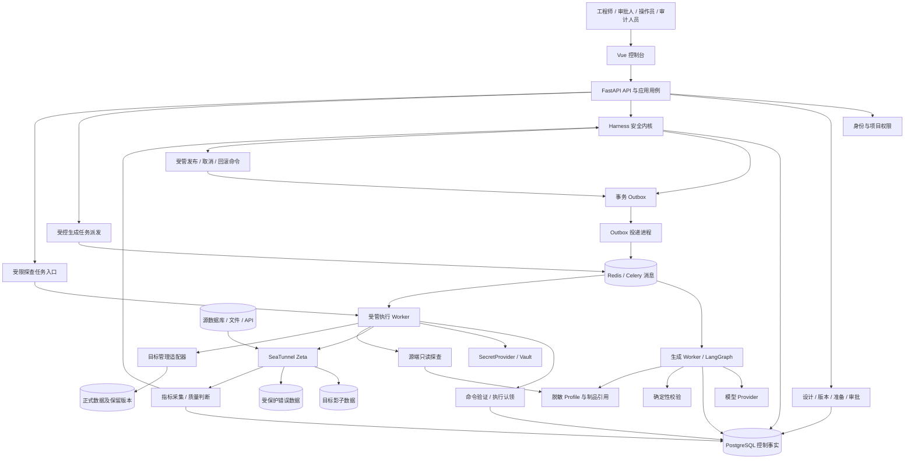
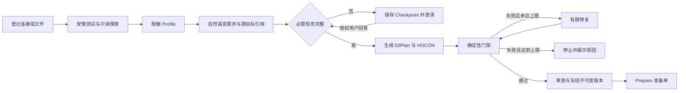
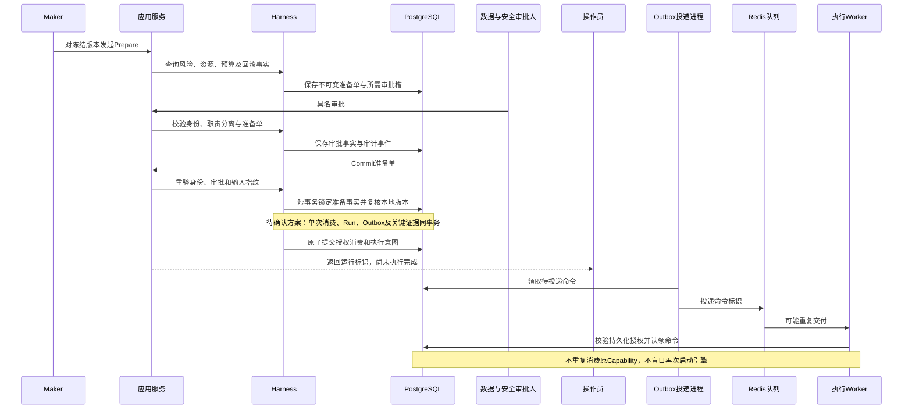
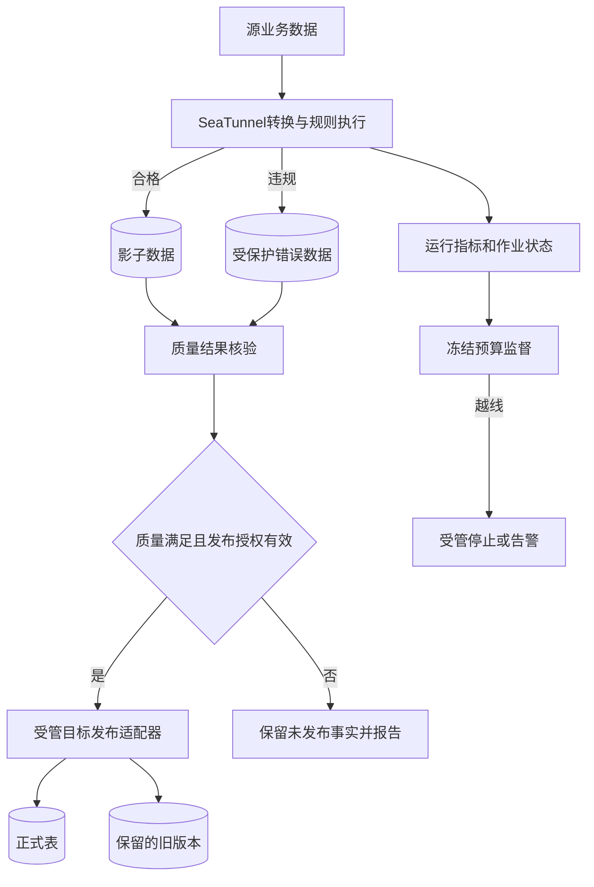
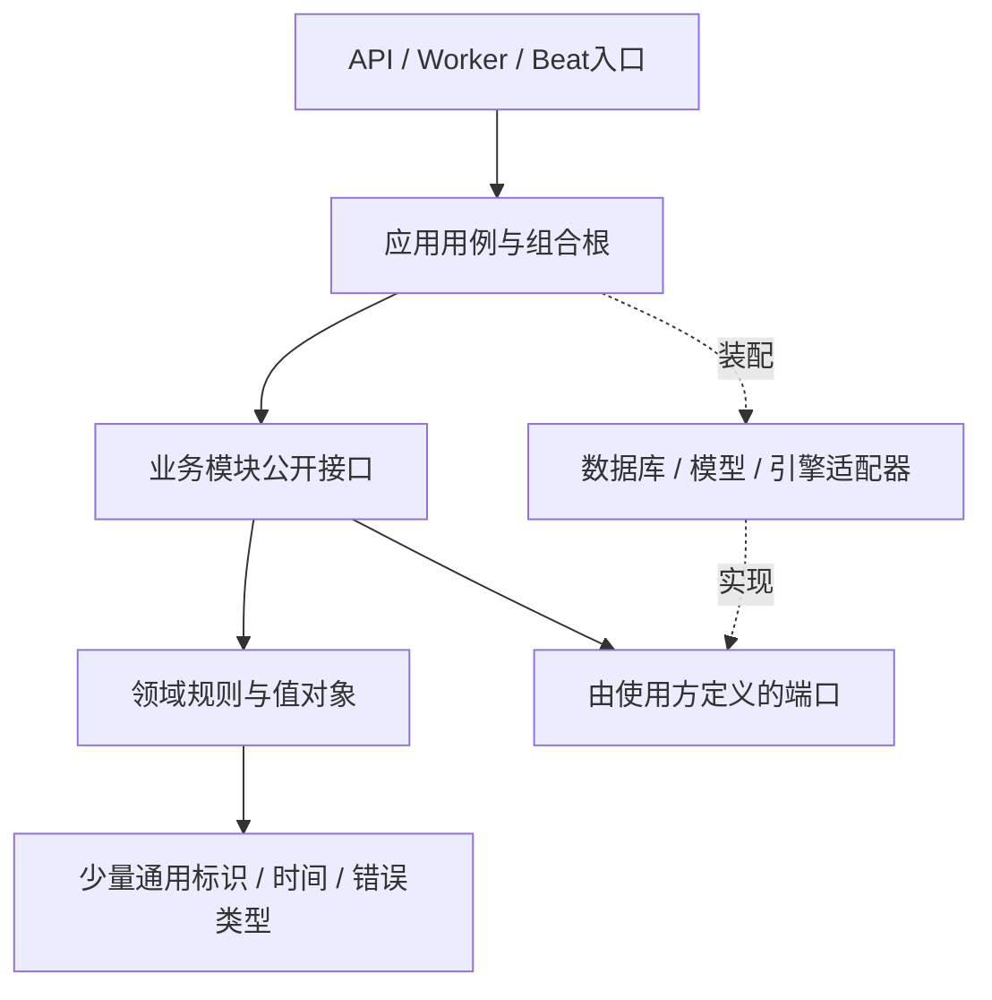

# ETL-Agent 概要设计总纲

| 属性 | 内容 |
|---|---|
| 版本 / 日期 | v0.1 / 2026-10-23 |
| 项目目录 | `D:\python\ETL_Agent` |
| 需求基线 | [ETL-Agent_PRD_v0.1.md](ETL-Agent_PRD_v0.1.md) |
| 文档性质 | 概要设计方案，待技术评审；本阶段仅形成文档 |
| 范围 | PRD REQ-001—REQ-040；不增加新的业务功能 |

## 0. 基线与设计状态

用户要求依据已确认 PRD 开展设计。本稿据此采用 PRD 中明确列出的功能基线；PRD 自身仍标记为初稿，其中 ASM-01—ASM-08、Q-01—Q-18 并未因开始概要设计而自动转为已确认。

- **继承约束**：PRD 已明确的能力、技术或安全要求，本设计必须遵守。
- **设计建议（待确认）**：本稿为落地提出的模块组织、库、进程部署、接口契约和工程规范；经过评审后再进入实施基线。
- **决策未定**：影响业务、安全或运行语义的内容，列出备选与依赖，不以默认值代替确认。

每个 `DES-xxx` 设计项均标注对应 REQ。模块、契约、规范、目录及风险表也提供需求追溯。本文示意状态、逻辑实体和目录不是已创建的代码或最终数据库设计。

## 1. 技术架构

### 1.1 DES-001：总体架构与部署边界

**追溯：REQ-001—REQ-040，PRD 第 13.1 节。状态：控制面/数据面分离为继承约束；模块化单体及进程拆分为设计建议（待确认）。**

采用“模块化单体控制面 + 按权限拆分的后台进程 + SeaTunnel 数据面”。一个 Python 工程维护统一领域契约，API、后台任务和投递进程共享受控模块，不拆成大量独立微服务。进程拆分服务于长任务与权限隔离，不要求每个模块都有独立服务。



图中连线是逻辑调用或数据流，不表示前端能访问内部数据库，也不表示探查是普通 HTTP 请求内直接执行。探查、执行、目标管理均须遵循受管操作目录和权限边界。

| 组成 | 责任 | 依赖与调用方向 | 边界 |
|---|---|---|---|
| Vue 控制台 | 输入、展示、交互反馈、路由和局部状态 | 仅调用控制面 API | 不持有数据源凭据、私钥或直接引擎访问权 |
| FastAPI/API 进程 | 身份校验、参数校验、应用用例、状态查询 | 调用应用服务和持久化端口 | 不搬运海量业务行，不在请求内等待长作业 |
| 生成 Worker | LangGraph 澄清、恢复、模型调用、候选生成 | 模型适配器、受限 Profile、制品、Checkpoint | 不持有生产目标写权限，不自行提交引擎任务 |
| Harness | PDP、冻结事实检查、审批约束、能力授权、统一执行入口 | 身份/事实查询端口、授权仓储、审计追加端口 | 不负责理解用户自然语言，不相信模型自报“安全” |
| 执行 Worker | 验证受管命令、认领运行、临时物化 Secret、操作引擎/目标端 | 命令事实、凭据服务、引擎与连接器适配器 | 不根据任意队列参数执行脚本，不改变已批制品 |
| Outbox 投递 / 调度进程 | 派发已持久化命令；生成调度到期意图 | PostgreSQL、Redis、受管应用入口 | Beat 不能直接绕过审批创建引擎作业 |
| 监督 / 对账任务 | 获取引擎状态、计算预算和质量、核实不确定结果 | 引擎查询、运行仓储、Harness 命令入口 | 不把网络超时直接解释为作业失败或未启动 |
| PostgreSQL | 业务事实、版本、准备、审批、运行、授权消费、Outbox、审计、Checkpoint | 被明确的仓储和 Checkpoint 适配器访问 | 不存储整批 ETL 数据；逻辑表/Schema 隔离方案待定 |
| Redis | Celery 消息传递及必要临时协作 | API/投递进程与 Worker | 不作为审批、令牌消费或运行终态的事实来源 |
| SeaTunnel Zeta | 读源、转换、清洗、分流、写目标及提供作业状态 | 源/目标连接器 | 不决定平台审批是否满足 |
| SecretProvider / Vault | 受管凭据读取和轮转 | 仅授权进程按最小权限访问 | 凭据不进入 Prompt、HOCON 预览、队列正文或普通日志 |

### 1.2 DES-002：技术栈、选择原因与替代方案

**追溯：REQ-004—REQ-015、REQ-020—REQ-024、REQ-034—REQ-040；PRD 第 13.1 节、Q-18。**

| 技术项 | 状态与建议 | 与真实需求的关系 | 替代方案及取舍 |
|---|---|---|---|
| Python、FastAPI | FastAPI 为继承约束；现有工程声明 Python >=3.12，准确运行版本待兼容性验证 | 统一生成、安全治理、异步任务的后端语言与接口 | Django/Flask 能实现控制面，但更换已定框架无直接需求收益 |
| Vue | 继承约束；建议 Vue 3 + TypeScript + Vite，待确认 | Studio、审批、运行中心需要复杂表单与类型一致性 | React 可满足，但无必要替换既有 Vue 基线 |
| Vue Router、Pinia | 设计建议，待确认 | 前者组织项目内页面；后者仅共享身份/当前项目等少量状态 | 小模块可用 composable；不为所有服务端数据建立全局 Store |
| LangGraph + PostgreSQL Checkpoint | 继承约束 | 中断提问、跨请求恢复和有限修复流程 | 自建状态机可行，但替换已定 LangGraph 会增加维护成本 |
| Celery Worker/Beat + Redis | 继承约束；Redis 作为消息 Broker 的分工是建议 | 长任务异步、运行监督和调度触发 | RabbitMQ 作为 Broker 可作为后续备选；当前无证据要求另增消息中间件 |
| PostgreSQL | 继承约束 | 审批一致性、单次消费、运行+Outbox 原子提交 | SQLite 不作为生产一致性验收替代；更换控制库须重新评审 |
| SQLAlchemy + Alembic | 设计建议，待确认；具体版本待选 | 统一仓储、事务、迁移和类型约束 | 直接使用 PostgreSQL 驱动可减少 ORM，但需自建一致访问规范；二者择一主路线 |
| Pydantic 数据契约 | 设计建议，待确认 | API 输入输出、配置、工具意图及模型输出的结构校验 | 手写字典校验更容易产生契约漂移；库版本须与 FastAPI 匹配 |
| SeaTunnel Zeta + HOCON | 继承约束 | 承担异构数据搬运，控制面保持轻量 | Spark/Flink/自写 Python ETL 不作为本期另增执行引擎 |
| SecretProvider / Vault KV v2 | 继承约束；实际部署形态待确认 | 受管加密凭据、权限与轮转 | 自建加密存储可作为 Provider 实现候选，但密钥管理/轮转成本需独立评审 |
| Ed25519、SHA256、证据链 | 继承约束；使用成熟密码库，库版本待确认 | 单次授权验签、制品摘要与审计校验 | 不换成仅靠数据库布尔字段授权，不自行实现密码算法 |
| 测试/静态检查工具 | 建议 pytest、Ruff、一个 Python 类型检查器；前端 vue-tsc、Vitest、Playwright，待确认 | 覆盖权限、故障、端到端及类型回归 | 同一职责避免并行引入多套工具；具体工具不改变验收标准 |

部署方面，Windows 可用于编辑；Celery 官方不支持 Windows，建议 Worker/Beat 使用 Linux 容器、WSL2 中的 Linux 或 Linux 主机，三者具体选择待 TD-01。该建议不修改工作目录，也不在本阶段安装环境。[Celery 官方说明](https://github.com/celery/celery)

数据库/引擎/框架具体版本均未冻结。不得把在线文档展示的最新接口当成目标部署版本承诺；在依赖锁定前完成兼容性检查（TD-02）。

### 1.3 DES-003：信任边界与调用限制

**追溯：REQ-001—REQ-006、REQ-012、REQ-017—REQ-022、REQ-034、REQ-039。继承安全边界，具体隔离实现待确认。**

1. 浏览器与模型输出都是不可信输入。服务端重新解析、校验身份、资源范围和 Schema。
2. 模型只提出候选计划和工具意图；不能生成审批事实、授予角色、提升预算或决定风险等级。
3. 源数据内容、字段注释、错误文本中可能包含提示注入；它们作为数据使用，不作为系统指令执行。
4. 生成进程不配置生产写凭据、Capability 私钥或引擎管理访问权。受管执行进程不提供通用 shell/SQL 任意执行入口。
5. “唯一副作用出口”不仅是一个类名：部署网络和凭据权限应阻止 API/生成进程直连引擎提交、绕过目标管理入口。具体网络部署待 TD-01。
6. 源端探查使用受限只读身份；采样上限、超时和脱敏由确定性规则控制。授权探查进程可短时取凭据，但脱敏结果返回生成侧前必须清除凭据及不允许的原始值。
7. Redis 消息按不可信触发信号处理；Worker 依据命令编号重新读取冻结事实、验签和认领，不能信任消息中自带的目标地址、配置或权限声明。
8. TLS、环境分离、密钥轮换和最小权限属于既有安全要求的实现建议；具体证书、密钥存储及身份方案待 TD-01/TD-03/TD-06。

## 2. 核心业务流程

### 2.1 DES-004：接入、澄清、生成与版本冻结

**追溯：REQ-004—REQ-016、REQ-023；Q-02—Q-05、Q-08、Q-10。**



- 连接配置保存非敏感元数据及 Secret 引用；源数据样本只以获准的脱敏形式用于生成。
- 文件接入产生资产与推断 Schema，不把整个文件内容全部塞入 Prompt 或 Checkpoint。文件实体存储位置、大小和解析限制待定。
- 工作流状态记录步骤、输入引用、澄清结果、修复计数及制品引用；对话与运行事实分别保存。
- Checkpoint 用于恢复生成，不代表已经过审批。恢复请求必须重新鉴权并校验任务所属项目；不能仅凭 `thread_id` 恢复任意用户任务。
- 外部模型调用不放在数据库事务中。恢复可能重新进入节点，任何外部副作用都不能依赖“节点只跑一次”的假设。
- 结构化候选经 Schema 和资源规则检查后才进入版本冻结；HOCON 可解析只是最低门禁，不能替代目标字段/连接器能力/资源权限校验。
- **试运行未画成默认必经读写步骤**：静态模式或隔离真实模式待 Q-10 决策；真实读写必须先通过独立受管授权，不能因“调试”身份绕过审批。

LangGraph Checkpoint 是工作流持久化机制；本设计将其与正式业务事实分开管理。[LangGraph 官方持久化说明](https://docs.langchain.com/oss/python/langgraph/persistence)

### 2.2 DES-005：Prepare、Approve、Commit 与可靠提交

**追溯：REQ-003、REQ-015—REQ-022、REQ-034；Q-06—Q-09。状态：三阶段协议继承；下面的消费时点方案为待确认建议 TD-06。**

推荐讨论方案：在 Broker 的本地提交事务中消费 Capability，后续 Worker 校验“已授权的受管命令”，不再次消费同一 Capability。这样将五分钟消费窗口与队列等待分开。但该方案须确认命令有效期、权限撤销与 Worker 验签对象，不能直接作为已定事实。



提交边界设计建议：

1. 先进行必要的外部元数据重查，再在短事务中锁定准备单、当前审批版本和消费记录，检查本地事实是否仍一致。
2. Capability 签名绑定服务端确定的主体、工具、资源、环境和制品指纹；不得由客户端自行指定签名事实。签名具体载荷见契约 C-06。
3. 一次本地事务内原子完成单次消费占位、ExecutionRun、Outbox 和相关关键审计事实；任一步失败整体回滚。唯一约束与状态条件更新承担并发防护，不能只靠 Redis 锁。
4. 不在上述事务内等待 SeaTunnel、模型、远程 Vault 或长耗时探查。远程签名/KMS 若被选用，要明确事务外签发与事务内验签/消费衔接；未提交的令牌不能形成有效运行命令。
5. 同一个 Commit 网络重试应识别为同一操作并返回既有结果；不能把“同一次请求重试”解释为“用户主动重跑”。幂等键范围与期限在 C-01/TD-07 冻结。
6. 外部 Schema/目标状态与 PostgreSQL 没有跨库事务。提交前检查只能缩小变化窗口；执行前复核及目标发布条件必须补上，不能承诺消除所有 TOCTOU 风险。

**备选待定：**若决定在 Worker 消费 Capability，排队超过五分钟时如何重新授权、如何保证消费与事实原子性必须另有协议。不得简单延长已签名令牌或忽略过期校验。

### 2.3 DES-006：执行、质量分流与原子发布

**追溯：REQ-021、REQ-022、REQ-025—REQ-029、REQ-032、REQ-034；Q-02、Q-09、Q-12、Q-13。**

1. Worker 根据命令标识读取不可变配置、准备单和授权事实，完成验签、范围校验及执行认领。
2. 临时取用 Secret，并以运行期配置交给引擎；持久化制品继续保留 Secret 引用，不因执行时凭据展开而改写原制品。
3. 按已批准资源建立/使用影子目标与错误目标。建表等副作用同样由受管命令覆盖，不能作为“准备工作”绕过授权。
4. SeaTunnel 读源并执行转换；合格记录进入影子数据，违规记录进入错误数据，指标及作业状态返回控制面。控制面只保存必要统计、引用和报告。
5. 监督模块依据冻结契约判断预算。引擎完成后，质量模块核对契约、计数和必要数据校验，形成发布资格判断。
6. 发布模块通过 Harness 提交受管目标操作。冻结授权是否包含条件式自动发布、还是另需单独授权，由 TD-09 决定；未确定前不开放无条件自动发布。
7. 原子替换成功后独立记录“已发布”；发布结果不确定时对账，不能把搬运成功当作发布成功。



Doris 官方说明原子替换适用于两张 OLAP 表，`swap=true` 可保留旧表数据。该能力不能推导为其他数据库、文件和 REST 目标都支持同样语义；也不能保证替换后的任意新写入可以通过再次 Swap 无损回滚。[Doris 原子替换说明](https://doris.apache.org/docs/dev/data-operate/delete/atomicity-replace/)

### 2.4 DES-007：取消、暂停、故障对账、回滚与重跑

**追溯：REQ-021、REQ-022、REQ-028—REQ-034；Q-09、Q-13—Q-15。**

| 事件 | 控制面步骤 | 外部交互及事实判定 |
|---|---|---|
| 取消请求 | 校验权限及授权 → 记录取消意图 → 派发受管命令 | 引擎确认停止前保持“取消请求中”；不能用杀 Worker 替代引擎取消 |
| 预算硬中断 | 保存越线快照 → 根据冻结授权生成停止意图 | 预算中断是已批准监督动作，不临时让模型审批；具体授权模板待 TD-09 |
| 暂停/恢复 | 校验目标版本是否支持 → 使用单独操作语义 | 不把取消改名为暂停；保存点、相同配置恢复及数据一致性须验证 |
| 引擎提交后回执丢失 | 标记“待对账”技术状态 → 查询同一运行关联的引擎标识 | 先查后判；没有可靠查询/幂等支持时保留不确定状态并限制重提 |
| 发布前失败 | 核实正式目标未变 → 依方案清理影子/错误资源 | 清理范围必须来自冻结资源清单，不按用户传入路径任意删除 |
| 发布后回滚 | 检查旧版本、目标代次及后续写入 → 受管恢复 → 核验结果 | 不盲目重复 Swap；目标已被新运行发布时拒绝覆盖或进入冲突处理 |
| 安全重跑 | 新运行标识、新能力授权，关联原运行和原因 | 原失败运行不覆盖；审批是否复用仍待 Q-07 |

SeaTunnel 当前官方文档通过停止保存点、重新提交恢复来描述暂停/恢复，且 REST 不提供 dry-run。目标部署版本与连接器是否满足本项目暂停语义，仍需能力验证。[SeaTunnel API 文档](https://seatunnel.apache.org/docs/engines/zeta/rest-api-v2/)

### 2.5 DES-008：调度、评测与安全进化

**追溯：REQ-024、REQ-037—REQ-039；Q-10、Q-11、Q-17。**

- Beat 只产生调度到期事件；业务调度服务检查版本、调度状态及授权策略。每次触发的准备/审批如何取得尚未决定，不设计“持有永久令牌定时运行”的旁路。
- L0 使用静态用例，L1 使用故障模拟，L2 连接隔离的真实链路；三类结果分别报告，不互相替代。
- Benchmark 绑定用例集、Prompt/策略、模型配置、制品及评测版本；报告保存逐例期望与实际，使指标可复算。
- 进化候选先评测和审查，再按批准范围进入小流量或影子验证；不能自动覆盖正式安全策略。流量选择、授权有效期和撤销条件待确认。
- 调度触发、L2 试验及进化试验都依赖同一 Harness 和执行契约；不能建立第二套无审批执行器。

### 2.6 DES-009：数据事实、状态和持久化责任

**追溯：REQ-002、REQ-007、REQ-014—REQ-022、REQ-025—REQ-039；Q-08、Q-09、Q-16、Q-18。**

| 逻辑事实 | 唯一负责模块 | 存储/关联建议 | 不能替代它的内容 |
|---|---|---|---|
| 用户/项目/授权 | identity_access | PostgreSQL；租户映射待确认 | 浏览器当前项目值 |
| 连接/资产/Profile | assets | 非敏感元数据、Secret 引用、版本化 Profile；文件本体存储适配器 | 模型自行描述的 Schema |
| 对话/Agent 状态 | generation | 对话记录与独立 Checkpoint，关联任务与项目 | 实际 ExecutionRun |
| 版本/制品/契约 | pipelines | 不可变内容、规范化摘要、版本引用 | 可编辑候选或运行期凭据展开文件 |
| 准备/审批 | governance | 冻结事实、所需审批槽、具名决定 | UI 上“已批准”的文字 |
| 能力消费/受管命令 | harness | 单次消费约束、命令完整性、授权引用 | Redis 缓存或模型判断 |
| Run/Outbox/投递 | execution / infrastructure | Run 与 Outbox 同事务；投递状态与运行状态分开 | Celery task result |
| 质量/监督/发布/回滚 | quality / supervision / publication | 每个运行的版本化报告、快照、发布代次与回滚引用 | 单一 success 布尔值 |
| 审计/评测/进化 | audit / evaluation | 追加证据与检查点；版本化用例结果及授权记录 | 普通应用日志 |

原文已有表不静默删除。缺少的逻辑事实（连接、Profile、准备单、能力消费、Outbox、发布、评测等）先在详细数据设计中与原表逐项协调；本总纲不直接创建 DDL。

数据库业务状态是前端事实来源；引擎状态须经过运行适配与对账后进入业务状态。候选生成、审批、执行、发布、回滚独立表示，不能互相覆盖。具体状态枚举、转移条件与修订号格式在 C-10 冻结。

## 3. 模块划分与接口约定

### 3.1 DES-010：模块职责与依赖

**状态：模块名称及组织为设计建议（待确认）；职责来源见各行。**

| 模块 | 负责 | 不负责 | 允许依赖的业务契约 | PRD |
|---|---|---|---|---|
| identity_access | 用户身份、项目成员、资源权限、职责身份查询 | 自行决定某次执行风险或审批结果 | 身份提供方、授权仓储 | REQ-001—REQ-003 |
| assets | 连接、文件、Profile、受限探查与脱敏结果 | 批量搬运、审批与生产发布 | 身份、SecretProvider、探查适配器 | REQ-004—REQ-007 |
| pipelines | Pipeline、候选、制品、版本冻结与 Diff | 审批、引擎启动 | 资产只读契约、制品仓储、校验结果 | REQ-008、REQ-011、REQ-012、REQ-015 |
| generation | 澄清、模型适配、LangGraph、Checkpoint、有限修复 | 签发授权、直接操作生产目标 | Profile 查询、候选写入、确定性校验端口 | REQ-009—REQ-014、REQ-023 |
| validation | 语法、Schema、类型与资源校验报告 | 用模型意见代替规则；执行搬运 | 版本化规则、能力矩阵、Profile | REQ-012、REQ-013 |
| governance | Preparation、审批槽、具名审批生命周期 | 物化 Secret、直接调引擎 | 身份查询、制品查询、PDP 决策接口 | REQ-003、REQ-016—REQ-019 |
| harness | PDP、能力签发/验签、防重放、受管命令准入 | 生成 ETL 内容、渲染页面、实现连接器 | 冻结事实查询端口、消费仓储、审计追加端口 | REQ-017—REQ-021、REQ-034 |
| execution | Run、命令认领、异步执行、对账、引擎作业映射 | 决定是否免审批；变更冻结配置 | Harness 验证、制品查询、引擎/凭据端口 | REQ-021、REQ-022、REQ-029—REQ-033 |
| quality | 质量契约解释、分流定义、结果核对、质量报告 | 决定审批权限、直接 Swap | 冻结契约、运行指标、目标查询适配器 | REQ-025、REQ-027 |
| publication | 发布/回滚计划、目标代次、恢复核验与清理范围 | 自行扩大资源范围或绕过授权 | 质量结果、Harness 命令入口、目标适配器 | REQ-026、REQ-032 |
| supervision | 预算计算、监督快照、超限动作意图 | 直接杀进程、擅自放宽预算 | 指标查询、冻结监督契约、受管命令入口 | REQ-028、REQ-030 |
| scheduling | 调度配置、到期意图、重叠触发判定 | 持有永久执行能力、绕过 Commit | 已批准调度策略、应用执行用例 | REQ-024 |
| audit | 事件追加、哈希链、检查点和验证查询 | 改写业务记录或反向调用审批模块 | 通用事件契约、证据仓储 | REQ-034 |
| reporting | 总览、运行/质量聚合视图、组件健康查询 | 更新审批/运行业务状态 | 各模块只读查询端口 | REQ-027、REQ-029、REQ-035、REQ-036 |
| evaluation | 分层仿真、用例版本、Benchmark、进化候选及授权记录 | 为真实评测开执行后门 | 生成/校验契约、受管执行契约、审计 | REQ-037—REQ-039 |

统一的 `application` 用例层组合上述模块完成跨模块业务；`adapters` 实现外部调用；`infrastructure` 实现仓储、消息和配置。模块数量表示职责边界，不代表必须立即创建同等数量的服务、数据库或完整分层空目录。

### 3.2 DES-011：依赖方向与循环依赖防护

**追溯：REQ-008—REQ-022、REQ-025—REQ-034、REQ-040。设计建议（待确认）。**



- 导入方向：入口→应用→模块/领域；适配器实现端口。领域代码不导入 FastAPI、Celery、ORM、HTTP 客户端或具体模型 SDK。
- `governance` 调用 PDP 接口获取决策；Harness 校验准备事实时使用只读事实端口，不能反向导入 `governance.service` 形成环。
- `execution` 接收授权命令，`publication` 创建发布意图；两者通过应用用例和契约协调，不互相调用内部仓储。
- 审计只接收通用事件数据，不依赖所有业务模块的实体；关键事件由事务用例传入，避免“业务→审计→业务”的递归。
- `shared` 只放稳定、无业务归属的类型，不能变成集中存放数据库连接、所有 DTO 和业务工具函数的公共大包。
- 仓储归属单一模块；跨模块读取走查询接口，跨模块原子提交由应用用例显式管理同一 Unit of Work，不让模块各自提交。
- 建议增加导入边界检查，重点检测生成模块引用执行适配器、领域引用框架、跨模块访问内部模型。检查方式待工程工具选定。

### 3.3 DES-012：开发前应先冻结的契约

**追溯：各行；字段为概要级建议，最终名称/类型由接口评审确定。**

| 契约 | 提供/使用方 | 应约定的内容 | PRD 与待决策 |
|---|---|---|---|
| C-01 API 公共契约 | API / 前端与任务调用方 | 身份与项目传递、分页、时间格式、错误结构、幂等键、并发版本号、接受任务后的返回语义 | REQ-001、REQ-002、REQ-008、REQ-019、REQ-029；Q-01/Q-09 |
| C-02 Profile | assets / generation、validation | 来源及版本、Schema、类型、主键、统计标识、脱敏样本引用、有效期及摘要 | REQ-006、REQ-007、REQ-011；Q-02—Q-04 |
| C-03 EtlPlan/制品 | generation、pipelines / validation、execution | 源目标资源、字段映射、转换、质量/预算引用、HOCON、DAG、格式版本和规范化摘要 | REQ-011—REQ-015、REQ-025、REQ-028；Q-05/Q-08 |
| C-04 校验与修复结果 | validation / generation、UI | 校验项、错误码、位置、严重度、是否可修复、规则版本、尝试计数 | REQ-012、REQ-013；Q-05 |
| C-05 准备与审批事实 | governance / harness、UI | 冻结指纹、主体、环境、资源、风险、必需职责槽、审批决定/版本、预算及回滚计划 | REQ-003、REQ-016—REQ-019；Q-06—Q-08 |
| C-06 Capability/命令 | harness / Broker、Worker | 工具、主体、资源、环境、制品指纹、唯一消费标识、签发/到期、密钥标识与签名；命令与令牌的区别 | REQ-020—REQ-022；Q-09 |
| C-07 Outbox/运行事件 | execution / 投递、Worker、监督 | command_id、run_id、类型、载荷摘要/引用、事件版本、认领/去重键、重投规则、对账依据 | REQ-021、REQ-022、REQ-029；Q-09 |
| C-08 质量/监督 | quality、supervision / 引擎适配器、UI | 规则语义、错误码、原值保护、计数口径、单位、零分母、阈值比较和超限动作 | REQ-025—REQ-029；Q-12/Q-14 |
| C-09 引擎/目标能力 | adapters / execution、publication | 提交、查询、取消、保存点能力、作业标识、幂等限制、原子发布和回滚前置条件 | REQ-022、REQ-026、REQ-030—REQ-032；Q-02/Q-13/Q-15 |
| C-10 状态与事件映射 | 后端各模块 / 前端 | 业务状态、引擎原态、状态修订号、已知/未知、允许操作、冲突与终态修正 | REQ-014、REQ-018、REQ-029—REQ-033；Q-07/Q-09/Q-13 |
| C-11 证据事件 | 各用例 / audit | 操作者、项目、对象、行为、时间、事实摘要、前序哈希、签名检查点、保留策略 | REQ-034；Q-16 |
| C-12 评测/进化 | evaluation / UI、生成与安全模块 | 用例版本、预期、实际、分层、指标分母、被测版本、授权范围和撤销 | REQ-037—REQ-039；Q-17 |

接口以 PRD 引用的原文 2.8.8 为已有基线，不擅自改变现有路径。认证、项目管理、调度、暂停、安全重跑及进化接口需补充契约；本稿只定义职责，不假定路径已经确定。OpenAPI 文档建议作为前后端接口类型的单一来源。

## 4. 开发规范

以下为落实 PRD 的工程设计建议，待技术评审后作为实施规范；并非新增业务功能。

### 4.1 DES-013：命名、类型与契约版本

**追溯：REQ-008—REQ-022、REQ-029、REQ-038、REQ-040。**

- Python 包/模块/函数/变量使用 `snake_case`，类使用 `PascalCase`，常量使用 `UPPER_SNAKE_CASE`；避免 `utils.py` 集中业务逻辑。
- 公共函数、端口、任务边界和 DTO 必须显式标注输入输出类型；不以任意字典贯穿业务链路。外部不可信数据先验证再转领域对象。
- 前端组件名 `PascalCase`，composable 使用 `useXxx`，变量/函数 `camelCase`；原始 API 字段是否保留 `snake_case` 或统一映射只选一种方案，在客户端边界执行。
- ID、金额/数量、时间、字节和比例分别定义语义与单位；UTC 存储带时区时间，前端按用户时区展示；调度时区单独确认，不与服务器时区隐式绑定。
- `null`、缺失和零不能混用。涉及业务小数精度使用明确十进制口径，禁止隐式浮点改变质量判断。
- EtlPlan、契约、命令、事件和评测载荷带格式版本；未知版本返回明确错误。摘要规范必须固定字段顺序、编码和 Secret 引用处理等规则后才能跨版本验证。

### 4.2 DES-014：配置管理

**追溯：REQ-004—REQ-006、REQ-010、REQ-017、REQ-028、REQ-039、REQ-040。**

- 区分部署配置、版本化业务策略、敏感凭据三类。部署地址/超时来自经校验配置；策略绑定版本；凭据来自 SecretProvider。
- 提供无真实密钥的配置样例，环境差异显式声明；建议启动时校验必填项、枚举和范围，缺失安全关键配置时拒绝启用对应执行能力。
- 密码、令牌、签名私钥不进入 Git、前端构建变量或日志；前端环境变量只能保存可公开配置。
- 已冻结准备单引用的策略不能因环境配置变化被静默覆盖。新策略适用新申请，旧申请如何失效依 Q-07/Q-08。
- PRD 没有要求通用配置热更新平台，不额外建设；凭据轮转和安全进化走已有授权流程。

### 4.3 DES-015：日志、异常与诊断

**追溯：REQ-004、REQ-027—REQ-029、REQ-033—REQ-036。**

- 结构化日志建议包含 request_id、project_id、agent_run_id/execution_run_id、command_id、actor_id、事件、耗时与错误码；按场景填写，不输出完整敏感载荷。
- 客户端错误提供稳定业务码、可理解消息、关联标识及是否允许重试；堆栈只进入授权运维日志，返回前脱敏。
- 建议错误分类：输入无效、未认证、无权限、状态冲突、指纹失效、授权过期/重放、依赖不可用、执行不确定、质量失败、预算超限。
- HTTP 状态和业务错误语义一致：不能所有情况都返回成功状态后靠字符串区分；具体状态映射在 C-01 固定。
- API 边界统一转换异常；不得吞掉异常后返回空列表或成功。基础设施异常转为领域可识别错误，保留原始关联信息。
- 诊断结论区分已证实原因、候选原因和证据不足；模型可解释日志，但不能修改真实故障状态。
- 普通日志不替代证据账本。脱敏既在数据产生处执行，也在出口检查；不可只靠前端遮盖。

### 4.4 DES-016：数据库访问、事务与审计一致性

**追溯：REQ-002、REQ-015—REQ-022、REQ-032、REQ-034。**

- 数据库操作集中到所属模块仓储；API 路由不直接拼 SQL。参数化查询；动态表名来自已授权资源映射和目标方言规则，不能拼接模型原始文本。
- 请求/任务独立数据库会话，事务由应用用例管理。禁止多个并发协程共享同一个可变 Session。
- 对版本冻结、审批、消费、Commit、发布认领设置数据库约束及条件更新；不能只用“先查再写”防并发。
- 业务变更和对应关键审计事实应在同一短事务里保存；Outbox 与 Run 同事务。事务结束后才投递，不在数据库事务内跨网络等长操作。
- Ledger 追加需避免并发分叉：按链范围序列化追加或使用等效原子前序检查；分链维度与签名检查点策略待 Q-16，不能只用时间排序。
- 迁移脚本纳入版本控制；已执行迁移不原地修改。数据恢复依赖备份和回滚方案，不能宣称所有迁移都可逆。
- 跨项目访问在仓储/用例边界落实。是否使用 PostgreSQL 行级安全作为第二层保护待 TD-03，不能代替身份校验。

若选用 SQLAlchemy，其官方文档明确并发任务应各用独立 AsyncSession；本规范据此避免共享事务状态。[SQLAlchemy 异步会话说明](https://docs.sqlalchemy.org/en/20/orm/extensions/asyncio.html#using-asyncsession-with-concurrent-tasks)

### 4.5 DES-017：异步、任务和幂等约定

**追溯：REQ-009、REQ-013、REQ-020—REQ-024、REQ-028—REQ-033。**

- FastAPI 的异步处理只使用非阻塞 I/O。阻塞驱动、文件解析和 CPU 密集校验交给受限执行池或后台任务；具体选择依据任务大小，不混用无界线程。
- Celery 任务入口采用明确的同步生命周期；如需驱动异步工作流，由适配层管理事件循环及客户端生命周期，不把 async 函数装饰成任务就假设它会被正确执行。
- 数据库连接池和网络客户端不能跨 Worker fork 或不同事件循环错误复用；在对应进程/生命周期建立。
- 生成、探查、执行、监督任务建议逻辑分队列，防止长生成任务阻塞取消/监督；队列及 Worker 数由容量验证决定，不预设多集群。
- 远程调用都设置有界超时；重试仅用于可证明安全的临时故障，并有限次数/退避。越权、无效签名、质量不达标不自动无限重试。
- 认领与任务确认时点要配合幂等协议；Celery 的重投设置不提供外部引擎“恰好一次”。重试前查运行事实与引擎状态。[Celery 任务说明](https://docs.celeryq.dev/en/v5.5.3/userguide/tasks.html)
- 长作业提交后由监督任务查询状态，避免占用数据库长事务等待完成。丢失请求连接不意味着取消 ETL 作业。
- 同一生成线程并发回答、同一准备单重复 Commit、同一目标并行发布分别设置独立并发规则；不使用一个全局锁解决全部问题。

### 4.6 DES-018：测试规范与交付检查

**追溯：REQ-001—REQ-040、PRD AC-001—AC-040、E2E-01—E2E-07。**

| 层级 | 验证对象 | 必须覆盖的代表场景 |
|---|---|---|
| 单元 | 纯领域规则、风险映射、质量公式、状态条件 | 自批、审批槽冲突、有限修复、阈值边界、零分母 |
| 契约 | API/命令/Profile/引擎适配 | 字段、格式版本、错误码、未知版本、不同 Provider 返回 |
| 集成 | PostgreSQL、Outbox、凭据引用、真实事务 | 并发单次消费、事务回滚、重复投递、冻结版本不可改 |
| 故障 | Worker/网络/引擎不确定结果 | 提交前后崩溃、回执丢失、发布成功后落库失败、取消竞态 |
| 前端组件 | 表单、状态、权限反馈 | 无权限、待澄清、失败、指标未知、过期页面状态 |
| 端到端 | PRD E2E 链路 | 正常发布、拦截、分流、超限、回滚、评测 |
| 安全回归 | 身份边界与副作用出口 | 跨项目访问、重放、篡改、Prompt 注入、日志泄密、任意 URL/路径 |
| Benchmark | L0/L1/L2 可复现指标 | 固定用例版本、预期结果与分子分母核验 |

测试命名表达行为和条件，关联 REQ/AC；不要只断言内部函数被调用。使用确定性夹具，模型结果不应让安全验收依赖随机生成。真实凭据、生产数据不能放入测试集；需要真实引擎时使用隔离资源并经受管授权。

建议合并检查包含格式、静态类型、单元/契约和相关集成测试；发布前执行所需 E2E、安全及 L2 验证。覆盖率、性能阈值与 CI 平台待确认，不凭空规定数字。本阶段不创建这些测试或流水线。

### 4.7 DES-019：安全实现规范

**追溯：REQ-001—REQ-007、REQ-012、REQ-017—REQ-022、REQ-025、REQ-032、REQ-034、REQ-039。**

- 身份来自可信服务端认证上下文；请求体中的 user_id、role、project_id 不构成授权证据。
- 凭据使用范围必须与命令批准的连接/资源一致；签名密钥有 key_id 和轮换方案，历史验签依赖的公钥/策略版本应可查询。
- 外部数据库/REST/对象存储目标使用受管地址策略，防止绕到未授权内网、云元数据地址或经重定向越界；具体网络允许范围待部署决策。
- HOCON 解析/校验不允许任意外部 include、文件读取、环境变量展开或插件执行越过资源清单；执行期只物化明确批准的配置项。
- 文件路径规范化并限制在项目受管根目录内；上传文件名不作为服务器路径；压缩/嵌套内容和解析资源预算需要限额。
- 业务数据在错误表、临时配置、引擎日志等处的暴露同样纳入保护；不能只验证平台日志无密码。原始错误值政策未定时禁止扩大可见范围。
- 清理与回滚只处理冻结资源清单及已核实的目标代次，禁止将请求中的任意 SQL/路径直接交给执行器。
- 原令牌、签名私钥和凭据不得作为前端长期状态或普通消息载荷保存。身份会话使用 Cookie 还是 Bearer 及相应 CSRF/CORS 方案待 TD-03。

### 4.8 DES-020：前端路由、分层、复用与类型检查

**追溯：REQ-001—REQ-003、REQ-005—REQ-019、REQ-027—REQ-039。路由及库为设计建议（待确认）。**

| 建议路由 | 页面职责 | 需求 |
|---|---|---|
| `/projects/:projectId/overview` | 项目总览、待审批概况、统计 | REQ-035 |
| `/projects/:projectId/assets` | 连接/文件列表、测试、Profile | REQ-005—REQ-007 |
| `/projects/:projectId/pipelines/:pipelineId/studio` | 需求、澄清、方案、校验与版本 Diff | REQ-008—REQ-015 |
| `/projects/:projectId/preparations/:preparationId` | 准备事实、独立审批及 Commit 入口 | REQ-016—REQ-020 |
| `/projects/:projectId/runs` 与 `.../runs/:runId` | 运行、质量、诊断及受管操作 | REQ-022、REQ-025—REQ-033 |
| `/projects/:projectId/governance` | Benchmark、进化与证据查询入口 | REQ-034、REQ-037—REQ-039 |

认证入口及成员授权页路径待 Q-01；不得擅自增加自助注册、密码找回等未要求业务。

分层规范：路由负责导航；页面负责布局和跨功能组合；feature 负责业务交互；composable 负责可复用交互状态；API client 统一请求；通用组件只接收类型化 props 和 events。组件不自行拼 URL、读 Token、调用引擎或计算审批是否满足。

可复用组件建议包括状态标签、空态/错误态、分页表格、字段 Diff、脱敏预览、审批卡片、运行指标和日志查看器。DAG/代码高亮库待选择，不引入完整可视化拖拽编排器，因为 PRD 只明确要求拓扑展示。

TypeScript 使用严格模式，禁止以无约束 `any` 绕过 API 契约；未知返回先验证。构建和类型检查分开执行，建议将 `vue-tsc --noEmit` 纳入检查，不能以打包成功代替类型通过。[Vue 官方 TypeScript 指南](https://vuejs.org/guide/typescript/overview.html)

服务端数据通过统一客户端获取，统一处理取消请求、认证失效、错误转换和请求标识。只对安全查询做有界自动重试；Commit、审批、取消等写操作只有明确幂等契约才能重试。项目切换要取消旧查询或隔离缓存，防止迟到响应覆盖当前项目。

### 4.9 DES-021：前后端状态、权限和错误责任

**追溯：REQ-001—REQ-003、REQ-009、REQ-014、REQ-018—REQ-020、REQ-027—REQ-033。**

| 事项 | 前端责任 | 后端责任 |
|---|---|---|
| 表单校验 | 必填/格式提示，保留未提交输入 | 重验所有字段、资源、Schema 与权限 |
| 身份与角色 | 根据返回能力显示入口，路由守卫改善体验 | 每次访问重新校验；按钮隐藏不是安全控制 |
| 审批/Commit | 展示冻结事实、冲突信息，避免重复点击 | 四眼规则、指纹、过期、并发及单次消费判定 |
| 状态 | 保存展开项、选中项、草稿等局部 UI 状态 | 对话/工作流/运行/发布/回滚各自事实与允许操作 |
| 乐观更新 | 可用于无风险局部交互 | 审批成功、执行完成、发布/回滚成功均以服务端确认为准 |
| 实时展示 | 轮询或订阅并按修订号处理迟到事件 | 提供单调版本/时间依据及快照查询；传输方案待 TD-12 |
| 错误 | 根据稳定错误码提供恢复指引，不展示敏感堆栈 | 判断业务失败/冲突/依赖故障，生成脱敏错误和追踪标识 |
| 指标 | 正确显示单位与未知状态 | 定义并计算公式、质量和预算结论，不能由浏览器决定发布 |

建议先使用有界轮询满足运行查询；若 Q-14 明确低延迟需求，再评估 SSE。双向 WebSocket 不是当前必选；无论传输方式如何，断线后以服务端快照恢复，不以浏览器事件历史作为事实。

## 5. 项目目录结构

### 5.1 DES-022：目录规划

**追溯：REQ-001—REQ-040；重点 REQ-014、REQ-020—REQ-022、REQ-037—REQ-040。设计建议（待确认）。以下仅为规划，不创建业务代码。**

沿用当前根目录 `pyproject.toml`，后端采用 `src` 布局；前端使用独立子目录。所有新增 Markdown 文档统一放 `docs/`，包括部署说明、ADR、接口说明和操作手册；不在根目录或模块中另建 Markdown。

```text
D:\python\ETL_Agent\
├─ pyproject.toml                 # 已有；后续统一声明Python依赖和检查配置
├─ <python-lockfile>              # 依赖管理工具确认后只选一种锁文件
├─ .gitignore                    # 排除凭据、缓存、临时制品和本地依赖
├─ .env.example                  # 无敏感值的部署变量示例
├─ src/etl_agent/
│  ├─ entrypoints/
│  │  ├─ api.py                  # API启动与应用装配入口
│  │  ├─ generation_worker.py    # 生成任务入口，不装配生产执行权限
│  │  ├─ execution_worker.py     # 受管执行入口
│  │  ├─ beat.py                 # 调度事件入口
│  │  └─ outbox_dispatcher.py    # 持久化命令投递入口
│  ├─ bootstrap.py              # 组合根，按进程角色装配端口与适配器
│  ├─ api/                      # 路由、请求/响应契约、身份依赖、错误映射
│  ├─ application/              # 跨模块用例及显式事务边界
│  ├─ modules/
│  │  ├─ identity_access/       # 用户、项目与权限
│  │  ├─ assets/                # 连接、文件和Profile
│  │  ├─ pipelines/             # 候选、版本、制品和Diff
│  │  ├─ generation/            # LangGraph图、澄清、恢复与Provider调用
│  │  ├─ validation/            # 确定性校验规则
│  │  ├─ governance/            # 准备单和审批
│  │  ├─ harness/               # 风险、能力、Replay Guard和Broker契约
│  │  ├─ execution/             # 运行、命令认领与对账
│  │  ├─ quality/               # 质量契约和报告
│  │  ├─ publication/           # 发布与回滚
│  │  ├─ supervision/           # 预算监督
│  │  ├─ scheduling/            # 业务调度意图
│  │  ├─ audit/                 # 证据链和验证
│  │  ├─ reporting/             # 只读汇总及健康查询
│  │  └─ evaluation/            # Benchmark与进化管理
│  ├─ adapters/
│  │  ├─ databases/             # 源端受限探查与目标管理适配
│  │  ├─ files/                 # 文件与对象存储适配
│  │  ├─ rest_sources/          # REST源端访问适配
│  │  ├─ models/                # 模型Provider适配
│  │  ├─ seatunnel/             # 引擎版本差异与生命周期接口
│  │  └─ secrets/               # SecretProvider实现
│  ├─ infrastructure/
│  │  ├─ persistence/           # 会话、仓储实现、ORM映射
│  │  ├─ messaging/             # Celery/Redis投递适配
│  │  ├─ checkpoint/            # LangGraph持久化适配
│  │  ├─ observability/         # 日志上下文、脱敏、指标基础设施
│  │  └─ settings.py            # 统一配置读取与校验
│  └─ shared/                   # 少量无业务归属的基础类型
├─ migrations/                 # 控制库迁移；工具确认后确定文件格式
├─ frontend/
│  ├─ package.json              # 前端依赖及检查命令
│  ├─ <frontend-lockfile>        # 包管理器确定后只选一种
│  ├─ tsconfig.json             # TypeScript严格检查
│  ├─ vite.config.ts            # 构建/开发配置，方案待确认
│  ├─ src/
│  │  ├─ main.ts                # 应用入口
│  │  ├─ app/                   # 根布局、路由、插件装配
│  │  ├─ pages/                 # 页面组合，不承载安全判定
│  │  ├─ features/              # assets、studio、approvals、runs、governance
│  │  ├─ components/            # 通用展示与表单组件
│  │  ├─ composables/           # 可复用交互与查询生命周期
│  │  ├─ api/                   # 统一客户端与生成接口类型
│  │  ├─ stores/                # 身份/当前项目等有限共享状态
│  │  └─ types/                 # 前端本地类型，不复制后端领域实现
│  └─ tests/                    # 组件测试与前端E2E入口
├─ tests/
│  ├─ unit/                     # 领域行为与规则
│  ├─ contract/                 # API、命令及适配器契约
│  ├─ integration/              # 数据库、消息、凭据与引擎集成
│  ├─ security/                 # 越权、防重放和泄密等回归
│  ├─ fault_injection/          # 崩溃、超时、竞态与对账
│  ├─ e2e/                      # PRD端到端验收
│  └─ fixtures/                 # 合成数据和预期结果
├─ benchmarks/                 # 版本化L0/L1/L2数据、清单及评测输入
├─ configs/                    # 非敏感环境样例、策略和连接能力声明
├─ deploy/                     # 确认后的部署清单，不含真实凭据
├─ scripts/                    # 后续初始化/校验入口，不复制领域业务
├─ runtime/                    # 本地临时资源，默认不入库；生产存储映射待定
└─ docs/
   ├─ ETL-Agent_PRD_v0.1.md
   ├─ ETL-Agent_概要设计总纲_v0.1.md
   ├─ adr/                     # 后续技术决策Markdown
   ├─ contracts/               # 后续接口、命令、状态与数据契约说明
   ├─ operations/              # 后续部署、运行与恢复说明
   └─ acceptance/              # 后续验收说明及证据索引
```

### 5.2 目录内的实现约束

- 模块按需要建立 `domain`、`service`、`ports`、`schemas` 等文件，只有确有职责时才创建，避免为分层生成大量空类。
- `bootstrap.py` 只负责装配，不包含审批/质量判断。入口只负责协议转换和调用用例；业务安全限制不能只写在 API 路由里。
- `adapters/seatunnel` 封装引擎差异，不让业务模块到处拼接引擎 URL。目标发布适配器负责方言和能力检测，不自行决定审批条件。
- `runtime` 中可能出现敏感临时配置，须有受限权限和明确清理机制；生产文件/报告存储介质及留存期限仍待确认。
- 配置、数据集、运行报告与文档各有归属；Benchmark 的机器可读结果不必转为 Markdown，若生成 Markdown 报告则放 `docs/acceptance/`。

## 6. 风险与待确认事项

### 6.1 DES-023：架构风险登记

**状态：已识别风险及建议措施；不能把建议措施视作已实施。**

| 风险 | 影响 | 设计处理/验证方向 | 追溯 |
|---|---|---|---|
| governance与harness双向导入 | 环依赖、安全校验难复用 | 只读事实端口、组合根装配、导入检查 | REQ-016—REQ-020 |
| execution与publication职责重叠 | 运行成功被误当发布成功 | 分离Run、发布事实与目标适配器 | REQ-022、REQ-026、REQ-029、REQ-032 |
| audit依赖所有业务模型 | 递归调用、事务不一致 | 通用事件契约、同事务追加、独立验证 | REQ-034 |
| 只在代码层声称唯一出口 | 模型/进程仍能直连生产执行 | 独立进程凭据与网络访问范围测试 | REQ-004、REQ-020、REQ-022 |
| 消费令牌与入队不同步 | 重放或授权丢失 | 单次消费和Run/Outbox事务协议待冻结 | REQ-020、REQ-021 |
| 引擎启动回执丢失 | 重试产生重复业务写入 | 引擎标识、认领、查询对账；不确定时禁盲重试 | REQ-021、REQ-022、REQ-033 |
| Schema/权限提交后变化 | 审批事实与执行不同 | 指纹、执行前复核、权限变化策略 | REQ-015—REQ-019 |
| 文件/采样/模型无界输入 | 内存、延迟、费用和泄密 | 限额与超时，外部内容不作为指令 | REQ-006、REQ-007、REQ-010、REQ-013 |
| 监督与执行争用Worker | 超限后不能及时停止 | 监督逻辑队列隔离、响应时限测试 | REQ-028—REQ-030 |
| 不同目标端能力不同 | 原子发布/回滚承诺失真 | 源目标能力矩阵，按版本真实验证 | REQ-005、REQ-022、REQ-026、REQ-032 |
| 旧表过早清理或并发发布 | 无法恢复、误覆盖新数据 | 保留窗口、发布代次与条件化回滚 | REQ-026、REQ-032 |
| 错误原值/引擎日志泄密 | 平台脱敏仍不满足全链路保护 | 全链路采集测试，错误数据查看策略 | REQ-004、REQ-025、REQ-029 |
| Checkpoint保存过大或敏感内容 | 泄密、恢复性能差 | 保存引用、限制样本、分离对话与运行事实 | REQ-006、REQ-009、REQ-014 |
| 哈希链没有可信检查点 | 数据库整体被改后难发现 | 签名检查点独立保护与截断测试 | REQ-034 |
| 前端缓存串项目、状态过时 | 泄露数据、误导审批 | 项目作用域查询、修订号、后端重验 | REQ-002、REQ-018、REQ-029 |
| 原生Windows运行Worker | 环境支持不足、行为难复现 | Linux运行方案待确认 | REQ-040 |

### 6.2 技术决策清单

| 编号 | 待确认决策与备选 | 本稿建议/限制 | 对应PRD |
|---|---|---|---|
| TD-01 | 部署环境：Linux容器、WSL2 Linux或Linux主机；角色进程隔离方式 | 倾向Linux运行Worker；不在本阶段安装或迁移 | REQ-020、REQ-022、REQ-040；Q-18 |
| TD-02 | Python、Vue、数据库、Celery、LangGraph、SeaTunnel及连接器版本；包管理器 | 先建立兼容矩阵再锁定，不以最新版替代验证 | REQ-005—REQ-010、REQ-022、REQ-040；Q-02/Q-18 |
| TD-03 | 认证会话、租户模型、角色管理主体、RLS及密钥/网络权限 | 继承PRD未决项，不增加管理员业务 | REQ-001—REQ-004；Q-01 |
| TD-04 | Profile/文件限额、格式推断、有效期、模型参数、修复上限 | 有界且可测；具体值不预设 | REQ-006—REQ-013；Q-03—Q-05 |
| TD-05 | 风险分级、审批槽、审批有效期/撤销、摘要和指纹覆盖 | 不臆定P0/P3的高低含义 | REQ-003、REQ-015—REQ-019；Q-06—Q-08 |
| TD-06 | Broker消费还是Worker消费；命令验签对象、有效期和权限撤销 | 倾向Broker事务消费+Worker核验持久化受管命令，须评审 | REQ-020—REQ-022；Q-09 |
| TD-07 | 引擎幂等提交、命令认领、重试、外部状态对账策略 | 不能承诺未经验证的恰好一次 | REQ-021、REQ-022、REQ-033；Q-09 |
| TD-08 | 试运行/L2是否读写、调度类型及每次授权 | 不提供无授权执行旁路 | REQ-023、REQ-024、REQ-037；Q-10/Q-11 |
| TD-09 | 质量原值保护、发布授权、监督停止授权、回滚代次与保留窗口 | 自动动作须有冻结授权，非Doris目标单独验证 | REQ-025—REQ-028、REQ-030、REQ-032；Q-02/Q-12/Q-13 |
| TD-10 | 监督公式、响应时限、监控失联、SLA、容量与恢复指标 | 先明确口径再性能测试 | REQ-028、REQ-029、REQ-035、REQ-036；Q-14 |
| TD-11 | 引擎暂停/恢复与保存点支持范围 | 不把停止等同暂停；版本和连接器联合验证 | REQ-031；Q-15 |
| TD-12 | 前端组件/DAG库、轮询或SSE、状态与错误契约 | 倾向有界轮询起步，具体低延迟要求待定 | REQ-011、REQ-018、REQ-029；Q-14 |
| TD-13 | 证据链范围、签名检查点位置、保留与异常策略 | 普通日志不能替代可信证据 | REQ-034；Q-16 |
| TD-14 | Benchmark指标、阈值、样本量及进化试验晋级规则 | 未明确前只验收可复算输出，不能验收安全效果达标 | REQ-037—REQ-039；Q-17 |
| TD-15 | ORM/驱动/迁移、存储介质、测试/CI工具及缺失逻辑实体 | 采用单一主路线，先契约再DDL | REQ-007、REQ-015—REQ-022、REQ-034、REQ-040；Q-18 |

### 6.3 设计阶段的完成边界

本总纲给出可评审的架构、模块、流程、契约、规范和目录。进入业务实现前，优先冻结身份与租户、风险/审批、指纹、能力消费、异步幂等、发布回滚和质量隐私等关键协议。其他页面样式和工具选型可后续细化，但不能以实现便利代替业务/安全决策。

不要求所有问题都解决后才能继续写详细设计；未决功能应保留清晰边界，不能以“先做一个默认实现”偷偷关闭问题。

## 7. 需求追溯与总纲自检

### 7.1 逐项追溯矩阵

| PRD需求 | 主要设计项 | 核心模块 |
|---|---|---|
| REQ-001 | DES-003、DES-010、DES-019、DES-021 | identity_access |
| REQ-002 | DES-009、DES-010、DES-016、DES-021 | identity_access |
| REQ-003 | DES-005、DES-010、DES-021 | identity_access / governance |
| REQ-004 | DES-003、DES-006、DES-014、DES-019 | assets / secrets |
| REQ-005 | DES-004、DES-010、DES-012 | assets |
| REQ-006 | DES-003、DES-004、DES-012 | assets |
| REQ-007 | DES-004、DES-009、DES-019 | assets |
| REQ-008 | DES-004、DES-010、DES-020 | pipelines |
| REQ-009 | DES-004、DES-017、DES-021 | generation |
| REQ-010 | DES-002、DES-004、DES-014 | generation / models |
| REQ-011 | DES-004、DES-012、DES-020 | pipelines / generation |
| REQ-012 | DES-003、DES-004、DES-010 | validation |
| REQ-013 | DES-004、DES-012、DES-018 | generation / validation |
| REQ-014 | DES-009、DES-021 | generation / execution |
| REQ-015 | DES-004、DES-005、DES-013、DES-016 | pipelines |
| REQ-016 | DES-005、DES-010、DES-012 | governance |
| REQ-017 | DES-003、DES-005、DES-010 | harness |
| REQ-018 | DES-005、DES-010、DES-021 | governance |
| REQ-019 | DES-005、DES-012、DES-016 | governance / harness |
| REQ-020 | DES-003、DES-005、DES-019 | harness |
| REQ-021 | DES-005、DES-007、DES-016、DES-017 | execution / messaging |
| REQ-022 | DES-006、DES-007、DES-012 | execution / seatunnel |
| REQ-023 | DES-004、DES-008 | generation / harness |
| REQ-024 | DES-008、DES-010 | scheduling |
| REQ-025 | DES-006、DES-012、DES-019 | quality |
| REQ-026 | DES-006、DES-007、DES-010 | publication |
| REQ-027 | DES-006、DES-009、DES-021 | quality / reporting |
| REQ-028 | DES-006、DES-007、DES-017 | supervision |
| REQ-029 | DES-007、DES-015、DES-020、DES-021 | execution / reporting |
| REQ-030 | DES-007、DES-017、DES-021 | execution / supervision |
| REQ-031 | DES-007、DES-012 | execution / seatunnel |
| REQ-032 | DES-006、DES-007、DES-019 | publication |
| REQ-033 | DES-007、DES-015、DES-017 | execution |
| REQ-034 | DES-005、DES-009、DES-016 | audit |
| REQ-035 | DES-009、DES-010、DES-020 | reporting |
| REQ-036 | DES-010、DES-015 | reporting / infrastructure |
| REQ-037 | DES-008、DES-018 | evaluation |
| REQ-038 | DES-008、DES-012、DES-018 | evaluation |
| REQ-039 | DES-003、DES-008、DES-014 | evaluation |
| REQ-040 | DES-001、DES-002、DES-018、DES-022 | 全体模块及交付 |

### 7.2 自检结论

- 覆盖用户要求的六部分；40项PRD需求均有设计落点，未将调度、暂停、试运行、安全进化等未决功能静默删去。
- 设计建议与已给定技术约束分开标识；PRD的18项待确认问题均在技术决策表中保留映射。
- 五张Mermaid图分别描述总体架构、生成流程、授权提交时序、质量发布和依赖方向；图中的推荐消费流程明确标为待确认。
- 重点检查并区分了Capability单次消费与命令重投、任务成功与发布成功、取消与回滚、业务状态与Celery/引擎状态。
- 已识别并给出模块循环依赖防护，但没有代码，因此不声称通过了真实导入检查、运行测试或兼容性测试。
- 目录仅为设计，不代表已创建服务或安装依赖；本阶段唯一交付是本Markdown文档。
- 发布授权、令牌消费时点、错误原值保护及非Doris发布能力仍需评审；本稿不把这些缺口标为已解决。


