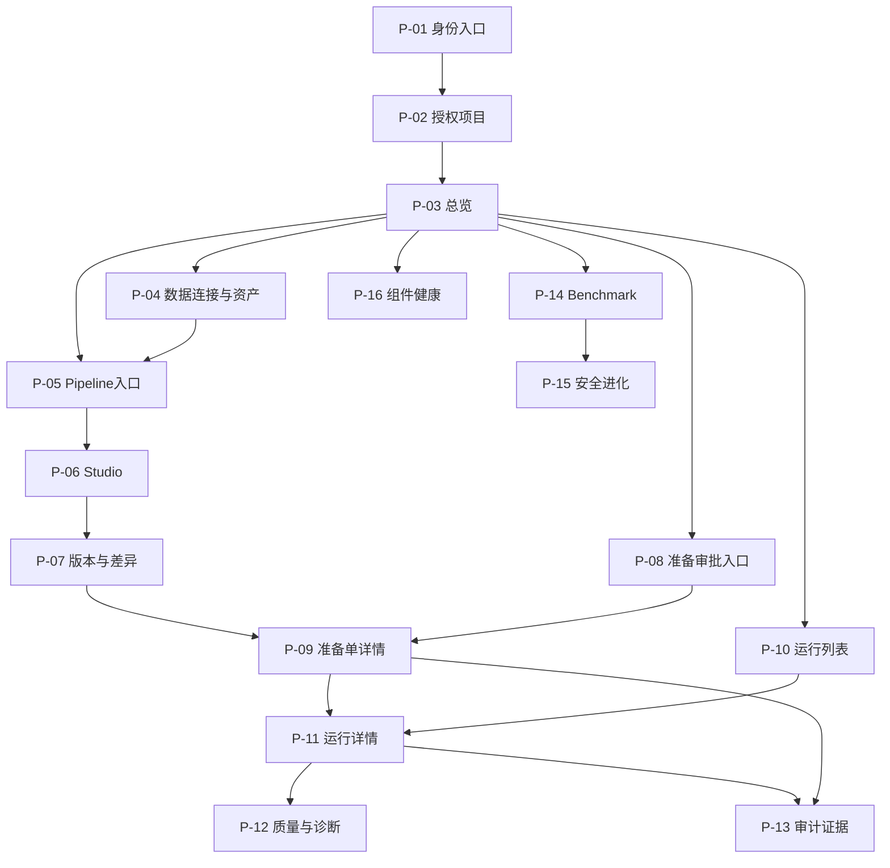
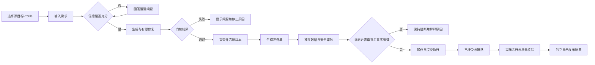

# ETL-Agent 页面原型规划：文字线框与页面流程

| 属性 | 内容 |
|---|---|
| 版本 / 日期 | v0.1 / 2026-10-23 |
| 需求基线 | [ETL-Agent_PRD_v0.1.md](ETL-Agent_PRD_v0.1.md) |
| 架构基线 | [ETL-Agent_概要设计总纲_v0.1.md](ETL-Agent_概要设计总纲_v0.1.md) |
| 原始接口依据 | 《项目实战(1).md》2.8.8；原路径在第 8 节逐项引用 |
| 交付形式 | 文字线框、页面流程、交互规则及验收矩阵；无完整前端代码 |
| 设备确认 | 用户已确认：桌面和手机均需完整操作；不是手机只读版 |
| 保存位置 | `D:\python\ETL_Agent\docs` |

## 0. 设计状态和边界

- **继承需求**：REQ-001—REQ-040 的业务能力；来源文档的待确认项不自动转为已确认。
- **本次新增确认**：桌面和手机都支持完整业务操作，设备仅影响布局和输入方式，不改变角色权限、审批规则或授权流程。
- **交互建议**：页面拆分、组件、布局、搜索和视觉参数均为本轮低保真建议，待评审后冻结。
- **契约缺口**：已明确业务但缺查询/提交接口，标为 G-xx。原型可展示结构和模拟状态，不能假定真实功能已联通，不能发起猜测的 HTTP 请求。
- 本稿使用中文业务标签；代码、字段名、HOCON 和标准标识保留原文。用户此前修改 Codex 软件语言/主题不作为本项目新增主题功能需求。
- 页面编号 P-01—P-16，交互编号 UX-001—UX-040，接口编号 A-01—A-18。页面编号不是已确认前端路由，更不是后端路径。
- 本轮不添加注册、密码找回、批量审批、任意 SQL、数据下载/导出、通知中心、拖拽编排、删除资源等未确认能力。

## 1. 页面清单与页面目标

以下为逻辑页面，可按设备合并为页内标签、详情页或全屏面板；拆分不增加业务模块。

| 页面 | 目标与主要用户 | 页面形态 | PRD / 概要设计 |
|---|---|---|---|
| P-01 身份入口 | 识别当前用户并进入授权项目；所有用户 | 入口页，认证方式待定 | REQ-001；DES-003、DES-021 |
| P-02 项目与成员 | 切换已授权项目；管理成员的入口仅向具备权限者提供 | 项目选择页 + 成员面板 | REQ-002、REQ-003；DES-010；Q-01未决 |
| P-03 总览 | 理解项目连接/Pipeline/待审批与运行概况 | 工作台 | REQ-035；DES-009、DES-020 |
| P-04 数据连接与资产 | 登记/编辑连接、测试、探查、上传文件、查看Profile | 列表 + 编辑/探查/资产详情子视图 | REQ-004—REQ-007；DES-004、DES-010 |
| P-05 Pipeline入口 | 找到已有Pipeline或创建后进入Studio | 列表/选择入口 | REQ-008、REQ-015；DES-010；列表契约缺失 |
| P-06 Pipeline Studio | 从自然语言和澄清生成、审查合格候选 | 复杂工作台 | REQ-008—REQ-014、REQ-023；DES-004、DES-020 |
| P-07 版本与差异 | 查看冻结版本、摘要、Schema/HOCON/质量Diff，发起准备 | 版本详情 + Diff | REQ-015、REQ-016、REQ-024；DES-005 |
| P-08 准备/审批入口 | 找到与自己有关、或有权限查看的准备单 | 列表/运行中心子页 | REQ-016—REQ-019；DES-010；可见范围待定 |
| P-09 准备单与审批详情 | 审查冻结事实、独立审批、由操作员Commit | 详情页 | REQ-003、REQ-016—REQ-021；DES-005、DES-021 |
| P-10 运行列表 | 找到运行并理解执行、发布、回滚的不同结果 | 列表/运行中心子页 | REQ-022、REQ-029；DES-009、DES-020 |
| P-11 运行详情 | 看指标、日志、监督和事实，执行取消/暂停/回滚/重跑 | 详情页 + 操作确认 | REQ-022、REQ-028—REQ-033；DES-006、DES-007 |
| P-12 质量与诊断 | 查看分流、规则命中、错误分布、证据和根因建议 | 运行详情子页 | REQ-025—REQ-027、REQ-033；DES-006、DES-015 |
| P-13 审计证据 | 追溯行为并查看证据链校验结果；审计及其他授权人员 | 检索列表 + 事件详情 | REQ-034；DES-009、DES-016 |
| P-14 Benchmark | 发起分层评测，查看可复算结果 | 评测列表/报告 | REQ-037、REQ-038；DES-008、DES-012 |
| P-15 安全进化 | 审查改进候选及小流量/影子授权；安全审批人管理 | 候选列表/审查详情 | REQ-039；DES-008、DES-010 |
| P-16 组件健康 | 判断依赖就绪，解释操作为何暂不可用 | 健康详情 | REQ-036；DES-010、DES-015 |

系统操作员、工程师、审批人与审计人员看到的页面范围由服务端授权决定；角色名称不能代替精确的资源访问规则。

## 2. 导航关系与页面流程

### 2.1 全局导航

桌面：顶栏显示项目、当前身份、面包屑；左侧导航依次为“总览、数据连接与资产、Pipeline Studio入口、运行中心、安全治理、组件健康”。运行中心内分“准备/审批、执行运行”；安全治理内分“审计证据、Benchmark、安全进化”。

手机：顶栏保留当前项目与页面标题，菜单按钮打开全屏导航；全部入口可达。层级内使用返回按钮/面包屑摘要。关键业务动作在当前页面显式出现，不只藏在全局菜单。具体导航排序属于建议，不假定存在个性化菜单后端功能。



图中导航能力受数据和权限控制，例如从报告进入进化候选只在已有明确关联且有查看权限时提供；未关联时仍可由全局导航访问对应列表，不凭空创建候选。

### 2.2 正常生成、审批与执行



审批不是“生成成功后默认通过”；冻结不是“准备成功”；提交成功不是“运行完成”。真实试运行、调度和自动发布授权仍继承Q-10/Q-11/Q-13，不插入无授权捷径。

### 2.3 异常处理与返回

运行异常/超限 → P-11展示真实状态和监督快照 → P-12查看证据、诊断与修复建议 → 有权限且可回滚时确认回滚 → P-11等待实际结果 → 如需重跑进入新运行授权流程，关联原运行。

准备事实过期/审批冲突 → P-09展示失效原因和原审批快照 → 返回P-07/P-06调整并形成新版本/准备事实；不在原冻结内容上直接改字后继续Commit。重提路径和审批复用仍待后端契约明确。

## 3. 各页面布局与主要组件

### 3.1 通用页面外壳

```text
桌面
┌──────────────────────────────────────────────────────────┐
│ 当前项目 / 页面路径                      当前身份与职责    │
├─────────────┬────────────────────────────────────────────┤
│ 模块导航     │ 标题 + 对象标识 + 状态 + 当前页主操作         │
│             │ 筛选/步骤/上下文提示                         │
│             │ 主内容区                                    │
│             │ 分页或页内辅助区                            │
└─────────────┴────────────────────────────────────────────┘

手机
┌─────────────────────────┐
│ 菜单/返回  当前项目       │
│ 页面标题 / 对象 / 状态    │
├─────────────────────────┤
│ 标签或步骤切换           │
│ 单列主内容               │
│ 完整详情入口             │
├─────────────────────────┤
│ 当前步骤操作（不遮内容）  │
└─────────────────────────┘
```

### 3.2 P-01 身份入口

- **目标/组件**：应用名、认证状态说明、由确认方案决定的“登录”入口、失败反馈、重新尝试；认证方式不明前不设计用户名密码字段或第三方品牌。
- **布局**：桌面居中短内容；手机单列。认证返回后进入仍有权限的原目标，否则项目选择；不把无权限资源内容带入返回地址预览。
- **交互/状态**：跳转中防重复点击；认证失效说明原因并进入既有登录流程。会话失效时清除敏感视图；非敏感未提交输入保留策略待会话方案确认。
- **数据/接口/验收**：身份来自认证服务端，认证契约G-01；UX-001、UX-039。

### 3.3 P-02 项目与成员

- **布局**：项目列表/卡片显示名称、代码、当前可见角色；选择项目后更新全局上下文。成员面板显示用户、角色及职责槽。手机卡片展开后完整展示。
- **交互**：项目切换先检查未提交输入；确认切换后取消旧项目请求并隔离缓存。成员编辑入口只有明确的管理主体授权后才启用；不自动把操作员当管理员。
- **状态**：无授权项目与项目查询失败分开；无管理权限不显示可写表单；授权变更失败保留原服务端事实。
- **数据/接口/验收**：users/projects/memberships/role grants，G-01/G-02；UX-002、UX-003、UX-039。

### 3.4 P-03 总览

- **布局**：顶部项目名/统计时间范围；中部连接数、Pipeline数、待审批概况、运行成功率；下部资源分布及对应明细入口。不增加业务趋势预测或额外KPI。
- **手机**：指标两列或单列，资源分布用可读摘要和列表替代依赖鼠标的图表；每个钻取入口可触达完整明细。
- **交互/状态**：指标点击只进入已有页面并传递确认支持的筛选；统计窗口/分母未定时标注“口径待确认”。组件局部失败不将该指标显示为0。
- **数据/接口/验收**：项目内统计与服务端口径，G-03；UX-004、UX-033—UX-035。

### 3.5 P-04 数据连接与资产

- **布局**：页首“连接 / 文件资产”标签；筛选栏；连接表格（名称、类型、连接测试结果/时间、可用操作）或文件表格（名称、格式、大小、解析状态）；编辑和Profile为子视图。
- **连接表单**：名称、源端类型及该类型需要的连接参数、Secret受管录入/引用区域。精确字段由连接能力契约决定；未修改凭据时不要求重新填写。已保存凭据不回显可复制明文，“已配置”不能被误保存成密码。
- **Profile视图**：资源选择、Schema、主键、近似统计标识、脱敏样本、Profile标识与生成时间；文件视图显示字段推断及不确定项。只读探查不提供编辑源数据入口。
- **手机**：列表卡片→全屏连接表单/Profile；Schema列按字段逐项展开，样本表在受控区域横向滚动；支持完整编辑、测试、探查和系统文件选择器上传，不只支持拖拽。
- **交互/状态**：连接保存、连通性测试和探查各有独立结果，测试成功不等于搬运可执行。轮转凭据入口按操作员授权显示，其流程/接口待确认。损坏/空/不支持文件按策略反馈，不能伪造进度百分比。
- **数据/接口/验收**：连接、资产、Profile、Secret引用；A-02—A-07，读取Profile/文件详情G-04，轮转G-05；UX-005—UX-008、UX-038。

### 3.6 P-05 Pipeline入口

- **布局**：名称/代码搜索与状态筛选建议；Pipeline列表显示标识、描述和可获得的版本摘要；“创建Pipeline”短表单。描述等字段以既有模型/契约为准，不新增分类、收藏和模板市场。
- **交互**：创建成功进入Studio；已有Pipeline进入其当前授权版本上下文。列表缺查询接口时原型标“列表契约待补”，不使用创建接口充当查询。
- **手机/状态**：单列卡片、独立创建页；空项目引导创建，筛选无结果引导清除筛选。
- **数据/接口/验收**：pipelines/pipeline_versions；A-08创建，列表和详情G-06；UX-009、UX-033、UX-034。

### 3.7 P-06 Pipeline Studio

```text
桌面
┌──────────────────────────────────────────────────────────┐
│ Pipeline / 候选上下文    生成状态           进入版本审查    │
├────────────────┬─────────────────────────┬───────────────┤
│ 源/目标Profile  │ 方案 / 字段映射 / DAG     │ 校验结果       │
│ 自然语言需求    │ HOCON / 质量规则          │ 当前步骤       │
│ 澄清问题与回答  │ 当前制品或空态            │ 修复次数与原因 │
│ 生成操作        │                         │               │
└────────────────┴─────────────────────────┴───────────────┘

手机：同一生成任务的四个页内步骤
[1 需求] → [2 澄清与进度] → [3 方案审查] → [4 校验与版本]
每步可返回；不重复创建任务；底部操作随步骤改变。
```

- **需求区**：自然语言多行输入，已授权源/目标Profile选择器，Profile版本/有效性提示。Provider配置权限未定，不默认向所有Maker开放模型管理表单。
- **澄清区**：按服务器返回问题和字段展示回答表单；已回答项可回看。未提出的问题不由前端擅自补造为必填。显示保存/恢复状态，不出现未经支持的自动保存承诺。
- **方案区**：结构化EtlPlan、完整字段映射、只读DAG与文本节点关系表、HOCON、质量契约。DAG不是拖拽编辑器；手机支持节点列表检索和详细属性，图形缩放不能成为唯一使用方式。
- **门禁区**：通过/未通过、错误位置/原因、当前步骤、修复次数和上限（后端提供）。字段映射编辑、直接HOCON编辑方式尚未明确，本轮仅提供审查与返回需求调试路径，不暗加配置编辑能力。
- **试运行**：保留能力说明，模式/资源范围/授权未定时显示“试运行方案待确认”，不画成无条件可点击按钮。真实读写必须走受管授权链。
- **状态**：生成中可看当前已确认结果；网络断开不宣称任务停止；重连按任务标识恢复。长文本输入不通过按Enter直接提交，使用显式操作。
- **数据/接口/验收**：Agent任务、Checkpoint、Profile与候选制品；A-09—A-11；生成进度G-07、候选版本创建/冻结G-08、试运行G-09；UX-010—UX-016。

### 3.8 P-07 版本与差异

- **布局**：版本标识、冻结状态、SHA256摘要；版本对比选择；Schema/HOCON/质量规则Diff；页尾准备入口、调度策略占位说明。
- **手机**：选择旧/新版本后单列逐项展示“原内容 / 新内容 / 变化类型”，支持只看变更与查看全部；不能只显示截断摘要却让审批人确认完整方案。
- **交互**：摘要可复制属于本地便利交互；冻结后内容只读，调整需求形成新候选。冻结按钮只在能力/契约明确时启用，不能在浏览器自行生成权威摘要或将本地锁图标当作服务端冻结。
- **调度**：展示策略区域和待定说明；类型、时区、每次授权未定，不预设Cron字段、不默认周期运行。
- **数据/接口/验收**：版本、制品、差异、调度；A-11读取设计、A-12准备；版本历史/Diff/冻结G-08、调度G-10；UX-014、UX-015、UX-017、UX-018。

### 3.9 P-08 准备/审批入口

- **布局**：项目上下文、准备单/审批状态筛选；列表显示准备单、Pipeline/版本、申请人、所需职责、当前状态。可选“与我相关”视图建议须由后端明确范围，不自行推断全部待审批可见。
- **手机**：卡片上优先显示状态、申请人和自己可执行职责；点击进入完整P-09。无批量勾选审批。
- **状态/交互**：没有分配给自己的待办与当前筛选无结果区分；进入详情后重新获取最新事实，不能从列表直接推断批准条件。
- **数据/接口/验收**：Preparation、审批请求、权限；G-11；UX-019、UX-033—UX-035。

### 3.10 P-09 准备单与审批详情

```text
桌面
┌────────────────────────────────────────────────────┐
│ 准备单 / 项目 / 版本摘要 / 冻结时间 / 当前有效性       │
├──────────────────────────────┬─────────────────────┤
│ 需求与字段映射                │ 所需审批职责与决定   │
│ Schema / 脱敏 / DAG / 质量规则│ 当前用户身份         │
│ 资源范围 / 环境 / 预算        │ 数据审批操作         │
│ Secret引用 / 回滚方案          │ 安全审批操作         │
│ 完整冻结事实与版本链接        │ 操作员Commit入口     │
└──────────────────────────────┴─────────────────────┘
手机：事实分节纵向排列 → 审批记录 → 适用的操作区。
内容可分节跳转，但所有事实都可完整查看。
```

- **审批**：数据/安全职责各自显示审查范围，按服务端所需槽展示；显示审批人和决定时间。自批或职责冲突显示具体阻断理由；不提供“代他人审批”或“一键全部通过”。
- **提交前复核**：操作员点击“提交执行”后进入确认面板，复述项目、环境、目标、版本、预算及影响范围。按钮文案不使用含糊的“确定”。
- **结果**：审批接口返回后更新对应事实；Commit返回运行标识则进入P-11，显示“提交已接受/实际状态待查询”，不显示“ETL完成”。浏览器不接收或复制单次执行令牌作为常规用户步骤。
- **冲突/过期**：保留用户看过的版本提示，刷新最新事实后重新核查；不得自动对新事实重复提交原审批。拒绝理由是否必填待Q-07，不硬加业务校验；原型可展示可选说明占位但不假定接口已接收。
- **数据/接口/验收**：准备单、冻结版本、审批事实、允许操作；A-13审批、A-14提交，详情/权限G-11；UX-019、UX-020、UX-040。

### 3.11 P-10 运行列表

- **布局**：Pipeline/运行标识搜索、状态/时间筛选建议；列包含运行标识、Pipeline/版本、执行状态、发布状态、起止时间、质量摘要。不能把发布失败隐藏在“执行成功”标签后。
- **手机**：运行卡片优先显示三类状态及时间，展开后查看标识/版本等其余字段；分页为显式前后翻页。
- **交互/状态**：更新不跳动当前阅读位置、不自动跳第一页；排序/筛选是否服务端支持待C-01。列表状态未知与执行失败区分。
- **数据/接口/验收**：ExecutionRun及发布/质量摘要；运行列表G-12，不能循环猜测运行ID调用单条接口；UX-021、UX-033—UX-035。

### 3.12 P-11 运行详情

- **布局**：项目/Pipeline/版本/准备单导航；分列“执行状态、发布状态、回滚状态”；指标区包含读/写/过滤行数、字节、时长、吞吐；监督区包含冻结预算与最新快照；日志与运维操作区。
- **手机**：概要→指标→监督→日志→操作，标签可切换但完整功能保留。日志默认折行，可切原文横向滚动；新日志不强行把用户从旧位置拉回底部，可显式恢复跟随。
- **操作**：取消、暂停、回滚、安全重跑分别有独立条件和确认内容。取消被接受后显示“已请求，等待引擎确认”；暂停不支持时说明能力限制；回滚展示恢复目标及保留资源状态。清理入口仅在既有受管回滚/清理契约明确后出现，不创造任意删除按钮。
- **异常**：提交结果不确定显示“结果待核实”，提供安全的状态查询；不能直接给“再提交一次”按钮导致重复作业。重跑是新运行和新授权，不覆盖原运行。
- **数据/接口/验收**：运行、引擎映射、指标/日志、监督、发布/回滚事实、权限；A-15查询，A-16取消，A-17回滚；日志/状态字段G-13、暂停/重跑G-14、发布清理G-15；UX-022、UX-024—UX-028、UX-040。

### 3.13 P-12 质量与诊断

- **布局**：运行/版本上下文；质量结论；有效/违规统计；规则命中与错误码分布；受保护错误详情；诊断证据、已证实原因/候选原因/建议分组。
- **交互**：错误码筛选只影响报告展示，不修改契约；点击证据定位已有运行日志/元数据引用。错误原值未获授权或政策未定时不显示，不能先下发明文再用星号盖住。
- **手机**：统计卡片、规则列表、单条错误全屏详情；表格转逐项字段展示。全错/空输入结论由服务端契约决定，不由前端合成“通过”。
- **数据/接口/验收**：A-15包含的质量报告，诊断/明细缺口G-13；UX-023、UX-028、UX-040。

### 3.14 P-13 审计证据

- **布局**：项目、对象/运行、事件时间与行为筛选建议；事件列表；事件详情展示操作者、对象、行为、时间、事实摘要、前序关联；验证区显示有效/异常/未校验及检查点覆盖范围。
- **交互**：从审批/运行带入对象上下文；不得把“列表有记录”标为“证据验证通过”。验证是否即时重算或读取最近报告待契约，不编造验证按钮对应接口。
- **手机/状态**：列表卡片和完整事件详情；链路提供文本顺序，不依赖关系图；尾部完整性未验证时明确限制，不显示全链绝对可信。
- **数据/接口/验收**：审计事件与签名检查点/校验报告，G-16；UX-029、UX-033、UX-034。

### 3.15 P-14 Benchmark

- **布局**：已有用例集/版本与L0/L1/L2选择；评测触发；历史结果/当前进度；逐例期望/实际；准确率、覆盖率、拦截率及延迟对比。用例维护方式未定，不新增自由编辑测试代码功能。
- **交互**：发起前显示测试环境与层级；L2有真实副作用时必须满足受管授权，不因“测试”免审批。指标应显示样本量/分子分母，未定义阈值时只展示结果，不打“生产安全合格”标签。
- **手机**：选择、提交、逐例查看和对比全可用；宽报告用每例卡片与完整详情替代缩小到不可读的整表。
- **数据/接口/验收**：A-18发起；用例/进度/结果G-17；UX-030、UX-033—UX-035。

### 3.16 P-15 安全进化

- **布局**：候选、Prompt/策略版本、审查报告、评测关联、适用范围、授权状态；安全审批人操作区，其他授权角色只读。
- **交互**：“影子授权/小流量授权”使用带范围与后果的操作面板，不设计点击开关即全局生效。未授权候选不能改变正式执行；撤销/晋级规则未明确时只展示待确认，不虚构自动上线流程。
- **手机/状态**：报告全文、版本差异和授权事实均可逐节查看；缺少必要评测或范围时操作阻断原因可见。
- **数据/接口/验收**：进化候选/审查/授权，G-18；UX-031、UX-040。

### 3.17 P-16 组件健康

- **布局**：控制面组件与PostgreSQL/Redis/SeaTunnel等依赖就绪状态、检查时间、脱敏错误摘要；受影响功能提示。
- **交互/状态**：刷新仅查询，不提供启停外部服务；健康检查失败不代表所有历史页面不可读，按实际影响展示。详细内部地址/堆栈按权限提供。
- **手机/数据/验收**：组件卡片完整展开；A-01查询，敏感字段可见范围G-19；UX-032、UX-035。

## 4. 用户操作与跨页交互规则

| 场景 | 操作及反馈 | 前端控制 | 服务端事实/权限 |
|---|---|---|---|
| 生成 | 选Profile→输入→澄清→查看方案/门禁→版本审查 | 保留当前任务标识与输入，提示缺项 | 项目鉴权、Checkpoint归属、限次修复、门禁结果 |
| 冻结与准备 | 审查→冻结→查看摘要→Prepare | 不在同一冻结内容里继续编辑 | 不可变版本、摘要及准备事实由服务端确定 |
| 独立审批 | 打开完整事实→按职责同意/拒绝→更新记录 | 提示自己身份与阻断理由 | 自批/占槽/资源范围/审批时效由服务端强制 |
| Commit | 操作员复核→确认提交→进入实际运行详情 | 防重复点击、展示“已接受” | 重验指纹/审批、单次授权、Run与Outbox一致性 |
| 取消/暂停 | 看可用性→复核影响→请求→查询真实结果 | 不提前宣布已停止 | 权限、引擎能力和实际状态 |
| 回滚/重跑 | 看恢复方案/新运行影响→确认→查询 | 分别提示恢复和重执行，不共用“重试”按钮 | 授权、目标代次、保留资源、新运行与幂等 |
| 项目/版本切换 | 检查未提交输入→切换→载入 | 旧请求取消/隔离，不复用另项目缓存 | 每次请求重验资源归属；404/403语义待契约 |

涉及生产数据或授权的操作，确认面板展示的是当前服务端事实；若数据已变化，停止提交并要求重新查看，不能只重置按钮继续发旧请求。

## 5. 表单、搜索、筛选和分页

以下是交互建议，精确限制/查询参数须与概要设计C-01—C-12确认；不据此新增业务字段或后端路径。

### 5.1 表单

- 必填标识与文字说明同时出现；默认值只有基线或服务端有明确依据时才填入。连接参数随类型切换，提示将清除哪些不适用输入。
- 输入时提供格式帮助；离开字段或提交时提示错误。提交失败在表单顶部给错误摘要，并在对应字段显示具体原因；不清空所有输入。
- 前端检查必填、可识别格式和显式配置上限；服务端检查所有字段、连接能力、权限及业务条件。不能因前端通过就跳过服务端校验。
- 凭据不持久保存在浏览器本地草稿、URL或前端埋点；非敏感输入可在当前页面内存保留。跨会话草稿保存未经确认，不设计自动保存承诺。
- 提交中显示具体动作并防重复；如果响应丢失，只查询/对账或使用既有幂等协议，不对写操作通用自动重发。
- 澄清回答按服务端问题结构校验；不能将模型自由文本直接当成可执行表单脚本。
- 审批意见必填、角色分配约束、调度参数上限等原文未明确的规则标注待确认，不自行增加。

### 5.2 搜索与筛选

- 原型建议列表支持按名称/标识搜索，按已有类型、状态、时间等筛选；每页具体可用字段取第3节和最终查询契约交集。
- 输入搜索词后按Enter或点击“查询”触发；中文输入法选词时的Enter不提交。清空输入不会立即创建业务请求以外的副作用。
- 显示生效条件标签及“清除筛选”；“草拟筛选”和“已生效筛选”状态区分；筛选变化后从第一页重新查询。
- 不支持的筛选在真实页面不启用；原型显示“查询契约待确认”。不能只筛当前分页却宣称筛选全项目数据。
- 时间范围显示用户时区及起止含义，边界规则由C-01确认。无数据时间点不伪造零成功率。
- 已有页面内的文本查找（例如当前HOCON或节点列表）可以本地执行，但明确只查当前已加载内容。

### 5.3 分页与排序

- 列表采用显式分页建议，不默认无限滚动；支持页码或游标取决于接口，不能在仅有游标时编造总页数。
- 每页条数、默认排序、总数口径与最大范围待确认；低保真使用“第N页/下一页”占位，不把20条/页等示例当成需求。
- 更换筛选或每页条数回到第一页；进入详情再返回恢复已生效条件和合理的阅读位置，受授权变化影响时重新查询。
- 手机保留完整分页控制；表格转卡片不改变数据范围、排序或总数语义。
- 轮询更新默认不抢占排序和焦点；若已有条目不再匹配条件，显示变化提示并由用户刷新，最终策略待列表契约确认。

## 6. 通用状态与反馈

| 状态 | 页面呈现 | 可用操作及恢复 | 不允许的误导 |
|---|---|---|---|
| 首次加载 | 维持布局的骨架/进度说明 | 查询取消/返回；不执行业务动作 | 显示假统计、假样本或假百分比 |
| 局部刷新 | 保留已有内容并注明正在更新/最近更新时间 | 继续阅读，按需刷新 | 把旧数据装作实时事实 |
| 初始无数据 | 说明当前项目尚无对应对象 | 有创建权限时给既有创建入口 | 无权限用户也出现必点创建步骤 |
| 筛选无结果 | 展示当前条件与清除入口 | 清除条件重新查询 | 等同于项目没有数据 |
| 请求失败 | 局部错误、稳定错误码/追踪标识（如有） | 仅安全查询可重试 | 将失败显示成0条或空白 |
| 无权限 | 显示不可访问/不可操作的清晰提示 | 返回授权页面 | 显示其他项目敏感名称或直接暴露缓存内容 |
| 身份过期 | 终止敏感交互，提示重新认证 | 按既有认证流程返回；不自动提交原写请求 | 重新认证后自动批准/执行 |
| 生成待澄清 | 问题、已知上下文、回答入口 | 提交回答并恢复同一任务 | 把待澄清当失败或悄悄新建任务 |
| 生成失败/修复耗尽 | 最后失败原因、校验位置和计数 | 回到需求调试路径 | 无限旋转、无限自动修复 |
| 审批缺失/拒绝 | 分槽展示与阻断原因 | 查看原事实和已确认重提路径 | 前端显示审批齐全即无条件放行 |
| 事实失效/状态冲突 | 显示服务端原因与需重新查看内容 | 刷新事实后人工复核 | 自动重试旧审批/Commit |
| 写请求结果未知 | “请求结果待核实”，保留关联标识 | 查询现有对象/状态 | 引导用户无条件再次执行 |
| 指标不可用 | “未知/暂不可用”、最后确认时间 | 按契约继续查询 | 用0填补缺失值 |
| 取消/回滚进行中 | 分别展示请求阶段和最终结果 | 查询进展、查看诊断 | 请求已接受等于已完成 |
| 技术能力未定 | 原型注释“待确认”，真实功能按服务端能力禁用/不展示 | 查看说明 | 幻影按钮、点击即模拟真实成功 |
| 部分依赖不可用 | 指出受影响能力，其他可读内容保持可用 | 前往组件健康查看 | 整站统一“系统坏了”或误放行受影响执行 |

提示分级：字段错误在字段内，页面阻断原因在持久提示区，操作成功可短提示并更新事实。关键失败和结果不确定不能只用一闪而过的Toast。

## 7. 展示数据与来源

“来源”表示业务事实归属，不代表前端直接查询数据库；均经受保护API读取，具体响应契约未定义的字段不能视为后端已提供。

| 页面 | 需要展示的数据 | 权威来源 | 契约状态 |
|---|---|---|---|
| P-01/P-02 | 当前身份、项目、角色/职责、允许操作 | 认证与identity_access | G-01/G-02，范围Q-01 |
| P-03 | 连接/Pipeline/审批统计、成功率、资源分布 | reporting的项目内聚合 | G-03，口径Q-14 |
| P-04 | 连接非敏感信息、测试/探查结果、Profile、资产解析状态 | assets、Secret引用和受管探查结果 | A-02—A-07，G-04/G-05 |
| P-05 | Pipeline及当前授权版本信息 | pipelines | A-08创建，G-06读取 |
| P-06 | 输入/澄清、Agent步骤、候选计划、映射/DAG/HOCON、门禁、修复计数 | generation、Checkpoint、validation、pipelines | A-09—A-11，G-07—G-09 |
| P-07 | 版本、不可变摘要、版本差异、调度状态 | pipelines、scheduling | A-11/A-12，G-08/G-10 |
| P-08/P-09 | 准备事实、资源/预算/风险/回滚、职责槽、审批、提交结果 | governance、harness、execution | A-12—A-14，G-11 |
| P-10/P-11 | Run、引擎标识、执行/发布/回滚状态、指标、日志、监督 | execution、publication、supervision | A-15—A-17，G-12—G-15 |
| P-12 | 质量契约结果、有效/错误计数、错误码、受保护明细、诊断证据 | quality、execution、诊断结果 | A-15覆盖已有质量报告，G-13补明细 |
| P-13 | 审计事件、哈希链关联、检查点、验证结果 | audit | G-16 |
| P-14/P-15 | 用例/候选版本、评测状态/结果/分子分母、审查和授权事实 | evaluation、governance | A-18，G-17/G-18 |
| P-16 | 依赖就绪与检查时间、脱敏错误 | health/reporting | A-01，G-19明确详细可见性 |

UI不自行算权威风险等级、审批是否满足、质量是否允许发布或授权是否有效。前端可以计算展示排版和当前视图筛选，但业务结论由对应服务端模块返回。

## 8. 页面与后端接口对应

### 8.1 原文已列明的接口

“已列明”仅指请求方法/路径和用途来自原文，不表示服务已实现、字段完整或分页/异步结果契约已冻结。

| 编号 | 原文接口 | 页面与操作 | PRD |
|---|---|---|---|
| A-01 | `GET /health` | P-16就绪检查 | REQ-036 |
| A-02 | `GET /api/v1/projects/{project_id}/connections` | P-04连接列表/已有连接选择 | REQ-005 |
| A-03 | `POST /api/v1/connections` | P-04创建连接 | REQ-004、REQ-005 |
| A-04 | `PUT /api/v1/connections/{id}` | P-04编辑连接 | REQ-004、REQ-005 |
| A-05 | `POST /api/v1/connections/{id}/tests` | P-04测试连接 | REQ-005 |
| A-06 | `POST /api/v1/connections/{id}/profiles` | P-04发起安全探查 | REQ-006 |
| A-07 | `POST /api/v1/file-assets` | P-04上传解析文件 | REQ-007 |
| A-08 | `POST /api/v1/pipelines` | P-05创建Pipeline | REQ-008 |
| A-09 | `POST /api/v1/versions/{version_id}/generation` | P-06发起生成 | REQ-008—REQ-013 |
| A-10 | `POST /api/v1/agent-runs/{run_id}/answers` | P-06回答澄清 | REQ-009 |
| A-11 | `GET /api/v1/versions/{version_id}/design` | P-06/P-07读取设计 | REQ-011、REQ-015 |
| A-12 | `POST /api/v1/versions/{version_id}/prepare` | P-07生成准备单 | REQ-016、REQ-017 |
| A-13 | `POST /api/v1/approval-requests/{approval_id}/decisions` | P-09独立同意/拒绝 | REQ-003、REQ-018 |
| A-14 | `POST /api/v1/preparations/{preparation_id}/commit` | P-09操作员提交执行 | REQ-019—REQ-021 |
| A-15 | `GET /api/v1/execution-runs/{id}` | P-11/P-12状态、指标、质量报告 | REQ-022、REQ-027、REQ-029 |
| A-16 | `POST /api/v1/execution-runs/{id}/cancel` | P-11取消请求 | REQ-030 |
| A-17 | `POST /api/v1/execution-runs/{id}/rollback` | P-11受管回滚/清理 | REQ-032 |
| A-18 | `POST /api/v1/benchmarks/run` | P-14发起评测 | REQ-037、REQ-038 |

### 8.2 必须补充或明确的契约：不指定新路径

| 编号 | 缺口 | 影响页面与限制 | 对应概要设计 |
|---|---|---|---|
| G-01 | 认证入口/返回、当前身份、失效处理 | P-01/P-02；不设计注册等额外功能 | C-01，TD-03 |
| G-02 | 项目列表/成员/角色/可用操作读取和管理权限 | P-02及全局上下文 | C-01/C-05，Q-01 |
| G-03 | 总览聚合查询、统计窗口和分母 | P-03；不从当前分页估算全项目统计 | Q-14 |
| G-04 | Profile结果/任务进度、文件资产列表/详情 | P-04/Studio选择；发起探查接口不能充当无限轮询读接口 | C-02 |
| G-05 | 凭据轮转流程、Secret引用录入方式、旧准备单影响 | P-04；不假设编辑连接就是轮转全部流程 | Q-08 |
| G-06 | Pipeline列表/详情、创建后候选版本标识如何取得 | P-05/P-06；A-09所需version_id不能前端伪造 | C-03 |
| G-07 | Agent任务/澄清/门禁进度读取及恢复归属 | P-06；不新增猜测的流式接口 | C-04/C-10 |
| G-08 | 版本历史/Diff、冻结和新候选生命周期 | P-07；A-11不自动承诺所有版本管理能力 | C-03，Q-08 |
| G-09 | 试运行模式、资源和授权入口 | P-06；未定时保留说明，不模拟无授权生产运行 | Q-10 |
| G-10 | 调度读取/保存、时区、每次触发授权 | P-07；不规定Cron字段和周期枚举 | Q-11 |
| G-11 | 准备/审批列表与详情、可见范围、时效和允许操作 | P-08/P-09；提交接口不能取代完整审批事实查询 | C-05/C-10 |
| G-12 | 运行列表、过滤、排序和分页 | P-10；不能猜ID遍历 | C-01/C-10 |
| G-13 | 运行详情响应中的日志、监督、诊断、错误明细及敏感字段范围 | P-11/P-12；A-15已有范围以外不臆定字段已存在 | C-08/C-10 |
| G-14 | 暂停/恢复能力、安全重跑提交及授权 | P-11；不能用cancel或commit旧准备单冒充 | C-09，Q-07/Q-15 |
| G-15 | 发布/回滚代次、独立清理、当前允许动作 | P-11；不添加手工发布/任意删除接口 | C-09，Q-13 |
| G-16 | 审计查询/详情、验证报告读取或重新校验 | P-13；不把哈希字符串存在当验证成功 | C-11 |
| G-17 | 用例版本、评测列表/进度/报告 | P-14；发起评测不代表能读取全部报告 | C-12 |
| G-18 | 进化候选、审查、范围和授权操作 | P-15；禁止未经授权自动上线 | C-12，Q-17 |
| G-19 | 健康结果可见字段、敏感内部细节权限 | P-16；不为所有角色开放系统内部信息 | C-01，Q-14 |

所有列表的搜索、过滤、分页、排序和返回关联ID都需契约确认；本稿提供原型占位而非请求参数规范。若现有接口可扩展覆盖缺口，由接口评审确定，不要求一定新增接口。

## 9. 统一视觉和组件规范

低保真阶段使用灰阶，不确定品牌色、插画或高保真装饰。以下为建议参数，不等同于已确认的品牌设计系统。

| 项目 | 低保真规范 |
|---|---|
| 层级 | 页面标题→区块标题→字段标签→正文/辅助说明；对象标识和状态始终有文字 |
| 间距 | 采用8单位基础节奏；手机保留稳定页边距，避免复杂密集嵌套 |
| 字体 | 中文优先系统无衬线；代码/摘要等宽；手机正文建议16 CSS px，长标识可换行/完整展开 |
| 颜色 | 灰阶主体；通过/警告/失败即使使用色彩也必须有文字和图标；不预先把P0—P3映射红绿高低 |
| 操作 | 每个任务步骤一个主操作；次操作弱化；危险操作单独标明动作及对象，不用仅有图标的红按钮 |
| 状态标签 | 生成、审批、执行、发布、回滚、证据验证分别显示；不使用一个通用成功标签概括所有状态 |
| 表格/卡片 | 桌面表格、手机卡片共享字段语义与操作；隐藏列必须有可访问详情，不代表删除信息 |
| Diff | 新增/删除/修改具有文字标识；支持全文，不能只靠左右红绿背景 |
| 图形 | DAG和统计图附节点/关系/数值列表；缩放、折行与文本视图不改变业务内容 |
| 对话框 | 普通短表单可用对话框；长审批事实/手机表单使用整页；避免多层对话框互相遮挡 |
| 反馈 | 字段错误、区块错误、页面阻断、短成功提示各有层级；危险动作结果保留可查事实 |

组件建议：ProjectContext、PageHeader、StatusBadge、FilterBar、DataTable/RecordCard、Pagination、LabeledField、ErrorSummary、EmptyState、AsyncState、SchemaViewer、MaskedSample、PlanViewer、DagTextView、VersionDiff、ApprovalSlotCard、ExecutionMetrics、BudgetPanel、LogViewer、EvidenceItem、ScopedActionConfirm。名称只是设计注释，不要求现在创建代码。

这些组件只处理展示和输入，不各自实现角色判定、签发令牌、修改风险策略或直接调用引擎。

## 10. 桌面与手机完整适配

### 10.1 已确认目标与建议验证尺寸

**已确认：桌面、手机都支持完整操作。** 浏览器/操作系统版本和是否支持平板作为独立交付目标尚未确认。

建议低保真制作桌面1440×900、手机390×844两套主要视图，并用320/360 CSS px窄视口、横屏、文本放大及软键盘展开验证；这些是测试视口建议，不是固定设备清单。布局断点依据内容承载，不能以屏幕宽度判断用户权限。

### 10.2 各复杂页面适配

| 能力 | 桌面 | 手机完整操作 |
|---|---|---|
| 项目/模块导航 | 常驻侧栏与顶栏 | 全屏菜单 + 当前项目；所有模块有入口 |
| 连接/上传 | 并排表单、拖放与选择文件 | 单列表单、系统选择文件；同等格式/权限规则 |
| Studio | 多栏同时审查 | 同一任务四步骤，回退不丢已有回答和服务端上下文 |
| Schema/Diff/HOCON | 宽表、并列Diff | 字段卡片、单列前后对比、折行/局部横滚、完整内容查看 |
| DAG | 图形和属性侧栏 | 图形缩放+同等内容的节点关系列表，不要求双指操作才能完成 |
| 审批/Commit | 事实与操作并列 | 完整分节事实+操作区；确认中仍展示项目/环境/版本/目标 |
| 指标/日志 | 指标行、曲线和日志 | 指标卡片、可读数值表与日志局部滚动；操作可触达 |
| 回滚/重跑 | 详情面板 | 全屏影响复核和确认；保留所有授权要求 |
| Benchmark/进化 | 表格、报告并排 | 单列用例/报告、版本差异完整展开和范围复核 |

手机不以“请到电脑操作”作为本轮需求的满足方式。未决接口或引擎能力对两个设备都按同一规则限制，不成为只限制手机的理由。

### 10.3 软键盘与触控

- 固定操作栏给内容留足空间，不能遮住最后一个字段、错误消息或焦点；软键盘弹出时当前输入及提交按钮可滚动到达。
- 触控目标建议至少44×44 CSS px并留间隔；这是本稿交互建议，不把它混称为WCAG所有级别的统一要求。
- 不依赖悬停提示、右键、拖拽、双击或精确拖动完成核心操作；有显式按钮/菜单/文本路径。
- 上传受系统权限影响时显示失败原因；离开页面是否终止上传/后台任务依服务端事实显示，不承诺浏览器关闭后仍继续传文件。
- 长任务切后台/锁屏后重回页面重新查状态；不得靠手机计时器推断引擎运行结果。

## 11. 可访问性要求

建议以WCAG 2.2 AA作为详细设计与实现评审目标，是否作为正式交付承诺仍待确认。本稿参考其键盘、重排、标签、焦点和状态反馈等方向，不声称文字原型已达到认证。[W3C官方快速参考](https://www.w3.org/WAI/WCAG22/quickref/)

- **键盘**：所有导航、筛选、分页、标签、表单、审批和运维操作可通过Tab/Shift+Tab及标准按键使用；不用鼠标可完成整条流程。无必要不添加全局字母快捷键。
- **标签**：输入有持久可见标签；占位符不是唯一说明。必填、单位、帮助与错误都关联到字段；同名按钮带足对象上下文。
- **焦点**：顺序与视觉阅读顺序一致；可见焦点不被粘性顶栏/底栏遮挡。打开对话框后焦点进入其中，关闭后回到原触发处；不可产生键盘陷阱。
- **错误**：提交失败焦点进入错误摘要或首个错误字段；链接可定位对应字段。服务端非字段错误在表单范围内持久说明。
- **标签页/步骤**：使用可感知的当前项和语义；切换后标题/内容关联，保持任务上下文；不让焦点跳到页面最顶端。
- **图表/代码/日志**：DAG有同等文本视图；HOCON可选择和阅读，键盘能退出代码区；日志暂停跟随只暂停展示，不是暂停作业。
- **反馈**：提交/加载/新结果用适度状态播报，重要错误及时通知；不让每秒指标变化持续抢读屏，不因新日志抢焦点。
- **色彩与缩放**：状态不只靠颜色，正文/控件对比度在高保真阶段实测；普通内容缩放重排，必须二维阅读的代码/表格限制在自身区域。
- **认证**：按最终方案支持可用的辅助方式；不主动设计禁止粘贴密码、记忆谜题等障碍。
- **手机读屏**：在TalkBack/VoiceOver等目标平台确认后验证名称、角色、状态、顺序和操作反馈；不能仅做桌面Tab测试就宣称手机可访问性通过。

## 12. 逐项交互验收与权限边界

### 12.1 验收方法

每项均记录前置身份/项目、对象版本、输入、动作、预期和实际。低保真阶段通过文字/点击路径走查确认信息完整及恢复路径；实现阶段按下表进行组件、接口与端到端测试。

**F表示前端展示/交互验证；S表示服务端行为/权限验证。** 仅F通过不能代替S通过。G契约未明确的项目标“条件未决”，不得使用模拟成功截图当作真实验收证据。所有业务路径桌面和手机都走查，涉及键盘的路径另用外接键盘验证。

| 交互 | 对应页面/需求 | F：具体可验证条件 | S：必须独立验证的事实/权限 |
|---|---|---|---|
| UX-001 身份入口 | P-01；REQ-001 | 合法入口可到授权项目，过期时不继续展示敏感数据 | 未认证访问/越权请求被拒；G-01 |
| UX-002 项目切换 | P-02；REQ-002 | 从A切B后迟到的A结果不覆盖B，项目标题同步更新 | 修改请求项目标识不能访问无授权项目 |
| UX-003 成员与职责 | P-02；REQ-002、REQ-003 | 非管理者无可写授权表单；成功后以新事实显示 | 无权限请求不能改角色；高风险职责分离；G-02 |
| UX-004 概览钻取 | P-03；REQ-035 | 固定样例统计及钻取条件一致，未知显示未知 | 聚合范围/分母正确，不混项目；G-03 |
| UX-005 保存连接 | P-04；REQ-004、REQ-005 | 字段错误定位；编辑时凭据占位不被当密码提交 | 校验类型和范围，凭据受管且不明文回显 |
| UX-006 连接测试 | P-04；REQ-005 | 进度/成功/失败独立显示，不显示“ETL已成功” | 无权限/无效凭据被拒，错误不泄密 |
| UX-007 安全探查 | P-04；REQ-006 | 展示基准Schema/主键、近似统计标识与脱敏样本 | 只读、采样与权限有效；原业务数据不变 |
| UX-008 上传解析 | P-04；REQ-007 | 手机可选文件，损坏文件显示失败，不伪造百分比 | 格式/大小等按确认策略检查，路径安全 |
| UX-009 创建Pipeline | P-05；REQ-008 | 创建成功进入正确对象上下文，重复点击受控 | 项目归属与创建权限有效，返回上下文可查 |
| UX-010 发起生成 | P-06；REQ-008、REQ-010 | 显示当前任务，长输入Enter不误提交 | 正确项目/版本与Provider策略；不能从浏览器伪造version_id |
| UX-011 澄清恢复 | P-06；REQ-009、REQ-014 | 回答后恢复同一任务，已答内容可回看 | Checkpoint归属校验；别人的thread不能恢复 |
| UX-012 方案审查 | P-06；REQ-011 | 手机能读完整映射/DAG文本/HOCON/质量规则 | 返回制品/Schema引用一致，无敏感明文 |
| UX-013 门禁与修复 | P-06；REQ-012、REQ-013 | 展示错误位置、次数和上限；耗尽后停止进度 | 非法配置被拦截，不能绕过或无限修复 |
| UX-014 版本Diff | P-07；REQ-015 | 两版本各类差异完整，手机单列可区分原/新 | 版本属于授权项目且内容/摘要准确；G-08 |
| UX-015 冻结版本 | P-07；REQ-015 | 服务端确认后才显示冻结，调整入口不改原版 | 原版不可修改；候选与冻结生命周期正确；G-08 |
| UX-016 试运行 | P-06；REQ-023 | 未决时显示限制，不存在可直写生产的假按钮 | 真实读写不绕过授权；G-09/Q-10 |
| UX-017 调度策略 | P-07；REQ-024 | 显示时区/范围等确认后的字段，手机可完整配置 | 每次触发合法授权、不重用令牌；G-10 |
| UX-018 Prepare | P-07/P-09；REQ-016、REQ-017 | 展示全部冻结事实，风险标识不自定高低 | 不触发搬运，PDP与指纹、版本绑定 |
| UX-019 独立审批 | P-08/P-09；REQ-003、REQ-018 | 显示槽、审批人及阻断原因，不做批量通过 | 自批/高风险同人多槽被拒；修改请求不能绕过 |
| UX-020 Commit | P-09；REQ-019—REQ-021 | 确认含项目/环境/目标/版本；返回后只显示实际阶段 | 缺审批/过期/事实变化被拒；单次授权及事务一致 |
| UX-021 运行定位 | P-10；REQ-029 | 执行和发布状态分开，详情返回不丢筛选 | 列表项目范围与查询正确；G-12 |
| UX-022 监控日志 | P-11；REQ-028、REQ-029 | 指标未知不填0，新日志不抢阅读位置 | 指标、日志与运行绑定，脱敏并按授权返回 |
| UX-023 质量明细 | P-12；REQ-025—REQ-027 | 基准样例7条有效/3条错误与报告一致，原因可读 | 契约与计数真实，未通过不能发布，原值保护 |
| UX-024 取消 | P-11；REQ-030 | 请求后先显示等待确认，失败可见 | 权限、状态与引擎取消结果真实，不等同回滚 |
| UX-025 暂停 | P-11；REQ-031 | 不支持时说明，不伪报暂停；手机同等入口 | 能力/保存点/恢复规则有效；G-14/Q-15 |
| UX-026 回滚清理 | P-11；REQ-032 | 展示恢复对象和风险，成功只在确认后显示 | 权限/授权/代次/资源范围及实际恢复结果有效 |
| UX-027 安全重跑 | P-11；REQ-033 | 新运行与原运行关联，旧记录不被覆盖 | 新授权、审批策略和幂等正确；G-14 |
| UX-028 诊断 | P-11/P-12；REQ-033 | 已证实/候选原因分开，证据可定位 | 不因模型建议改真实状态，不泄露错误原文 |
| UX-029 审计证据 | P-13；REQ-034 | 未校验与通过分开，检查点范围可见 | 越权拒绝；修改/删除样例事件触发验证失败；G-16 |
| UX-030 Benchmark | P-14；REQ-037、REQ-038 | L0/L1/L2区分，逐例及指标分子分母可读 | 真实链路受管，报告绑定版本且可复算；G-17 |
| UX-031 进化授权 | P-15；REQ-039 | 范围复核后才操作，不以开关暗示全局生效 | 只有授权角色操作，未授权候选不影响正式执行；G-18 |
| UX-032 健康查询 | P-16；REQ-036 | 故障依赖和受影响能力可见，不提供额外启停 | 返回真实依赖结果，敏感详情受限 |
| UX-033 搜索筛选 | 列表页；相关REQ-005/008/029/034/035/038 | 输入法Enter不误查，条件标签/清除正确 | 按确认查询契约筛全范围，不泄露跨项目结果 |
| UX-034 分页返回 | 列表页；同上 | 页码/游标语义真实，返回恢复条件 | 分页边界/排序/总数正确；缺契约不伪造总页数 |
| UX-035 查询失败重试 | 全页；REQ-029、REQ-036 | 保留输入和旧内容时标过期，不把错误变空态 | 重试查询仍鉴权，不自动重发业务写请求 |
| UX-036 手机完整路径 | P-01—P-16；本次设备确认 | 同角色在手机能完成桌面全部路径，长内容不丢失 | 与桌面使用相同权限与业务协议，不能信任设备声明 |
| UX-037 键盘与读屏 | P-01—P-16；第11节建议 | 无鼠标完成导航/审批等，标签、焦点、错误反馈可感知 | 不用前端焦点状态作为鉴权证据；敏感数据不先下发 |
| UX-038 凭据轮转 | P-04；REQ-004 | 不回显明文，展示轮转结果与已知影响 | 操作员权限、凭据受管、旧准备事实策略；G-05 |
| UX-039 离页/失效恢复 | 全页；REQ-001、REQ-009、REQ-014 | 未提交输入有明确提示；认证后不自动重复写操作 | 恢复时重验权限和对象归属，后台任务事实不被浏览器覆盖 |
| UX-040 状态冲突反馈 | P-09/P-11/P-12/P-15；REQ-018—REQ-021、REQ-026—REQ-033、REQ-039 | 过期/冲突/未知展示各自原因，刷新后重新复核 | 拒绝旧事实上的危险提交；不因按钮曾可用就放行 |

### 12.2 关键走查样例

1. **正常链路**：Maker接入MySQL/Doris→Studio澄清与生成→门禁通过→版本冻结→Prepare→两名独立Checker→操作员Commit→运行/质量/发布。桌面和手机分别完成，同一套业务事实。
2. **禁止自批**：Maker在自己申请页看见阻断说明；直接构造审批请求也被服务端拒绝。仅隐藏按钮不算通过。
3. **事实变化**：打开审批详情后使Schema/准备事实变化，再提交；显示冲突而不自动批准新版本；刷新后重新审查。
4. **结果不确定**：Commit提交后模拟断网；重回页面查现有运行，不出现无条件重复提交。后端验证无重复逻辑运行。
5. **质量失败**：违规数据分流，报告显示不满足契约，正式表不被替换；手机能看到全部规则及原因。
6. **取消/回滚**：提交取消后等待引擎事实，再单独进行受管回滚；不把取消当恢复。回滚失败保留真实状态。
7. **权限变化/串项目**：A项目请求未完成时切到B；A结果不能渲染；直接访问无权限详情也不能读到数据。
8. **可访问性**：键盘/手机读屏完成连接表单、澄清、完整审批与运维复核；不靠DAG拖动或悬停才能获取必要信息。

## 13. 设计交接、待确认项与自检

### 13.1 原型制作交接状态

当前仅输出文字版线框和页面流程。尚未指定Figma、Penpot或其他设计工具，因此不预设插件、导入格式、自动布局API或工具专属操作。用户指定工具后，再按实际工具能力提供制作说明，沿用P/UX编号和桌面/手机完整路径。

原型评审时把模拟数据和模拟状态明确标注为示例；不连接生产执行接口演示危险动作。原型点击通过只证明导航与信息设计可用，不代表后端业务和权限验收通过。

### 13.2 需要确认的UI决策

| 编号 | 待确认内容 | 影响 |
|---|---|---|
| UI-Q01 | 桌面/手机浏览器与系统版本；平板是否单独列为目标 | 最终设备测试矩阵，不影响本次已确认手机完整操作 |
| UI-Q02 | 登录方式、成员管理主体与每类页面查看权限 | P-01/P-02及全局入口；继承Q-01 |
| UI-Q03 | 连接/文件表单字段、采样/上传限制、Provider配置权限 | P-04/P-06；继承Q-02—Q-05 |
| UI-Q04 | 版本冻结、候选生命周期、Diff和审批查询契约 | P-05—P-09；G-06—G-08/G-11 |
| UI-Q05 | 审批槽、时效、拒绝后重提、意见字段及事实失效规则 | P-09；继承Q-06—Q-09 |
| UI-Q06 | 试运行/调度/暂停/重跑的实际操作和授权契约 | P-06/P-07/P-11；继承Q-10/Q-11/Q-15 |
| UI-Q07 | 错误原值权限、质量判定、发布与回滚条件 | P-11/P-12；继承Q-12/Q-13 |
| UI-Q08 | 列表查询、统计窗口、刷新时限及事件传输方式 | 所有列表/总览/运行页；C-01/C-10、Q-14 |
| UI-Q09 | 审计验证范围、评测和进化授权规则 | P-13—P-15；继承Q-16/Q-17 |
| UI-Q10 | 中文品牌词汇、视觉主题及WCAG 2.2 AA是否正式验收目标 | 高保真/实现阶段，当前使用灰阶文字规范 |

### 13.3 需求覆盖与边界自检

| PRD需求 | 页面/交互覆盖 |
|---|---|
| REQ-001—REQ-003 | P-01/P-02/P-09；UX-001—UX-003、UX-019 |
| REQ-004—REQ-007 | P-04；UX-005—UX-008、UX-038 |
| REQ-008—REQ-014 | P-05/P-06；UX-009—UX-013、UX-039 |
| REQ-015 | P-07；UX-014/UX-015 |
| REQ-016—REQ-021 | P-07—P-09；UX-018—UX-020、UX-040；令牌/Outbox由后端承担，不增加用户手工令牌页 |
| REQ-022 | P-10/P-11；UX-021/UX-022 |
| REQ-023/REQ-024 | P-06/P-07；UX-016/UX-017，契约未决明确保留 |
| REQ-025—REQ-027 | P-11/P-12；UX-023/UX-040，发布事实与执行结果分开 |
| REQ-028—REQ-033 | P-11/P-12；UX-022—UX-028，取消/暂停/回滚/重跑不混用 |
| REQ-034—REQ-036 | P-13/P-03/P-16；UX-029/UX-004/UX-032 |
| REQ-037—REQ-039 | P-14/P-15；UX-030/UX-031 |
| REQ-040 | 全文形成设计交接；可运行交付不由文字原型替代 |

检查结论：已覆盖用户列出的12项输出；设备范围已询问并按回答设计；40项交互都有F/S验收边界；只引用18个原文已列明的HTTP方法/路径，19类契约缺口不指定新路由。手机保留完整业务能力，图表、长表、代码和审批事实都有可读替代布局。本次未生成完整前端代码、设计工具文件或宣称真实接口已实现。仍待确认的业务与接口不会通过视觉按钮假装已完成。
